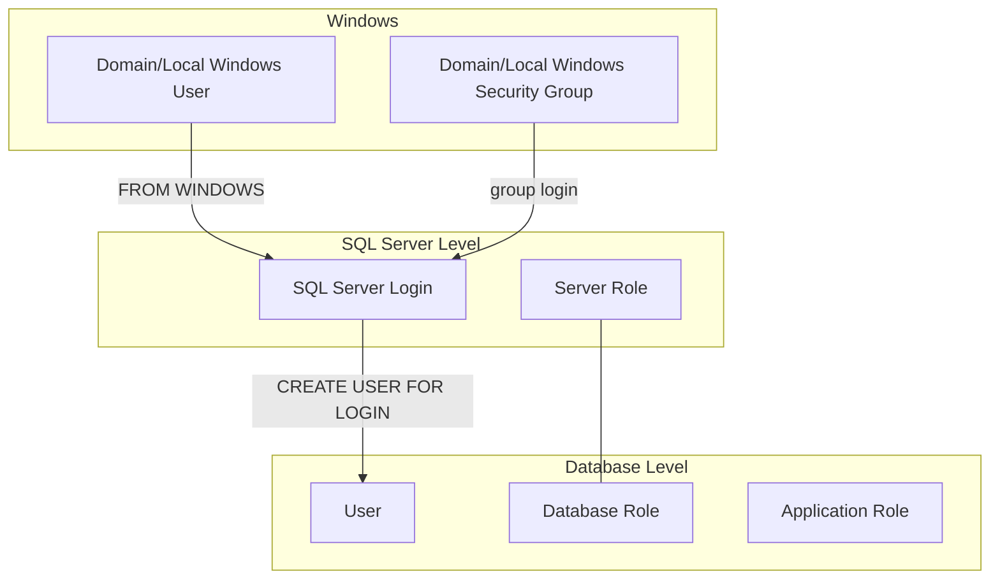

# Section 1 — การพิสูจน์ตัวตนเพื่อเข้าใช้ SQL Server (Authentication และ Logins)

งาน DBA เกือบทุกเรื่องเริ่มจากคำถามเดียวกัน: **"ใครเข้าถึงระบบได้ และในฐานะใคร"** — Section นี้ตอบครึ่งแรกของคำถาม ผ่านโมเดล 3 องค์ประกอบ: **Securable** (ทรัพยากรที่กำหนดสิทธิ์ได้), **Principal** (ตัวตนที่ขอเข้าถึง) และ **Permission** (สิทธิ์ที่ผูกทั้งสองเข้าด้วยกัน)

## 1.1 โมเดลความปลอดภัย: Securable — Principal — Permission

| องค์ประกอบ | ความหมาย | ตัวอย่าง |
|:-----------|:---------|:---------|
| **Securable** | ทรัพยากรที่ SQL Server กำหนดสิทธิ์ให้ปกป้องได้ | Server, Database, Schema, Table, View, Stored Procedure, Column |
| **Principal** | ตัวตนที่ขอเข้าถึง Securable | Windows User/Group, SQL Login, Server Role, Database User, Database Role, Application Role |
| **Permission** | สิทธิ์ที่มอบให้ Principal เข้าถึง Securable | `GRANT`, `DENY`, `REVOKE` + ชื่อสิทธิ์ (`SELECT`, `CONTROL`, `VIEW SERVER STATE` ฯลฯ) |

โครงสร้าง Principal จะซ้อนกันสามชั้นตามขอบเขต — เขียนเป็นภาพได้ดังนี้:



**กฎเหล็กที่ต้องจำ**: Login ยืนยันตัวตนเฉพาะ "การเข้าถึง server" เท่านั้น — จะสัมผัสข้อมูลในฐานข้อมูลไม่ได้เลยจนกว่าจะถูกแมปเป็น **User** ในฐานข้อมูลนั้น (Section 2)

## 1.2 ทางเลือกการพิสูจน์ตัวตน (Authentication Modes)

SQL Server รองรับการพิสูจน์ตัวตนสองแบบ และใน SQL Server 2022+ ยังรองรับ **Microsoft Entra ID** เพิ่มอีกช่องทาง:

| แบบ | กลไก | เหมาะกับ | ข้อควรระวัง |
|:----|:-----|:---------|:------------|
| **Windows Authentication** | ใช้ Kerberos/NTLM ของ Windows — client ส่ง token จาก OS มาให้ SQL Server ตรวจกับ Windows | องค์กรที่มี AD/Entra; ความปลอดภัยสูงสุดเพราะรหัสผ่านไม่ถูกส่งให้ SQL Server | ต้องจัดการ AD, double-hop ที่จะเรียนใน Section 3 |
| **SQL Server Authentication** | รหัสผ่านเก็บใน SQL Server เอง (hash) | ระบบ legacy, แอป cross-platform, สภาพแวดล้อมไม่มี AD | ต้องเปิด **Mixed Mode**; รหัสผ่านเดินทางผ่าน network ต้องมี TLS เสมอ |
| **Microsoft Entra ID (SQL Server 2022+)** | `FROM EXTERNAL PROVIDER` — ใช้ token จาก Entra ID | สถาปัตยกรรม cloud-first / hybrid | ต้องตั้งค่า instance ให้เชื่อม Entra (บน Azure VM / Arc-enabled) |

การเปิด Mixed Mode (สำหรับ SQL Authentication):

```sql
-- เปิด Mixed Mode แล้ว restart SQL Server service
USE [master];
GO
EXEC xp_instance_regwrite
    N'HKEY_LOCAL_MACHINE',
    N'Software\Microsoft\MSSQLServer\MSSQLServer',
    N'LoginMode',
    REG_DWORD,
    2;   -- 1 = Windows only, 2 = Mixed Mode
GO
```

> ปกติเปลี่ยนผ่านหน้าจอ SSMS: *Server Properties → Security → SQL Server and Windows Authentication mode* แล้ว restart service — ถ้าเปลี่ยนผ่าน registry แบบด้านบนให้ระวัง restart เองด้วย

## 1.3 การสร้าง Login ด้วย SSMS

1. ใน **Object Explorer** → **Security** → คลิกขวา **Logins** → **New Login…**
2. เลือก **Windows authentication** ใส่ชื่อ account หรือกลุ่ม เช่น `MACHINE\WebUsers` — หรือเลือก **SQL Server authentication** ตั้งรหัสผ่านและติ๊กตามนโยบาย:
   - **Enforce password policy** = `CHECK_POLICY=ON` (ผ่านกฎรหัสผ่านของ Windows)
   - **Enforce password expiration** = `CHECK_EXPIRATION=ON`
   - **User must change password at next login** (ต้องเปิดสองอันแรกก่อนจึงใช้ได้)
3. กำหนด **Default database** และ **Default language**
4. ในแท็บ Server Roles / User Mapping ทำหน้าที่เดียวกับคำสั่งในหัวข้อถัดไป

## 1.4 การสร้างและจัดการ Login ด้วย T-SQL

สคริปต์เดโม: [Scripts/01_CreateLogins.sql](Scripts/01_CreateLogins.sql)

```sql
USE [master];
GO

-- 1) Windows Authentication login (account หรือ group ของ Windows)
--    แทน MACHINE ด้วยชื่อเครื่องของคุณ (local account) หรือ DOMAIN\Group
CREATE LOGIN [MACHINE\WebUsers] FROM WINDOWS
    WITH DEFAULT_DATABASE = [AdventureWorks2025];
GO

-- 2) SQL Server Authentication login
CREATE LOGIN [Web_Application] WITH PASSWORD = N'Pa$$w0rd2025',
    DEFAULT_DATABASE = [AdventureWorks2025],
    CHECK_EXPIRATION = OFF, CHECK_POLICY = ON;
GO

-- 3) จัดการ login ที่มีอยู่
ALTER LOGIN [Web_Application] DISABLE;     -- ระงับ ไม่ลบ
ALTER LOGIN [Web_Application] ENABLE;
ALTER LOGIN [Web_Application] WITH PASSWORD = N'Pa$$w0rd2026';
GO

-- 4) ลบ login เมื่อไม่ใช้แล้ว
DROP LOGIN IF EXISTS [Web_Application];
GO
```

ข้อควรรู้:

- `DEFAULT_DATABASE` ต้องมีจริงตอน login เท่านั้น — ถ้าฐานข้อมูลถูกลบทิ้ง login จะเข้าไม่ได้ (error 4064) — แก้ด้วย `ALTER LOGIN ... WITH DEFAULT_DATABASE = [master]`
- `CHECK_POLICY = ON` จะส่งกฎความซับซ้อนของ Windows มาใช้กับรหัสผ่าน SQL login — เปิดไว้เสมอใน production
- ถ้าเครื่องอยู่ใน **Windows Server 2025** สังเกตว่า NTLMv1 ถูกถอดและ TLS 1.0/1.1 ปิด default — ให้ใช้ Kerberos/TLS 1.2+ เสมอ

## 1.5 เบื้องลึกเกี่ยวกับ Logins — sys.server_principals

ทุก login (รวมถึง server roles ที่มากับตัว) ถูกเก็บเป็นแถวใน `sys.server_principals` ของฐานข้อมูล master:

```sql
SELECT TOP 10 name, sid, type, type_desc,
       is_disabled, create_date, modify_date
FROM sys.server_principals
ORDER BY modify_date DESC;
```

คอลัมน์สำคัญ:

| คอลัมน์ | ความหมาย |
|:--------|:---------|
| `sid` | **Security Identifier** — รหัสเฉพาะที่ใช้ผูก login ↔ user (ปัญหา orphaned user ใน Section 3 คือ SID ไม่ตรง) |
| `type` / `type_desc` | `S`=SQL Login, `U`=Windows Login, `G`=Windows Group, `R`=Server Role, `C`=Cert, `K`=Asymmetric Key |
| `is_disabled` | บังคับด้วย `ALTER LOGIN ... DISABLE` |

สำหรับ audit การเข้าใช้ ยังมี `sys.sql_logins` (SQL logins เฉพาะกลุ่ม) และตั้งแต่ SQL Server 2025 ตัว hash รหัสผ่านเปลี่ยนเป็น **PBKDF2 (PBKDF2+SHA512)** ตามมาตรฐาน NIST SP 800-63b — โดย default ทันที ไม่ต้องตั้งค่า ทำให้การโจมตี hash แพงขึ้นหลายเท่า

## 1.6 Security Token — engine ประกอบสิทธิ์อย่างไร

เมื่อ login เชื่อมต่อสำเร็จ SQL Server ประกอบ **login token** (ระดับ server) และ **user token** (ระดับ database) ที่รวมทุก identity และ role ที่ตัวตนนั้นเป็นสมาชิก ตรวจดูได้ด้วย `EXECUTE AS`:

สคริปต์เดโม: [Scripts/02_Security_Tokens_Demo.sql](Scripts/02_Security_Tokens_Demo.sql)

```sql
USE master;
GO

CREATE SERVER ROLE LabServerRole;
CREATE LOGIN LabLogin WITH PASSWORD = N'Pa$$w0rd2025', CHECK_POLICY = OFF;
ALTER SERVER ROLE LabServerRole ADD MEMBER LabLogin;
GO

-- สวมสิทธิ์ login แล้วดู token
EXECUTE AS LOGIN = 'LabLogin';
SELECT * FROM sys.login_token;   -- login token: มี LabLogin + LabServerRole + public
REVERT;
GO

-- สร้าง user และดู user token
CREATE ROLE LabDatabaseRole;
CREATE USER LabUser FOR LOGIN LabLogin;
ALTER ROLE LabDatabaseRole ADD MEMBER LabUser;
GO

EXECUTE AS USER = 'LabUser';
SELECT * FROM sys.user_token;    -- user token: LabUser + LabDatabaseRole + public
REVERT;
GO

-- Cleanup
ALTER SERVER ROLE LabServerRole DROP MEMBER LabLogin;
DROP ROLE IF EXISTS LabDatabaseRole;
DROP USER IF EXISTS LabUser;
DROP LOGIN IF EXISTS LabLogin;
DROP SERVER ROLE IF EXISTS LabServerRole;
GO
```

✅ **สังเกต**: token รวม identities ทั้งหมดที่ตัวตนเป็นสมาชิก — เมื่อ engine ตรวจสิทธิ์จะเทียบกับ token นี้รวมกันทุกแถว ไม่ได้ดูเฉพาะตัวตนหลัก

## 1.7 Microsoft Entra ID และ Managed Identity (Modern)

ตั้งแต่ SQL Server 2022 สามารถสร้าง login จาก Entra ได้ (ต้องตั้งค่า instance ให้เชื่อมกับ Entra — Azure VM หรือ Azure Arc-enabled):

```sql
-- (SQL Server 2022+, ต้องตั้งค่า Entra integration ก่อน)
CREATE LOGIN [ada@datafabric.onmicrosoft.com] FROM EXTERNAL PROVIDER;
GO

-- SQL Server 2025: ชื่อซ้ำกันใน tenant ให้ระบุ OBJECT_ID แทนชื่อ
CREATE LOGIN [svc_user] FROM EXTERNAL PROVIDER
    WITH OBJECT_ID = 'aaaaaaaa-bbbb-cccc-dddd-eeeeeeeeeeee';
GO
```

และตั้งแต่ **SQL Server 2025** (ผ่าน Azure Arc) มี **Managed Identity**:

- **Outbound**: SQL Server เรียก Azure resources (เช่น Blob Storage เพื่อ backup to URL) ด้วย identity ที่ Azure จัดการ ไม่ต้องเก็บ secret
- **Inbound**: user ภายนอกเชื่อมต่อ SQL Server ด้วย managed identity แทน password
- ใช้ได้กับ **EKM กับ Azure Key Vault** ด้วย (การเข้ารหัสใน Module 4)

## 🚀 SQL Server 2025 & Modern Notes

- **PBKDF2 password hash default** — ใช้กับ SQL logins และ application roles โดยอัตโนมัติ ([CREATE APPLICATION ROLE — Remarks](https://learn.microsoft.com/sql/t-sql/statements/create-application-role-transact-sql?view=sql-server-ver17#remarks))
- **Security cache improvements** — การเปลี่ยนสิทธิ์ invalidate เฉพาะ cache ของ login ที่เกี่ยวข้อง ทำให้ระบบที่ GRANT/DENY บ่อยกระทบ user คนอื่นน้อยลง ([Security cache](https://learn.microsoft.com/sql/relational-databases/security-cache?view=sql-server-ver17))
- **TLS 1.3 + TDS 8.0** — โปรโตคอลเชื่อมต่อรุ่นใหม่ (strict encryption) รองรับ sqlcmd, linked servers และบริการประกอบอีกหลายตัว ([TDS 8](https://learn.microsoft.com/sql/relational-databases/security/networking/tds-8?view=sql-server-ver17#sql-server-2025-support))
- **Managed identity (2025, Azure Arc)** — inbound/outbound โดยไม่มี secret ([Managed identity](https://learn.microsoft.com/sql/sql-server/azure-arc/managed-identity?view=sql-server-ver17))
- **Custom password policy บน Linux** ([SQL Server on Linux password policy](https://learn.microsoft.com/sql/linux/sql-server-linux-custom-password-policy?view=sql-server-ver17))
- Windows Server 2025 ยังมีข้อเปลี่ยนที่กระทบการเชื่อมต่อ: NTLMv1 ถูกถอด, TLS 1.0/1.1 ปิด — วางแผน Kerberos + TLS 1.2 ขึ้นไป

> อ้างอิง: [Choose an Authentication Mode](https://learn.microsoft.com/sql/relational-databases/security/authentication-access/choose-authentication-mode?view=sql-server-ver17), [Create a Login](https://learn.microsoft.com/sql/relational-databases/security/authentication-access/create-a-login?view=sql-server-ver17), [CREATE LOGIN (T-SQL)](https://learn.microsoft.com/sql/t-sql/statements/create-login-transact-sql?view=sql-server-ver17)
