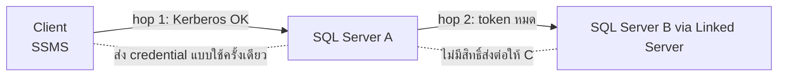

# Section 3 — สิทธิ์ข้ามเครื่อง: Linked Servers, Double-Hop และ SID

โลกจริงไม่มี database เดียว — ระบบต้อง query ข้าม server, ข้าม instance และบางครั้งย้ายฐานข้อมูลไปเครื่องใหม่ Section นี้ครอบคลุมสามปัญหาคลาสสิกที่ DBA พบบ่อยที่สุดเรื่องความปลอดภัย: **Linked Servers**, **Double-Hop** และ **orphaned users (SID mismatch)**

## 3.1 รู้จัก Linked Servers

**Linked Server** คือตัวเชื่อมที่ให้ SQL Server ข้ามไป query แหล่งข้อมูลอื่น (SQL Server อีกตัว, Oracle, ODBC, Azure Blob ฯลฯ) แล้วใช้ชื่อแบบ 4 ส่วน: `server.database.schema.object`

```sql
USE [master];
GO

-- สร้าง linked server ไป instance อื่น (แทน SQLB ด้วย server/port ที่มีจริง)
EXEC sp_addlinkedserver
    @server     = N'SQLB',
    @srvproduct = N'',
    @provider   = N'SQLNCLI',     -- SQL Server Native Client
    @datasrc    = N'SQLB',        -- hostname\instance หรือ IP,port
    @provstr    = N'Trusted_Connection=yes;';
GO

-- ตั้ง security mapping: เมื่อ [MACHINE\Student] ใช้ SQLB ให้ยิงไปเป็น SQL account
EXEC sp_addlinkedsrvlogin
    @rmtsrvname = N'SQLB',
    @useself    = N'FALSE',
    @locallogin = NULL,            -- NULL = ใช้ได้ทุก local login
    @rmtuser    = N'reader_account',
    @rmtpassword= N'Pa$$w0rd2025';
GO

-- ใช้งานจริง (4-part name)
SELECT TOP 5 name, database_id
FROM SQLB.master.sys.databases;
GO
```

หัวใจของความปลอดภัยบน linked server คือ **`sp_addlinkedsrvlogin`** — มีสามโหมดหลัก:

| โหมด (`@useself`) | พฤติกรรม | ข้อควรระวัง |
|:------------------|:---------|:------------|
| `TRUE` | ส่ง security context ของ local login ไปตรง ๆ (**self-mapping**) | กับ Windows auth จะกลายเป็น **double-hop** — ส่วนใหญ่ fail ถ้าไม่มี Kerberos delegation |
| `FALSE` + mapping | แปลงเป็น user/password ปลายทางเสมอ | รหัสผ่านถูกเก็บใน msdb (เข้ารหัส) — จัดการ secret ให้ดี |
| `FALSE` + @rmtuser NULL | ใช้ default ของ SQL Server service account ที่ปลายทาง | service account ต้องมีสิทธิ์จริงที่ปลายทาง — อย่าใช้ sa! |

> ข้อจำกัดที่ควรรู้: linked server query ต้องมี **server-level identity** — จะใช้ `EXECUTE AS USER` (database-level impersonation) ตรง ๆ กับ linked server query ไม่ได้ (error 15406) — ใช้ `EXECUTE AS LOGIN` แทน

## 3.2 ปัญหา "Double-Hop"

**Double-Hop** คือเมื่อ credential ของ Windows ไม่ถูกส่งต่อไปเครื่องที่สาม:



Windows (Kerberos) ออกแบบให้ token ที่ได้จาก login ใช้ได้เพียง **hop เดียว** — เมื่อ SQL Server A พยายามใช้ context ของผู้ใช้เพื่อไป login ที่ Server B จะไม่มีสิทธิ์มากพอ → error `Login failed for user 'NT AUTHORITY\ANONYMOUS LOGON'`

## 3.3 Impersonation เทียบกับ Delegation

| ตัวเลือก | กลไก | ตั้งค่าที่ไหน | เหมาะกับ |
|:---------|:-----|:-------------|:---------|
| **Impersonation** | SQL Server ระดับเดียวสวมสิทธิ์ principal อื่น (`EXECUTE AS LOGIN/USER`) | ใน SQL Server เอง | stored proc ที่ต้องใช้สิทธิ์เจ้าของ |
| **Delegation (Kerberos constrained delegation)** | AD อนุญาตให้ service account ของ Server A "ใช้บัตรผู้ใช้" ต่อไปยัง Server B ได้ | AD Domain Controller: ตั้ง SPN ให้ service account + ตั้ง constrained delegation | ส่งต่อ security context จริง ๆ ข้ามเครื่อง (SSRS/SSIS → SQL → file share) |

ขั้นตอนย่อของ Kerberos delegation ในสภาพแวดล้อมที่มี domain:

1. ลงทะเบียน **SPN** (`SETSPN -S MSSQLSvc/host:port domain\sqlserviceaccount`) — ต้อง unique ต่อ service
2. บน AD: เปิด **Delegation** tab ของ service account → constrained delegation → เพิ่ม `MSSQLSvc/host:port` ของปลายทาง
3. ตรวจด้วย `SELECT auth_scheme FROM sys.dm_exec_connections WHERE session_id = @@SPID;` ต้องได้ **KERBEROS** (ไม่ใช่ NTLM)

ถ้าไม่มี domain (ห้องเรียน/workstation): ใช้วิธีทดแทนคือ **mapping แบบ explicit** (โหมด `@useself=FALSE`) หรือเก็บ connection ด้วย SQL auth — ปลอดภัยพอสำหรับ lab แต่ควรเปลี่ยนเป็น constrained delegation ใน production

## 3.4 การจัดการกรณี SID ไม่ตรงกัน (Orphaned Users)

**สาเหตุ**: เมื่อ restore/attach ฐานข้อมูลจาก server อื่น หรือสร้าง login ใหม่ที่มีชื่อเดียวกัน — `sid` ของ user ในฐานข้อมูลไม่ตรงกับ `sid` ของ login ระดับ server → login เข้าฐานข้อมูลไม่ได้เหมือนไม่รู้จักกัน

สคริปต์เดโม: [Scripts/01_OrphanedUsers_Fix.sql](Scripts/01_OrphanedUsers_Fix.sql)

```sql
-- 1) หา orphaned users (วิธีสมัยใหม่ — ไม่ใช้ sp_change_users_login ซึ่ง deprecated)
USE AdventureWorks2025;
GO
SELECT dp.name AS orphaned_user, dp.sid
FROM sys.database_principals AS dp
WHERE dp.type = 'S'                                   -- SQL users เท่านั้น
  AND dp.sid NOT IN (SELECT sid FROM sys.server_principals)
  AND dp.sid <> 0x0;                                  -- เว้น guest ฯลฯ
GO

-- 2) แก้ด้วยการผูก user เข้ากับ login ที่มีอยู่ (แนะนำ)
ALTER USER [appuser] WITH LOGIN = [appuser];
GO

-- 3) หรือแก้ด้วยการสร้าง login ใหม่ที่มี SID เดียวกับ user
--    (ใช้เมื่อต้องรักษา SID ที่โปรแกรม/สคริปต์อ้างอิงไว้)
DECLARE @sid varbinary(85) = (SELECT sid FROM sys.database_principals
                              WHERE name = N'reportuser');
CREATE LOGIN [reportuser] WITH PASSWORD = N'Pa$$w0rd2025', SID = @sid;
GO
```

ข้อสังเกตจากหลักสูตรเดิม (20764D):

- `EXEC sp_change_users_login 'Report'` และ `'Update_One'` เดิมใช้สอนข้อนี้ — **ยังทำงานแต่ deprecated** และแก้ได้เฉพาะ SQL users; วิธีมาตรฐานปัจจุบันคือ `ALTER USER ... WITH LOGIN`
- Windows users ไม่ orphan ได้ง่าย ๆ (SID มาจาก Windows โดยตรง) — ปัญหาเกิดกับ **SQL logins** เป็นหลัก
- **ป้องกันตั้งแต่ต้น**: สร้าง SQL login บนทุก replica/instance ด้วย **SID เดิม** (`CREATE LOGIN ... WITH SID = 0x...` — สกัดจาก server แรกด้วย `SELECT sid FROM sys.server_principals WHERE name = '...'`) — จำเป็นมากกับ **Availability Groups** เพราะ user สร้างบน primary จะถูก sync ไป secondary ทั้งตัว

## 🚀 SQL Server 2025 & Modern Notes

- **TLS 1.3 + TDS 8.0** รองรับ **linked servers** ใน SQL Server 2025 — ตั้งค่า strict encryption ระหว่าง server ได้ ([TDS 8](https://learn.microsoft.com/sql/relational-databases/security/networking/tds-8?view=sql-server-ver17#sql-server-2025-support)); อ่าน [Breaking changes to linked servers in 2025](https://learn.microsoft.com/sql/database-engine/breaking-changes-to-database-engine-features-in-sql-server-2025?view=sql-server-ver17) ก่อนอัปเกรด
- ข้อจำกัด double-hop ยังมีอยู่ — ทางเลือกสมัยใหม่: ใช้ SQL auth + credential, ใช้ **managed identity** (2025, Arc) เมื่อปลายทางคือ Azure, หรือ query ผ่าน PolyBase/external tables
- `sp_change_users_login` **deprecated** — ใช้ `ALTER USER ... WITH LOGIN` เสมอ
- ก่อน migrate ฐานข้อมูล ให้ทำ **login inventory** ด้วยสคริปต์ (ยกทั้ง `sys.sql_logins` + SIDs) — ปัญหา orphaned users เป็น top-3 ของ migration failure ทุกที่

> อ้างอิง: [Linked Servers](https://learn.microsoft.com/sql/relational-databases/linked-servers/create-linked-servers-sql-server-database-engine?view=sql-server-ver17), [sp_addlinkedsrvlogin](https://learn.microsoft.com/sql/relational-databases/system-stored-procedures/sp-addlinkedsrvlogin-transact-sql?view=sql-server-ver17), [Troubleshoot orphaned users](https://learn.microsoft.com/sql/sql-server/database-engine/configure-windows/troubleshoot-orphaned-users-sql-server?view=sql-server-ver17)
