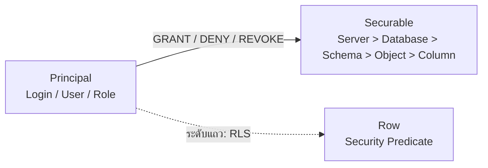
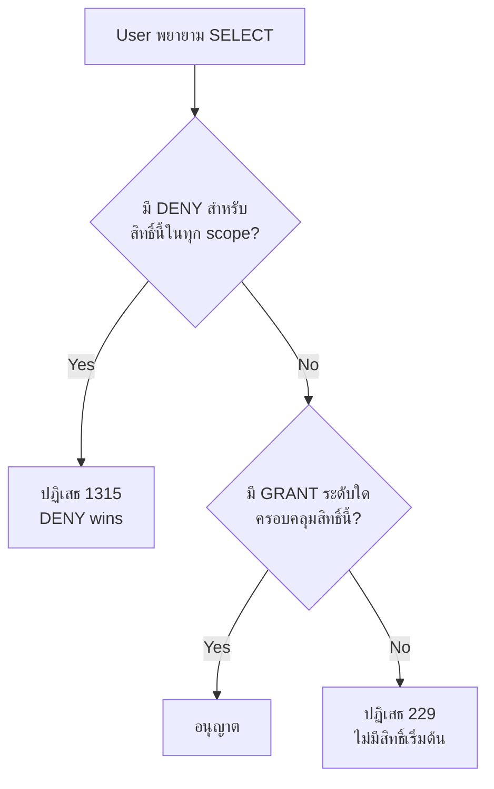
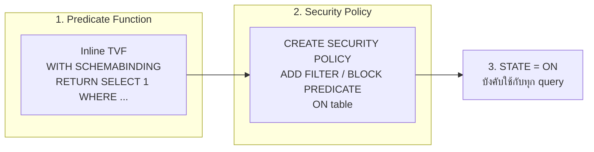

# Section 01 — Object Permissions: สิทธิ์บนตาราง, คอลัมน์ และแถว

เมื่อ user เข้าถึงฐานข้อมูลได้แล้ว (เรื่อง Authentication จบไปแล้วใน Module 01–02) คำถามถัดไปของ DBA คือ "ให้เขาทำอะไรได้บ้าง?" SQL Server ตอบคำถามนี้ด้วยระบบ **Permission** ที่มีความละเอียดสูงมาก — กำหนดได้ตั้งแต่ระดับ server จนถึงระดับ **คอลัมน์เดียวของตาราง** และแม้กระทั่งระดับ **แถว** ผ่าน Row-Level Security

Section นี้เป็นรากฐานของทั้งโมดูล: ถ้าเข้าใจ Principal/Securable และลำดับการประเมินของ GRANT/DENY/REVOKE แล้ว ที่เหลือของ Section 2 (Code) และ Section 3 (Schema) คือการนำกลไกเดิมไปใช้กับ object คนละประเภทเท่านั้น

## Principal และ Securable — ทบทวนก่อนเริ่ม

สองคำนี้คือกรอบคิดของระบบสิทธิ์ทั้งหมด:

| ศัพท์ | ความหมาย | ตัวอย่าง |
|:------|:---------|:---------|
| **Principal** | ตัวตนที่ "ขอ" เข้าถึงทรัพยากร | Login, Database User, Role, Application Role |
| **Securable** | ทรัพยากรที่ "คุมสิทธิ์ได้" | Server, Database, Schema, Table, View, Procedure, คอลัมน์ |



หลักการเข้าใจง่าย ๆ: **ทุก principal เริ่มต้นด้วยสิทธิ์เป็นศูนย์** — ยกเว้น member ของ `sysadmin` (ทำอะไรก็ได้ระดับ server) และ `db_owner` (ทำอะไรก็ได้ระดับ database) เท่านั้น ทุกสิทธิ์อื่นต้องถูกมอบให้อย่างชัดเจนด้วยคำสั่ง `GRANT`

## GRANT / REVOKE / DENY — สามคำสั่งหลัก

| คำสั่ง | ผลต่อ principal | ใช้เมื่อไหร่ |
|:-------|:---------------|:------------|
| `GRANT` | มอบสิทธิ์ | อนุญาตให้ทำงานนั้น |
| `DENY` | ปฏิเสธสิทธิ์ **ชัดเจน** | บล็อกไม่ให้ทำ แม้จะได้รับสิทธิ์จากทางอื่น (เช่นผ่าน role) |
| `REVOKE` | เรียกคืน GRANT หรือ DENY ที่เคยให้ | กลับสู่สถานะ "ไม่ได้กำหนด" |

```sql
-- มอบสิทธิ์ SELECT บนตาราง
GRANT SELECT ON Production.Product TO SalesClerk;

-- เรียกคืน (กลับเป็น "ไม่ได้กำหนด")
REVOKE SELECT ON Production.Product FROM SalesClerk;

-- ปฏิเสธชัดเจน — ชนะทุก GRANT อื่น
DENY SELECT ON Production.Product TO SalesClerk;
```

### ลำดับความสำคัญ: DENY ชนะเสมอ (เกือบเสมอ)



กติกาการประเมินสิทธิ์:

1. **ถ้ามี DENY ที่ระดับใดก็ตาม (server, database, schema, object, column) ครอบคลุมสิทธิ์ที่ขอ → ปฏิเสธทันที** ไม่สนว่า GRANT มากันทางไหน
2. ถ้าไม่มี DENY มองหา GRANT ที่ครอบคลุม — สิทธิ์ระดับใหญ่ (เช่น `SELECT` ที่ระดับ schema) ครอบคลุมสิทธิ์ระดับย่อย (SELECT บนตารางใน schema นั้น)
3. ถ้าไม่มีทั้ง DENY และ GRANT → ปฏิเสธ (ค่า default ของระบบคือไม่อนุญาต)

ตรวจสิทธิ์จริงที่ principal มีได้ด้วย DMF `sys.fn_my_permissions` และ `sys.effective_permissions`:

```sql
-- ดูสิทธิ์ของตัวเองใน database ปัจจุบัน
SELECT * FROM sys.fn_my_permissions(NULL, 'DATABASE');

-- ดูสิทธิ์ของ principal อื่นตอนเป็น admin
EXECUTE AS USER = 'SalesClerk';
SELECT * FROM sys.fn_my_permissions('Production.Product', 'OBJECT');
REVERT;
```

> **จุดละเอียดที่มักโดนถามในสอบ**: ตาม default, **column-level GRANT ชนะ table-level DENY** (เช่น DENY SELECT ทั้งตาราง แต่ GRANT SELECT บนคอลัมน์ A ก็ยังอ่านคอลัมน์ A ได้) ซึ่งขัดสามัญสำนึกของ "DENY ชนะเสมอ" — แต่ถ้าเปิด `common criteria compliance enabled` (เรื่องของ Module 04) กฎจะกลับด้าน: table-level DENY จะชนะ column-level GRANT ตามข้อกำหนด Common Criteria ([อ่านเพิ่ม](https://learn.microsoft.com/sql/database-engine/configure-windows/common-criteria-compliance-enabled-server-configuration-option?view=sql-server-ver17))

## สิทธิ์บน Table และ View

สิทธิ์ยอดนิยมบน object ประเภทตาราง/มุมมอง:

| Permission | ควบคุม |
|:-----------|:-------|
| `SELECT` | อ่านข้อมูล |
| `INSERT` / `UPDATE` / `DELETE` | เปลี่ยนข้อมูล (UPDATE ระบุคอลัมน์ได้) |
| `REFERENCES` | อ้างถึง object (เช่นทำ foreign key หรือผูก schema binding) |
| `ALTER` | เปลี่ยนโครงสร้าง (includes schema of the object) |
| `CONTROL` | สิทธิ์เต็มบน object (imply ทุกสิทธิ์อื่นบน object นั้น) |
| `VIEW DEFINITION` | ดู metadata โดยไม่มีสิทธิ์อ่านข้อมูล |
| `TAKE OWNERSHIP` | เปลี่ยนเจ้าของ object |

```sql
-- หลายสิทธิ์ในคำสั่งเดียว
GRANT SELECT, INSERT, UPDATE ON Sales.SalesOrderHeader TO SalesClerk;

-- UPDATE เฉพาะคอลัมน์ที่ควรแก้ได้ (เช่น อนุญาตแก้จำนวนสั่ง แต่ไม่อนุญาตแก้ราคา)
GRANT UPDATE ON Sales.SalesOrderDetail (OrderQty) TO SalesClerk;
```

**View เป็นเครื่องมือปกปิดธรรมชาติ**: การให้ user SELECT ผ่าน view แทนตารางจริง ช่วยซ่อนคอลัมน์ที่ไม่เกี่ยว ซ่อนตารางจริงจาก `SELECT *` และทำให้ได้ RLS-style filtering แบบเก่าก่อนจะมี RLS ในรุ่นใหม่ ข้อควรระวังเดียวคือ view ที่สร้างด้วย `WITH SCHEMABINDING` จะผูกกับโครงสร้างตารางจริง (แก้ตารางต้อง drop view ก่อน) ซึ่งดีต่อความเสถียรแต่เพิ่มงาน DBA เวลา refactor schema

สาธิตจากจุดเริ่มต้น "สิทธิ์เป็นศูนย์" ถึงการปฏิเสธที่ตำแหน่งต่าง ๆ (สคริปต์เต็มอยู่ที่ [`Scripts/01_ObjectPermissions_GrantRevokeDeny.sql`](Scripts/01_ObjectPermissions_GrantRevokeDeny.sql)):

```sql
USE AdventureWorks2025;
GO

-- สร้าง login + user สาธิต
CREATE LOGIN DemoSalesClerk WITH PASSWORD = 'Pa$$w0rd2025', CHECK_POLICY = OFF;
CREATE USER DemoSalesClerk FOR LOGIN DemoSalesClerk;
GO

-- ก่อนมอบสิทธิ์: อ่านไม่ได้ (error 229)
EXECUTE AS USER = 'DemoSalesClerk';
SELECT TOP 1 Name FROM Production.Product;  -- The SELECT permission was denied...
REVERT;
GO

-- มอบสิทธิ์แล้วลองใหม่
GRANT SELECT ON Production.Product TO DemoSalesClerk;

EXECUTE AS USER = 'DemoSalesClerk';
SELECT TOP 1 Name FROM Production.Product;  -- ทำงานได้
REVERT;
GO
```

✅ **สังเกต**: ข้อความ error ต่างกันไปตามเหตุ — error **229** ("The SELECT permission was denied on object") คือ "ไม่มีสิทธิ์" ขณะ error **1315** ("The server principal ... is not able to access the database") คือระดับ database ขึ้นไป

## Column-Level Permissions

เมื่อไม่อยากให้ใครบางคนเห็นคอลัมน์อ่อนไหว (เงินเดือน, เลขบัตร, ที่อยู่) SQL Server ให้กำหนดสิทธิ์ที่ระดับคอลัมน์ได้โดยตรง:

```sql
-- รูปแบบที่ 1: ระบุคอลัมน์ในวงเล็บหลังชื่อตาราง
GRANT SELECT ON HumanResources.EmployeePayHistory (Rate) TO PayrollViewer;

-- รูปแบบที่ 2: ระบุชัดเจนว่าเป็น OBJECT:: (ชัดกว่าเวลาอ่านโค้ดย้อนหลัง)
GRANT SELECT ON OBJECT::HumanResources.EmployeePayHistory (Rate)
    TO PayrollViewer;

-- ปฏิเสธคอลัมน์เดียว
DENY SELECT ON OBJECT::HumanResources.EmployeePayHistory (Rate)
    TO HRIntern;
```

พฤติกรรมที่ต้องเข้าใจเวลา user query:

- `SELECT Rate, BusinessEntityID FROM HumanResources.EmployeePayHistory` → ได้เฉพาะคอลัมน์ที่มีสิทธิ์
- `SELECT * FROM HumanResources.EmployeePayHistory` → **error** และ SQL Server จะแจ้ง error ทีละคอลัมน์ที่ไม่มีสิทธิ์ — ผลข้างเคียงที่ดีคือ user รู้ว่ามีคอลัมน์อะไร แต่อ่านไม่ได้; ผลข้างเคียงที่แย่คือ error ทีละคอลัมน์ก็บอกชื่อคอลัมน์ให้คนไม่ควรรู้ฟังได้เหมือนกัน ถ้าความลับสำคัญให้ใช้ view + masking แทน

ตัวอย่างเต็ม (คู่กับ [`Scripts/02_ColumnPermissions.sql`](Scripts/02_ColumnPermissions.sql)):

```sql
-- ให้เห็นแถว/คอลัมน์จัดสินค้า แต่ห้ามเห็นช่องจัดเก็บทั้งตาราง
GRANT SELECT ON Production.ProductInventory (LocationID) TO DemoSalesClerk;

EXECUTE AS USER = 'DemoSalesClerk';
SELECT DISTINCT LocationID FROM Production.ProductInventory;  -- OK
SELECT * FROM Production.ProductInventory;                    -- error รายคอลัมน์
REVERT;
```

### เมื่อไหร่ใช้ Column permission vs View vs DDM?

| เครื่องมือ | จุดแข็ง | ข้อจำกัด |
|:----------|:-------|:---------|
| Column-level `GRANT`/`DENY` | ตรงไปตรงมา ไม่ต้องสร้าง object เพิ่ม | SELECT * พัง; error เผยชื่อคอลัมน์; จัดการกระจัดกระจาย |
| View (เลือกคอลัมน์ที่จะโชว์) | จัดการเป็นชุด, ซ่อนโครงสร้างจริง | ต้องสร้าง/ดูแล view เพิ่ม |
| Dynamic Data Masking (Module 04) | โชว์ข้อมูลแบบปกปิดโดยไม่แก้ query | ปกปิดเฉพาะ "หน้าตา" ข้อมูลบน disk ยังเป็นของจริง ต้องปิดช่องทางเข้าถึงอื่นด้วย |

## Row-Level Security (RLS)

Column permissions แก้เรื่อง "คอลัมน์ไหนเห็นได้" แต่ไม่แก้เรื่อง "แถวไหนเห็นได้" — เช่นพนักงานขายแต่ละคนควรเห็นเฉพาะลูกค้าในพื้นที่ตัวเอง RLS แก้ปัญหานี้ที่ระดับ database engine: เงื่อนไขกรองถูกบังคับใช้กับ **ทุก query จากทุก tier** แอปไม่ต้องเขียน WHERE และ user ที่ลืมเขียน WHERE ก็ไม่เห็นข้อมูลเกินสักบรรทัด

องค์ประกอบ 3 ชิ้น:



1. **Inline table-valued function** — คืน 1 เมื่อแถวนั้นอนุญาตให้ผู้ query มักเทียบคอลัมน์ของตารางกับ `USER_NAME()`, `SUSER_SNAME()` หรือ `SESSION_CONTEXT()`
2. **Security Policy** — ผูก function เป็น:
   - `FILTER PREDICATE` — กรองแถวตอน **อ่าน** (`SELECT`, `UPDATE`, `DELETE`) อย่างเงียบ ๆ (user เห็นแค่ผลที่ผ่านเงื่อนไข ราวกับมี WHERE ทุก query)
   - `BLOCK PREDICATE` — บล็อก **การเขียน** ที่ขัดเงื่อนไข (`AFTER INSERT`, `AFTER UPDATE`, `BEFORE UPDATE`, `BEFORE DELETE`) เช่นป้องกันการ INSERT แถวที่ระบุ user id ของคนอื่น
3. **STATE = ON** — เปิดบังคับใช้; `STATE = OFF` ชั่วคราวเวลาโหลดข้อมูล

ตัวอย่างเต็ม (คู่กับ [`Scripts/03_RowLevelSecurity.sql`](Scripts/03_RowLevelSecurity.sql)) — กรองคำสั่งขายให้แต่ละพนักงานเห็นของตัวเอง:

```sql
USE AdventureWorks2025;
GO

-- 1) schema แยกสำหรับวัตถุความปลอดภัย (best practice)
CREATE SCHEMA Security;
GO

-- 2) predicate function — คืน 1 เมื่อแถวอนุญาต
CREATE FUNCTION Security.fn_repFilter(@SalesRep AS sysname)
RETURNS TABLE
WITH SCHEMABINDING
AS
    RETURN SELECT 1 AS result
    WHERE @SalesRep = USER_NAME() OR USER_NAME() = 'DemoManager';
GO

-- 3) security policy ผูก function เข้ากับตาราง
CREATE SECURITY POLICY DemoRepFilter
ADD FILTER PREDICATE Security.fn_repFilter(SalesRep)
ON Sales.OrdersRepDemo
WITH (STATE = ON);
GO
```

ทดสอบ:

```sql
EXECUTE AS USER = 'DemoRep1';
SELECT * FROM Sales.OrdersRepDemo;  -- เห็นเฉพาะแถวที่ SalesRep = 'DemoRep1'
REVERT;

EXECUTE AS USER = 'DemoManager';
SELECT * FROM Sales.OrdersRepDemo;  -- เห็นทุกแถว
REVERT;
```

ข้อควรรู้เรื่อง RLS:

- **RLS ไม่ใช่การเข้ารหัส** — มันเป็นการกรอง ถ้า user มีช่องทางอื่นเข้าถึงข้อมูล (เช่น view statistics, CDC) อาจรั่วได้ อ่านหมวด cross-feature compatibility ในเอกสารอย่างเป็นทางการก่อนใช้จริง
- `dbo` และ `db_owner` **ไม่ได้ยกเว้นจาก filter** — หากต้อง debug ให้สร้างเงื่อนไข bypass ใน function เช่น `OR USER_NAME() = 'DBATools'` (คุม role นี้ให้ดี)
- ถ้า policy สร้างด้วย `SCHEMABINDING = ON` (default) user ไม่ต้องมีสิทธิ์ SELECT บนตาราง/function ที่ function อ้างถึง — สะดวกกว่า
- Performance: ทุก query มี function ทำงานเสริม ดังนั้นหลีกเลี่ยง join มากเกินไปและ type conversion ใน function

## WITH GRANT OPTION — ให้ใครบางคน "แจกสิทธิ์ต่อ"

เมื่อมอบสิทธิ์แบบ `WITH GRANT OPTION` principal ที่ได้รับสามารถ **มอบสิทธิ์นั้นต่อให้คนอื่นได้** สร้างเป็น "สายการแจก" (re-grant chain):

```sql
GRANT SELECT ON Production.Product
    TO DemoManager WITH GRANT OPTION;   -- manager แจกต่อได้

-- manager ใช้สิทธิ์ที่ได้มาแจกต่อ
EXECUTE AS USER = 'DemoManager';
GRANT SELECT ON Production.Product TO DemoSalesClerk;
REVERT;
```

ข้อควรระวังคือเวลา **เรียกคืน**:

```sql
-- ระหว่างระดับบนกับล่าง: REVOKE ที่ manager จะไม่สะเทือนสิ่งที่ manager แจกให้คนอื่น
-- ถ้า admin เรียกคืนจาก manager และต้องการเรียกคืนทั้งสายให้ใช้ CASCADE:
REVOKE SELECT ON Production.Product FROM DemoManager CASCADE;
```

`CASCADE` เรียกคืนสิทธิ์ของทุกคนที่ได้รับสิทธิ์จากสายของ principal นั้นด้วย — ใช้ก่อนคิดดี ๆ เพราะกระแทก user ที่ไม่รู้ตัว ในทางปฏิบัติ **มอบ WITH GRANT OPTION ให้น้อยที่สุดเท่าที่จำเป็น** เพราะความยากของการเรียกคืนแบบเห็นภาพทั้ง chain

ดูสายการให้สิทธิ์ที่เกิดขึ้นจริงได้จาก catalog view:

```sql
SELECT pr.name AS grantee, pe.permission_name, pe.state_desc,
       gr.name AS grantor
FROM sys.database_permissions pe
JOIN sys.database_principals pr ON pr.principal_id = pe.grantee_principal_id
JOIN sys.database_principals gr ON gr.principal_id = pe.grantor_principal_id
WHERE pe.class = 1  -- OBJECT
ORDER BY pe.permission_name, pr.name;
```

## RLS กับแอป middle-tier — SESSION_CONTEXT

โจทย์จริงอีกรูปแบบหนึ่ง: แอปหน้าเว็บเชื่อมต่อด้วย **user เดียว** (app pool) แต่ต้องกรองข้อมูลต่อ "ผู้ใช้ปลายทาง" ที่ล็อกอินผ่านแอป ใช้ user รายคนไม่ได้ (ผู้ใช้จริงไม่มี SQL login) ทางแก้คือแอป set ค่าต่อ connection ด้วย `sp_set_session_context` แล้ว predicate function อ่านจาก `SESSION_CONTEXT()`:

```sql
CREATE FUNCTION Security.fn_tenantFilter(@TenantId int)
RETURNS TABLE
WITH SCHEMABINDING
AS
    RETURN SELECT 1 AS result
    WHERE CAST(SESSION_CONTEXT(N'TenantId') AS int) = @TenantId;
GO

CREATE SECURITY POLICY Security.TenantPolicy
ADD FILTER PREDICATE Security.fn_tenantFilter(TenantId)
    ON dbo.Orders,
ADD BLOCK PREDICATE Security.fn_tenantFilter(TenantId)
    ON dbo.Orders AFTER INSERT        -- กัน insert แถวของ tenant อื่น
WITH (STATE = ON);
GO

-- แอปตั้งค่าทันทีหลังเปิด connection (และควรล็อกค่าไว้ด้วย @read_only = 1)
EXEC sp_set_session_context @key = N'TenantId', @value = 42, @read_only = 1;
```

จุดที่ควรทำคู่กันเสมอ: `DENY UPDATE ON dbo.Orders(TenantId) TO AppUser;` เพื่อไม่ให้แอปแก้ค่า tenant ในแถว — เป็น pattern ที่เอกสาร Microsoft เองใช้ในตัวอย่าง middle-tier

## ตรวจสิทธิ์ตามขอบเขต — เครื่องมือวินิจฉัย

ตอน troubleshooting "ทำไม user นี้ query ไม่ได้" มีเครื่องมือชุดนี้ช่วยได้ทุกครั้ง:

```sql
-- สิทธิ์ระดับ schema ของตัวเอง
SELECT * FROM sys.fn_my_permissions('Sales', 'SCHEMA');

-- สิทธิ์ระดับ object
SELECT * FROM sys.fn_my_permissions('Sales.SalesOrderHeader', 'OBJECT');

-- สิทธิ์ระดับคอลัมน์
SELECT * FROM sys.fn_my_permissions('Sales.SalesOrderHeader.TotalDue', 'OBJECT');

-- ดูความยาวลำดับการสวมบทบาท (context stack) — เวลาสงสัย EXECUTE AS
SELECT * FROM sys.user_token;   -- บริบททั้งหมดของ session ปัจจุบัน
```

✅ **สังเกต**: `fn_my_permissions` รายงาน "สิทธิ์ที่มีผลจริง (effective)" รวมที่ได้จาก role ทุกชั้น — ถ้ารายงานว่ามีสิทธิ์แต่ query ยัง fail ให้สงสัย DENY หรือ RLS/filter ที่อยู่นอก permission system

## Checklist ตัดสินใจเลือกกลไกคุมข้อมูล (รวมจากทั้ง Section)

| โจทย์ | กลไกที่เหมาะ | เหตุผล |
|:------|:-------------|:-------|
| ไม่ให้เห็นคอลัมน์ราคาทุน | Column-level DENY หรือ View | ง่าย, ตรงขอบเขต |
| ไม่ให้เห็นแถวของลูกค้าอื่น | RLS (filter predicate) | บังคับทุก query รวมถึงโค้ดเก่า |
| ห้ามใช้ระบบโดยไม่มีสิทธิ์ใด ๆ | default ของ SQL Server | สิทธิ์เริ่มต้นคือศูนย์เสมอ |
| แอปเดียวหลายผู้ใช้ปลายทาง | RLS + SESSION_CONTEXT | กรองต่อ tenant โดยไม่ต้องมี SQL login รายคน |
| มอบสิทธิ์ทีละชุดให้ทีมงาน | Role + GRANT ระดับ schema | บริหารเป็นกลุ่ม (Section 3) |

## สรุปเตรียมเข้า Section ถัดไป

- GRANT/DENY/REVOKE คือชุดคำสั่งเดียวที่ใช้กับ **ทุกระดับ** securable — จบที่ column ก็ได้ ลึกถึงแถวด้วย RLS ก็ได้
- DENY ชนะ GRANT เกือบทุกกรณี (ข้อยกเว้น column vs table ตามที่อธิบาย)
- RLS ทำให้ logic "ใครเห็นอะไร" อยู่ใน database tier ไม่พึ่งแอป

Section 2 ต่อไปเปลี่ยน securable จาก "ข้อมูล" เป็น "โค้ด" — stored procedure และ function ซึ่งมาพร้อมกลไกพิเศษคือ EXECUTE AS และ ownership chaining ที่ทำให้ design ของ permission บนโค้ดต่างจากตารางอย่างสิ้นเชิง

---

### 🚀 SQL Server 2025 & Modern Notes

- **Security cache improvements (2025)**: การ GRANT/DENY/REVOKE จะ invalidate security cache **เฉพาะ entries ของ login ที่ได้รับผลกระทบ** — ทำงานใหญ่ ๆ เช่น revoke บน role ใหญ่จะไม่กระทบ performance ของ user คนอื่นแบบรุ่นเก่า ([Security cache](https://learn.microsoft.com/sql/relational-databases/security-cache?view=sql-server-ver17))
- **RLS ยังเป็นมาตรฐาน** ใน SQL Server 2025 รวมถึง Azure SQL Database/Managed Instance และ Microsoft Fabric (Fabric/Synapse รองรับเฉพาะ FILTER PREDICATE — BLOCK PREDICATE ยังไม่มีบน Fabric/Synapse)
- **Ledger (SQL Server 2022+)** ใช้เสริมเรื่อง tamper-evidence ถ้าความกังวลของคุณคือ "ใครแก้ข้อมูลโดยไม่ให้รู้" ([Ledger overview](https://learn.microsoft.com/sql/relational-databases/security/ledger/ledger-overview?view=sql-server-ver17))
- ตามหลัก least privilege คู่กับ **fixed server roles รุ่น 2022** (`##MS_DefinitionReader##` ฯลฯ) เมื่อต้องการให้คนตรวจ metadata โดยไม่ต้องเป็น sysadmin

> อ้างอิง: [GRANT (Transact-SQL)](https://learn.microsoft.com/sql/t-sql/statements/grant-transact-sql?view=sql-server-ver17), [Row-Level Security](https://learn.microsoft.com/sql/relational-databases/security/row-level-security?view=sql-server-ver17), [CREATE SECURITY POLICY](https://learn.microsoft.com/sql/t-sql/statements/create-security-policy-transact-sql?view=sql-server-ver17)
