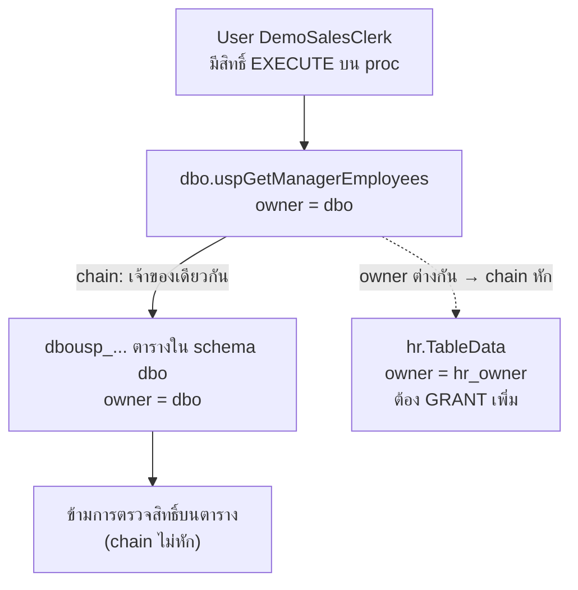

# Section 02 — Code Permissions: Stored Procedure, Function และ Execution Context

ใน Section ก่อนหน้าเรามอบสิทธิ์บน "ข้อมูล" (ตาราง, คอลัมน์) โดยตรง ซึ่งใช้ได้ดีกับระบบเล็ก ๆ แต่ระบบจริงส่วนใหญ่ไม่ให้ client query ตารางตรง ๆ แล้ว — ทุกอย่างผ่าน **stored procedure** และ **function** วิธีคิดนี้ปลอดภัยกว่าเพราะ DBA กำหนดได้ว่าเข้าถึงข้อมูลได้เฉพาะทางที่โค้ดเขียนไว้ และสิทธิ์ที่ต้องมอบคือ `EXECUTE` บนโค้ดเท่านั้น

Section นี้ตอบคำถาม 3 ข้อที่ DBA เจอทุกวัน: (1) มอบสิทธิ์ EXECUTE อย่างไรและทำไมจึงมีตัวเลือกน้อยกว่าตาราง (2) เมื่อโค้ดถูก execute แล้วมัน "รันในตัวตนของใคร" — เรื่อง **EXECUTE AS** และ **Ownership Chaining** และ (3) เมื่อกลไกดังกล่าวพังเพราะ dynamic SQL จะเอาอย่างไร — เรื่อง certificate signing

## สิทธิ์บน Stored Procedure: GRANT EXECUTE

โมดูลของ object แบบ "เรียกใช้" คือ `EXECUTE` — ไม่มี SELECT/INSERT ทีละชิ้นให้เลือก:

```sql
-- มอบให้ user หรือ role
GRANT EXECUTE ON dbo.uspGetManagerEmployees TO SalesClerk;

-- หลาย proc ที่อยู่ใน schema เดียว ก็ใช้ schema-level grant ได้ (Section 3)
GRANT EXECUTE ON SCHEMA::dbo TO SalesClerk;
```

สาธิตจาก error จริง (คู่กับ [`Scripts/01_GrantExecuteCode.sql`](Scripts/01_GrantExecuteCode.sql)):

```sql
USE AdventureWorks2025;
GO

-- user ที่ไม่มีสิทธิ์ใด ๆ → error 229 (EXECUTE permission denied)
EXECUTE AS USER = 'DemoSalesClerk';
EXEC dbo.uspGetManagerEmployees @BusinessEntityID = 2;
REVERT;
GO

GRANT EXECUTE ON dbo.uspGetManagerEmployees TO DemoSalesClerk;
GO

EXECUTE AS USER = 'DemoSalesClerk';
EXEC dbo.uspGetManagerEmployees @BusinessEntityID = 1;  -- ทำงานได้
REVERT;
GO
```

✅ **สังเกต**: user ที่ได้ EXECUTE บน proc ไม่จำเป็นต้องมีสิทธิ์ใด ๆ บนตารางที่ proc อ่าน — เพราะกลไก Ownership Chaining (ต่อหัวข้อถัดไป)

### Function ใช้สิทธิ์คนละประเภท

จุดที่มักสับสน: **scalar function และ inline TVF ใช้สิทธิ์ `EXECUTE`** (ถูกเรียกแบบรันโค้ด) แต่ **multi-statement TVF ใช้ `SELECT`** (ถูกอ่านแบบ result set):

```sql
-- scalar UDF → EXECUTE
GRANT EXECUTE ON dbo.ufnGetStock TO DemoSalesClerk;

-- เรียกใช้ผ่าน query ธรรมดา (ไม่ต้องมี SELECT บน function)
SELECT dbo.ufnGetStock(42);
```

ตัวอย่างเต็มพร้อม error message ที่ระบุ EXECUTE (ไม่ใช่ SELECT) อยู่ในสคริปต์ Demo 01 — ข้อความ "The EXECUTE permission was denied on the object" คือหลักฐานว่าเรื่องนี้เป็น "การรันโค้ด" ไม่ใช่ "การอ่านข้อมูล"

นิยมมอบ `EXECUTE` ของ function ทั่วไปที่ไม่มีความอ่อนไหวให้ `public` เพราะทุก user ใน database เป็น member ของ `public` โดย default:

```sql
GRANT EXECUTE ON dbo.ufnGetStock TO public;  -- ทุก user ใน database ใช้ได้
```

## EXECUTE AS — โค้ดรันในตัวตนของใคร

เมื่อ statement ภายใน module (proc/function) ถูกรัน SQL Server ต้องตัดสินสิทธิ์ด้วย "execution context" บริบทนี้กำหนดได้ด้วย `WITH EXECUTE AS`:

| ตัวเลือก | บริบทที่โค้ดรันอยู่ | ใช้เมื่อ |
|:---------|:------------------|:--------|
| (ไม่ระบุ) | **CALLER** — ตัวตนผู้เรียก | ปกติ, ต้องการ audit ตามตัวจริง |
| `EXECUTE AS CALLER` | ตัวตนผู้เรียก (ประกาศชัด) | เหมือน default แต่เจตนาชัด |
| `EXECUTE AS 'owner'` | เจ้าของ module | ให้ user ทั่วไปรันโค้ดที่ต้องสิทธิ์เยอะ |
| `EXECUTE AS 'self'` | คนที่ **CREATE/ALTER** module | เทียบเท่า OWNER ส่วนใหญ่ |
| `EXECUTE AS 'user_name'` | user เฉพาะใน database | ตั้งชื่อบัญชี service เดียวสำหรับ proc |

```sql
CREATE PROCEDURE dbo.uspUpdateCustomerNotes
    @CustomerId int,
    @Notes nvarchar(500)
WITH EXECUTE AS OWNER    -- โค้ดภายในรันในบริบทเจ้าของ proc
AS
    UPDATE Customers.Customer SET Notes = @Notes WHERE CustomerId = @CustomerId;
GO
```

ข้อควรรู้สำคัญ:

- `EXECUTE AS OWNER` บน proc มีข้อจำกัดเวลาโค้ดไปยุ่งข้างนอก database (linked server, cross-db) บริบท impersonate ไม่ถ่ายทอดไปเครื่องอื่นโดยไม่มีการตั้งค่าพิเศษ (double-hop) — ใช้ได้ดีเฉพาะงานใน database เดียว
- ถ้าใช้ `EXECUTE AS 'user'` ต้องมีสิทธิ์ `IMPERSONATE` บน user นั้น
- `EXECUTE AS LOGIN` ระดับ server ต้อง `IMPERSONATE ANY LOGIN` หรือ sysadmin — ใช้เฉพาะเครื่องมือ admin

## Ownership Chaining — กลไกหลังบ้านที่ทำให้ GRANT EXECUTE พอ

**Ownership Chaining** คือเงื่อนไข: เมื่อ object หนึ่งเรียกอีก object หนึ่ง และทั้งคู่มี **เจ้าของเดียวกัน** SQL Server จะ **ข้ามการตรวจสิทธิ์ของ statement ที่ถูกเรียก** ตรวจเฉพาะสิทธิ์จุดเริ่มของ chain (คือการ EXEC ของผู้เรียก)



เงื่อนไขและขอบเขต:

- **เจ้าของที่เทียบคือ owner ของ schema ที่ object อยู่** (เช่นทั้งหมดใน `dbo` → จับ chain ได้ทั้งก้อน) นี่คือเหตุผลว่าทำไมการใช้ default schema `dbo` รวม ๆ ทำให้ทุก proc ต่อ chain กันเองได้ง่าย
- Chaining ประเมินเฉพาะ **statement แบบ static** ที่อยู่ในโค้ด (SELECT/INSERT/UPDATE/DELETE ที่เขียนไว้ตรง ๆ)
- ข้าม database ต้องเปิด `cross db ownership chaining` (server-level) หรือ `ALTER DATABASE ... SET DB_CHAINING ON` — ปล่อยปิดไว้ถ้าไม่จำเป็น เพราะเปิดแล้ว owner เดียวกันมีอำนาจข้าม database ([Cross db ownership chaining](https://learn.microsoft.com/sql/database-engine/configure-windows/cross-db-ownership-chaining-server-configuration-option?view=sql-server-ver17))

## Ownership Chaining ทำงาน/ไม่ทำงานเมื่อไหร่ — สรุปเป็นตาราง

| สถานการณ์ | Chain ทำงาน? | หมายเหตุ |
|:----------|:-------------|:---------|
| proc อ่านตารางใน schema เดียวกัน (owner เดียวกัน) | ✅ | กรณีมาตรฐาน |
| proc เรียก proc อื่น (owner เดียวกัน) | ✅ | ต่อ chain ยาวได้หลายชั้น |
| proc + ตาราง owner ต่างกัน (คนละ schema ที่มีเจ้าของต่างกัน) | ❌ | ผู้เรียกต้องมีสิทธิ์บนตารางโดยตรง |
| Dynamic SQL (`EXEC(...)`, `sp_executesql`) | ❌ | สิทธิ์ถูกประเมินใหม่ในบริบทผู้เรียก |
| ข้าม database | ❌ (default) | ต้องเปิด `cross db ownership chaining` หรือ DB_CHAINING — ควรหลีกเลี่ยง |
| ผ่าน linked server | ❌ | security context ไม่ไหลข้ามเครื่องโดยไม่มี delegation |
| DDL statement ใน proc | ❌ | สร้าง/แก้ object ต้องมีสิทธิ์ DDL โดยตรงเสมอ |

ข้อสรุปเชิงออกแบบระบบ: ให้ proc ทั้งหมดที่ "ทำงานกับข้อมูลชุดเดียวกัน" อยู่ใน schema เดียวกันที่มีเจ้าของเดียวกัน และแยก schema ที่มีเจ้าของต่างกันเมื่อจงใจต้องการให้ chain หัก

## ตรวจบริบทการรันจริง (Execution Context) ใน session

เมื่อ debug เรื่องสิทธิ์ คำถามแรกเสมอคือ "โค้ดบรรทัดนี้รันในตัวตนของใคร":

```sql
SELECT USER_NAME()          AS database_context,   -- user ระดับ database ขณะรัน
       SUSER_SNAME()        AS server_login,       -- login ที่ผูกอยู่ (ถ้ามี)
       ORIGINAL_LOGIN()     AS original_login;     -- login จริงของ connection
GO
```

ผลต่างกันตามการตั้งค่า:

| สถานการณ์ | USER_NAME() | ORIGINAL_LOGIN() |
|:----------|:------------|:-----------------|
| เรียกตรง ๆ ไม่มี EXECUTE AS | user ของผู้เรียก | login ของผู้เรียก |
| ภายใน proc `WITH EXECUTE AS OWNER` | owner ของ proc | login ของผู้เรียก (original ไม่เปลี่ยน) |
| ภายใน proc ลง signature | user ของผู้เรียก (เพิ่มสิทธิ์จาก cert user เงียบ ๆ) | login ของผู้เรียก |

## บริบทซ้อนกันได้ — EXECUTE AS / REVERT และ context stack

`EXECUTE AS USER = '...'` แบบ session-level กองเป็น stack ได้ ทุกครั้ง `REVERT` เด้งออกหนึ่งชั้น:

```sql
EXECUTE AS USER = 'UserA';
SELECT USER_NAME();            -- UserA

EXECUTE AS USER = 'UserB';
SELECT USER_NAME();            -- UserB

REVERT;                        -- ออกชั้น UserB
SELECT USER_NAME();            -- กลับเป็น UserA
REVERT;                        -- ออกชั้น UserA
SELECT USER_NAME();            -- กลับตัวเอง
GO
```

ข้อควรระวัง: ถ้าปล่อย session ค้างในบริบทที่สวมไว้ ทุกคำสั่งถัดไปรันในตัวตนนั้น — เครื่องมือเขียนสคริปต์ที่ดีปิดด้วย `REVERT` เสมอ (สคริปต์ทุกตัวในคอร์สนี้ทำแบบนี้) และใน stored procedure บริบทจาก `WITH EXECUTE AS` กลับอัตโนมัติเมื่อจบ proc — ไม่ต้อง REVERT เอง

## Impersonate ระดับ server (EXECUTE AS LOGIN)

นอกจาก `EXECUTE AS USER` (ระดับ database) ยังมี `EXECUTE AS LOGIN` ที่สวมตัวตนทั้ง login ใช้เฉพาะเครื่องมือ admin และการสอบ permission ระดับ server ใครได้สิทธิ์นี้ควบคุมได้:

- `GRANT IMPERSONATE ON LOGIN::SomeLogin TO SomeUser;` — สวม login ใด login หนึ่งเท่านั้น (แคบกว่า)
- `GRANT IMPERSONATE ANY LOGIN TO SomeUser;` — สวมได้ทุก login (อันตราย, ไม่ควรมอบ)

> **หลักคิด**: impersonation คือสิทธิ์ระดับ "สวมตัวตน" ถ้ามอบให้กว้าง user นั้นจะทำได้ทุกอย่างที่เจ้าของตัวตนทำได้ จึงมอบเฉพาะเครื่องมือ DBA เท่านั้น

## Dynamic SQL ทำ Ownership Chaining พัง

ถ้า proc เรียก `EXEC(@sql)` หรือ `sp_executesql` — statement นั้น **ไม่ใช่ส่วนของ module ที่ compiled** ดังนั้น:

- Ownership chaining **ไม่ทำงาน** กับ dynamic SQL
- SQL Server ประเมินสิทธิ์ใหม่ทั้งหมดใน **บริบทผู้เรียก** (CALLER)
- ผลลัพธ์: user ที่ได้แค่ EXECUTE บน proc จะได้ error 229 จากข้างใน proc

```sql
CREATE PROCEDURE dbo.uspBadDynamic
    @BusinessEntityID int
AS
    -- ownership chain หักตรงบรรทัดนี้
    EXEC('SELECT BusinessEntityID FROM HumanResources.Employee
          WHERE BusinessEntityID = ' + @BusinessEntityID);
GO
```

วิธีแก้มี 2 ทางหลัก มี trade-off ต่างกันชัดเจน:

### ทางที่ 1: EXECUTE AS OWNER (ง่าย แต่กระทบบริบททั้ง proc)

```sql
CREATE PROCEDURE dbo.uspDynamicWithOwner
    @BusinessEntityID int
WITH EXECUTE AS OWNER
AS
    EXEC('SELECT ... FROM HumanResources.Employee ...');
GO
```

dynamic SQL รันในบริบทของเจ้าของ proc ซึ่งโดยมากมีสิทธิ์ครบ ข้อเสีย: บริบททั้ง proc เปลี่ยน สิ่งที่ตั้งใจ audit ด้วยตัวตนผู้เรียกจะเห็นเป็น owner หมด; และ cross-database อาจต้องพึ่ง TRUSTWORTHY ซึ่งเป็นสิ่งที่ควรหลีกเลี่ยง

### ทางที่ 2: Certificate Signing (แนะนำ — ควบคุมสิทธิ์แคบที่สุด)

แนวคิด: **ลงลายมือชื่อ (sign) โค้ดด้วย certificate** แล้วสร้าง user "ผู้แบกสิทธิ์" จาก certificate นั้น มอบสิทธิ์ให้ user ปลอมตัวนี้เท่าที่จำเป็น ตอน proc ถูกรัน SQL Server จะเพิ่มสิทธิ์ของ certificate user เข้าไปเฉพาะการรัน proc นั้น **บริบทผู้เรียกยังเหมือนเดิมทุกอย่าง** ([Module signing](https://learn.microsoft.com/sql/relational-databases/security/module-signing?view=sql-server-ver17))

```sql
-- 1) สร้าง certificate ใน database
CREATE CERTIFICATE DemoProcCert
    WITH SUBJECT = 'Sign uspDynamicWithCert';

-- 2) สร้าง user จาก certificate (ไม่มี login จริง, ไม่ล็อกอินได้)
CREATE USER CertUser_DemoProc FROM CERTIFICATE DemoProcCert;

-- 3) มอบสิทธิ์ "ขั้นต่ำที่โค้ดต้องใช้" ให้ cert user
GRANT SELECT ON HumanResources.Employee TO CertUser_DemoProc;

-- 4) ลงลายมือชื่อบน proc
ADD SIGNATURE TO OBJECT::dbo.uspDynamicWithCert BY CERTIFICATE DemoProcCert
    WITH PASSWORD = 'Pa$$w0rd2025';
```

> **Operational note สำคัญ**: ทุกครั้งที่ `ALTER PROCEDURE` ลายมือชื่อจะ **หายไป** — deployment script จึงต้องมี `ADD SIGNATURE` คู่กับการ ALTER เสมอ ตรวจว่า proc ไหนยังมีลายมือชื่อด้วย:
>
> ```sql
> SELECT OBJECT_NAME(cp.major_id) AS object_name, c.name AS certificate_name
> FROM sys.crypt_properties cp
> JOIN sys.certificates c ON c.thumbprint = cp.thumbprint
> WHERE cp.class = 1;
> ```

✅ **สังเกต**: user ที่เรียกยังมีบริบทเป็นตัวเอง (audit เห็นตัวจริง) แต่ statement ภายใน proc ผ่านเพราะสิทธิ์จาก certificate — หลักการเดียวกับการลง code signing

ทั้งสองทางมีสคริปต์สาธิตจริงคู่กันใน [`Scripts/02_ExecuteAs_OwnershipChaining.sql`](Scripts/02_ExecuteAs_OwnershipChaining.sql) และ [`Scripts/03_DynamicSql_CertificateSigning.sql`](Scripts/03_DynamicSql_CertificateSigning.sql)

## Managed Code (CLR) — สั้น ๆ แต่ต้องรู้

SQL Server ยังรองรับ .NET assemblies (CLR integration) เป็น stored procedure/function/UDT แต่ตั้งแต่ SQL Server 2017 มี **CLR strict security** เป็น default: ต้องมี `UNSAFE ASSEMBLY` หรือสร้างจาก assembly ที่ sign เชื่อถือได้เท่านั้น สิทธิ์ที่ควบคุมคือ:

- `CREATE ASSEMBLY` — ต้อง `CREATE ASSEMBLY` permission (หรือ `UNSAFE ASSEMBLY` / membership ใน role `##MS_DatabaseImpacturator##` รุ่นใหม่)
- `EXECUTE` บน CLR proc/function เหมือน T-SQL proc ปกติ

ในโลกใหม่ ยิ่งเลี่ยง CLR ยิ่งดี — ส่วนใหญ่ใช้แทนได้ด้วย JSON functions, regular expressions (SQL Server 2025) หรือ external processes ถ้าต้อง maintain CLR เดิม ให้ตรวจด้วย:

```sql
SELECT name, is_trustworthy_on FROM sys.databases WHERE name = DB_NAME();
SELECT * FROM sys.assemblies;   -- assembly ใน database ปัจจุบัน
```

## แบบแผนที่ใช้จริงเมื่อ deploy แอป

ตารางนี้คือรูปแบบที่โรงงานระบบใช้กันจริง — เลือกตามโจทย์ไม่ตามความสวย:

| โจทย์ | แบบแผน | เหตุผล |
|:------|:-------|:-------|
| แอปเข้าถึงข้อมูลผ่าน proc เท่านั้น | GRANT EXECUTE บน proc/role + ไม่ให้ SELECT ตารางเลย | chaining ปกปิดตารางจาก client |
| ต้องการกรอง "ผู้ใช้ปลายทาง" ของแอปเดียว | proc เช็ค `SESSION_CONTEXT` / `USER_NAME` เอง | RLS ก็ทำได้ (Section 1) |
| proc มี dynamic SQL | certificate signing (แนะนำ) หรือ EXECUTE AS OWNER | ตามหัวข้อก่อนหน้า |
| เครื่องมือ BI อ่านทั้ง database | role ใหม่ + `GRANT SELECT ON SCHEMA::...` | แคบกว่า db_datareader (Section 3) |
| ให้ทุกคนเรียก function ตัวช่วยธรรมดา | `GRANT EXECUTE ... TO public` | function ไม่เผยข้อมูลอ่อนไหว |

เครื่องยืนยันท้ายงานเวลาเปลี่ยน permission ของโค้ด — รันในบริบทผู้ใช้จริงแล้วดู effective permissions ของ proc:

```sql
EXECUTE AS USER = 'AppRole';
SELECT * FROM sys.fn_my_permissions('dbo.uspGetManagerEmployees', 'OBJECT');
REVERT;
```

## การดูแลลายมือชื่อ (Module Signing) ระยะยาว

สิ่งที่ทีมสร้าง signature มักโดนตอนหกเดือนผ่านไป:

- **ALTER PROCEDURE ลบ signature ทิ้ง** — deploy script ทุกรอบต้องลงใหม่ วิธีคุมที่ได้ผลคือใส่ `ADD SIGNATURE` อยู่ใน migration script เดียวกับการ ALTER เสมอ (หรือใช้ `ADD SIGNATURE ... FROM ...` ที่ idempotent)
- **certificate หมดอายุ** — cert ที่ sign proc มี expiry; cert หมดอายุไม่ทำให้ signature ใช้ไม่ได้ (SQL Server ยังเชื่อ signature เดิม) แต่ถ้าต้องการคุมเชิงความปลอดภัยให้ rotate: สร้าง cert ใหม่ → ADD SIGNATURE ด้วย cert ใหม่ (signature ใหม่ทับเดิม) → DROP CERTIFICATE ตัวเกิน
- **คนลืมมอบสิทธิ์ให้ cert user** — วินิจฉัยได้จากการรัน proc ในบริบท user จริงแล้วดู effective permission ของ statement ใน proc (error 229 ที่ต่างจากตอนทดสอบ)

## ข้อควรจำปิดท้ายหัวข้อโค้ด

- `EXECUTE` เท่านั้นที่คุมการเรียก proc — ไม่มี "partial execute"
- signature หายเมื่อ ALTER — ผูก `ADD SIGNATURE` เข้า deploy script ตลอดชีวิตของ proc
- dynamic SQL หัก chain เสมอ และ `EXECUTE AS OWNER` ไม่ใช่ยาแก้ทุกกรณีข้าม database — อ่านข้อจำกัด TRUSTWORTHY ก่อนเปิด
- ตรวจบริบทด้วย `USER_NAME()` ตลอดเวลาพัฒนา — อย่าเดา

## สรุปเตรียมเข้า Section ถัดไป

- `EXECUTE` คือสิทธิ์เดียวที่คุมการเรียก proc; function แยกสาย EXECUTE/SELECT ตามชนิด
- Ownership chaining ทำให้ "มอบ EXECUTE บนโค้ด" ปลอดภัยกว่า "มอบ SELECT บนตาราง" เพราะผู้เรียกไม่ต้องและไม่สามารถเข้าถึงข้อมูลโดยตรง
- Dynamic SQL หัก chain — เลือกแก้ด้วย EXECUTE AS (ง่าย, บริบทเปลี่ยนทั้ง proc) หรือ certificate signing (แนะนำ, สิทธิ์แคบและ audit ยังเห็นตัวจริง)

Section 3 ปิดท้ายด้วยการยกทั้งหมดขึ้นระดับ schema — GRANT ทีเดียวครอบทุก object ใน schema ซึ่งเป็นรูปแบบจริงที่สไลด์ให้ทำแบบฝึกหัด

---

### 🚀 SQL Server 2025 & Modern Notes

- **Security cache improvements (2025)**: การมอบ/เรียกคืน EXECUTE รายใหญ่กระทบ user คนอื่นน้อยลงเพราะ cache invalidation เฉพาะ login ที่ได้ผลกระทบ ([Security cache](https://learn.microsoft.com/sql/relational-databases/security-cache?view=sql-server-ver17))
- **Module signing** ยังเป็น best practice คู่กับ certificate; สคริปต์ deployment ยุคใหม่ (dacpac/SqlPackage) รักษา signature ได้ถ้า deploy อย่างถูกลำดับ ([Module signing](https://learn.microsoft.com/sql/relational-databases/security/module-signing?view=sql-server-ver17))
- **PBKDF2 password hashing (2025)** ทำให้การสร้าง LOGIN ที่ใช้ใน demo ปลอดภัยขึ้นโดย default — NIST SP 800-63b ([CREATE LOGIN](https://learn.microsoft.com/sql/t-sql/statements/create-login-transact-sql?view=sql-server-ver17))
- สำหรับการเข้ารหัส/คุมข้อมูลละเอียดกว่านี้ (เช่น column ที่ DBA ไม่ควรเห็น) รอ Module 04 — Always Encrypted แก้ปัญหาที่ GRANT/RLS แก้ไม่ได้

> อ้างอิง: [GRANT (Transact-SQL)](https://learn.microsoft.com/sql/t-sql/statements/grant-transact-sql?view=sql-server-ver17), [Ownership chains](https://learn.microsoft.com/sql/relational-databases/security/ownership-chains?view=sql-server-ver17), [Writing secure dynamic SQL](https://learn.microsoft.com/sql/connect/ado-net/sql/writing-secure-dynamic-sql?view=sql-server-ver17), [TRUSTWORTHY database property](https://learn.microsoft.com/sql/relational-databases/security/trustworthy-database-property?view=sql-server-ver17)
