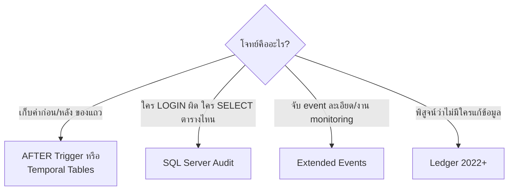
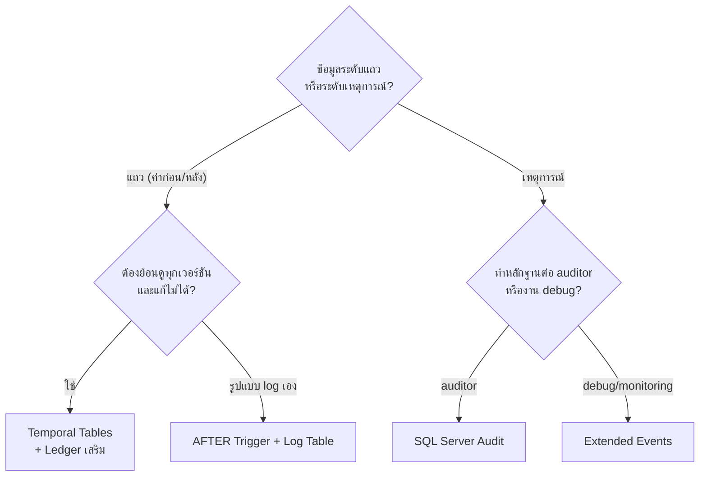

# Section 01 — Audit Options: เลือกกลไกตรวจสอบให้ถูกงาน

"ใครแก้ราคาสินค้าเมื่อวาน?" "ทำไมข้อมูลลูกค้าหาย?" — เมื่อเกิดเหตุการณ์แบบนี้ DBA ที่ไม่มี audit เท่ากับเดินสำรวจบ้านที่ไม่มีกล้องวงจรปิด หน้าที่ของ Section นี้คือแผนที่กลไก audit ทั้งหมดของ SQL Server เทียบจุดแข็งจุดอ่อน แล้วเลือกให้ตรงโจทย์เพราะกลไกแต่ละตัวตอบคำถาม **คนละคำถาม**

## ภาพรวมกลไก audit ของ SQL Server

| กลไก | จับอะไร | จุดแข็ง | จุดอ่อน |
|:-----|:--------|:-------|:--------|
| **AFTER Trigger** + log table | DML ที่เราเลือก | คุมรูปแบบ log ได้เอง เขียน logic เฉพาะได้ | รันใน transaction เดียวกัน — หนัก workload, ข้ามได้ถ้าไม่มีใครลบ trigger |
| **Temporal Tables** | ประวัติทุกเวอร์ชันของแถว | อัตโนมัติ, แก้ history ไม่ได้, query ย้อนเวลาด้วย `FOR SYSTEM_TIME` | ดูข้อมูลเปลี่ยนเท่านั้น ไม่บอกใครแก้ (เว้นแต่ใส่คอลัมน์ audit เอง) |
| **SQL Server Audit** | เหตุการณ์ engine ระดับ server/database | ทางการ, อยู่นอก database, ไฟล์ป้องกันแก้ไข | จับ "เหตุการณ์" ไม่จับ "ค่าก่อน-หลัง" ของแถว |
| **Extended Events (XE)** | เหตุการณ์ระดับ engine ลึกมาก | น้ำหนักเบา ยืดหยุ่น แทน Profiler ที่ deprecated | ต้องจัด session เอง |
| **Ledger (2022+)** | พิสูจน์ tamper ด้วย digest | แก้ไขข้อมูลโดยไม่รู้ตัวไม่ได้ | ใช้กับตาราง ledger เท่านั้น |



## Common Criteria Compliance

ก่อนแตะกลไกใด ๆ มี "โหมดเข้มงวด" ระดับ server ที่เปลี่ยนพฤติกรรมความปลอดภัยหลายจุดในครั้งเดียว — `common criteria compliance enabled` ช่วยให้ SQL Server ตรงข้อกำหนด Common Criteria (EAL2/EAL4+):

```sql
EXECUTE sp_configure 'show advanced options', 1;
RECONFIGURE;
GO

EXECUTE sp_configure 'common criteria compliance enabled', 1;
RECONFIGURE WITH OVERRIDE;
GO
-- ต้อง RESTART SQL Server service ก่อนตั้งค่ามีผลจริง
```

เมื่อเปิดแล้ว เกิดอะไร ([doc อย่างเป็นทางการ](https://learn.microsoft.com/sql/database-engine/configure-windows/common-criteria-compliance-enabled-server-configuration-option?view=sql-server-ver17)):

1. **Login auditing** — เปิดการบันทึกการล็อกอิน และเพิ่มข้อมูลต่อ session ใน `sys.dm_exec_sessions`: เวลาล็อกอินสำเร็จล่าสุด, เวลาล้มเหลวล่าสุด, จำนวนครั้งระหว่างสองเหตุการณ์
2. **Residual Information Protection (RIP)** — memory ที่จะแบ่งให้ resource ใหม่ถูก overwrite ด้วย bit pattern ก่อน (กันข้อมูลตกค้างใน RAM) แลกกับ performance
3. **Column GRANT ไม่ override table DENY อีกต่อไป** — กลับกฎที่พูดใน Module 3: เมื่อเปิด CCC, table-level `DENY` จะชนะ column-level `GRANT`

ข้อควรรู้: เปิดเมื่อจำเป็นตาม compliance เท่านั้น (มี performance cost ชัดเจน) และ Common Criteria รับรองเฉพาะ Enterprise edition

## Audit ด้วย Trigger (AFTER Trigger + Log Table)

วิธีดั้งเดิมที่ยังใช้ได้: สร้างตาราง log แล้วให้ AFTER trigger เขียนแถว `inserted`/`deleted` ลงไป:

```sql
CREATE TABLE Lab.AuditLog
(
    AuditId int IDENTITY PRIMARY KEY,
    EventTime datetime2 DEFAULT SYSDATETIME(),
    ChangedBy sysname DEFAULT SUSER_SNAME(),
    Action nvarchar(10),
    OldValue nvarchar(200),
    NewValue nvarchar(200)
);
GO

CREATE TRIGGER Lab.trg_AuditSalary
ON Lab.SalaryDemo
AFTER INSERT, UPDATE, DELETE
AS
BEGIN
    SET NOCOUNT ON;
    INSERT INTO Lab.AuditLog (Action, OldValue, NewValue)
    SELECT 'DELETE', CONCAT(d.Id, '|', d.EmployeeName), NULL FROM deleted d
    WHERE NOT EXISTS (SELECT 1 FROM inserted i WHERE i.Id = d.Id);

    INSERT INTO Lab.AuditLog (Action, OldValue, NewValue)
    SELECT 'INSERT', NULL, CONCAT(i.Id, '|', i.EmployeeName) FROM inserted i
    WHERE NOT EXISTS (SELECT 1 FROM deleted d WHERE d.Id = i.Id);

    INSERT INTO Lab.AuditLog (Action, OldValue, NewValue)
    SELECT 'UPDATE', CONCAT(d.Id, '|', d.EmployeeName), CONCAT(i.Id, '|', i.EmployeeName)
    FROM deleted d JOIN inserted i ON i.Id = d.Id;
END
```

ข้อดีข้อเสียชัดเจน:

- ✅ จับ **ค่าก่อน/หลัง** แบบที่ SQL Server Audit ทำไม่ได้; จัดรูปแบบ log เองได้ทุกคอลัมน์
- ❌ trigger รันใน transaction เดียวกับคำสั่งเดิม — เพิ่ม latency ให้ทุก DML และถ้า trigger fail การเขียนข้อมูลจริงก็ fail ด้วย
- ❌ audit อยู่ "ใน" database ผู้ก่อการที่มีสิทธิ์พออาจปิด/แก้ trigger (ต่างจาก SQL Server Audit ที่เก็บข้างนอก) — ใช้คู่กับ permissions ที่ป้องกัน trigger

## Audit ด้วย Temporal Tables

Temporal table (system-versioned) เก็บประวัติทุกเวอร์ชันของแถวอัตโนมัติใน history table — ทุก `UPDATE`/`DELETE` ย้ายแถวเก่าเข้า history ที่ **INSERT/UPDATE/DELETE โดยตรงไม่ได้** จึงใช้เป็น audit ของข้อมูลได้เป็นอย่างดี:

```sql
CREATE TABLE Lab.Manager
(
    ManagerId int NOT NULL PRIMARY KEY,
    ManagerName nvarchar(50) NOT NULL,
    ValidFrom datetime2 GENERATED ALWAYS AS ROW START NOT NULL,
    ValidTo   datetime2 GENERATED ALWAYS AS ROW END   NOT NULL,
    PERIOD FOR SYSTEM_TIME (ValidFrom, ValidTo)
)
WITH (SYSTEM_VERSIONING = ON (HISTORY_TABLE = Lab.ManagerHistory));
```

สืบค้นประวัติด้วย `FOR SYSTEM_TIME`:

| ตัวเลือก | ความหมาย |
|:---------|:---------|
| `FOR SYSTEM_TIME AS OF '2026-01-01 10:00'` | สถานะตาราง ณ เวลานั้น |
| `FOR SYSTEM_TIME FROM '2026-01-01' TO '2026-02-01'` | ช่วงเวลา |
| `FOR SYSTEM_TIME ALL` | ทุกเวอร์ชัน + ปัจจุบัน |
| `FOR SYSTEM_TIME BETWEEN ... AND ...` | ช่วงเวลาแบบรวมขอบ |

ข้อจำกัดด้าน audit: temporal table บอก "ค่าเปลี่ยนจากอะไรเป็นอะไรเมื่อไหร่" แต่ไม่บอก **ใคร** — เว้นแต่เพิ่มคอลัมน์อย่าง `ChangedBy sysname DEFAULT SUSER_SNAME()` เอง (และมีโอกาสโดนปลอมจาก user ที่สิทธิ์พอ เพราะเป็นคอลัมน์ธรรมดา — สาธิตในสคริปต์ Demo 03) ถ้าต้องการหลักฐานแบบพิสูจน์ได้ว่า "แก้ไม่ได้" ใช้ **Ledger** (2022+) ที่คุมด้วย cryptographically digest จริง

## Trigger อีกข้อที่ควรรู้: DDL Trigger และข้อจำกัดของ DML Trigger

ข้างบนพูดถึง AFTER trigger บน DML ซึ่งใช้ได้แค่ส่วนหนึ่งของงาน:

- **DML trigger** (`AFTER`/`INSTEAD OF`) ทำงานเฉพาะ INSERT/UPDATE/DELETE บนตาราง/มุมมอง — จับไม่ได้ว่า "ใคร SELECT" (SELECT ไม่ผ่าน trigger เลย) และระวัง **nested/recursive trigger** ที่เขียน log เป็นวง
- **DDL trigger** (`CREATE TRIGGER ... FOR CREATE_TABLE` ฯลฯ) จับเหตุการณ์โครงสร้าง ใช้กันทำลาย schema ได้ แต่ไม่จับ "ค่าก่อนหลังของแถว"
- trigger รันใน transaction เดียวกัน — ถ้า log table ตาย ธุรกรรมธุรกิจตายด้วย (เหมาะกับสถานการณ์ "ห้ามแก้โดยไม่บันทึก" แต่ต้องรู้ว่าเพิ่มภาระต่อทุก DML)
- INSTEAD OF trigger เปลี่ยนคำสั่งเดิมเป็นโค้ดของเรา — พลังมากแต่ซับซ้อน ใช้เมื่อมีเหตุผลจริง

## Temporal Tables เพิ่มเติม: Retention ของ history

แล็บเก่าให้ history table โตไม่จำกัด แต่ตั้งแต่ SQL Server 2016 มี retention policy ให้ลบประวัติเก่าอัตโนมัติ:

```sql
WITH (SYSTEM_VERSIONING = ON (
    HISTORY_TABLE = Lab.ManagerHistory,
    HISTORY_RETENTION_PERIOD = 1 YEAR     -- INFINITE (default) / DAY..YEAR
))
```

ควรตั้ง retention ตามข้อกำหนดเก็บข้อมูลขององค์กร — ถ้ากฎกำหนดเก็บ log 5 ปี ให้ตั้ง 5 ปี (หรือเก็บออกไปที่ data warehouse) หมายเหตุ: ถ้าผูกกับ RLS ให้เพิ่ม security predicate ให้ history table ด้วยตนเอง (RLS ไม่ถ่ายทอดอัตโนมัติ)

## SQL Trace — Deprecated, ใช้ Extended Events แทน

**สิ่งสำคัญที่สุดของหัวข้อนี้คืออย่าใช้มันกับงานใหม่** — SQL Trace (กลไกหลังบ้านของ Profiler รุ่นเก่า, คำสั่ง `sp_trace_*`, event classes เดิม) เป็น **deprecated feature** Microsoft ประกาศชัดให้ใช้ Extended Events แทน ([Deprecated Database Engine features](https://learn.microsoft.com/sql/database-engine/deprecated-database-engine-features?view=sql-server-ver17))

เมื่อเจอโค้ด/แนวปฏิบัติเก่าที่พึ่ง SQL Trace ให้แปลเป็น:

| งานแบบเดิม (SQL Trace) | ทางใหม่ (Extended Events) |
|:-----------------------|:--------------------------|
| SQL Profiler trace sessions | **XEvent Profiler** ใน SSMS (คลิกขวา instance → XEvent Profiler) |
| `sp_trace_create` + `sp_trace_setevent` | `CREATE EVENT SESSION ... ADD EVENT sqlserver.* ... TARGET file` |
| `ALTER TRACE` permission | `ALTER ANY EVENT SESSION` + `VIEW SERVER PERFORMANCE STATE` หรือ roles `##MS_ServerPerformanceStateReader##` |

สั้น ๆ: แนวคิด mapping — Trace "event" ≈ XE "event"; Trace "column" ≈ XE "action/predicate"; Trace "filter" ≈ XE "predicate (WHERE)"; ปลายทาง trace file ≈ XE "event_file target" รายละเอียดการใช้ XE ลึก ๆ จะไม่ซ้ำกับ Module ที่ครอบ monitoring ในคอร์สนี้ แต่ตัวอย่าง XE session ที่จับ failed login (ทดแทน trace คลาสสิก Login Audit) อยู่ใน [`Scripts/04_SQLTrace_Deprecated_XE.sql`](Scripts/04_SQLTrace_Deprecated_XE.sql)

### ตารางแปลงงานเดิม Trace → XE

| เป้าหมายเดิม (SQL Trace event) | ทางใหม่ (XE) |
|:------------------------------|:-------------|
| Audit Login Failed (event 14) | `error_reported` ที่ severity=14, error 18456 (ในสคริปต์ Demo 04) หรือ SQL Server Audit `FAILED_LOGIN_GROUP` |
| Audit Login / Logout (events 11–12) | XE events `login`/`logout` หรือ audit groups `SUCCESSFUL_LOGIN_GROUP` |
| Statements (BatchCompleted 10 / RPCCompleted 10) | `sql_batch_completed`, `rpc_completed` (XEvent Profiler ให้พร้อม) |
| Deadlock graph (event 148) | `xml_deadlock_report` ใน session `system_health` |
| Query ช้า (Duration filter) | `sql_batch_completed`/`rpc_completed` + predicate `WHERE duration > <ค่า µs>` |

ตัวสคริปต์เก่าที่เขียน `sp_trace_create`/`sp_trace_setevent` เจอแล้วให้ย้ายรูปแบบนี้ทั้งหมด — ตั้งแต่ SQL Server 2022 การเรียกใช้ SQL Trace ถูกนับเป็น deprecated feature ที่ตรวจเจอได้จาก performance counter "Deprecated Features" (คำสั่งตรวจอยู่ในสคริปต์ Demo 04)

## เก็บ "ใครแก้" แบบยากปลอม — จับคู่กลไก

คำถามโจทย์จริงคือ trigger/temporal เก็บ `SUSER_SNAME()` ได้ แต่คนสิทธิ์พอปลอมมันได้ วิธีเสริมความแน่น (เลือกได้หลายชั้น):

1. **DENY UPDATE บนคอลัมน์ audit**: `DENY UPDATE ON OBJECT::Lab.Manager (ChangedBy) TO [AppUsers];` — ตัดปลอมทางตรง (ข้ามได้เฉพาะ EXECUTE AS)
2. **Temporal table ล้วน**: history แก้ไม่ได้จริง (engine คุม) แต่แถวปัจจุบันเปลี่ยน ChangedBy ได้ — ค่า "ท้ายสุด" จึงปลอมได้ ประวัติเก่าไม่ได้ถูกแก้แต่ถูกบันทึกตามที่ปลอมไปแล้ว
3. **SQL Server Audit**: จับ UPDATE แบบอิสระจากโค้ด — เห็น `statement` เดิมพร้อม login จริง
4. **Ledger (2022+)**: digest เข้ารหัสครอบทุกเวอร์ชัน — คู่ที่แข็งที่สุดเวลาต้องพิสูจน์ต่อศาล/auditor

การใช้ซ้อน 1+3 (หรือ 2+3) เป็นรูปแบบปกติของระบบที่มีข้อกำหนด compliance จริง

## ผลกระทบกับ bulk load และระบบใหญ่

| กลไก | ผลตอน BULK INSERT ล้านแถว |
|:-----|:--------------------------|
| AFTER trigger | แถว log เพิ่มตามล้าน — โตเร็ว, transaction ยาวขึ้นชัดเจน |
| Temporal | history โตตาม (ประหยัดกว่า trigger เพราะ engine เขียนตรง) |
| SQL Server Audit | เขียนเฉพาะ "เหตุการณ์" (1 event) ไม่ใช่ต่อแถว — ตัวเดียวที่เบาที่สุดต่อแถวเยอะ ๆ |
| XE | เขียนตาม event — คุมกรองได้ละเอียด |

ถ้างานประจำวันคือ bulk load ใหญ่และโจทย์เป็นเรื่อง "เหตุการณ์" ไม่ใช่ "ค่าก่อน-หลังทุกแถว" — SQL Server Audit เหมาะกว่า trigger ชัดเจน (เหตุผลเดียวที่ Section 2 นี้เป็นกลไกหลักของคอร์ส)

## ใช้ XEvent Profiler ใน SSMS — ทางลัดแทน Profiler เดิม

ถ้าเพียงแค่ "อยากดู query ที่รันไปหน้าจอเดียว" แบบที่เคยใช้ Profiler — ไม่ต้องเขียน CREATE EVENT SESSION เอง:

1. SSMS → Object Explorer → คลิกขวาที่ instance → **XEvent Profiler** → **Standard** (หรือ TSQL)
2. SSMS สร้าง session `xe_profiler` พร้อม event กลุ่ม batch/rpc completed ให้ทันที
3. ดับเบิลคลิกเปิด Live Data Viewer — หน้าตาเหมือน Profiler เดิม แต่รันบน XE

เหมาะกับการ debug ทันที; งานที่ต้องเก็บหลักฐานระยะยาวยังใช้ SQL Server Audit ตามที่อธิบาย

## ข้อจำกัดอื่น ๆ ของ Temporal Tables ที่เจอจริง

- ตาราง temporal เป็น **FK ของตารางอื่นไม่ได้** (FK ออกได้เข้าไม่ได้ตาม docs) — วางโครงสร้างควรรู้ก่อน
- `MERGE` statement ใช้ได้, แต่ TRUNCATE TABLE **ไม่ทำกับ temporal table**
- เปลี่ยนโครงสร้าง (ALTER TABLE) ทำได้ที่ตารางหลักและ engine กระจายให้ history เอง ยกเว้นบาง type change
- ตาราง history เก็บทุกคอลัมน์เหมือนตารางหลัก — เปลี่ยนคอลัมน์ mask/RLS อย่าลืมว่า history เก็บค่า "ก่อน mask" แบบเดียวกัน
- ต้องมี PK บนตารางหลักจึงจะเปิด SYSTEM_VERSIONING ได้

## เช็กลิสต์เลือกกลไก audit ให้จบภายใน 5 คำถาม

1. โจทย์คือ "พิสูจน์ต่อคนนอก" หรือ "แก้ปัญหาภายใน"? — คนนอก → SQL Server Audit/Ledger; ภายใน → ตัวไหนก็ได้ที่ถูกงาน
2. ต้องเห็น **ค่าก่อน/หลังของแถว** หรือแค่ **เหตุการณ์**? — ค่า → temporal/trigger; เหตุการณ์ → audit
3. โดนว่า "ห้ามให้ผู้ดูแลระบบแก้ log"? — ใช่ → SQL Server Audit ปลายทางไฟล์ (+ Ledger ถ้าเข้มสุด)
4. เหตุการณ์ที่จับมีเพียงใด (แถวต่อคำสั่ง)? — bulk load ใหญ่ → เลี่ยง DML trigger
5. เครื่องมือนี้ deprecated ไหม? — SQL Trace/Profiler → แทนด้วย XE ทุกครั้ง



## เทียบกับ "Login auditing" ปกติของ instance (ไม่ใช่ CCC)

สับสนกันมากเรื่องนี้: SQL Server มีตัวเลือก login auditing ของ instance แยกต่างหาก (SSMS → Server Properties → Security: *Failed logins only / Successful / Both*) เขียนลง **SQL Server Error Log** — ต่างจาก CCC ที่เป็นโหมดเข้มงวดทั้งระบบ:

| ประเด็น | Login auditing (ปกติ) | Common Criteria Compliance |
|:--------|:----------------------|:---------------------------|
| เก็บที่ไหน | ERRORLOG | ตามกลไก + เพิ่มข้อมูล login ต่อ session |
| จับ login ล้มเหลว | ได้ (default: Failed logins only) | ได้ + เพิ่ม login statistics ราย session |
| RIP (memory overwrite) | ไม่มี | มี |
| เปลี่ยนกฎ column DENY ชนะ table GRANT | ไม่เปลี่ยน | เปลี่ยน (DENY ชนะเสมอ) |
| เปิด-ปิด | restart เฉพาะบริการนี้ | restart + performance cost ตลอดเวลา |

ในงานจริง: login auditing ปกติให้เปิดไว้เสมอ (Failed logins only เป็นค่าที่แนะนำ) ส่วน CCC เปิดเมื่อมีข้อกำหนดเฉพาะเท่านั้น หากต้องการหลักฐาน login ที่ดีกว่า ERRORLOG ใช้ SQL Server Audit `FAILED_LOGIN_GROUP` (Section 2)

## สรุป

- Trigger = audit เนื้อหาแบบปรับแต่งได้ (จ่ายด้วย transaction overhead), Temporal = ประวัติแถวอัตโนมัติแก้ไม่ได้, SQL Server Audit = เหตุการณ์ระดับ engine แบบทางการ (Section 2), XE = ทุกงาน monitoring/trace ใหม่, Ledger = หลักฐานแบบแก้ไม่ได้
- Common Criteria compliance คือ "โหมดเข้มงวด" ระดับ server — ใช้เมื่อ compliance ต้องการเท่านั้น
- SQL Trace/Profiler: deprecated — อย่าเริ่มงานใหม่ด้วยมัน

Section 2 เจาะกลไกที่ทางการที่สุด: SQL Server Audit ครบทั้ง Server Audit, Specifications และ DMVs

---

### 🚀 SQL Server 2025 & Modern Notes

- **SQL Trace + SQL Server Profiler = deprecated** — ประกาศซ้ำใน [What's new in SQL Server 2025](https://learn.microsoft.com/sql/sql-server/what-s-new-in-sql-server-2025?view=sql-server-ver17); เริ่มทุกงานใหม่ด้วย Extended Events
- **Temporal tables ยังเดินเต็มสปีด** ใน 2025 เหมาะกับ audit เชิงธุรกิจ; คู่กับ RLS ได้ (ต้องเพิ่ม predicate ให้ history table ด้วยตนเอง)
- **Ledger (2022+)**: audit แบบ tamper-evident — [Ledger overview](https://learn.microsoft.com/sql/relational-databases/security/ledger/ledger-overview?view=sql-server-ver17)
- **Common Criteria**: รับรองเฉพาะ Enterprise edition; เปิดแล้วมี [performance degradation](https://learn.microsoft.com/troubleshoot/sql/database-engine/performance/performance-degradation-ccc-enabled) ที่ควรวัดก่อน

> อ้างอิง: [Common criteria compliance enabled](https://learn.microsoft.com/sql/database-engine/configure-windows/common-criteria-compliance-enabled-server-configuration-option?view=sql-server-ver17), [Temporal tables](https://learn.microsoft.com/sql/relational-databases/tables/temporal-tables?view=sql-server-ver17), [Deprecated Database Engine features](https://learn.microsoft.com/sql/database-engine/deprecated-database-engine-features?view=sql-server-ver17)
