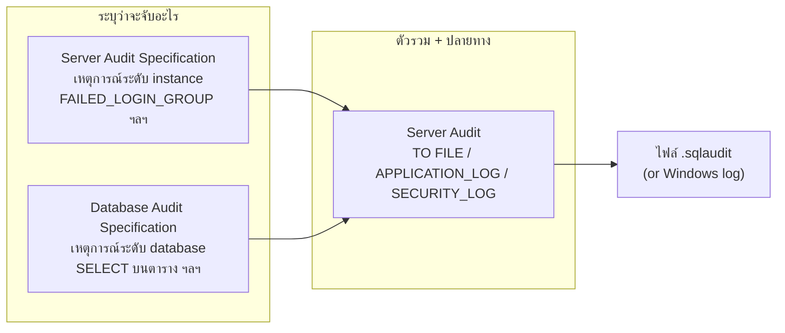

# Section 02 — SQL Server Audit: กลไก Audit ทางการของ Database Engine

SQL Server Audit คือกลไก audit ที่ "อยู่นอก" database — เหตุการณ์ถูกบันทึกโดย engine โดยตรง ผู้ใช้/ผู้ดูแล database ธรรมดาไม่มีช่องทางแก้ไขหรือลบ log ได้ง่าย ๆ จึงเป็นเครื่องมือมาตรฐานที่ตอบข้อกำหนด compliance ส่วนใหญ่ (ตรวจสอบ login ล้มเหลว, ใคร SELECT ตารางไหน, ใครเปลี่ยนโครงสร้าง) สคริปต์เก่าของหลักสูตรนี้เคยใช้ SQL Trace แต่แนวปฏิบัติปัจจุบัน (และหน้า docs เอง) กำหนดให้ SQL Server Audit คือเครื่องมือ audit หลัก

## สถาปัตยกรรม: 3 ชิ้นที่ต้องจำ



| ชิ้น | ระดับ | หน้าที่ | ต่อ database ได้กี่ตัว |
|:-----|:------|:--------|:--------------------|
| **Server Audit** | instance | ปลายทางบันทึก (ไฟล์/Windows log) + คุมเวลา flush | หนึ่ง database ผูก spec ได้กับ audit หนึ่งตัว |
| **Server Audit Specification** | instance | รายการ **action groups** ระดับ server | 1 spec / audit |
| **Database Audit Specification** | database | รายการ **actions** หรือ groups ระดับ database | 1 spec / audit / database |

เหตุผลที่ออกแบบเป็น 3 ชิ้น: แยก "จะจับอะไร" (specification) ออกจาก "จะเก็บที่ไหน" (audit) — เปลี่ยนปลายทางโดยไม่ต้องแตะรายการเหตุการณ์ และ audit เดียวรวมเหตุการณ์จากหลาย database

## สร้าง Server Audit — ปลายทางและตัวเลือก

```sql
CREATE SERVER AUDIT LabAudit
TO FILE
(
    FILEPATH = 'C:\AuditLogs\',
    MAXSIZE = 100 MB,
    MAX_ROLLOVER_FILES = 10
)
WITH
(
    QUEUE_DELAY = 5000,        -- ms ที่ flush รอบละ 5000 (0 = ทันที, ช้าลง)
    ON_FAILURE = CONTINUE      -- ถ้าเขียน log ไม่ได้: CONTINUE หรือ SHUTDOWN
);
GO

ALTER SERVER AUDIT LabAudit WITH (STATE = ON);
```

ตัวเลือกสำคัญ:

| ตัวเลือก | ค่า | หมายเหตุ |
|:---------|:----|:---------|
| `TO FILE` | FILEPATH, MAXSIZE, MAX_ROLLOVER_FILES | ไฟล์ `.sqlaudit` — รูปแบบไบนารีอ่านด้วย `sys.fn_get_audit_file` เท่านั้น |
| `TO APPLICATION_LOG` / `TO SECURITY_LOG` | — | เขียนลง Windows Event Log (SECURITY_LOG ต้องกำหนด audit object access policy ของ Windows เพิ่ม) |
| `QUEUE_DELAY` | มิลลิวินาที | 5000 = ลด overhead เขียนไฟล์รอบละ 5 วินาที; 0 = เขียนทันที (strictest, ช้าสุด) |
| `ON_FAILURE` | CONTINUE / SHUTDOWN | SHUTDOWN = ปิด engine ทันทีถ้า audit เขียนไม่ได้ (compliance เข้มงวดสุด) — ใช้เมื่อ "ห้ามใช้ระบบโดยไม่มี audit" |
| `STATE = ON/OFF` | | เปิด/ปิดผ่าน ALTER เสมอ |

ข้อจำกัดเรื่องสิทธิ์: การสร้าง/จัดการ audit ต้อง `ALTER ANY SERVER AUDIT` (มีใน `sysadmin`); การอ่านไฟล์ audit ด้วย `sys.fn_get_audit_file` ต้อง `VIEW SERVER SECURITY AUDIT` บน server (ตั้งแต่ SQL Server 2022; รุ่น 2019 ลงไปใช้ `CONTROL SERVER`) — role ใหม่อย่าง `##MS_ServerSecurityStateReader##` (2022+) ให้สิทธิ์ฝั่งอ่านความปลอดภัยได้โดยไม่ต้องเป็น sysadmin ([fn_get_audit_file](https://learn.microsoft.com/sql/relational-databases/system-functions/sys-fn-get-audit-file-transact-sql?view=sql-server-ver17))

## Audit Actions และ Action Groups

- **Action Groups** (server spec และใช้ใน database spec ได้ด้วย) = ชุดเหตุการณ์รวมกัน ตัวที่ใช้บ่อย:

| Action Group | จับอะไร |
|:-------------|:--------|
| `FAILED_LOGIN_GROUP` | การล็อกอินที่ล้มเหลว |
| `SUCCESSFUL_LOGIN_GROUP` | การล็อกอินสำเร็จ |
| `SERVER_STATE_CHANGE_GROUP` | เปลี่ยนสถานะ service |
| `DATABASE_CHANGE_GROUP` | สร้าง/แก้/ลบ database |
| `SCHEMA_OBJECT_CHANGE_GROUP` | DDL ระดับ database |
| `SCHEMA_OBJECT_PERMISSION_CHANGE_GROUP` | GRANT/DENY/REVOKE |
| `DATABASE_LOGOUT_GROUP` / `SUCCESSFUL_DATABASE_AUTHENTICATION_GROUP` | ล็อกอิน/เอาท์ระดับ database |

([รายการทั้งหมด](https://learn.microsoft.com/sql/relational-databases/security/auditing/sql-server-audit-action-groups-and-actions?view=sql-server-ver17) — ควรเลือกเฉพาะที่ต้องใช้ เพราะจับกลุ่มใหญ่ = ไฟล์โตเร็ว)

- **Actions** (database spec เท่านั้น) = เหตุการณ์เจาะจงบน securable: `SELECT, INSERT, UPDATE, DELETE, EXECUTE, RECEIVE, REFERENCES` + `AUDIT GROUP ต่าง ๆ` ระดับ database รูปแบบ: `ADD (action ON securable BY principal)`

## Database Audit Specification

```sql
USE AdventureWorks2025;
GO
CREATE DATABASE AUDIT SPECIFICATION LabDbAuditSpec
FOR SERVER AUDIT LabAudit
ADD (SELECT, INSERT ON OBJECT::HumanResources.Employee BY public),
ADD (SELECT ON SCHEMA::Sales BY public),
ADD (SCHEMA_OBJECT_CHANGE_GROUP)
WITH (STATE = ON);
GO
```

อ่านบรรทัด `ADD` ได้ว่า "จับ SELECT+INSERT บนตาราง Employee ของทุกคน (public), SELECT ทั้ง schema Sales ของทุกคน และ DDL ทั้ง database" — `BY principal` กรองว่าจับเฉพาะใคร (`public` = ทุกคน มักใช้เป็น default แล้วกรองตอนอ่านผล; ระบุ user/role ชัดเจนก็ได้เพื่อลดขนาด log)

จัดการตัว spec: แก้ไขได้เฉพาะเมื่อ **STATE = OFF**:

```sql
ALTER DATABASE AUDIT SPECIFICATION LabDbAuditSpec WITH (STATE = OFF);
ALTER DATABASE AUDIT SPECIFICATION LabDbAuditSpec
ADD (SCHEMA_OBJECT_PERMISSION_CHANGE_GROUP);
ALTER DATABASE AUDIT SPECIFICATION LabDbAuditSpec WITH (STATE = ON);
```

## Server Audit Specification (ระดับ instance)

```sql
CREATE SERVER AUDIT SPECIFICATION LabServerAuditSpec
FOR SERVER AUDIT LabAudit
ADD (FAILED_LOGIN_GROUP)
WITH (STATE = ON);
```

Server spec จับเหตุการณ์ "ทั้ง instance" — ต่างจาก database spec ที่ผูกกับ database เดียว หนึ่ง audit มี spec ระดับ server ได้ตัวเดียว แต่รับ database spec จากหลาย database

## Audit เดียว หลาย Database — การรวมด้วย audit_guid

ความสัมพันธ์ระหว่าง spec กับ audit ผูกด้วย **`audit_guid`** (ไม่ใช่ชื่อ) — audit หนึ่งรับ Database Audit Specification จากหลาย database พร้อมกัน:

```sql
-- ดูว่า database spec แต่ละตัวชี้ไปที่ audit ไหน (ผ่าน GUID)
SELECT db_name() AS database_name, das.name AS db_spec,
       sa.name AS audit_name, das.is_state_enabled
FROM sys.database_audit_specifications das
LEFT JOIN sys.server_audits sa ON sa.audit_guid = das.audit_guid;
GO
```

เพราะไฟล์ audit หนึ่งรวมเหตุการณ์จากหลาย database คอลัมน์ `database_name` ในผล `fn_get_audit_file` จึงเป็นตัวกรองสำคัญตอนสืบค้น (Section 3)

ข้อจำกัดที่ควรรู้:

- Database หนึ่งมี Database Audit Specification ตัวเดียวต่อ audit หนึ่งตัว (ต้องการจับชุดเหตุการณ์เพิ่มใน database เดิม → เพิ่ม `ADD` ใน spec เดิม)
- Audit ทำงานกับ user database — ไม่สามารถสร้าง database audit spec บน `master/model/msdb` ได้
- การเปิด/ปิด audit (`STATE`) ผลต่อ spec ทั้งหมดที่ผูกอยู่ทันที

## ควบคุมปริมาณ log: trade-offs ที่ต้องตัดสิน

| ตัวแปร | ค่าเข้มงวด | ค่าประหยัด disk/ผลงาน | ความเสี่ยงอีกฝั่ง |
|:-------|:----------|:----------------------|:-----------------|
| `QUEUE_DELAY` | 0 (เขียนทันที) | 5000–60000 ms | log หายบางส่วนถ้าตายก่อน flush |
| `MAXSIZE` | เล็ก (หมุนไฟล์ถี่) | ใหญ่ | ไฟล์เดี่ยวโต อ่านช้าเวลาสืบค้น |
| `MAX_ROLLOVER_FILES` | มาก (เก็บนาน) | น้อย (ประหยัด disk) | ประวัติถูกทับก่อนถึงเวลา audit |
| `ON_FAILURE` | SHUTDOWN | CONTINUE | SHUTDOWN ทำระบบตายทั้ง instance เมื่อ disk เต็ม |

คำแนะนำเชิงปฏิบัติ: เริ่มแบบ `QUEUE_DELAY = 5000, ON_FAILURE = CONTINUE` + monitoring ขนาดโฟลเดอร์ เปลี่ยนไป SHUTDOWN เมื่อ compliance ขององค์กรระบุว่า "ระบบใช้งานไม่ได้หากไม่มี audit" เท่านั้น

## DMVs ที่เกี่ยวข้อง

| View / Function | ใช้ดูอะไร |
|:----------------|:----------|
| `sys.server_audits` | รายการ audit + สถานะ (is_state_enabled) |
| `sys.server_file_audits` | server_audits + ข้อมูลไฟล์ (จำนวนไฟล์ ขนาด ฯลฯ) |
| `sys.server_audit_specifications` | server specs ทั้งหมด |
| `sys.server_audit_specification_details` | รายการ action group ในแต่ละ server spec |
| `sys.database_audit_specifications` | database specs ของ database ปัจจุบัน |
| `sys.database_audit_specification_details` | รายการ action ในแต่ละ database spec |
| `sys.dm_audit_actions` | รายการ action/action group ทั้งหมด + คำอธิบาย |
| `sys.fn_get_audit_file` | **อ่านไฟล์ .sqlaudit** (หัวข้อหลัก Section 3) |

```sql
-- ตัวอย่าง: รายการ audit ใน instance + รายละเอียด database spec
SELECT name, is_state_enabled, status_desc FROM sys.server_audits;

SELECT sp.name AS spec_name, sd.audit_action_name, sd.class_desc,
       sd.schema_name, OBJECT_NAME(sd.major_id) AS object_name,
       sd.audited_result, sd.is_state_enabled
FROM sys.database_audit_specifications sp
JOIN sys.database_audit_specification_details sd ON sd.database_specification_id = sp.database_specification_id;
GO

-- ตรวจว่า action ที่ตั้งใจจับมีจริงในระบบ
SELECT name, class_desc, parent_class_desc, containing_group_name
FROM sys.dm_audit_actions
WHERE name IN ('SELECT', 'INSERT', 'FAILED_LOGIN_GROUP');
GO
```

## Azure SQL Audit (สั้น ๆ)

บน Azure SQL Database กลไกเดียวกันมีอยู่แต่วิธีเปิดต่างกัน: audit จัดการระดับ **server (logical server) ผ่าน Azure Portal / PowerShell / az cli** (เก็บผลใน Azure Storage account หรือ Log Analytics) แล้วเพิ่ม `CREATE DATABASE AUDIT SPECIFICATION` เฉพาะตัวเหตุการณ์ได้เหมือนกัน T-SQL ฝั่ง database spec ใช้ได้เหมือนกันทุกอย่าง ส่วน `CREATE SERVER AUDIT` ด้วย T-SQL ไม่ใช่วิธีทำบน Azure SQL DB — ใช้คำสั่ง `SET AUDIT` ระดับ server หรือ portal แทน ([Azure SQL auditing](https://learn.microsoft.com/azure/azure-sql/database/auditing-overview?view=azuresql))

จุดต่างที่ใช้งานจริง:

| ประเด็น | SQL Server on-prem | Azure SQL Database |
|:--------|:-------------------|:-------------------|
| ปลายทาง | ไฟล์ .sqlaudit / Windows log | Azure Storage blob / Log Analytics / Event Hub |
| เปิดระดับ | T-SQL `CREATE SERVER AUDIT` | Portal/PowerShell ระดับ logical server (default เปิดให้ทุก database) |
| อ่านผล | `sys.fn_get_audit_file` กับ path ไฟล์ | `sys.fn_get_audit_file` กับ blob URL |
| Retention | จัดการเอง (จำนวนไฟล์) | กำหนดใน storage setting (เช่น archive blob) |

## Audit เทียบกับ Extended Events — เลือกตัวไหนเมื่อไหร่

| โจทย์ | ตัวที่เหมาะ |
|:------|:-----------|
| พิสูจน์ต่อ auditor ว่ามี log แก้ไม่ได้ อ่านได้จากไฟล์นอก DB | SQL Server Audit |
| จับ "ใคร SELECT ตารางไหน" ระดับ compliance | SQL Server Audit |
| Monitoring performance / deadlock / query ช้า | Extended Events |
| จับเหตุการณ์เฉพาะจุดมาก ๆ แบบเบา ๆ (น้ำหนักต่ำกว่า) | Extended Events |

ทั้งคู่อยู่ใน engine เดียวกัน แต่ SQL Server Audit เน้น "หลักฐานที่ปกป้องจากผู้ดูแลระบบ" ขณะ XE เน้น "ความยืดหยุ่นของงาน monitoring"

## จับเหตุการณ์เฉพาะกลุ่มคนด้วย BY principal

พารามิเตอร์ `BY <principal>` ของ action ใน database spec คือตัวกรองแรกที่ตัด log ลงได้มหาศาล:

```sql
CREATE DATABASE AUDIT SPECIFICATION HrAuditSpec
FOR SERVER AUDIT LabAudit
-- จับเฉพาะทีม HR แก้ตารางสำคัญ (ไม่จับระบบ batch ที่รันทุกคืน)
ADD (INSERT, UPDATE, DELETE ON OBJECT::HumanResources.Employee
     BY HrWriterRole),
-- จับเฉพาะ login บริการของเว็บอ่านข้อมูลการเงิน
ADD (SELECT ON OBJECT::Finance.InvoiceHeader BY WebAppSvcUser),
-- แต่จับทุกคนที่ลบ (เหตุการณ์หายาก น้ำหนักต่ำ)
ADD (DELETE ON OBJECT::Finance.InvoiceHeader BY public)
WITH (STATE = ON);
```

ข้อแนะนำจากประสบการณ์ตรง ๆ:

- ใช้ `BY public` เฉพาะเหตุการณ์ที่เกิดน้อย (DELETE, DDL) — อย่าจับ `SELECT ... BY public` บนตารางร้อยล้านแถว เพราะทุก row-per-query เขียนลงไฟล์
- อ้าง role ที่วางไว้จาก Module 3 (เช่น `HR_Writer`) จะทำให้ log อ่านง่ายกว่าอ้าง user รายคน
- ระบบ batch ควรรันใน login เฉพาะ เพื่อกรองทิ้งตอนวิเคราะห์ (แทนที่จะไม่จับเลย — เก็บไว้สืบสวนเวลาเกิดเหตุ)

## สิ่งที่ SQL Server Audit จับไม่ได้ — รู้ก่อนผิดหวัง

| ความคาดหวัง | ความจริง |
|:------------|:---------|
| เก็บ "ค่าก่อน/หลัง" ของแถว | ไม่ได้ — เก็บ `statement` เดิม + เหตุการณ์; ค่าก่อน-หลังต้องใช้ temporal/trigger |
| จับทุกแถวใน bulk insert | บันทึก 1 event ต่อคำสั่ง (พอต่อ compliance ปกติ) |
| ป้องกันคนแก้ log ที่เขียนลง Windows log | ปลายทาง SECURITY_LOG คุมด้วย Windows (ต้องตั้ง audit object access policy ฝั่ง OS) — ใช่ เข้มกว่าไฟล์ แต่อ่านด้วย Event Viewer ไม่ใช่ fn_get_audit_file |
| Audit ตาราง tempdb | สร้าง database spec บน tempdb ไม่ได้ |

## ผลต่อ performance — วัดก่อนเชื่อ

ปัจจัยที่กำหนด overhead: (1) จำนวน event ที่ถูกจับต่อวินาที, (2) `QUEUE_DELAY`, (3) ปลายทาง (ไฟล์เร็วกว่า Windows log) แนวปฏิบัติเวลาเปิด audit ใหม่บนระบบจริง:

1. เริ่มตั้งค่า spec ที่ **ระดับ staging** เทียบ load เดียวกัน — วัด throughput/latency
2. ใช้ `QUEUE_DELAY = 5000` ก่อนเสมอ (ลด disk write frequency)
3. ทดสอบ "แย่สุด" คือ disk เต็ม — จำกัด `MAX_ROLLOVER_FILES` และให้ monitoring แจ้งก่อน disk ว่างน้อยกว่า 20% (ON_FAILURE = SHUTDOWN เฉพาะเมื่อข้อกำหนดบังคับ)
4. วัดขนาดไฟล์ต่อวัน → คำนวณ retention ที่ต้องเก็บ → ตั้ง `MAX_ROLLOVER_FILES` ให้พอและ archive ออกไป

## Deploy แบบ idempotent และพฤติกรรมหลัง restart

สคริปต์ audit ที่ดีต้องรันซ้ำได้ (ลบของเก่าก่อนสร้าง ตามรูปที่สคริปต์คู่มือทุกตัวในโมดูลนี้ใช้) และควรจำพฤติกรรม restart:

- audit ที่ถูกตั้ง `STATE = ON` **กลับมาเปิดเอง** เมื่อ SQL Server service รีสตาร์ท — ไม่ต้องมี option เพิ่ม (ต่างจาก XE session ที่ต้องตั้ง `STARTUP_STATE = ON`)
- Database Audit Specification เปิด-ปิดตามสถานะของตัวเอง และตามสถานะ audit ที่ผูก
- ตอนเกิดเหตุ restart ไฟล์ .sqlaudit ใหม่จะถูกเปิดขึ้น (ไฟล์เก่าไม่ถูกลบ) — วิเคราะห์ย้อนหลังข้ามไฟล์ได้ด้วย wildcard

## Starter pack — spec ชุด compliance ที่ใช้เปิดระบบใหม่ได้เลย

จุดเริ่มที่ดีสำหรับระบบที่ยังไม่มี audit เลย (จับพอประมาณ ไม่หนักจน disk ตาย):

```sql
-- Server level: เหตุการณ์ "หลังบ้าน" ที่ผู้ตรวจมักถาม
CREATE SERVER AUDIT SPECIFICATION ComplianceServerSpec
FOR SERVER AUDIT LabAudit
ADD (FAILED_LOGIN_GROUP),                       -- ใครพยายามเข้าไม่สำเร็จ
ADD (SERVER_STATE_CHANGE_GROUP),                -- service ตาย/เปิด
ADD (AUDIT_CHANGE_GROUP)                        -- ใครเปลี่ยนการตั้งค่า audit เอง!
WITH (STATE = ON);

-- Database level: กิจกรรมข้อมูล + DDL + การเปลี่ยนสิทธิ์
CREATE DATABASE AUDIT SPECIFICATION ComplianceDbSpec
FOR SERVER AUDIT LabAudit
ADD (DELETE ON DATABASE::AdventureWorks2025 BY public),   -- DELETE หายาก จับได้ถูก
ADD (SCHEMA_OBJECT_CHANGE_GROUP),                         -- DDL ทั้ง database
ADD (SCHEMA_OBJECT_PERMISSION_CHANGE_GROUP),              -- GRANT/DENY/REVOKE
ADD (DATABASE_PERMISSION_CHANGE_GROUP)
WITH (STATE = ON);
```

✅ **สังเกต**: `AUDIT_CHANGE_GROUP` มีไว้เฝ้า "ใครแก้ audit" — ถ้า log เองไม่คุมการเปลี่ยนแปลงของมัน ผู้ก่อการก็ปิด audit ก่อนทำผิดได้ หลังระบบนิ่งแล้วจึงเพิ่ม SELECT/INSERT บนตารางเฉพาะที่ควรจับ (ตามหัวข้อ BY principal) เพื่อไม่ให้ log บวม

## สรุป

- Server Audit = ปลายทาง; Server/Database Audit Specification = รายการเหตุการณ์; แก้ spec ต้องปิดก่อน
- เลือก action group เฉพาะที่จำเป็น; `QUEUE_DELAY` แลก overhead กับความเข้มงวด; `ON_FAILURE = SHUTDOWN` ใช้เมื่อ compliance ห้ามระบบวิ่งไม่มี audit
- ไฟล์ .sqlaudit อ่านด้วย `sys.fn_get_audit_file` เท่านั้น — วิธีอ่านและแก้ปัญหาที่พบบ่อยคือหัวข้อ Section 3

---

### 🚀 SQL Server 2025 & Modern Notes

- SQL Server Audit ยังเป็นกลไก audit ทางการเหมือนเดิมใน 2025 — คำสั่ง CREATE SERVER AUDIT ฯลฯ รันได้เหมือนรุ่น 2019/2022 ([SQL Server Audit](https://learn.microsoft.com/sql/relational-databases/security/auditing/sql-server-audit-database-engine?view=sql-server-ver17))
- **Ledger (2022+)** เติมช่องที่ audit log ธรรมดาไม่ครบ: พิสูจน์แบบเข้ารหัสว่า "ข้อมูลไม่ถูกแก้" ไม่ใช่แค่ "ถูกบันทึกแล้ว" ([Ledger overview](https://learn.microsoft.com/sql/relational-databases/security/ledger/ledger-overview?view=sql-server-ver17))
- บน SQL Server enabled by Azure Arc ใช้ **managed identity** ทำ outbound integration ต่าง ๆ รวมถึง backup to URL (2025) — แนวเดียวกันกับ audit/monitoring ที่ส่งผลขึ้น Azure ได้โดยไม่เก็บ secret
- SQL Trace ที่เคยเทียบกันในหลักสูตรเก่า = deprecated; อย่าเริ่มงานใหม่ ([Deprecated features](https://learn.microsoft.com/sql/database-engine/deprecated-database-engine-features?view=sql-server-ver17))

> อ้างอิง: [CREATE SERVER AUDIT](https://learn.microsoft.com/sql/t-sql/statements/create-server-audit-transact-sql?view=sql-server-ver17), [CREATE DATABASE AUDIT SPECIFICATION](https://learn.microsoft.com/sql/t-sql/statements/create-database-audit-specification-transact-sql?view=sql-server-ver17), [Audit action groups and actions](https://learn.microsoft.com/sql/relational-databases/security/auditing/sql-server-audit-action-groups-and-actions?view=sql-server-ver17)
