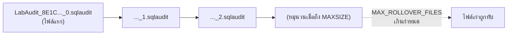

# Section 03 — Managing Audit: สืบค้นข้อมูล Audit และแก้ปัญหาที่พบบ่อย

สร้าง audit ได้แล้ว (Section 2) ครึ่งหนึ่งของงาน อีกครึ่งคือ **อ่านมัน** และรับมือเมื่อ audit ไม่ทำงานอย่างที่คิด — สองเรื่องนี้เกิดขึ้นจริงบ่อยกว่าที่คิด: audit ที่ "เปิดแล้ว" แต่ไม่มีไฟล์เกิดขึ้นเพราะ folder permission, audit ที่รีสตาร์ทแล้วปิดเอง, และขั้นตอนปิดลบที่ต้องทำตามลำดับจึงผ่าน

## อ่านไฟล์ audit ด้วย sys.fn_get_audit_file

ไฟล์ `.sqlaudit` เป็นรูปแบบไบนารีของ SQL Server — ไม่สามารถเปิดด้วย editor อ่านได้เอง วิธีมาตรฐานคือ DMF `sys.fn_get_audit_file`:

```sql
SELECT *
FROM sys.fn_get_audit_file
     ('C:\AuditLogs\LabAudit*', default, default)
ORDER BY event_time DESC;
```

อาร์กิวเมนต์ 3 ตัว:

| พารามิเตอร์ | ความหมาย |
|:-----------|:---------|
| `file_pattern` | path + wildcard ของไฟล์ audit เช่น `C:\AuditLogs\LabAudit*` (จุดสำคัญ: **ไม่ต้อง**ระบุชื่อไฟล์เต็มเพราะชื่อมี GUID); บน Linux ใช้ path Linux ได้ |
| `initial_file_name` / `audit_record_offset` | จุดเริ่มอ่าน — ใส่ `default` = อ่านจากต้นทุกไฟล์ที่ตรง pattern |

คอลัมน์ที่ใช้บ่อยในผลลัพธ์:

| คอลัมน์ | เนื้อหา |
|:--------|:-------|
| `event_time` | เวลาที่เกิดเหตุการณ์ (UTC) |
| `action_id` / `class_type` | ชนิดเหตุการณ์ (ตาราง legend ด้านล่าง) |
| `sequence_number` | ลำดับของ record ในเหตุการณ์เดียวที่ใหญ่เกิน buffer ต้องแบ่งเขียน |
| `succeeded` | 1 = สำเร็จ, 0 = ล้มเหลว (สำหรับ event อื่นที่ไม่ใช่ login: หมายถึง permission check ผ่าน/ไม่ผ่าน) |
| `server_principal_name` / `server_principal_sid` | login ที่กระทำ |
| `session_server_principal_name` | login ต้นทางของ session (เมื่อมี context switch เช่น EXECUTE AS) |
| `database_principal_name` | user ระดับ database ที่กระทำ |
| `object_name`, `schema_name`, `database_name` | object/schema/database ที่ถูกแตะ |
| `statement` | คำสั่งที่เกิดขึ้นจริง (nvarchar(4000)) |
| `application_name`, `client_ip`, `host_name` | แอป/เครื่องที่เรียก (มีตั้งแต่ SQL Server 2017) |
| `session_id`, `server_instance_name` | บริบท session / instance |
| `transaction_id` | จับเหตุการณ์หลายอันใน transaction เดียวกัน |

> **จุดละเอียดเรื่องบริบท**: เมื่อรัน `EXECUTE AS USER = 'X'` ใน session ที่ล็อกอินเป็น `Y` ไฟล์จะบันทึก `server_principal_name = Y` (login ต้นทางไม่เปลี่ยน) แต่ `database_principal_name = X` — ใช้จำแนก "ใครจริง" กับ "รันในบริบทใคร"

### action_id legend ที่เจอบ่อย

| action_id | เหตุการณ์ |
|:----------|:----------|
| `SL` / `IN` / `UP` / `DL` | SELECT / INSERT / UPDATE / DELETE |
| `EX` | EXECUTE (proc/function) |
| `CR` / `DF` / `AL` | CREATE / DROP / ALTER |
| `LGIS` / `LGIF` / `LGOU` | login success / login failed / logout |
| `GR` / `DR` / `DN` | GRANT / DENY / REVOKE |
| `PWCU` | password change |
| `DAG` / `SAG` | database / server audit action group events |

รายการครบดูได้จาก `sys.dm_audit_actions` (มีคำอธิบายของทุก action และกลุ่มที่มันอยู่)

### ข้อจำกัดที่ต้องรู้ของ fn_get_audit_file

- `file_pattern` **ต้องมีชื่อไฟล์/wildcard** — ส่งแค่ path จะ error; ใช้ `C:\AuditLogs\LabAudit*` เพื่อคว้าทุกไฟล์ของ audit นั้น
- ใช้อ่าน audit ที่ปลายทางเป็น **ไฟล์** เท่านั้น — audit ที่ `TO APPLICATION_LOG`/`TO SECURITY_LOG` ต้องอ่านด้วย Event Viewer ฝั่ง Windows
- สิทธิ์: SQL Server 2022+ ต้องการ `VIEW SERVER SECURITY AUDIT` (รุ่นเก่าคือ `CONTROL SERVER`)
- ผลมาเป็น **แถวต่อ record** — เหตุการณ์ใหญ่ (statement ยาว) จะถูกแบ่งหลายแถวตาม `sequence_number` ให้มองหา record แรก (sequence_number = 0) เวลาสรุป

ตัวอย่าง query ที่ใช้งานจริง — กรองตาม session ของตัวเองเวลาทดสอบ:

```sql
SELECT event_time, action_id, object_name, statement, succeeded
FROM sys.fn_get_audit_file('C:\AuditLogs\LabAudit*', default, default)
WHERE session_id = @@SPID
ORDER BY event_time DESC;
```

> **ทริคเวลาทดสอบ**: เมื่อรัน `EXECUTE AS USER = '...'` ใน session เดียวกัน เหตุการณ์ในไฟล์ audit จะบันทึก principal ที่สวม (ผล audit ตาม execution context) — ใช้จำลองการ audit user ทั่วไปได้โดยไม่ต้องล็อกอินหลาย session

### โครงสร้างไฟล์ audit log

ไฟล์ที่เกิดจาก audit หนึ่งตัวมีรูปแบบ: `<AuditName>_<GUID>_<N>.sqlaudit`



- ไฟล์ใหม่ถูกสร้างเมื่อ: (1) ขนาดถึง `MAXSIZE`, (2) service restart, (3) เปิด/ปิด audit
- เมื่อไฟล์เกิน `MAX_ROLLOVER_FILES` ไฟล์เก่าสุดถูกเขียนทับ — ตั้ง retention ให้ตรงข้อกำหนดเก็บ log ขององค์กร (เช่น PDPA/ISO ที่ต้องเก็บ 1 ปี ต้องมี process archive ไฟล์ออกไปเก็บที่อื่น)
- ไฟล์สองชุดจาก audit ต่างชื่อไม่ปนกันเพราะ GUID ในชื่อไฟล์

## เครื่องมืออ่าน .sqlaudit อื่น ๆ (T-SQL ไม่ใช่ทางเดียว)

- **SSMS Log File Viewer**: ใน Object Explorer → Security → Audits → คลิกขวา audit → View Audit Logs — มีกรอก filter เหตุการณ์/เวลา ใช้เวลาสืบสวนแบบ manual สะดวกกว่า T-SQL
- **PowerShell**: อ่านผ่าน `Invoke-Sqlcmd` กับ `fn_get_audit_file` เพื่อทำ pipeline แจ้งเตือน/ส่ง SIEM
- ไฟล์ `.sqlaudit` อ่านข้ามเครื่องได้จาก instance ใด ก็ตามที่รุ่น SQL Server ไม่เก่ากว่าตอนสร้าง — ย้ายไปเครื่องตรวจสอบแล้วอ่านด้วย DMF เดิมได้

## แผน retention/archive ให้เป็นระบบ

สิ่งที่ควรอยู่ใน runbook ตั้งแต่วันแรกที่เปิด audit:

| งาน | ความถี่ | เครื่องมือ |
|:----|:--------|:----------|
| ตรวจ status ของ audit ทุกตัว (`sys.server_audits`) | รายวัน (Agent job) | query + Database Mail |
| ขนาดโฟลเดอร์ audit log | รายชั่วโมง | monitoring/PowerShell |
| ย้ายไฟล์ .sqlaudit เก่าไป archive (share/blob) | รายวัน/รายสัปดาห์ | SQL Agent job step (CmdExec/PowerShell) |
| นำเข้า snapshot ลงตารางวิเคราะห์ | รายวัน | `SELECT INTO` จาก `fn_get_audit_file` |
| ลบไฟล์ที่เกิน retention | ตามข้อกำหนด | script ฝั่ง OS |

หมายเหตุ: ไฟล์ที่ย้ายออกจาก FILEPATH ไปแล้ว SQL Server ไม่ลบให้เอง — ตัว `MAX_ROLLOVER_FILES` คุมเฉพาะไฟล์ที่ยังอยู่ใน path เดิม

## ปัญหาที่พบบ่อยและวิธีแก้

### 1. Audit สร้างแล้ว fail เพราะ folder permission

อาการ: `CREATE SERVER AUDIT ... STATE = ON` error 33223 หรือคล้ายกัน ("...does not have permission to access or create...") เหตุผล: SQL Server **service account** (ไม่ใช่ user ของคุณ) ต้องเขียนได้ที่ FILEPATH แก้ทางเลือก:

- สร้างโฟลเดอร์และให้สิทธิ์ Modify แก้ service account (เช่น `NT Service\MSSQLSERVER`)
- หรือเลือกโฟลเดอร์ที่ service เขียนได้อยู่แล้ว เช่น default data directory
- บน Linux container: path ต้องอยู่ใน filesystem ของ container และเจ้าของเป็น `mssql`

### 2. Audit รีสตาร์ทแล้ว "ปิด" เอง / สถานะประหลาด

สถานะของ audit/spec เก็บใน metadata และกลับมาตามที่ตั้งไว้หลัง restart — แต่กรณี `ON_FAILURE = CONTINUE` เมื่อ engine ขึ้นมาแล้วเขียนไฟล์ไม่ได้ จะเห็น `status_desc` เป็น AFTER_ERROR / MSSQL_AUDIT... ตรวจเสมอด้วย:

```sql
SELECT name, is_state_enabled, status_desc, status_change_dt
FROM sys.server_audits;
```

ถ้า status ไม่ใช่ ON/AFTER_START ให้ตรวจ folder permission ก่อน แล้ว `ALTER SERVER AUDIT ... WITH (STATE = ON)` ใหม่

### 3. ลบ audit ไม่ได้ (มี spec ผูกอยู่ / ยังเปิดอยู่)

ลำดับที่ถูกต้องเสมอ:

```sql
-- 1) ปิด + ลบ database specs ที่ผูกกับ audit นี้
ALTER DATABASE AUDIT SPECIFICATION LabDbAuditSpec WITH (STATE = OFF);
DROP DATABASE AUDIT SPECIFICATION LabDbAuditSpec;

-- 2) ปิด + ลบ server specs
ALTER SERVER AUDIT SPECIFICATION LabServerSpec WITH (STATE = OFF);
DROP SERVER AUDIT SPECIFICATION LabServerSpec;

-- 3) ปิด + ลบ audit (ทำท้ายสุด)
ALTER SERVER AUDIT LabAudit WITH (STATE = OFF);
DROP SERVER AUDIT LabAudit;
```

พยายาม DROP โดย audit ยัง STATE = ON จะ error 33005; ลบ audit ก่อนลบ spec ก็ error เหมือนกัน — ข้อความ error บอกชัดว่าอะไรผูกอยู่

### 4. ไฟล์ audit โตเร็ว / disk เต็ม

สาเหตุที่พบ: จับ group ใหญ่เกินจำเป็น (เช่น `BATCH_COMPLETED_GROUP` บน workload หนัก) หรือจับ SELECT ทั้ง schema ให้ `public` วิธีจัดการ: ลด scope ของ spec (จับเฉพาะ object/principal จริง), เพิ่ม `MAX_ROLLOVER_FILES` ตามจำนวน disk รับได้, ตั้ง monitoring ขนาดโฟลเดอร์

### 5. อ่านไฟล์ย้อนหลังจากเครื่องอื่น

`sys.fn_get_audit_file` อ่านไฟล์จาก path ใด ๆ ที่ SQL Server เห็น รวมถึง UNC share (`\\fileserver\audit\*`) — ย้ายไฟล์เก็บ archive ที่ share แล้วอ่านย้อนหลังด้วย DMF เดิมได้ โดยไม่ต้องมี instance ที่สร้างไฟล์นั้นอยู่ด้วย

## ทำรายงานจาก audit — ตัวอย่างรูปแบบ query ที่ใช้ซ้ำได้

```sql
-- 1) ใครอ่านตารางนี้บ้างใน 7 วันล่าสุด (นับจำนวนครั้ง)
SELECT server_principal_name, COUNT(*) AS reads
FROM sys.fn_get_audit_file('C:\AuditLogs\LabAudit*', default, default)
WHERE action_id = 'SL'
  AND object_name = 'EmployeePayHistory'
  AND event_time >= DATEADD(DAY, -7, SYSDATETIME())
GROUP BY server_principal_name
ORDER BY reads DESC;

-- 2) กิจกรรม login ล้มเหลว ณ ช่วงเวลาไหนบ่อยที่สุด
SELECT CAST(event_time AS date) AS day, COUNT(*) AS failed_logins
FROM sys.fn_get_audit_file('C:\AuditLogs\LabAudit*', default, default)
WHERE action_id = 'LGIF'
GROUP BY CAST(event_time AS date)
ORDER BY day DESC;

-- 3) เก็บผลลง staging table เพื่อวิเคราะห์ต่อ (แทน query ไฟล์ทุกครั้ง)
SELECT *
INTO Lab.AuditSnapshot
FROM sys.fn_get_audit_file('C:\AuditLogs\LabAudit*', default, default)
WHERE event_time >= DATEADD(DAY, -30, SYSDATETIME());
```

✅ **สังเกต**: `fn_get_audit_file` ใช้ใน SELECT INTO ได้ปกติบน SQL Server — ทำ "snapshot รายวัน" ด้วย SQL Server Agent job (Module 9) ได้สะดวก

## จัดการ lifecycle ของ audit รวม ๆ

```sql
-- ปิด audit ชั่วคราว (เช่นระหว่าง load ข้อมูลใหญ่)
ALTER SERVER AUDIT LabAudit WITH (STATE = OFF);
-- ... งาน batch ...
ALTER SERVER AUDIT LabAudit WITH (STATE = ON);

-- ดูว่า spec ไหนผูกกับ audit ไหน (ก่อนจะปรับโครงสร้าง)
SELECT sa.name AS audit_name, sa.is_state_enabled,
       sas.name AS server_spec
FROM sys.server_audits sa
LEFT JOIN sys.server_audit_specifications sas
     ON sas.audit_guid = sa.audit_guid;
GO

SELECT db_name() AS database_name, das.name AS db_spec,
       das.audit_guid, sa.name AS audit_name
FROM sys.database_audit_specifications das
LEFT JOIN sys.server_audits sa ON sa.audit_guid = das.audit_guid;
GO
```

## ตารางอาการ → สาเหตุ → ทางแก้ (เฉพาะเหตุการณ์ที่เจอบ่อยใน field)

| อาการ | สาเหตุที่พบจริง | ทางแก้ |
|:------|:----------------|:-------|
| audit เปิด STATE=ON แต่ไม่มีไฟล์เกิด | service account เขียนโฟลเดอร์ไม่ได้ | ให้สิทธิ์ Modify แก้ service account; ดู error ใน ERRORLOG |
| `fn_get_audit_file` error MSG_INVALID_AUDIT_FILE | pattern ชี้ไปที่ไฟล์ non-audit (เช่น .xel) หรือ path ผิด | ใช้ pattern รูป `<name>*` ให้ตรงชื่อ audit |
| อ่านไฟล์ได้บาง audit เท่านั้น | audit ที่ TO APPLICATION_LOG/SECURITY_LOG อ่านด้วย T-SQL ไม่ได้ | ใช้ Event Viewer ฝั่ง Windows |
| event ในไฟล์ "ค้าง 5 วินาที" | QUEUE_DELAY = 5000 เป็น behavior ปกติ | ตั้ง 0 เฉพาะช่วงทดสอบ |
| log หายบางช่วงเวลา | ON_FAILURE=CONTINUE + เขียนไม่ได้ช่วงนั้น | ตรวจ ERRORLOG, พิจารณา SHUTDOWN หาก compliance บังคับ |
| ไฟล์เก่าหาย | MAX_ROLLOVER_FILES หมุนวนทับ | เพิ่มจำนวน + archive ออกไปเก็บ |

## รายงานรายสัปดาห์ที่ compliance มักขอ — ตัวอย่างจริง

ผู้ตรวจ (auditor) มักขอสามรายงานพื้นฐาน เตรียมเป็น SQL ไว้ล่วงหน้าจะตอบได้ในหนึ่งจอ:

```sql
DECLARE @from date = DATEADD(DAY, -7, CAST(SYSDATETIME() AS date)),
        @to   date = CAST(SYSDATETIME() AS date);

-- (1) กิจกรรม login ล้มเหลวต่อวัน + เครื่องที่มา (จับ brute force)
SELECT CAST(event_time AS date) AS day, client_ip, COUNT(*) AS fails
FROM sys.fn_get_audit_file('C:\AuditLogs\LabAudit*', default, default)
WHERE action_id = 'LGIF'
  AND CAST(event_time AS date) BETWEEN @from AND @to
GROUP BY CAST(event_time AS date), client_ip
ORDER BY fails DESC;

-- (2) ใครลบข้อมูล (DELETE เหตุการณ์หายาก — ต้องมี 0 แถวในอุดมคติ)
SELECT event_time, server_principal_name, object_name, statement
FROM sys.fn_get_audit_file('C:\AuditLogs\LabAudit*', default, default)
WHERE action_id = 'DL'
  AND CAST(event_time AS date) BETWEEN @from AND @to
ORDER BY event_time;

-- (3) ใครแก้สิทธิ์/โครงสร้าง (เหตุการณ์พิเศษที่ต้องอธิบายทุกครั้ง)
SELECT event_time, server_principal_name, action_id, object_name, statement
FROM sys.fn_get_audit_file('C:\AuditLogs\LabAudit*', default, default)
WHERE action_id IN ('GR', 'DN', 'DR', 'CR', 'DF', 'AL')
  AND CAST(event_time AS date) BETWEEN @from AND @to
ORDER BY event_time;
GO
```

ใส่คำสั่งเหล่านี้ใน SQL Server Agent job ที่ส่งผลผ่าน Database Mail ทุกสัปดาห์ — เวลาถูกขอหลักฐานก็ส่งจดหมายฉบับเดียวจบ

## ปิด/เปิด audit อย่างมีวินัย — สิ่งที่ควรทำทุกครั้ง

เพราะ audit เป็นหลักฐานทางกฎหมาย การเปิด-ปิดต้องมีบันทึกของมันเอง:

- บันทึกเวลา + เหตุผล + ผู้อนุมัติทุกครั้งที่ `STATE = OFF` (ปกติเก็บใน ticket หรือ runbook log)
- `AUDIT_CHANGE_GROUP` (server spec) คือตัวจับ "ใครเปลี่ยน audit" — ตรวจไฟล์เพื่อยืนยันว่าคนเปิด/ปิดคือคนที่ได้อนุมัติ
- หลังเปิดใหม่ ตรวจว่า spec ทั้งหมดกลับมา `is_state_enabled = 1` และไฟล์ใหม่กำลังเขียน (ไฟล์ที่มี timestamp ปัจจุบัน)

## สรุป

- `sys.fn_get_audit_file('path\name*', default, default)` คือวิธีอ่าน .sqlaudit เดียวที่ทางการ — กรองด้วย session_id ยามทดสอบ
- ไฟล์หมุนวนตาม MAXSIZE/MAX_ROLLOVER_FILES — ออกแบบ retention ให้ตรงข้อกำหนด
- ปัญหาสามข้อที่ต้องจำ: folder permission (สาเหตุอันดับหนึ่ง), สถานะหลัง restart, ลำดับปิด-ลบ spec ก่อน audit

Section 4 ขยับไปฝั่งการเข้ารหัส — TDE, Always Encrypted และ DDM ซึ่งทำงานคู่กับ audit ได้ (audit SELECT บนคอลัมน์ที่ masked ก็ทำได้ปกติ)

---

### 🚀 SQL Server 2025 & Modern Notes

- SQL Server Audit ทั้ง syntax และ DMV ยังคงเดิมใน 2025 — สคริปต์เก่าย้ายมารันได้ตรง ๆ ([SQL Server Audit](https://learn.microsoft.com/sql/relational-databases/security/auditing/sql-server-audit-database-engine?view=sql-server-ver17))
- **Ledger (2022+)** เป็นทางเลือก audit "แก้ไม่ได้" ระดับข้อมูล — digest เข้ารหัสตรวจย้อนหลังได้ ([Ledger overview](https://learn.microsoft.com/sql/relational-databases/security/ledger/ledger-overview?view=sql-server-ver17))
- ผู้ที่ควรอ่าน audit log: มอบ `VIEW SERVER STATE` ผ่าน **fixed server role `##MS_ServerSecurityStateReader##` (2022+)** แทนการเป็น sysadmin ([Server-level roles](https://learn.microsoft.com/sql/relational-databases/security/authentication-access/server-level-roles?view=sql-server-ver17))
- `ALTER TRACE` สิทธิ์เก่าของ SQL Trace ไม่ควรใช้มอบใหม่แล้ว (trace deprecated) — ใช้ role ใหม่ตามข้างบนแทน

> อ้างอิง: [sys.fn_get_audit_file](https://learn.microsoft.com/sql/relational-databases/system-functions/sys-fn-get-audit-file-transact-sql?view=sql-server-ver17), [SQL Server Audit](https://learn.microsoft.com/sql/relational-databases/security/auditing/sql-server-audit-database-engine?view=sql-server-ver17)
