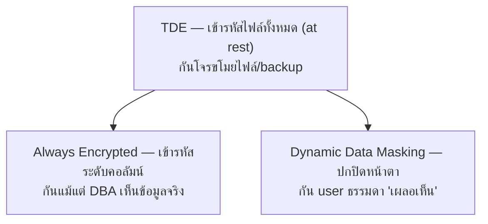
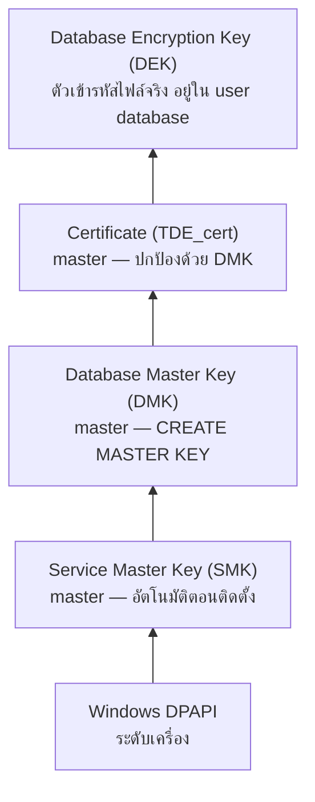

# Section 04 — Encryption: TDE, Always Encrypted, Dynamic Data Masking และ EKM

Audit บอกให้รู้ว่าเกิดอะไรขึ้น แต่ไม่กันข้อมูลรั่ว — คนได้ไฟล์ .mdf/.bak ไปก็ยังเปิดอ่านได้หมดถ้าไม่มีการเข้ารหัส SQL Server มีเครื่องมือเข้ารหัส 3 ระดับที่ครอบภัยคนละแบบ และ DBA ที่ดีต้องเลือกให้ตรงภัย เพราะทั้งสามตัว **ไม่ได้แทนกัน** แต่ซ้อนกันได้:



## TDE — Transparent Data Encryption

TDE เข้ารหัส **ไฟล์ฐานข้อมูลทั้งหมด** (data + log) ณ จุดเขียนลง disk และถอดรหัสเมื่ออ่านเข้า memory โปร่งใสต่อแอปทุกตัว (ไม่ต้องแก้โค้ด) จุดขายคือทำลายมูลค่าของ "ไฟล์ที่ถูกขโมย" — copy .mdf หรือ .bak ไปเปิดเครื่องอื่นไม่ได้

### ลำดับคีย์ (Encryption Hierarchy)



ความหมายเชิงปฏิบัติ: **cert อยู่ที่ master ของเครื่องต้นเท่านั้น** — ไฟล์ DB ที่เข้ารหัสจึงเปิดได้เฉพาะเครื่องที่มี cert เดียวกัน นี่ทั้งเป็นคุณสมบัติ (กันขโมยไฟล์) และเป็นภาระ (ย้าย DB ต้องยก cert ไปด้วยเสมอ)

### เปิด TDE — 4 ขั้น

```sql
USE master;
GO

-- 1) DMK ใน master (มีอยู่แล้วใน instance จริงส่วนใหญ่ — ตรวจด้วย sys.databases/is_master_key_encrypted_by_server)
CREATE MASTER KEY ENCRYPTION BY PASSWORD = 'Pa$$w0rd2025';
GO

-- 2) Certificate ปกป้องด้วย DMK
CREATE CERTIFICATE TDE_Cert WITH SUBJECT = 'TDE certificate for AdventureWorks2025';
GO

-- 3) DEK ใน user database (AES_256 เป็นค่าที่ใช้ทั่วไป)
USE AdventureWorks2025;
GO
CREATE DATABASE ENCRYPTION KEY
WITH ALGORITHM = AES_256
ENCRYPTION BY SERVER CERTIFICATE TDE_Cert;
GO

-- 4) เปิดใช้
ALTER DATABASE AdventureWorks2025 SET ENCRYPTION ON;
GO
```

ตรวจสถานะด้วย DMV `sys.dm_database_encryption_keys`:

```sql
SELECT d.name, d.is_encrypted, ek.encryption_state, ek.percent_complete,
       ek.key_algorithm, ek.key_length
FROM sys.dm_database_encryption_keys ek
JOIN sys.databases d ON d.database_id = ek.database_id;
```

สคริปต์สาธิตเปิด TDE ครบทั้งขั้น (มี cleanup คืนสภาพ) อยู่ที่ [`Scripts/01_TDE_Hierarchy.sql`](Scripts/01_TDE_Hierarchy.sql)

ค่า `encryption_state` สำคัญ: **3 = เข้ารหัสเสร็จ** (1 = unencrypted, 2 = กำลังเข้ารหัส, 4 = key change, 5 = กำลังถอดรหัส, 6 = กำลังเปลี่ยน protection)

ข้อเท็จจริงที่ต้องรู้เวลาเปิด TDE ([TDE docs](https://learn.microsoft.com/sql/relational-databases/security/encryption/transparent-data-encryption?view=sql-server-ver17)):

- `tempdb` ถูกเข้ารหัส **อัตโนมัติ** ทันทีที่มี database ไหนบน instance เปิด TDE (แต่ master/model/msdb เข้ารหัสไม่ได้)
- การเข้ารหัสทำผ่าน **encryption scan** หน้าถึงหลัง — ตรวจความคืบหน้าด้วย `percent_complete`; ตั้งแต่ SQL Server 2019 หยุด/เดินต่อได้ด้วย `ALTER DATABASE ... SET ENCRYPTION SUSPEND/RESUME`
- **Backup ของ DB ที่เปิด TDE ถูกเข้ารหัสด้วย DEK โดยอัตโนมัติ** — restore ต้องมี cert
- เปิด TDE แล้ว **สำรอง cert + private key ทันที** — SQL Server จะ warn (error 33091) จนกว่าจะ backup
- **Full-text / FILESTREAM ไม่ถูกเข้ารหัส** ด้วย TDE

### ย้ายฐานข้อมูลที่เปิด TDE — ต้องทำอะไรบ้าง (สรุปให้จำ)

1. `BACKUP CERTIFICATE TDE_Cert TO FILE = '...' WITH PRIVATE KEY (FILE = '...', ENCRYPTION BY PASSWORD = '...')` ที่เครื่องต้น
2. ที่เครื่องปลายทาง: สร้าง DMK ใน master (ถ้ายังไม่มี)
3. `CREATE CERTIFICATE TDE_Cert FROM FILE = '...' WITH PRIVATE KEY (FILE = '...', DECRYPTION BY PASSWORD = '...')`
4. Restore/attach ฐานข้อมูล — ทำงานได้เพราะ cert มาแล้ว

**ถ้าลืม step 3** restore จะ error 33111 และฐานข้อมูลใช้ไม่ได้ — และเก็บ cert backup ไว้ที่ปลอดภัยเสมอ สูญ cert = สูญฐานข้อมูล

### TDE กับ Backup Compression

เดิม TDE กับ backup compression ทำงานร่วมกันยาก (บีบข้อมูลที่เข้ารหัสแล้ว = ไม่คุ้ม) ตั้งแต่ SQL Server 2016 เพิ่ม optimized algorithm (ถอดหน้า → บีบ → เข้ารหัสใหม่) และ **ตั้งแต่ SQL Server 2019 CU5 ไม่ต้องตั้ง MAXTRANSFERSIZE แล้ว** — ระบุ `WITH COMPRESSION` หรือเปิด `backup compression default` ก็จะเพิ่ม MAXTRANSFERSIZE เป็น 128K ให้อัตโนมัติ ([BACKUP docs](https://learn.microsoft.com/sql/t-sql/statements/backup-transact-sql?view=sql-server-ver17)); ใน 2025 มี ZSTD algorithm ใหม่ที่เร็วกว่า

```sql
BACKUP DATABASE AdventureWorks2025
TO DISK = 'C:\Backups\AW2025_tde.bak'
WITH COMPRESSION, CHECKSUM;   -- ทำงานกับ TDE ได้ปกติตั้งแต่ 2019 CU5
```

### ปิด TDE ให้ถูกลำดับ (removal checklist)

การถอด TDE มีลำดับเคร่งครัด — ลับลำดับเมื่อไหร่จะค้าง:

1. `ALTER DATABASE ... SET ENCRYPTION OFF;` — เริ่ม decryption scan (ดูจาก `percent_complete` ใน DMV จน `encryption_state = 1`)
2. รอเสร็จ **ก่อน** รัน `DROP DATABASE ENCRYPTION KEY;` (ถ้ายังไม่เสร็จ DROP จะ fail)
3. `BACKUP LOG` หนึ่งครั้ง แล้วทำ full backup ใหม่ของฐานข้อมูลที่ถอดรหัสแล้ว
4. เก็บ certificate + DMK backup ไว้ต่อ — log เก่าบางส่วนอาจยังถูกเข้ารหัสจนกว่าจะ backup ครั้งใหม่

| ตัวแปรสถานะ | ค่า | ความหมาย |
|:------------|:----|:---------|
| `encryption_state` | 0/1 | ไม่มี DEK / ถอดรหัสแล้ว |
| | 2 / 5 | กำลังเข้ารหัส / กำลังถอดรหัส |
| | **3** | เข้ารหัสเสร็จสมบูรณ์ |
| | 4 / 6 | กำลังเปลี่ยน key / กำลังเปลี่ยน protection |
| `is_encrypted` (sys.databases) | 1 | database ถูก flag ว่าเปิด TDE |

อีกจุดที่คนไม่ค่อยเจอจนกว่าจะเจอ: เมื่อ TDE เปิด **instant file initialization ไม่ทำงาน** สำหรับไฟล์ฐานข้อมูลนั้น (growth จะช้าขึ้น) และ FILESTREAM data ไม่ถูกเข้ารหัสแม้ TDE เปิด

## EKM — Extensible Key Management (Azure Key Vault)

TDE default เก็บ cert ใน master — บางองค์กรต้องการให้คีย์อยู่ **นอก** SQL Server (HSM / Azure Key Vault) เพื่อ split roles: DBA รัน TDE ได้แต่ถอดคีย์เองไม่ได้ EKM คือตัวเชื่อม:

```sql
-- โครงร่าง (ต้องติดตั้ง SQL Server Connector / provider ของ vendor ก่อน)
CREATE CREDENTIAL Azure_EKM_Cred ...;
CREATE CRYPTOGRAPHIC PROVIDER AzureKeyVault_EKM ...;
CREATE ASYMMETRIC KEY TDE_EKM_AK
    FROM PROVIDER AzureKeyVault_EKM
    WITH PROVIDER_KEY_NAME = 'TDEKey', CREATION_DISPOSITION = OPEN_EXISTING;
-- แล้วใช้ ASYMMETRIC KEY แทน CERTIFICATE ใน CREATE DATABASE ENCRYPTION KEY
```

**ข่าวใหม่ SQL Server 2025**: EKM กับ Azure Key Vault และ Managed HSM รองรับ **Managed Identity** ผ่าน SQL Server enabled by Azure Arc — ไม่ต้องจัดการ secret/credential ใน SQL Server อีกต่อไป ([Managed Identity + EKM](https://learn.microsoft.com/sql/sql-server/azure-arc/managed-identity-extensible-key-management?view=sql-server-ver17)) ตรวจ provider ที่ติดตั้งแล้วด้วย:

```sql
SELECT * FROM sys.cryptographic_providers;
SELECT * FROM sys.asymmetric_keys;
```

## Always Encrypted (+ Secure Enclaves)

ต่างจาก TDE สุดขั้ว: Always Encrypted เข้ารหัส **ระดับคอลัมน์** และ SQL Server **ไม่เคยเห็นข้อมูลจริง** — เข้ารหัส/ถอดรหัสเกิดใน **client driver** (ADO.NET/ODBC) ที่ถือ key ผลคือแม้ DBA (sysadmin) query ตาราง ก็เห็นแค่ข้อความเข้ารหัส เหมาะกับข้อมูลอ่อนไหวสุด (เลขบัตร, รหัสสุขภาพ)

องค์ประกอบ: **Column Master Key (CMK)** เก็บใน key store ฝั่ง client (Windows cert store / Azure Key Vault) และ **Column Encryption Key (CEK)** ที่เข้ารหัสด้วย CMK อยู่ใน database:

```sql
-- 1) ลงทะเบียน metadata CMK (ตัว key จริงอยู่ใน key store ฝั่ง client)
CREATE COLUMN MASTER KEY CMK_AW
WITH (KEY_STORE_PROVIDER_NAME = N'MSSQL_CERTIFICATE_STORE',
      KEY_PATH = N'CurrentUser/My/THUMBPRINT');

-- 2) CEK — ค่าเข้ารหัสด้วย CMK (ENCRYPTED_VALUE) สร้างได้จาก SSMS wizard/PowerShell
--    รูปแบบ T-SQL (ENCRYPTED_VALUE ที่ถูกต้องมาจากเครื่องมือ ไม่พิมพ์มือได้):
-- CREATE COLUMN ENCRYPTION KEY CEK_AW
-- WITH VALUES
--     (COLUMN_MASTER_KEY = CMK_AW,
--      ALGORITHM = 'RSA_OAEP',
--      ENCRYPTED_VALUE = 0x...);

-- 3) คอลัมน์ที่เข้ารหัส
CREATE TABLE Customers.CreditCards
(
    Id int PRIMARY KEY,
    CardNumber nvarchar(50)
        COLLATE Latin1_General_BIN2 ENCRYPTED WITH
        (ENCRYPTION_TYPE = DETERMINISTIC,
         ALGORITHM = 'AEAD_AES_256_CBC_HMAC_SHA_256',
         COLUMN_ENCRYPTION_KEY = CEK_AW)
);
```

ประเภทการเข้ารหัส: `DETERMINISTIC` (ค่าเดิมคำนวณได้ค่าเดียว — join/equality ได้) กับ `RANDOMIZED` (ปลอดภัยสุด แต่ query แบบเทียบไม่ได้) ข้อจำกัดใหญ่คือคอลัมน์เข้ารหัสต้องใช้ collation BIN2 และคำสั่งที่เกี่ยว (UPDATE/JOIN) ทำได้จำกัด

ทางเลือก key store ฝั่ง client:

| Key store | ตั้งแต่ | เหมาะกับ |
|:----------|:-------|:---------|
| Windows Certificate Store (`MSSQL_CERTIFICATE_STORE`) | 2016 | แอป on-prem เครื่องเดียวกับ driver |
| Azure Key Vault / Managed HSM (`AZURE_KEY_VAULT`) | 2016 | แอปบน Azure, ต้องการ centralize key |
| Cryptography Provider CNG API (`MSSQL_CSP_PROVIDER`, `MSSQL_CNG_STORE`) | 2016 | HSM ของ vendor |

ข้อจำกัดที่ควรจำ (ก่อนออกแบบให้ทีมแอป): คอลัมน์เข้ารหัสใช้เป็น PK/FK/unique/default constraint หรือ computed column ไม่ได้, WHERE/GROUP BY/JOIN ทำได้จำกัด (DETERMINISTIC เฉพาะ equality — เทียบ LIKE/comparison ต้องใช้ secure enclave) และ connection ที่ query ต้องเปิด `Column Encryption Setting=Enabled` ไม่งั้นเห็น ciphertext (ซึ่งเป็น behavior ที่ต้องการ — DBA ตัวจริงจะเห็นแค่ตัวเข้ารหัส)

**Always Encrypted with secure enclaves** (SQL Server 2019+) เปิดพื้นที่ memory ปลอดภัยใน engine ให้คำนวณบนข้อมูลเข้ารหัสได้ (comparison, pattern matching, **JOIN/GROUP BY/ORDER BY** ใน 2022) โดยยังไม่เห็น plaintext — ลดข้อจำกัดของ DETERMINISTIC ลงได้มาก การสร้าง CMK/CEK/ตารางที่ใช้ enclave ทำผ่าน SSMS wizard หรือ PowerShell เป็นหลัก (สคริปต์ T-SQL ต้องเกี่ยวกับ key จริงฝั่ง client) — demo ที่รันได้จริงของหัวข้อนี้ใช้ metadata queries อยู่ใน [`Scripts/03_AlwaysEncrypted_Notes.sql`](Scripts/03_AlwaysEncrypted_Notes.sql)

## Dynamic Data Masking (DDM)

DDM คือ "ผ้าคลุมหน้า" ของคอลัมน์ — user ที่ไม่มีสิทธิ์ `UNMASK` จะเห็นค่าปกปิดแทนของจริง **แต่ข้อมูลบน disk ยังเป็น plaintext ทั้งหมด** — จุดที่ต้องย้ำที่สุดของหัวข้อนี้: DDM ไม่ใช่การเข้ารหัส ใครได้ไฟล์โดยตรงก็อ่านได้หมด

| Function | ผลกับ user ที่ไม่มี UNMASK | ตัวอย่างค่า |
|:---------|:--------------------------|:------------|
| `default()` | ปกปิดตาม type (int → 0, varchar → XXXX) | `0` |
| `email()` | เห็นอักษรแรก + domain | `sXXX@XXXX.com` |
| `partial(prefix,"...",suffix)` | คงหัว/ท้าย ปกปิดกลาง | `XXXX-XXXX-2211` |
| `random(from,to)` | ค่าสุ่มในช่วง (int type) | `7` |

```sql
CREATE TABLE Lab.EmployeePersonalData
(
    empid int NOT NULL PRIMARY KEY,
    salary int MASKED WITH (FUNCTION = 'default()') NOT NULL,
    email_address varchar(255) MASKED WITH (FUNCTION = 'email()') NULL,
    company_credit_card_number varchar(30)
        MASKED WITH (FUNCTION = 'partial(0,"XXXX-",4)') NULL
);
```

คุมด้วยสิทธิ์ `UNMASK` — ตั้งแต่ SQL Server 2022 ให้ระบุระดับคอลัมน์ได้ (granular): `GRANT UNMASK ON OBJECT::Lab.EmployeePersonalData (email_address) TO SomeUser;` ระดับ database ทั้งตัวคือ `GRANT UNMASK TO SomeUser;` สคริปต์สาธิต mask ครบ 4 แบบอยู่ที่ [`Scripts/02_DynamicDataMasking.sql`](Scripts/02_DynamicDataMasking.sql)

> **โพรงที่ต้องรู้**: user ที่มีสิทธิ์เรียก stored proc ตรง ๆ / สร้าง function เอง / query statistics อาจถอดค่าจริงผ่าน side-channel ได้ — Microsoft docs ระบุให้ตั้งใจ: DDM มีไว้ "จำกัดการเปิดเผยข้อมูลโดยไม่ตั้งใจ" ไม่ใช่กันผู้โจมตีตั้งใจ ใช้คู่กับ permission ที่เหมาะสม ([DDM docs](https://learn.microsoft.com/sql/relational-databases/security/dynamic-data-masking?view=sql-server-ver17))

ข้อจำกัดทางเทคนิคของคอลัมน์ที่มี mask (อ่านเช็กลิสต์เต็มจาก docs ก่อนใช้):

- ใช้ใน WHERE clause แบบเทียบค่าตรง ๆ ไม่ได้ (user ที่ไม่มี UNMASK จะหาค่าจริงผ่าน query ไม่ได้ตามออกแบบ)
- คอลัมน์ที่มี mask ต้องไม่เป็น PK/FK/key column
- ไม่มีผลกับข้อมูลที่ "เคยถูกอ่านแล้ว" ใน result cache ของแอป และไม่แทนการเข้ารหัส backup
- ALTER ... ADD MASKED ต้องใช้สิทธิ์ ALTER บนตาราง (เปิด/ปิด mask เป็น metadata operation เร็ว)

## เทียบให้ชัด: TDE vs Always Encrypted vs DDM

| ประเด็น | TDE | Always Encrypted | DDM |
|:--------|:----|:-----------------|:----|
| เข้ารหัสอะไร | ไฟล์ทั้ง DB (data+log+backup) | เฉพาะคอลัมน์ที่ระบุ | ไม่เข้ารหัสเลย (เพียงปกปิดหน้าตา) |
| ใครเห็น plaintext | ทุกคนที่ query ผ่าน SQL Server (รวม DBA) | เฉพาะ client ที่ถือ key | user ที่มี UNMASK (รวม DBA) |
| กัน "ขโมยไฟล์/backup" | ✅ โดยตรง | ✅ (ไฟล์หลุดก็เห็น ciphertext) | ❌ ไม่กันเลย |
| กัน "DBA อ่านข้อมูล" | ❌ | ✅ ตัวที่ออกแบบมาเพื่อโจทย์นี้ | ❌ |
| แก้แอป | ไม่ต้อง | ต้อง (client driver + connection string `Column Encryption Setting=Enabled`) | ไม่ต้อง |
| Query บนข้อมูลเข้ารหัส | ปกติทุกอย่าง | จำกัด (DETERMINISTIC = equality; enclave เพิ่มขอบเขต) | ปกติ (query engine เห็นของจริง) |
| Performance overhead | เล็กน้อย (I/O) | มากกว่าตามจำนวนคอลัมน์ | น้อยมาก |

ยุทธศาสตร์จริงมักใช้ซ้อน: **TDE ทั้ง database** (ฐาน baseline compliance) + **Always Encrypted เฉพาะคอลัมน์ที่ DBA ไม่ควรเห็น** + **DDM บนคอลัมน์ที่แอปต้องใช้จริงแต่ user บางกลุ่มไม่ควรเห็นเต็ม**

## คำถาม 5 ข้อก่อนเลือกเครื่องมือเข้ารหัส (decision checklist)

ตอบจบก่อนติดตั้ง — ทุกคำตอบชี้ไปที่เครื่องมือใดเครื่องมือหนึ่งและกันการเลือกซ้ำซ้อน:

1. **ภัยที่กังวลคือ "ไฟล์หลุด" หรือ "คนดูข้อมูล"?** ไฟล์หลุด → TDE; คนดู (รวม DBA) → Always Encrypted; แค่กัน user ทั่วไปเผลอเห็น → DDM
2. **ใครเป็นเจ้าของ key?** ต้องการแยกอำนาจจาก DBA → AKV/HSM (EKM); DBA จัดการเองได้ → cert ใน master
3. **แอปแก้โค้ดได้ไหม?** แก้ไม่ได้เลย → TDE/DDM เท่านั้น; แอปเขียนใหม่ด้วย driver ใหม่ → Always Encrypted เป็นไปได้
4. **ต้อง query ย้อนหลัง/aggregate บนข้อมูลเข้ารหัสไหม?** ต้องมาก → TDE (query ปกติ); เฉพาะ equality → AE DETERMINISTIC; มี enclave → AE แบบเต็ม
5. **ข้อกำหนดบอก "เก็บหลักฐานแบบแก้ไม่ได้" ด้วยไหม?** บอก → เพิ่ม Ledger (2022+) เข้าแผน

## การเข้ารหัสบน Azure (สั้น ๆ)

บน Azure SQL Database/MI กลไกเหมือนกัน + จัดการอัตโนมัติเพิ่ม: TDE เปิด default (service-managed key, สลับ TDE protector ผ่าน portal), BYOK ผ่าน **customer-managed key ใน Azure Key Vault** (TDE with CMK), Always Encrypted + DDM ใช้ได้เหมือนกัน ส่วน SQL Server on-prem ที่ผูก Azure (Arc) ได้ managed identity สำหรับ EKM/AKV ตามที่เกริ่นไว้

## TDE กับ Availability Group / Log Shipping / การย้ายที่พบบ่อย

ระบบ HA ที่คัดลอกข้อมูลไปเครื่องอื่นจะโดนกฎ cert เดิมเสมอ — เช็กลิสต์ย่อ:

| โทโพโลยี | ต้องทำบนปลายทางก่อนรับข้อมูล |
|:---------|:------------------------------|
| Always On AG | สร้าง DMK + cert จาก backup ไฟล์เดียวกัน **ทุก secondary** ก่อนเพิ่ม DB เข้า AG |
| Log Shipping | สร้าง cert ที่ secondary ก่อน restore log ชุดแรก |
| Backup/restore ปกติ | สร้าง cert ก่อน RESTORE ทุกครั้ง |
| Attach ไฟล์ .mdf โดยตรง | สร้าง cert ก่อน ATTACH — ไม่งั้น attach fail |

ระวังอีกจุด: **backup ที่ถูกเข้ารหัสด้วย DEK** ยังถูกบีบอัดได้ปกติ (ตั้งแต่ 2019 CU5) แต่ถ้าเจอระบบเก่าที่ระบุ `MAXTRANSFERSIZE = 65536` พร้อม COMPRESSION ให้ลบค่า MAXTRANSFERSIZE ออกเพื่อให้ระบบเลือก 128K เอง

## ลำดับ rollout เมื่อไปเปิดจริงในระบบ production

เพราะ TDE กระทบทั้ง instance (tempdb) และ backup chain การเปิดต้องมีแผน:

1. เปิดบน staging เทียบ workload จริง วัด `encryption scan` เวลา + backup เวลาใหม่
2. Backup certificate + DMK **ก่อน** ทำกับ production — ทดลอง restore จากไฟล์ backup จริงบนเครื่องปลายทางทันที (จำลองเหตุการณ์ย้ายเครื่องขณะยังไม่เกิดเหตุ)
3. แจ้งผู้เกี่ยว: backup system (ไฟล์ .bak กลายเป็นเข้ารหัส), HA/DR runbook (ต้องเพิ่มขั้นตอน cert), ทีม storage (disk growth ช่วง scan)
4. เปิดบน production ช่วง load ต่ำ และใช้ `SET ENCRYPTION SUSPEND` เมื่อ workload หนักแทรก
5. เพิ่มการเฝ้า `sys.dm_database_encryption_keys` เข้า daily health check ของทีม

## ข้อควรจำสั้น ๆ ก่อนไปแล็บ

- TDE: สำรอง cert "ทันที" หลังเปิด — หลักฐานว่าจำได้คือ error 33091 ที่เตือนจนกว่าจะ backup
- ย้าย DB: cert ต้องมาก่อน restore ทุกครั้ง (AG/Log Shipping/restore/attach ทุกรูปแบบ)
- AE: คอลัมน์เข้ารหัส = collation BIN2 + client driver ต้องเปิด CE setting
- DDM: จำไว้ว่า "บน disk เป็นของจริงเสมอ" — อย่าอ้างว่าเป็นการเข้ารหัสต่อ auditor

## สรุป

- TDE = กันไฟล์หลุด; ลำดับคีย์ DMK → cert → DEK; ย้าย DB ต้องยก cert; backup ที่เกิดหลังเปิด TDE เข้ารหัสอัตโนมัติ
- EKM เลื่อนคีย์ไป HSM/AKV; 2025 ใช้ managed identity ได้
- Always Encrypted = DBA ไม่เห็นข้อมูล; DDM = ปกปิดหน้าตาเท่านั้น (บน disk เป็น plaintext)
- สามตัวไม่แทนกัน — เลือกตามภัยที่ต้องป้องกัน

---

### 🚀 SQL Server 2025 & Modern Notes

- **EKM + Azure Key Vault/Managed HSM ด้วย Managed Identity (2025)** ผ่าน Azure Arc — ลดการเก็บ secret ใน SQL Server ([Managed Identity + EKM](https://learn.microsoft.com/sql/sql-server/azure-arc/managed-identity-extensible-key-management?view=sql-server-ver17))
- **OAEP padding สำหรับ RSA (2025)** — certificates/asymmetric keys รองรับ OAEP padding mode เพิ่มความปลอดภัยในการเข้ารหัส/ถอดรหัส ([Encryption hierarchy](https://learn.microsoft.com/sql/relational-databases/security/encryption/encryption-hierarchy?view=sql-server-ver17))
- **TDE + backup compression ไม่ต้องปรับ MAXTRANSFERSIZE อีกแล้ว** (ตั้งแต่ SQL Server 2019 CU5 ระบบจะเพิ่มเป็น 128K เองเมื่อ WITH COMPRESSION); 2025 เพิ่ม ZSTD ให้เร็วขึ้น ([BACKUP](https://learn.microsoft.com/sql/t-sql/statements/backup-transact-sql?view=sql-server-ver17))
- **DDM granular UNMASK (2022+)** — มอบสิทธิ์ถอด mask ระดับคอลัมน์ได้ ([Dynamic Data Masking](https://learn.microsoft.com/sql/relational-databases/security/dynamic-data-masking?view=sql-server-ver17))
- **Ledger (2022+)** เสริมความน่าเชื่อถือแบบ tamper-evident คู่กับ encryption ([Ledger](https://learn.microsoft.com/sql/relational-databases/security/ledger/ledger-overview?view=sql-server-ver17))

> อ้างอิง: [TDE](https://learn.microsoft.com/sql/relational-databases/security/encryption/transparent-data-encryption?view=sql-server-ver17), [Always Encrypted](https://learn.microsoft.com/sql/relational-databases/security/encryption/always-encrypted-database-engine?view=sql-server-ver17), [Dynamic Data Masking](https://learn.microsoft.com/sql/relational-databases/security/dynamic-data-masking?view=sql-server-ver17), [Move a TDE-protected database](https://learn.microsoft.com/sql/relational-databases/security/encryption/move-a-tde-protected-database-to-another-sql-server?view=sql-server-ver17)
