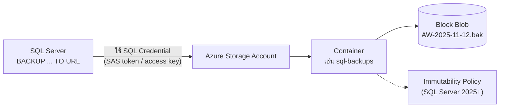

# Section 1 — กลยุทธ์การ Backup ให้เหมาะกับธุรกิจ (RPO/RTO, สื่อบันทึก, Retention)

DBA ไม่ได้ทำ backup เพราะเป็นขั้นตอนใน checklist — ทำเพราะต้องรับประกันคำถามสองข้อของผู้บริหาร: **"เราจะเสียข้อมูลเท่าไร"** และ **"ระบบจะกลับมาเร็วแค่ไหน"** ทั้งสองข้อมีชื่อเรียกวิชาการคือ RPO และ RTO และการตอบข้อสองข้อนี้อย่างซื่อสัตย์คือจุดเริ่มของกลยุทธ์ backup ที่ดี ก่อนที่จะเลือก recovery model หรือเขียนคำสั่ง `BACKUP` แม้แต่บรรทัดเดียว

กลยุทธ์ที่ไม่ได้ออกแบบมักลงเอยด้วยสองแบบที่ล้มเหลวทั้งคู่: แบบแรก backup ทุกอย่างทุกคืนแล้วไม่เคยทดสอบ restore (RPO จริงคือ 24 ชั่วโมง ทั้งที่ธุรกิจยอมได้แค่ 5 นาที) และแบบที่สอง backup ถี่มากแต่เก็บไว้ที่เดียวกับ server เอง (disaster เดียวพาทั้งเซิร์ฟเวอร์และ backup หายพร้อมกัน) — Section นี้ให้กรอบคิดที่กันทั้งสองหลุมนี้

## 1.1 RPO และ RTO — ตัวเลขสองตัวที่กำหนดทุกอย่าง

| ตัวชี้วัด | ความหมาย | คำถามจริง ๆ | คุมด้วยการตั้งค่าใดใน SQL Server |
|:----------|:----------|:-------------|:--------------------------------|
| **RPO** (Recovery Point Objective) | ปริมาณข้อมูล (วัดเป็นเวลา) ที่ยอมรับได้เมื่อสูญหาย | "เสียข้อมูล 5 นาทีที่ผ่านมาได้ไหม?" | **ช่วงเวลาระหว่าง log backup** (FULL recovery) — รวมถึง HA solution เช่น Availability Group (sync commit ให้ RPO ≈ 0) |
| **RTO** (Recovery Time Objective) | เวลาสูงสุดที่ระบบต้องกลับมาใช้งานได้หลังเกิดเหตุ | "ระบบต้องกลับมาภายในกี่นาที?" | **เวลา restore**: ขนาด backup, ความเร็วสื่อ, จำนวน log backup ที่ต้อง apply ตามลำดับ, แผนสำรองระดับ server (AG/FCI) ช่วยให้ RTO สั้นมาก |

```mermaid
flowchart LR
    subgraph เหตุการณ์
        A["Log backup 10:30"] --> B["Disaster 10:37"]
    end
    subgraph การวัด
        C["RPO = ข้อมูลที่หาย<br/>10:30 → 10:37 = 7 นาที"]
        D["RTO = เวลาจากเหตุการณ์<br/>ถึงระบบกลับมาใช้ได้"]
    end
    B -.-> C
    B -.-> D
```

**สูตรประมาณการจากช่วง backup** (สมมติใช้ FULL recovery แบบคลาสสิก ไม่มี AG):

- `RPO ≈ ช่วง log backup` — log backup ทุก 5 นาที → สูญได้สูงสุดประมาณ 5 นาที
- `RTO ≈ เวลา restore full + diff + (จำนวน log ที่ค้าง × เวลาต่อ log) + เวลา redo (recovery)` — log backup ถี่ขึ้นทำให้ RPO ดี แต่ **RTO แย่ขึ้น** เพราะต้อง apply log เยอะ — differential backup เข้ามาช่วยตัดจำนวน log ที่ต้อง apply (เรียนละเอียดใน [Section 3](../03_Backup_Types/README.md))

### ตัวอย่างคำนวณจริงทีละขั้น

โจทย์: ระบบวางบิลต้องการ RPO ≤ 10 นาที, RTO ≤ 60 นาที, ฐานข้อมูลขนาด 500 GB, เครื่อง restore (drill) ทำ full backup ได้ 200 GB/ชั่วโมง:

1. RPO 10 นาที → `BACKUP LOG` ทุก 10 นาที (Agent job, FULL recovery)
2. RTO: full backup 500 GB ÷ 200 GB/ชม. = 2.5 ชั่วโมง **เกิน RTO** — ทางแก้:
   - เพิ่ม differential ทุก 2 ชั่วโมง (diff มักเล็กกว่า full มาก เช่น 20–40 GB ≈ 10–15 นาที)
   - เหลือ log หลัง diff สูงสุด 12 ไฟล์ ≈ 2–5 นาที
   - RTO โดยประมาณ = 15 (diff) + 5 (log) + เผื่อ overhead ≈ **25 นาที** — ผ่านเป้า
3. สิ่งที่ต้องเขียนลงเอกสาร: ตาราง job ทุกตัว, ขนาด backup จริงจาก msdb และผล restore drill ล่าสุด

สคริปต์เดโมคำนวณจาก backup history จริงใน msdb: [Scripts/01_RPO_RTO_BackupInterval.sql](Scripts/01_RPO_RTO_BackupInterval.sql)

ตัวอย่างการตอบโจทย์ด้วยช่วง backup:

| โจทย์ธุรกิจ | RPO | แนวทาง |
|:------------|:----|:--------|
| ระบบวางบิลท้ายวัน งานเริ่มเช้า | เสียงานทั้งวันไม่ได้ แต่เสีย 1 ชั่วโมงท้ายวันยอมได้ | log backup ทุก 60 นาที ตลอดเวลาทำการ |
| E-commerce รับคำสั่งซื้อตลอด | ≤ 5 นาที | log backup ทุก 5 นาที + full รายวัน |
| ระบบวิเคราะห์ (data warehouse) โหลดข้อมูลทุกคืน | เสียข้อมูลคืนนี้ยอมได้ ขอ restore เร็ว | full รายคืน + diff ช่วงเย็น — SIMPLE ก็อาจพอ |

> **หัวใจข้อความเดียว**: ถ้าใครมาถามว่า "backup กี่โมงดี" ให้กลับถามว่า "RPO/RTO เท่าไร" ก่อน — ตัวเลข backup ทั้งหมดต้องแปลงมาจากข้อสองตัวนี้เสมอ

## 1.2 สื่อบันทึก (Backup Media) — disk, object storage และข้อดีข้อจำกัด

SQL Server รองรับปลายทาง backup สามตระกูล: **DISK**, **URL** (Azure Blob Storage และตั้งแต่ SQL Server 2022 รองรับ S3-compatible object storage) และ TAPE (เลิกใช้จริงแล้ว — จะถูกถอดในอนาคต)

| สื่อ | รูปแบบคำสั่ง | จุดแข็ง | ข้อจำกัด |
|:-----|:-------------|:--------|:---------|
| **Local disk / NAS** | `TO DISK = 'D:\SQLBackups\AW.bak'` | เร็วที่สุด, จัดการง่าย, restore สั้นสุด | อยู่ห้องเดียวกับ server — ไม่กัน disaster ระดับไซต์, ต้องวางแผนพื้นที่ |
| **Azure Blob Storage** | `TO URL = 'https://acc.blob.core.windows.net/c/AW.bak'` + credential (SAS) | แยกไซต์อัตโนมัติ, immutable storage กัน ransomware (2025), ราคาตามใช้จริง | ต้องมี credential, ขนาด block blob ต่อไฟล์ ~195 GB (stripe ได้ถึง 64 URLs), restore เร็วเท่า network |
| **S3-compatible object storage** (SQL Server 2022+) | `TO URL = 's3://endpoint:port/bucket/AW.bak'` + credential `S3 Access Key` | ใช้ได้กับ MinIO/NetApp/หลาย vendor, stripe ถึง 64 URLs, รองรับ compression + encryption | ต้องเป็น HTTPS, Express edition ไม่รองรับ, `MAXTRANSFERSIZE` 5–20 MB |
| **Tape** | `TO TAPE = ...` | งบด้าน archive ยาว ๆ | legacy — TAPE option จะถูกถอด, ทางที่ดีใช้ object storage แทน |

ผลของสื่อต่อเวลา restore (ตัวเลขให้ลักษณะเปรียบเทียบ ไม่ใช่ benchmark จริง — วัดบนเครื่องของคุณเสมอ):

| สื่อปลายทาง | ขั้น "ย้ายไฟล์กลับมาก่อนกู้" | ความเร็ว read ตอน restore | เหมาะกับ |
|:-------------|:-----------------------------|:--------------------------|:---------|
| Local disk เดียวกัน | ไม่ต้องย้าย | เร็วสุด (เท่า disk) | RTO สั้นสุด แต่เสี่ยงไฟล์หายพร้อม server |
| NAS/SAN ใกล้เครื่อง | ไม่ต้องย้าย | เร็ว (network LAN) | แยกจาก server แล้วแต่ยังไซต์เดียว |
| Azure Blob / S3 | กู้จาก URL ตรง ๆ ได้ (ไม่ต้องดาวน์โหลด) | เท่า bandwidth internet | retention ยาว, นอกไซต์, กัน ransomware |

### Backup to URL — ภาพรวมคอมโพเนนต์



ขั้นตอนระดับสูง:

1. สร้าง Storage account + container ใน Azure (ทำนอก SQL Server)
2. สร้าง **SQL Credential** ที่เก็บ SAS token (`CREATE CREDENTIAL ... WITH IDENTITY = 'SHARED ACCESS SIGNATURE'`)
3. `BACKUP DATABASE ... TO URL = 'https://...'` — SQL Server มอง blob เหมือนไฟล์ปกติ
4. (ทางเลือก SQL Server 2025) เปิด **immutable policy ที่ container** แล้ว backup ปกติ — engine จะเขียนแบบ one-pass เพราะเขียนทับ/แก้ไฟล์ไม่ได้
5. Restore ย้อนกลับด้วย `RESTORE DATABASE ... FROM URL`

แบบ S3-compatible (SQL Server 2022+) ใช้ server-level credential ที่ชื่อขึ้นต้น `s3://endpoint:port/bucket` และ `IDENTITY = 'S3 Access Key'` — ข้อแตกต่างสำคัญจาก Azure คือ credential ต้องสร้าง **ก่อน** backup เสมอ (Azure แบบ SAS จะหา credential จาก URL ให้เอง)

หัวข้อ Backup to URL แบบละเอียด (CREATE CREDENTIAL, SAS, S3, immutable storage) อยู่ใน [Module 6 — Section 3](../../../Module_06_Backing_Up_Databases/Sections/03_Special_Options/README.md); Section นี้สรุปภาพรวมไว้ที่ [Scripts/02_Backup_To_Storage_Overview.sql](Scripts/02_Backup_To_Storage_Overview.sql)

**3-2-1 rule** ที่ยังใช้ได้ดีในยุคนี้: สำรองอย่างน้อย **3** สำเนา, บน **2** ชนิดสื่อ, **1** สำเนาอยู่นอกไซต์ — การ backup to URL ทำให้ "1 นอกไซต์" เกิดขึ้นอัตโนมัติ และ **immutable storage (SQL Server 2025)** ทำให้สำเนานั้น "ลบไม่ได้ตามกำหนดเวลา" เป็นกำแพงชั้นดีต่อ ransomware

## 1.3 นโยบายเก็บรักษา (Retention Policy)

Retention ตอบคำถามว่า **"เก็บ backup แต่ละประเภทไว้นานแค่ไหน และทิ้งตอนไหน"** — มีสองชั้นใน SQL Server:

1. **ชั้น engine** — `EXPIREDATE` / `RETAINDAYS` ใน `BACKUP` กันการเขียนทับไฟล์ media ก่อนเวลา (`INIT` จะ fail ถ้า backup set ยังไม่หมดอายุ จนกว่าจะใช้ `SKIP`) — ดูข้อควรระวัง: ตัวเลือกนี้**ไม่**กันการลบไฟล์ที่ระดับระบบปฏิบัติการ
2. **ชั้น process** — script/Agent job ลบไฟล์ที่เก่ากว่า N วัน (เช่น PowerShell `Remove-Item` หรือ maintenance cleanup task)

```sql
-- ชั้น engine: กันเขียนทับ 35 วัน
BACKUP DATABASE [AdventureWorks2025]
TO DISK = N'C:\SQLBackups\AW_Month.bak'
WITH FORMAT, INIT, RETAINDAYS = 35, NAME = N'AW monthly keep 35d', CHECKSUM;

-- ตรวจว่ามี backup ตัวไหนจะหมดอายุในสัปดาห์นี้ (วางแผนลบที่ฝั่ง storage)
SELECT name, backup_start_date, expiration_date
FROM msdb.dbo.backupset
WHERE expiration_date BETWEEN GETDATE() AND DATEADD(DAY, 7, GETDATE())
ORDER BY expiration_date;
```

แนว GFS (Grandfather–Father–Son) ที่ใช้กันทั่วไป:

| วง | สร้างเมื่อ | เก็บ | ตัวอย่าง |
|:---|:-----------|:-----|:---------|
| **Son** (รายวัน) | ทุกวัน | 7–14 วัน | full/diff รายวัน |
| **Father** (รายสัปดาห์) | ทุกสุดสัปดาห์ | 4–8 สัปดาห์ | full สุดสัปดาห์ |
| **Grandfather** (รายเดือน/รายปี) | ทุกเดือน/สิ้นปี | 12 เดือน / 7 ปี ตามกฎหมาย | full จุดตรวจนิติสารบัญ |

ข้อกำหนดบังคับมักมาจากหน่วยงานกำกับ (ตรวจสอบบัญชี, PDPA ยุโรป/พ.ร.บ.ข้อมูลส่วนบุคคล) — **retention ที่ดีเก็บ backup ให้เกินข้อกำหนดเล็กน้อยแต่ไม่เก็บมากจนต้นทุน storage เกินประโยชน์**

สคริปต์เดโม retention ระดับ engine + การอ่าน expiration: [Scripts/03_Retention_Policy_Demo.sql](Scripts/03_Retention_Policy_Demo.sql)

## 1.4 การทดสอบ — กลยุทธ์จะไม่สมบูรณ์จนกว่า restore ได้จริง

- **RESTORE VERIFYONLY** ตรวจโครงสร้างไฟล์ backup ได้เร็ว (ไม่กู้จริง) — ใช้เป็น watchdog รายวันใน Agent job (ละเอียดใน [Module 6 Section 2](../../../Module_06_Backing_Up_Databases/Sections/02_Managing_Backups/README.md))

```sql
BACKUP DATABASE [AdventureWorks2025]
TO DISK = N'C:\SQLBackups\AW_Daily.bak' WITH FORMAT, INIT, CHECKSUM, COMPRESSION;
GO
RESTORE VERIFYONLY FROM DISK = N'C:\SQLBackups\AW_Daily.bak' WITH CHECKSUM;
GO
-- ✅ "The backup set on file 1 is valid."
```

- **Restore drill** ตามรอบ (เช่น ทุกไตรมาส) กู้จริงไปยัง DB ชื่ออื่น เปลี่ยน MOVE path แล้วตรวจข้อมูล — ตอนเกิดเหตุจริงจะไม่ใช่ครั้งแรกที่คุณกด restore
- บันทึกเวลาที่ใช้ใน drill → เป็นตัวเลข RTO จริงที่ทำสัญญา SLA ได้ ไม่ใช่การเดา
- Drill ควรเจาะกรณีที่ยากด้วย: restore บนเครื่องที่ user/system DB ไม่ตรงต้นทาง, restore จาก encrypted backup (มี certificate ครบไหม), restore จากไฟล์บน object storage

## 1.5 ผูกกลยุทธ์เข้ากับ SQL Server Agent (ภาพรวม)

จังหวะทั้งหมดข้างบนจะกลายเป็น "อัตโนมัติจริง" ด้วย Agent jobs (เรียนเต็มใน Module 8) — ตารางตัวอย่างของระบบ production ขนาดกลาง:

| เวลา | Job | คำสั่งหลัก |
|:-----|:----|:-----------|
| ทุก 15 นาที | Log backup | `BACKUP LOG ... WITH CHECKSUM, COMPRESSION` |
| 02:00 ทุกวัน | Full backup | `BACKUP DATABASE ... WITH FORMAT, CHECKSUM` |
| 06:00/10:00/14:00/18:00 | Differential | `BACKUP DATABASE ... WITH DIFFERENTIAL, CHECKSUM` |
| หลัง backup ทุกตัว | Verify | `RESTORE VERIFYONLY ... WITH CHECKSUM` |
| 03:00 ทุกวัน | Cleanup | ลบไฟล์เก่ากว่า retention + ลบข้อมูล retention ใน agent history |
| รายไตรมาส | Restore drill | กู้จริงบนเครื่องทดสอบ + บันทึก RTO ที่วัดได้ |

## 1.6 ข้อผิดพลาดที่พบบ่อยของกลยุทธ์ (เช็กก่อนแล้วแก้)

| ข้อผิดพลาด | อาการ | ทางแก้ |
|:-----------|:------|:--------|
| เปิด FULL แต่ไม่มี job log backup | log โตจน disk เต็ม (error 9002) | สร้าง job log backup ทันที — FULL ต้องมี log backup เป็นคู่หูเสมอ |
| เก็บ backup ไว้ volume เดียวกับ data | disaster ระดับ disk เสียทั้งคู่ | แยก volume + tier ไป object storage |
| ไม่เคยทดสอบ restore | เจอปัญหาตอนวันแห่งโศกนาฏกรรม | ตาราง drill ตามรอบ + VERIFYONLY รายวัน |
| Retention ตามความรู้สึก | ไฟล์ถูกลบก่อนที่จะมีใครอ้างอิงได้ / ค่า storage บวม | ตาราง GFS + automation ลบตามกำหนด |
| หลงเชื่อ "มี HA แล้วไม่ต้อง backup" | DROP TABLE sync ผ่าน AG ไปทุก replica ในพริบตา | HA กัน hardware down ไม่ได้กัน data corruption/human error — backup คนละภารกิจ |

## 1.7 ตรวจความพร้อมของกลยุทธ์ทั้งหมดด้วย Query เดียว

ความพร้อมของกลยุทธ์วัดได้จริงจาก msdb — query ต่อไปนี้คือ "การตรวจสุขภาพกลยุทธ์" ที่รันได้ทุกเช้า (รวมเป็น Agent job ได้ทันที):

```sql
SELECT
    d.name AS database_name,
    d.recovery_model_desc,
    -- ตัวชี้วัด 1: full/diff ล่าสุด
    MAX(CASE WHEN s.type IN ('D','I') THEN s.backup_finish_date END) AS last_full_or_diff,
    -- ตัวชี้วัด 2: log backup ล่าสุด (RPO ปัจจุบัน)
    MAX(CASE WHEN s.type = 'L' THEN s.backup_finish_date END) AS last_log_backup,
    -- ตัวชี้วัด 3: งานที่ยังไม่ถูกสำรอง (วินาที — ต้องเล็กตาม RPO)
    DATEDIFF(SECOND,
             MAX(CASE WHEN s.type = 'L' THEN s.backup_finish_date END),
             GETDATE()) AS seconds_since_last_log_backup,
    -- ตัวชี้วัด 4: verifyonly ผ่านล่าสุดหรือไม่ (จาก history ถ้าบันทึกไว้)
    d.state_desc
FROM sys.databases AS d
LEFT JOIN msdb.dbo.backupset AS s ON s.database_name = d.name
WHERE d.database_id > 4 AND d.state_desc = N'ONLINE'
GROUP BY d.name, d.recovery_model_desc, d.state_desc
ORDER BY seconds_since_last_log_backup DESC;
```

อ่านผลเป็นการตัดสิน:

- `recovery_model_desc = FULL` แต่ `last_log_backup = NULL` → **RPO แตกแล้ว** — log chain ยังไม่เคยเริ่ม (ทำ full ก่อน แล้วเปิด job log)
- `seconds_since_last_log_backup` > RPO เป้าหมาย → job หลุด/ล่า — หาสาเหตุทันที
- `last_full_or_diff` เกินรอบคาดหวัง → ตรวจ job รายวัน/รายสัปดาห์
- ประกอบกับผล `RESTORE VERIFYONLY` รายวัน = ภาพความพร้อมที่สมบูรณ์ทั้ง "มีไฟล์" และ "ไฟล์ใช้ได้"

## 1.8 สรุป Checklist ก่อนปิดจ็อบกลยุทธ์

- [ ] ตาราง RPO/RTO ของทุกฐานข้อมูลมีเจ้าของและวันที่อนุมัติจากธุรกิจ
- [ ] Recovery model ถูกเลือกตาม RPO ไม่ใช่ตาม default
- [ ] Job full/diff/log ทุกตัวมี CHECKSUM + VERIFYONLY + Operator รับแจ้งเมื่อ fail
- [ ] Backup ออกนอกเครื่อง (สื่อที่ 2) และมีสำเนานอกไซต์ (สื่อที่ 3) — ตรวจด้วยตาเองทุกไตรมาส
- [ ] Retention ทั้งชั้น engine (RETAINDAYS) และชั้น process (ลบไฟล์/lifecycle policy) ตรงกัน
- [ ] Restore drill มีตารางและผลล่าสุด (วัดเวลา RTO จริง)
- [ ] ไฟล์บน object storage มี credential ที่เก็บปลอดภัย และ plan B เมื่อ credential หมดอายุ

### 🚀 SQL Server 2025 & Modern Notes
- **ZSTD backup compression** — เร็วกว่าและได้ ratio ดีกว่า MS_XPRESS ลดขนาดไฟล์ที่ต้องย้ายไป cloud (`WITH COMPRESSION (ALGORITHM = ZSTD)`) ([Backup Compression](https://learn.microsoft.com/sql/relational-databases/backup-restore/backup-compression-sql-server?view=sql-server-ver17))
- **Immutable blob storage** — รองรับเฉพาะ immutability **ระดับ container**; backup ที่มีชื่อเดิมอยู่แล้ว + `WITH FORMAT` จะ fail แทนการเขียนทับ ([Backup to URL — immutable](https://learn.microsoft.com/sql/relational-databases/backup-restore/sql-server-backup-to-url?view=sql-server-ver17#azure-immutable-storage-support))
- **Backup to URL with managed identity** — SQL Server enabled by Azure Arc ([Back up to URL with managed identity](https://learn.microsoft.com/sql/sql-server/azure-arc/backup-to-url?view=sql-server-ver17))
- **Backup on secondary replicas** — full/differential บน AG secondary ได้เต็มรูปแบบ (เดิม COPY_ONLY เท่านั้น) ([Active secondaries: backup on secondary replicas](https://learn.microsoft.com/sql/database-engine/availability-groups/windows/active-secondaries-backup-on-secondary-replicas-always-on-availability-groups?view=sql-server-ver17#new-for-sql-server-2025))
- **TAPE option กำลังจะถอด** — แผนย้าย archive ไป object storage ([BACKUP (T-SQL)](https://learn.microsoft.com/sql/t-sql/statements/backup-transact-sql?view=sql-server-ver17))

> อ้างอิง: [Backup Overview](https://learn.microsoft.com/sql/relational-databases/backup-restore/backup-overview-sql-server?view=sql-server-ver17), [SQL Server backup to URL for Azure Blob Storage](https://learn.microsoft.com/sql/relational-databases/backup-restore/sql-server-backup-to-url?view=sql-server-ver17), [Back up and restore with S3-compatible object storage](https://learn.microsoft.com/sql/relational-databases/backup-restore/sql-server-backup-and-restore-with-s3-compatible-object-storage?view=sql-server-ver17)
