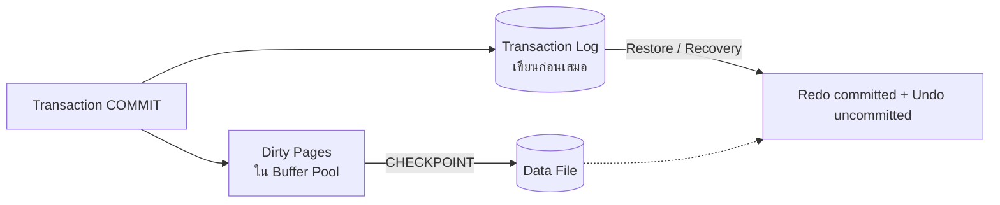

# Section 2 — Transaction Log, VLF และ Recovery Model

ทุกครั้งที่ข้อมูลเปลี่ยน (INSERT/UPDATE/DELETE หรือ DDL) SQL Server เขียนรายการการเปลี่ยนแปลงลง **transaction log ก่อนเขียนหน้า data เสมอ** (write-ahead logging) — log จึงเป็น "แหล่งความจริงของการเปลี่ยนแปลง" ที่ engine ใช้ทั้ง rollback ระหว่างทำงาน และ redo/undo ตอน recover หลังเกิดเหตุ DBA ที่เข้าใจ log จึงตัดสินใจเรื่อง backup strategy, ขนาด log และ RPO ได้อย่างถูกทาง ขณะที่คนที่ไม่เข้าใจมักเจอปัญหาเดิมซ้ำ: **log โตจน disk เต็ม**, **เกิด error 9002 (log full)**, หรือ **restore ช้าเพราะ VLF เยอะเกิน**

Section นี้เดินตามห่วงโซ่ความเข้าใจ: โครงสร้างไฟล์ log (VLF) → พฤติกรรม growth → การเลือก recovery model → กลไก log truncation → การตั้งค่า checkpoint และการวางแผนขนาด log

## 2.1 Transaction Log ทำงานอย่างไร (ภาพรวม)

- ทุกธุรกรรมถูกเขียนลง log เป็น **log record ที่มี LSN (Log Sequence Number)** เรียงต่อกันแบบลำดับเดียว
- การ commit ต้องรอ log record ถูกเขียน (flush) ลง disk เสร็จก่อนเสมอ — ทำให้ data file อ่าน/เขียนได้แบบ lazy แต่ความถูกต้องไม่เสียถึงตัววัดเวลา (durability) ที่พัง
- หน้า data ที่ถูกแก้ (dirty page) ถูกล้างลง disk เมื่อเกิด **CHECKPOINT** หรือเมื่อ Buffer Pool จำเป็น
- ตอน restart หรือ restore, engine ใช้ log เพื่อ **redo** (ขยับ forward การ commit แล้ว) และ **undo** (ถอนการ commit ยังไม่เสร็จ) — จุดอ้างอิงคือ checkpoint LSN



ตรวจสถานะ log ของฐานข้อมูลด้วยสองมุมมองคู่ใจ:

```sql
SELECT name, recovery_model_desc, log_reuse_wait_desc
FROM sys.databases
WHERE database_id = DB_ID(N'AdventureWorks2025');

SELECT * FROM sys.dm_db_log_stats(DB_ID(N'AdventureWorks2025'));
-- คอลัมน์สำคัญ: total_log_size_mb, active_log_size_mb,
-- log_truncation_holdup_reason, log_since_last_log_backup_mb, total_vlf_count
```

## 2.2 โครงสร้างไฟล์ Log: Virtual Log File (VLF)

SQL Server ไม่ใช้ไฟล์ log เป็นก้อนเดียว แต่แบ่งภายในเป็น **VLF (Virtual Log File)** หลายชิ้นตามลำดับ — จำนวน VLF ที่เกิดขึ้นเมื่อไฟล์ log **grow หนึ่งครั้ง** ขึ้นกับขนาดของ growth event

สูตรเดิม (ก่อน SQL Server 2022):

| ขนาดของ growth event | จำนวน VLF ที่เกิด |
|:----------------------|:-------------------|
| ≤ 64 MB | 4 |
| > 64 MB – 1 GB | 8 |
| > 1 GB – 8 GB | 16 |
| > 8 GB – 16 GB | 32 |
| > 16 GB | 128 |

**ตั้งแต่ SQL Server 2022 สูตรถูกปรับให้สร้าง VLF น้อยลงต่อ growth event** — ปัญหา "VLF หลักร้อยจาก auto-grow ทีละเล็ก" เบาลง แต่การตั้งขนาด growth ใหญ่และเหมาะสมยังเป็นแนวปฏิบัติที่ถูกต้อง ([Transaction Log Architecture Guide](https://learn.microsoft.com/sql/relational-databases/sql-server-transaction-log-architecture-and-management-guide?view=sql-server-ver17#virtual-log-files-vlfs))

ทำไม VLF เยอะถึงเป็นปัญหา:

- startup recovery, restore และ log backup ต้องเดินสแกนผ่าน VLF เป็นจำนวนมาก → ช้าชัดเจน
- database ที่ attach/restore หลายครั้ง (เช่น dev/test ต้องรีเซ็ตบ่อย) กระทบมากสุด
- ในระบบเก่าที่ใช้ auto-grow ทีละ 1 MB มาสิบปี — VLF หลักหมื่นมีจริงและเป็นหนึ่งในสาเหตุ top ของ recovery ช้า

**วิธีตรวจ** — `sys.dm_db_log_info` (มาแทน `DBCC LOGINFO` ตั้งแต่ SQL Server 2016 SP2):

```sql
-- นับ VLF ของทุกฐานข้อมูลที่มีมากกว่า 100
SELECT [name], COUNT(l.database_id) AS vlf_count
FROM sys.databases AS s
CROSS APPLY sys.dm_db_log_info(s.database_id) AS l
GROUP BY [name]
HAVING COUNT(l.database_id) > 100;

-- VLF ละเอียดของ database เดียว
SELECT file_id, vlf_size_mb, vlf_active, vlf_status, vlf_first_lsn
FROM sys.dm_db_log_info(DB_ID(N'AdventureWorks2025'));
```

คอลัมน์ที่ใช้อ่านผลจาก `sys.dm_db_log_info`:

| คอลัมน์ | ความหมาย |
|:--------|:---------|
| `vlf_size_mb` | ขนาด VLF หน่วย MB — เล็กเกิน (หลัก KB) = สัญญาณ "โตทีละนิด" มานาน |
| `vlf_active` | 1 = VLF นี้ยังใช้อยู่ (กู้คืนยังต้องใช้) |
| `vlf_status` | 0 = ยังไม่ initialize, 1 = initialize แล้วยังไม่ใช้, 2 = active |
| `vlf_first_lsn` | LSN แรกที่อยู่ใน VLF — ใช้ระบุขอบเขตเวลาในไฟล์ log |

สคริปต์เดโมครบเครื่อง (สร้าง DB ที่ log grow ทีละน้อยหลายครั้ง แล้วเปรียบเทียบกับ log ใหญ่ครั้งเดียว + วิธีแก้ด้วย SHRINKFILE): [Scripts/01_VLF_Inspection.sql](Scripts/01_VLF_Inspection.sql)

> `DBCC LOGINFO` ยังรันได้แต่ถูกแทนแล้ว — ใช้ `sys.dm_db_log_info` ในงานใหม่ทั้งหมด ข้อดีคือเป็น DMF ที่ JOIN/CROSS APPLY กับ `sys.databases` ได้ตรง ๆ (ดูหน้า doc: [sys.dm_db_log_info](https://learn.microsoft.com/sql/relational-databases/system-dynamic-management-views/sys-dm-db-log-info-transact-sql?view=sql-server-ver17))

## 2.3 Growth Increments และการวางแผนขนาด Log

พฤติกรรมที่ต้องออกแบบคือ **instant file initialization ใช้ไม่ได้กับไฟล์ log** — การ grow ไฟล์ log ต้องเขียนเป็นศูนย์ทั้งส่วนที่เพิ่ม (zero-init) ทำให้ growth ครั้งใหญ่ ๆ ขณะ workload หนักช่วงนั้น "ค้าง" (log write wait พุ่ง) ดังนั้นแนวทาง:

| การตั้งค่า | แนะนำ | เหตุผล |
|:-----------|:------|:-------|
| ขนาดเริ่มต้น log | ใหญ่พอสำหรับ peak ที่เคยเกิด (ดูจาก usage จริง) | ลดจำนวน growth event |
| FILEGROWTH | ขนาดคงที่พอสมควร เช่น 256–1024 MB (ไม่ใช้ % เล็ก ๆ) | % บนไฟล์ใหญ่ยิ่ง grow ยิ่งบวม, เล็กเกินก็ทำ VLF เยอะ |
| AUTO_SHRINK | **ห้ามเปิด** | shrink log ทำ VLF ตัวจิ๋วหลักร้อย + grow ซ้ำเป็นวงจรโทษ |
| MAXSIZE | ตั้งขอบบนกัน disk เต็มถ้าโจทย์ยอมรับได้ | จะได้เจอ error ที่จุดเลือกตั้ง ไม่ใช่ disk เครื่องหลักพัง |

วิธีประเมิน "ขนาด log ที่ควรวาง" แบบมีหลักการ:

1. วัด peak จริงจาก `sys.dm_db_log_stats(DB_ID())` (คอลัมน์ `active_log_size_mb`) และ `DBCC SQLPERF(LOGSPACE)` ช่วง workload หนักสุด (เช่น ระหว่าง batch กลางคืน)
2. วางขนาด log = peak จริง + พื้นที่เผื่อ 20–30%
3. ตั้ง FILEGROWTH คงที่ใหญ่พอที่ "grow ครั้งเดียวจบงาน" (เช่น peak สัปดาห์หนึ่งโตไม่เกิน 1 growth event)
4. ถ้าเคย shrink ไฟล์ log มาก่อน ให้ตามเวิร์กโฟลว์: truncation สำเร็จ → `DBCC SHRINKFILE` → ตั้งขนาด/growth ใหม่ทันที

การทราบ "ขนาด log ที่ใช้จริง" มีสามช่องทางที่ใช้ได้จริง:

```sql
-- 1) DBCC SQLPERF คลาสสิก — % ที่ใช้ของทุก DB
DBCC SQLPERF(LOGSPACE);

-- 2) sys.dm_db_log_space_usage — ตัวเลขไบต์ + ส่วนที่ใช้นับตั้งแต่ log backup ล่าสุด
SELECT total_log_size_in_bytes / 1048576.0 AS total_MB,
       used_log_space_in_percent,
       log_space_in_bytes_since_last_backup / 1048576.0 AS used_since_last_log_backup_MB
FROM sys.dm_db_log_space_usage;      -- รันใน database เป้าหมาย

-- 3) sys.dm_db_log_stats — สรุประดับ DB (รวม VLF count + holdup reason)
SELECT * FROM sys.dm_db_log_stats(DB_ID());
```

คอลัมน์สำคัญของ `sys.dm_db_log_stats` (SQL Server 2016 SP2+):

| คอลัมน์ | ใช้ทำอะไร |
|:--------|:----------|
| `total_log_size_mb` / `active_log_size_mb` | ขนาดไฟล์ vs ส่วนที่ยังใช้อยู่จริง |
| `log_truncation_holdup_reason` | เหตุผลที่ log ยังไม่ถูกตัด (เทียบเท่า `log_reuse_wait_desc`) |
| `log_backup_time` / `log_backup_lsn` | log backup ล่าสุดเมื่อไร/ถึง LSN ไหน — ใช้ตรวจ job หลุด |
| `log_since_last_log_backup_mb` | งานที่ยังไม่ถูกสำรอง — ใหญ่ = ต้อง backup log ทันที |
| `log_checkpoint_lsn` / `log_since_last_checkpoint_mb` | จุด checkpoint ล่าสุด |
| `total_vlf_count` / `active_vlf_count` | ตัวเลข VLF ที่ใช้เทียบ threshold 100 |
| `recovery_vlf_count` | จำนวน VLF ที่ต้อง recover ถ้า server ดับตอนนี้ — ตัวชี้วัดความช้าของ startup |

สคริปต์วัด growth/truncation จริงแบบทีละขั้น: [Scripts/02_Log_Growth_And_Truncation.sql](Scripts/02_Log_Growth_And_Truncation.sql)

## 2.4 การเลือก Recovery Model — FULL / BULK_LOGGED / SIMPLE

Recovery model ตัดสินใจสองเรื่องใหญ่: **ว่า log record จะถูกเก็บเมื่อไรได้** และ **จะกู้คืนถึงจุดไหนได้**

```sql
ALTER DATABASE [AdventureWorks2025] SET RECOVERY FULL;
-- หรือ SIMPLE / BULK_LOGGED — ดูค่าปัจจุบันจาก sys.databases.recovery_model_desc
```

| คุณสมบัติ | **SIMPLE** | **FULL** | **BULK_LOGGED** |
|:----------|:-----------|:---------|:----------------|
| Log truncation | อัตโนมัติหลัง CHECKPOINT | เฉพาะหลัง **BACKUP LOG** เท่านั้น | เหมือน FULL |
| Log backup | ทำไม่ได้ (error 4208/2528) | ทำได้ | ทำได้ |
| Point-in-time restore | ไม่ได้ | **ได้ (STOPAT/STOPATMARK)** | จำกัด — ช่วง minimal-logged ไม่สามารถตัดจุดกลางได้ |
| กู้จาก disaster มากสุดถึง | backup ล่าสุด (full/diff) | backup ล่าสุด + log ทุกอัน (ถึงวินาทีสุดท้ายด้วย tail-log) | เหมือน FULL ยกเว้นช่วง bulk operation |
| ต้นทุนบริหาร | ต่ำสุด | ต้องมี job log backup สม่ำเสมอ | เท่า FULL + ต้องเฝ้าช่วง bulk |
| เหมาะกับ | dev/test, DB ที่รื้อโหลดทุกวัน, ระบบจาก backup วันละครั้งก็พอ | production ที่ RPO เข้ม | ช่วง bulk load ชั่วคราวใน FULL workflow |

ข้อควรรู้สำคัญ:

- **สลับจาก FULL → SIMPLE ทำลาย log chain** — หลังเปิดกลับเป็น FULL ต้อง `BACKUP DATABASE` (full/diff ก็ได้) ก่อนถึงจะ `BACKUP LOG` ได้อีก (จะได้ error 4214 ถ้าพลาดขั้นนี้)
- **BULK_LOGGED ไม่ใช่พาหนะถาวร** — ตั้งช่วง bulk operation แล้วเปลี่ยนกลับ FULL เป็นแนวปฏิบัติ; การสลับ FULL ↔ BULK_LOGGED ไม่ทำลาย chain (SIMPLE เท่านั้นที่หัก)
- ภายใน log backup ที่ครอบคลุมช่วง minimal-logged จะไม่กู้ point-in-time ได้ ("มีหรือไม่มี" ของการกระทำนั้น)
- Minimal logging เกิดเมื่อ: อยู่ BULK_LOGGED **หรือ** SIMPLE + ปฏิบัติการที่ยอมให้ — รายการหลัก ๆ: `BULK INSERT` พร้อม `TABLOCK`, `bcp in` พร้อม TABLOCK, `SELECT INTO`, `INSERT ... SELECT` พร้อม TABLOCK ไป table ว่าง, สร้าง index แบบ offline rebuild และ `ALTER INDEX REBUILD` บางรูปแบบ — ทดสอบผลจริงใน [Scripts/04_BulkLogged_Impact.sql](Scripts/04_BulkLogged_Impact.sql) และ [Labs Exercise 3](../../Labs/README.md)

## 2.5 Log Truncation — เกิดเมื่อไร อะไรขวาง

"Truncation" หมายถึงการปลดล็อกพื้นที่ log เก่าให้นำมาใช้ซ้ำได้ (**ไม่ได้หมายถึงไฟล์เล็กลง**) — ถ้าต้องการไฟล์เล็กลงต้อง `DBCC SHRINKFILE` หลัง truncation สำเร็จ (และระวังจะโตกลับมาเหมือนเดิมถ้า workload เดิมยังอยู่)

| Recovery model | เกิดเมื่อไร |
|:---------------|:-----------|
| **SIMPLE** | หลัง **CHECKPOINT** — log ทั้งหมดก่อน checkpoint เสียสิทธิ์กู้คืนทันที |
| **FULL / BULK_LOGGED** | หลัง **BACKUP LOG** สำเร็จ (ไม่รวม COPY_ONLY) — กลไกเดียวกันทำงานเฉพาะเมื่อ log record ถูกสำรองไปแล้ว |

ปัจจัยที่**ขวาง** truncation — ตรวจได้จาก `log_reuse_wait_desc` / `log_truncation_holdup_reason`:

| ค่า | ความหมาย | ทางแก้ย่อ |
|:----|:---------|:----------|
| `LOG_BACKUP` | ยังไม่มี log backup ตั้งแต่เปิด FULL | สั่ง BACKUP LOG (full ก่อนถ้าเพิ่งเปลี่ยน model) |
| `ACTIVE_TRANSACTION` | ธุรกรรมยาวยังค้าง | หา session ค้างจาก `sys.dm_tran_session_transactions` / `DBCC OPENTRAN` |
| `ACTIVE_BACKUP_OR_RESTORE` | full/diff backup กำลังวิ่ง | รอจบ |
| `AVAILABILITY_REPLICA` | secondary ใน AG ยังส่ง/ยืนยัน log ไม่ครบ | ตรวจ log_send_queue/log_redo_queue |
| `REPLICATION` | log reader ค้างของ replication/CDC | ตรวจ replication agents |
| `DATABASE_MIRRORING` | mirroring ค้าง | ตรวจ mirroring state |
| `OLDEST_PAGE`, `XTP_CHECKPOINT`, `LOG_SCAN`, `DATABASE_SNAPSHOT_CREATION`, `OTHER_TRANSIENT` | ชั่วคราว/เชิงเทคนิคเฉพาะ | มักหายเอง, ตรวจกรณีเฉพาะ |

### รับมือ "Log Full" (error 9002) แบบมีลำดับ

1. ตรวจเหตุผล: `SELECT log_truncation_holdup_reason FROM sys.dm_db_log_stats(DB_ID())`
2. ถ้า `LOG_BACKUP` — สั่ง `BACKUP LOG` ทันที (เคสที่พบมากที่สุด)
3. ถ้า `ACTIVE_TRANSACTION` — ระบุ transaction ค้างด้วย `DBCC OPENTRAN` และตัดสินใจกับทีมแอป (kill หรือรอ)
4. ถ้า disk จริงเต็มและ log ตัดไม่ได้ — ทางเลือก: เพิ่มไฟล์ log บน disk อื่น (`ALTER DATABASE ... ADD LOG FILE`) หรือเพิ่ม MAXSIZE ชั่วคราว — **อย่าแก้ด้วยการ DETACH หรือลบไฟล์ .ldf เด็ดขาด** (ทำให้ฐานข้อมูล corrupt ถาวร)
5. แก้รากเหตุ: ตาราง backup schedule, ตรวจ long-running transaction ของแอป, พิจารณา replication/AG queue

สคริปต์เดโมเทียบตรง ๆ ว่า "CHECKPOINT ใน SIMPLE ตัด log แต่ใน FULL ไม่ตัด — ต้อง log backup เท่านั้น": [Scripts/03_Recovery_Models_Compare.sql](Scripts/03_Recovery_Models_Compare.sql)

## 2.6 Checkpoint และการตั้งค่าที่เกี่ยวข้อง

Checkpoint ทำสองหน้าที่ให้ recovery สั้นลง: เขียน dirty page ลง data file และบันทึก `checkpoint LSN` เป็นจุดเริ่ม redo

| การตั้งค่า | ค่า | ความหมาย |
|:-----------|:----|:---------|
| `TARGET_RECOVERY_TIME` (database) | `60 SECONDS` (default ของฐานข้อมูลใหม่ตั้งแต่ SQL Server 2016) | **Indirect checkpoint** — engine พยายามให้ recovery time ไม่เกิน ~60 วินาทีโดยเขียน checkpoint ตามความเหมาะสมเอง |
| `TARGET_RECOVERY_TIME` (database) | `0 SECONDS` | กลับไปใช้ checkpoint แบบ automatic เดิม ซึ่งผูกกับ server config ด้านล่าง |
| `recovery interval (min)` (server config) | default 0 (อัตโนมัติ) | เกณฑ์เป้าหมายของ automatic checkpoint แบบเดิม — ปล่อย default ส่วนใหญ่ดีที่สุด |
| tempdb | indirect checkpoint เปิด default ตั้งแต่ SQL Server 2019 | กันคอขวดของงาน temp table |

```sql
-- ดูค่าของฐานข้อมูล
SELECT name, target_recovery_time_in_seconds
FROM sys.databases
WHERE database_id = DB_ID(N'AdventureWorks2025');

-- ปรับ (มักไม่ต้องทำ ยกเว้น recovery หลัง failover ยาวเกิน SLA)
ALTER DATABASE [AdventureWorks2025] SET TARGET_RECOVERY_TIME = 60 SECONDS;

-- ค่า server ระดับ (ทดสอบก่อนเปลี่ยน — default 0 คืออัตโนมัติที่ engine จัดการเอง)
SELECT name, value_in_use FROM sys.configurations WHERE name = N'recovery interval (min)';
```

จุดเชื่อมกับงาน backup: checkpoint เป็นขอบเขตที่ full/diff backup ใช้ตัดสิน "งานที่จำเป็นต้องเก็บใน backup" และ SIMPLE ใช้ตัด log — เห็นกลไกเดียวกันครอบทั้งสาม recovery model

**ADR (Accelerated Database Recovery)** เปลี่ยนโมเดล recovery ของฐานข้อมูลที่เปิดใช้ให้ redo/undo เกือบทันทีด้วย Persistent Version Store + Logical Revert — ตั้งแต่ **SQL Server 2025 ADR รองรับ transactions บน tempdb** ด้วย ทำให้ rollback งาน temp table ยาว ๆ เร็วขึ้นหลายเท่า ([ADR in SQL Server 2025](https://learn.microsoft.com/sql/relational-databases/accelerated-database-recovery-concepts?view=sql-server-ver17#adr-improvements-in-sql-server-2025)) — ADR ไม่ทดแทน backup แต่ลด RTO ช่วง recovery ของ server restart

### 🚀 SQL Server 2025 & Modern Notes
- **ADR บน tempdb** — rollback/recovery ของ transactions ที่แตะ temp tables เร็วขึ้นอย่างมีนัยสำคัญ ([ADR concepts](https://learn.microsoft.com/sql/relational-databases/accelerated-database-recovery-concepts?view=sql-server-ver17#adr-improvements-in-sql-server-2025))
- **สูตร VLF ใหม่ตั้งแต่ SQL Server 2022** — จำนวน VLF ต่อ growth event ลดลง; ใช้ `sys.dm_db_log_info` ตรวจสอบเสมอ ([Transaction Log Architecture Guide](https://learn.microsoft.com/sql/relational-databases/sql-server-transaction-log-architecture-and-management-guide?view=sql-server-ver17#virtual-log-files-vlfs))
- `DBCC LOGINFO` ถูกแทนด้วย `sys.dm_db_log_info` — อย่าใช้ในสคริปต์ใหม่ ([sys.dm_db_log_info](https://learn.microsoft.com/sql/relational-databases/system-dynamic-management-views/sys-dm-db-log-info-transact-sql?view=sql-server-ver17))
- สิทธิ์ที่ใช้ query log DMV: SQL Server 2022+ ใช้ `VIEW SERVER PERFORMANCE STATE` (เดิม `VIEW SERVER STATE`) — ผูกกับ fixed server role ใหม่เช่น `##MS_ServerPerformanceStateReader##` ได้โดยไม่ต้อง sysadmin
- `BACKUP LOG ... WITH NO_LOG / TRUNCATE_ONLY` ถูกถอดไปนานแล้ว — ถ้าต้องการกำจัด log chain ให้สลับเป็น SIMPLE เท่านั้น ([BACKUP (T-SQL)](https://learn.microsoft.com/sql/t-sql/statements/backup-transact-sql?view=sql-server-ver17))

> อ้างอิง: [The Transaction Log (SQL Server)](https://learn.microsoft.com/sql/relational-databases/logs/the-transaction-log-sql-server?view=sql-server-ver17), [Recovery Models](https://learn.microsoft.com/sql/relational-databases/backup-restore/recovery-models-sql-server?view=sql-server-ver17), [Checkpoint and Indirect Checkpoint](https://learn.microsoft.com/sql/relational-databases/logs/database-checkpoints-sql-server?view=sql-server-ver17), [sys.dm_db_log_stats](https://learn.microsoft.com/sql/relational-databases/system-dynamic-management-views/sys-dm-db-log-stats-transact-sql?view=sql-server-ver17)
