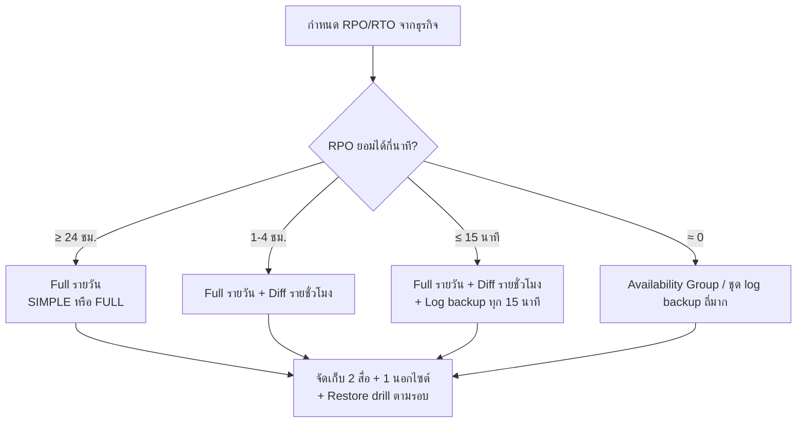

# Section 3 — ประเภท Backup และการเลือก Strategy

SQL Server มีอิฐหลายชนิดสำหรับประกอบกลยุทธ์ backup: **full, differential, transaction log, file/filegroup และ partial** — ทักษะของ DBA ไม่ใช่การจำคำสั่ง แต่คือการรู้ว่าอิฐแต่ละชนิด "ยืดหยุ่นขนาดไหน เสียเวลา restore เท่าไร และผูกกับอะไร" จนได้ภาพกุญแจของทั้งหมด: **backup chain** ที่ restore ต้องเดินตามลำดับจึงสมบูรณ์

กฎที่ต้องจำก่อนทุกอย่าง: **log backup ทำได้เฉพาะฐานข้อมูล FULL/BULK_LOGGED ที่ผ่าน full (หรือ diff) backup อย่างน้อยหนึ่งครั้ง** และ restore ต้องนำ backup กลับตามลำดับเวลาที่ engine ตรวจด้วย LSN เสมอ

## 3.1 ประเภท Backup ครบชุด

| ประเภท | คำสั่ง | เก็บอะไร | ข้อดี / ข้อจำกัด |
|:--------|:--------|:---------|:-----------------|
| **Full database backup** | `BACKUP DATABASE ... TO DISK` | ข้อมูลทั้ง DB + log จำนวนที่จำเป็นให้ restore ได้ consistent | ฐานของทุก strategy; ขนาดใหญ่ เวลานานที่สุด |
| **Differential backup** | `BACKUP DATABASE ... WITH DIFFERENTIAL` | เฉพาะ extent ที่เปลี่ยนหลัง **full ล่าสุด** (อ่านจาก Differential Changed Map) | เล็กและเร็วกว่า full; ยิ่งห่างจาก base ยิ่งโต; restore ต้องมี full ฐานก่อนเสมอ |
| **Transaction log backup** | `BACKUP LOG ...` | log record ทุกอันตั้งแต่ log backup ก่อนหน้าถึงปัจจุบัน | เปิด point-in-time recovery; restore ต้องทำ **ตามลำดับ** ข้ามอันไม่ได้; มีเฉพาะ FULL/BULK_LOGGED |
| **File / Filegroup backup** | `BACKUP DATABASE ... FILEGROUP = 'FG2'` | เฉพาะไฟล์/filegroup ที่ระบุ | ฐานข้อมูลหลาย filegroup ขนาดใหญ่; SIMPLE ใช้ได้จริงเฉพาะ read-only filegroup |
| **Partial backup** | `BACKUP DATABASE ... READ_WRITE_FILEGROUPS` | ทุก filegroup ที่เขียนได้ (+ read-only ที่ระบุเพิ่ม) | คู่ของ piecemeal restore — กู้ส่วนงานจริงก่อน ส่วน archive ทีหลัง |
| **Copy-only backup** | `BACKUP DATABASE ... WITH COPY_ONLY` | เหมือน full/log แต่**ไม่กระทบ chain** | full: ไม่ reset differential base; log: ไม่ truncate log (รายละเอียดใน [Module 6](../../../Module_06_Backing_Up_Databases/Sections/03_Special_Options/README.md)) |

ตาราง "ประเภทไหนใช้ได้กับ recovery model ไหน" (ตามเอกสาร BACKUP):

| ประเภท | SIMPLE | FULL | BULK_LOGGED |
|:--------|:-------|:-----|:------------|
| Full / Differential | ได้ | ได้ | ได้ |
| Log backup | ไม่ได้ | ได้ | ได้ |
| File backup (read-write FG) | ไม่ได้ในทางปฏิบัติ | ได้ | ได้ |
| File backup (read-only FG) | ได้ | ได้ | ได้ |
| Partial (READ_WRITE_FILEGROUPS) | ไม่มีประโยชน์ | ได้ | ได้ |
| Point-in-time (STOPAT) | ไม่ได้ | ได้ (ยกเว้นช่วง minimal-logged) | จำกัดเช่นเดียวกับ FULL |

## 3.2 ใช้ Full Backup เป็นกลยุทธ์พื้นฐาน

- Full ทุก ๆ N วัน/ชั่วโมง เป็น "จุด reset" ของ chain ทั้งหมด — differential และ log ทุกตัวผูกกับ full ล่าสุด
- ข้อจำกัด: RPO = ระยะห่าง full backup — full เดียวต่อวันให้ RPO 24 ชั่วโมง มักไม่พอสำหรับ production
- Full backup ทำงานแบบ online ผู้ใช้ทำงานต่อได้; จะ block เฉพาะ file management (ADD FILE) และ shrink operations
- ใน SIMPLE recovery, full + differential คือหลังบ้านทั้งหมด — restore ได้แค่จุด backup ล่าสุดเท่านั้น

```sql
-- Full backup แบบ production-grade (ทุกตัวเลือกมีเหตุผล)
BACKUP DATABASE [AdventureWorks2025]
TO DISK = N'C:\SQLBackups\AW_Daily.bak'
WITH FORMAT,                      -- สร้าง media set ใหม่ทุกครั้ง (ทับไฟล์เดิม)
     INIT,                        -- รวมกับ FORMAT = เริ่มไฟล์ใหม่สะอาด ๆ
     NAME = N'AW daily full',     -- ตัวระบุตัวตนที่อ่านย้อนใน msdb ได้
     CHECKSUM,                    -- ตรวจ page ระหว่างเขียน
     COMPRESSION,                 -- เริ่มจาก ZSTD ถ้าอยู่ SQL Server 2025
     STATS = 5;                   -- เห็นความคืบหน้าทุก 5%
```

> กติกาที่หลายคนเข้าใจผิด: full backup **ไม่ได้ตัด log** ใน FULL recovery — ตัวตัด log คือ log backup เท่านั้น (ดู [Section 2.5](../02_Transaction_Log/README.md))

## 3.3 Log Backup Strategy (FULL recovery)

- ตั้ง Agent job รัน `BACKUP LOG` ทุก 5–15 นาที (ตาม RPO) — log backup **คือ**กลไก truncation ของ log ใน FULL; ลืมทำ = log โตจน disk เต็ม
- Restore: full (NORECOVERY) → diff (ถ้ามี, NORECOVERY) → log **ตามลำดับเวลา** (NORECOVERY) → log ตัวสุดท้าย WITH RECOVERY
- **Tail-log backup** ก่อน restore ทุกครั้ง (บน DB ที่ยังชี้) เก็บงานถึงวินาทีสุดท้าย — สอนละเอียดใน [Module 7](../../../Module_07_Restoring_Databases/Sections/01_Restore_Mechanics/README.md)

```sql
BACKUP LOG [AdventureWorks2025]
TO DISK = N'C:\SQLBackups\AW_Log.trn'
WITH NAME = N'AW log every 15min', CHECKSUM, COMPRESSION;
```



```mermaid
gantt
    title ตารางการทำงานแบบ FULL + log ทุก 15 นาที
    dateFormat HH:mm
    axisFormat %H:%M
    section Backups
    Full backup            :crit, task1, 00:00, 10m
    Log backup             :task2, 00:15, 1m
    Log backup             :task3, 00:30, 1m
    Log backup             :task4, 00:45, 1m
    section หมายเหตุ
    ถ้าเกิดเหตุ 00.47 กู้ full + log ทุกอัน + tail-log : task5, 00:45, 3m
```

เคสที่ log backup ล่าสุด "หลุด" ตรวจได้จาก msdb — job นี้คือ watchdog ที่ควรมีทุกระบบ:

```sql
-- DB แบบ FULL ที่ไม่มี log backup มากว่า 30 นาที
SELECT d.name, d.recovery_model_desc,
       MAX(s.backup_finish_date) AS last_log_backup
FROM sys.databases AS d
LEFT JOIN msdb.dbo.backupset AS s
       ON s.database_name = d.name AND s.type = 'L'
WHERE d.recovery_model_desc = N'FULL' AND d.database_id > 4
GROUP BY d.name, d.recovery_model_desc
HAVING MAX(s.backup_finish_date) < DATEADD(MINUTE, -30, GETDATE());
```

## 3.4 Differential Strategy

Differential อ่าน **Differential Changed Map (DCM)** เพื่อเลือก extent ที่เปลี่ยนตั้งแต่ **differential base** — full backup แบบปกติล่าสุด (full แบบ COPY_ONLY **ไม่**เปลี่ยน base)

- จุดขาย: ตัดจำนวน log ที่ต้อง restore — แทน apply log 100 ไฟล์ ใช้ full + diff + log 10 ไฟล์ตั้งแต่ diff นั้น
- พฤติกรรมขนาด: ยิ่งนานจาก base ยิ่งโต — เมื่อ diff ใกล้เคียงขนาด full ก็ถึงเวลาตั้ง full ใหม่เป็น base
- ตรวจ base ปัจจุบันด้วย `sys.master_files` / `RESTORE HEADERONLY` (คอลัมน์ `differential_base_lsn`) — เดโมใน [Scripts/01_Backup_Types_Demo.sql](Scripts/01_Backup_Types_Demo.sql)

```sql
-- Differential backup
BACKUP DATABASE [AdventureWorks2025]
TO DISK = N'C:\SQLBackups\AW_Daily.bak'
WITH DIFFERENTIAL, NAME = N'AW diff 4h', CHECKSUM, COMPRESSION;

-- ตรวจว่า diff ถัดไปจะเทียบกับ full ตัวไหน (ฐานปัจจุบันของ engine)
SELECT name, differential_base_lsn, differential_base_guid
FROM sys.master_files
WHERE database_id = DB_ID(N'AdventureWorks2025') AND type = 0;
```

ตารางเทียบ restore เวลาเกิดเหตุ ณ เวลา T (สมมติ chain ล่าสุด):

| Strategy | ไฟล์ที่ต้อง restore | เวลาโดยประมาณ |
|:---------|:--------------------|:---------------|
| Full รายวัน | full (ใหญ่) | นานที่สุดต่อก้อนเดียว |
| Full รายวัน + diff ทุก 4 ชม. | full + diff + log ตั้งแต่ diff | diff เล็ก โตตามช่วง |
| Full รายวัน + log ทุก 15 นาที | full + log 96 ไฟล์/วัน | RPO ดีสุด แต่ apply log เยอะ |
| Full รายวัน + diff ทุก 4 ชม. + log ทุก 15 นาที | full + diff + log ≤16 ไฟล์ | **สมดุลที่ใช้จริงทั่วไป** |

> ข้อเสียที่ต้องรู้ของ diff: full backup ปกติทุกครั้ง **reset base** — ถ้าคุณเพิ่ม full กลางคืนแบบไม่ได้ตั้งใจ (เช่น job ทดลอง) diff ที่มีอยู่จะกู้ไม่ได้กับ full ใหม่ทันที — งานเสริมให้ใช้ COPY_ONLY เสมอ

## 3.5 Filegroup Strategy

ฐานข้อมูลใหญ่ (เช่น data warehouse ที่แยก filegroup archive read-only) ได้ประโยชน์ตรง:

- **Backup เฉพาะตามตารางงาน**: filegroup เปลี่ยนบ่อย backup บ่อย; read-only ที่เปลี่ยนปีละครั้ง backup ครั้งเดียวต่อการเปลี่ยน
- **Piecemeal restore**: กู้ PRIMARY + filegroup งานจริงขึ้นมาใช้ก่อน โดยส่วน archive ยัง offline รอคิว — ใช้ `BACKUP DATABASE ... READ_WRITE_FILEGROUPS` + `RESTORE DATABASE ... WITH PARTIAL` (เดโมเต็มจริงใน [Module 7 Section 3](../../../Module_07_Restoring_Databases/Sections/03_Special_Restores/README.md))
- SIMPLE recovery: file backup ใช้ได้จริงเฉพาะ read-only filegroup

```sql
-- backup เฉพาะ filegroup ที่ระบุ (file backup)
BACKUP DATABASE [AWDataWarehouse]
    FILEGROUP = N'Current'
TO DISK = N'C:\SQLBackups\AWDW_Current.bak' WITH CHECKSUM;

-- partial backup — ทุก filegroup ที่เขียนได้
BACKUP DATABASE [AWDataWarehouse]
    READ_WRITE_FILEGROUPS
TO DISK = N'C:\SQLBackups\AWDW_RW.bak' WITH CHECKSUM;
```

ข้อควรระวังของ file/partial backup ที่ควรจำก่อนใช้จริง:

- restore ต้องมี backup **ครบทุก filegroup** อย่างสม่ำเสมอเป็นลำดับช่วงเวลาเดียวกัน (ใช้ log เชื่อม) — จำนวนไฟล์ที่ต้องบริหารเพิ่มขึ้นจริง
- read-only filegroup ที่ถูกเขียนใหม่ (เปลี่ยนเป็น read-write แวบเดียว) ทำให้ "backup ครั้งเดียวพอ" หมดมูลค่า — ตรวจ `sys.database_files.is_read_only` ตามรอบ
- ผู้ใช้ทั่วไป query หา filegroup ที่ offline ระหว่าง piecemeal จะได้ error — สื่อสารกับทีมแอปว่า DB ขึ้นบางส่วนคือเงื่อนไขยอมรับได้หรือไม่

## 3.6 รวมทุกอย่างเป็น Strategy ที่แนะนำ



ตารางต้นทุน/ผลตอบแทนของแต่ละ strategy (ช่วยในการต่อรองกับธุรกิจ):

| Strategy | ต้นทุน storage | ต้นทุนบริหาร | RPO ได้ | RTO ได้ |
|:---------|:----------------|:--------------|:---------|:---------|
| Full รายวัน | 1× ขนาด DB ต่อวัน | ต่ำ | 24 ชม. | นาน (กู้ทั้งก้อน) |
| Full + diff | 1× full + diff เล็กหลายอัน | ต่ำ–กลาง | ถึงจุด diff ล่าสุด | สั้นลงชัดเจน |
| Full + log | full + log ตามช่วง (ขึ้นกับ write volume) | กลาง (ต้องเฝ้า job) | นาทีหรือดีกว่า | ต้อง apply log มาก |
| Full + diff + log | full + diff + log | กลาง | นาทีหรือดีกว่า | **สมดุลที่สุดในทางปฏิบัติ** |

สคริปต์เดโมที่เปรียบเทียบการสร้าง chain และผลต่อ restore: [Scripts/02_Strategies_Comparison.sql](Scripts/02_Strategies_Comparison.sql)

## 3.7 วางแผน chain ขององค์กรเดียวด้วย Query รวม

เมื่อดูแลหลายฐานข้อมูล สิ่งที่จัดการง่ายที่สุดคือ "ดู chain ทั้งหมดต่อ DB ในหนึ่งผลลัพธ์":

```sql
-- สรุป chain ล่าสุดของทุกฐานข้อมูล: ใครอยู่ตรงไหน ต่อกันถูกไหม
SELECT d.name AS database_name,
       d.recovery_model_desc,
       (SELECT TOP 1 s1.backup_finish_date
        FROM msdb.dbo.backupset s1
        WHERE s1.database_name = d.name AND s1.type = 'D'
        ORDER BY s1.backup_finish_date DESC) AS last_full,
       (SELECT TOP 1 s2.backup_finish_date
        FROM msdb.dbo.backupset s2
        WHERE s2.database_name = d.name AND s2.type = 'I'
        ORDER BY s2.backup_finish_date DESC) AS last_diff,
       (SELECT TOP 1 s3.backup_finish_date
        FROM msdb.dbo.backupset s3
        WHERE s3.database_name = d.name AND s3.type = 'L'
        ORDER BY s3.backup_finish_date DESC) AS last_log,
       d.recovery_model_desc + N' / ' +
       ISNULL(CONVERT(nvarchar(20), (SELECT TOP 1 s4.compressed_backup_size/1048576
                 FROM msdb.dbo.backupset s4
                 WHERE s4.database_name = d.name AND s4.type = 'D'
                 ORDER BY s4.backup_finish_date DESC)), N'ยังไม่เคย backup')
       AS full_size_MB
FROM sys.databases AS d
WHERE d.database_id > 4 AND d.state_desc = N'ONLINE'
ORDER BY d.name;
```

วิธีอ่านผลเพื่อจัดลำดับงานแก้ไข:

| สัญญาณในผล | ความหมาย | จัดลำดับความสำคัญ |
|:-------------|:-----------|:--------------------|
| last_full = NULL | ไม่เคย backup เลย — RPO แตกสิ้น | ทำทันที (highest) |
| last_full เก่า + last_diff = NULL + recovery FULL + last_log เก่า | chain ขาดกลางทาง | ทำ full ใหม่ + ตรวจ job log |
| last_log เก่ากว่า RPO ที่ตกลง | job log ล่า/หลุด | ตรวจ Agent job ทันที |
| full_size_MB โตขึ้นต่อเนื่อง | วางแผน storage ก่อนเกิดเหตุ | ทบทวน retention/tier |

## 3.8 เหตุการณ์สาธารณะที่ทำ chain ขาด — กันให้ได้ตั้งแต่ต้น

| เหตุการณ์ | ผลต่อ chain | วิธีกัน |
|:-----------|:-------------|:---------|
| สลับ FULL → SIMPLE → FULL (เช่นเผลอจาก script dev) | หัก log chain | จำกัดสิทธิ์ ALTER DATABASE + ทำ full หลังเปลี่ยนกลับเสมอ |
| Full backup ปกติที่รันนอกตาราง (script ทดลอง) | reset differential base — diff เดิมใช้ไม่ได้ | ทุก backup นอกตารางใช้ COPY_ONLY |
| ลืม job log backup หลัง restore จาก SIMPLE→FULL | log โตไม่หยุด | checklist หลัง restore: ยืนยัน recovery model + job log |
| ลบไฟล์ backup เก่าที่ยังเป็น base | กู้ diff ไม่ได้แม้มีไฟล์ diff | retention ทั้ง "เก็บอะไร" ต้องคิดเป็น chain ไม่ใช่รายไฟล์ |

สคริปต์เดโมที่เปรียบเทียบการสร้าง chain และผลต่อ restore: [Scripts/02_Strategies_Comparison.sql](Scripts/02_Strategies_Comparison.sql)

### 🚀 SQL Server 2025 & Modern Notes
- **Full + differential backup บน secondary replicas** — ใน Availability Group สั่ง backup full/diff ที่ replica อ่านได้ (เดิม COPY_ONLY เท่านั้น) — ลด I/O ฝั่ง primary โดยตรง ([Active secondaries](https://learn.microsoft.com/sql/database-engine/availability-groups/windows/active-secondaries-backup-on-secondary-replicas-always-on-availability-groups?view=sql-server-ver17#new-for-sql-server-2025))
- **ZSTD compression** — บีบ backup ทุกประเภท (full/diff/log) ให้เล็กลงและเร็วขึ้น (`WITH COMPRESSION (ALGORITHM = ZSTD)`) — ผลข้างเคียงที่ดีของ strategy คือไฟล์ที่ย้ายไป object storage เล็กลง ([Backup Compression](https://learn.microsoft.com/sql/relational-databases/backup-restore/backup-compression-sql-server?view=sql-server-ver17))
- `BACKUP SERVER` / `BACKUP GROUP` (snapshot backup, SQL Server 2022+) ยังเป็นตัวเลือกสำหรับองค์กรที่ใช้ SAN/storage-level snapshot โดยตรง
- ยังมีผลบังคับเดิม: **backup จาก version ใหม่ restore บน version เก่าไม่ได้** — วางแผน upgrade server restore ไปด้วยเสมอ ([BACKUP — Compatibility](https://learn.microsoft.com/sql/t-sql/statements/backup-transact-sql?view=sql-server-ver17#compatibility))

> อ้างอิง: [Backup Types](https://learn.microsoft.com/sql/relational-databases/backup-restore/backup-overview-sql-server?view=sql-server-ver17#backup-types), [Differential Backups](https://learn.microsoft.com/sql/relational-databases/backup-restore/differential-backups-sql-server?view=sql-server-ver17), [Full File Backups](https://learn.microsoft.com/sql/relational-databases/backup-restore/full-file-backups-sql-server?view=sql-server-ver17), [Partial Backups](https://learn.microsoft.com/sql/relational-databases/backup-restore/partial-backups-sql-server?view=sql-server-ver17)
