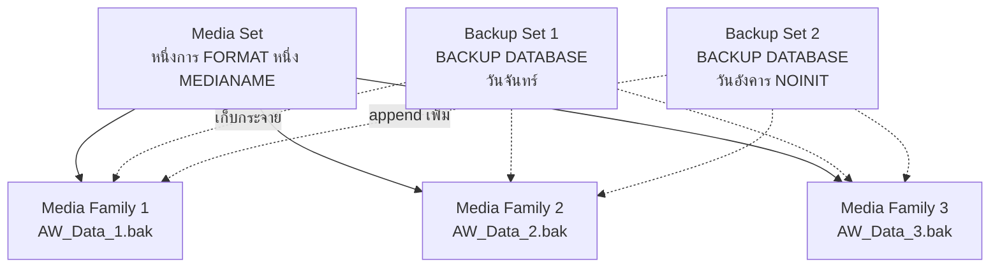

# Section 1 — พื้นฐานการ Backup: Media Sets, Stripe, MIRROR และ Tail-Log

คำสั่ง `BACKUP` ที่ดูง่ายมีโครงสร้างข้อมูลรองรับที่ต้องรู้ก่อนเขียน production script — **media set** (กลุ่มสื่อทั้งหมดที่ backup หนึ่งเขียนลง), **media family** (ส่วนที่เขียนลง device แต่ละตัว) และ **backup set** (ผลผลิตจากการ BACKUP หนึ่งครั้งที่วางใน media set) — เข้าใจโครงสร้างนี้แล้วคุณจะจัดการไฟล์ .bak หลายร้อยไฟล์ได้ รู้ว่าอันไหน append อันไหน overwrite และจะกู้คืนอันไหนด้วย `FILE = <เลข>`

Section นี้ครอบคลุม: การจัดการสื่อ (stripe, mirrored), `BACKUP LOG` และ tail-log backup ด้วย `NO_TRUNCATE` รับมือ DB กำลังพัง และการ backup เฉพาะส่วน (file/filegroup/partial)

## 1.1 Media Sets, Media Families และ Backup Sets



กฎที่ใช้ได้จริง:

- `FORMAT` = สร้าง media set **ใหม่** (เขียน header ทับทุกไฟล์ใน TO clause) — แถม SKIP การตรวจ expiration ให้อัตโนมัติ
- `NOINIT` (default) = append backup set ใหม่ต่อท้ายของเดิม — ไฟล์ .bak เดียวมีหลาย backup set เรียงเป็นเลข 1,2,3… อ้างอิงด้วย `FILE = n` ตอน restore
- `INIT` = เขียนทับ backup set ทั้งหมดแต่เก็บ media header — จะ fail ถ้า backup set เก่ายังไม่หมดอายุ (`EXPIREDATE`/`RETAINDAYS`) จนกว่าจะใส่ `SKIP`
- ชุด **stripe** ต้องมีไฟล์ครบจำนวนเดิมเสมอจนกว่าจะ FORMAT ใหม่ — ไฟล์เดียวหายชุดนั้นใช้ไม่ได้ทั้งชุด

พฤติกรรม {NOINIT | INIT} × {NOSKIP | SKIP} ที่จำได้ง่าย:

| | NOINIT (append) | INIT (เขียนทับ backup sets) |
|:---|:---|:---|
| **NOSKIP** (default) | append ต่อท้าย ตรวจ media name ถ้าระบุ | ตรวจ expiration ก่อนเขียนทับ — fail ถ้ายังไม่หมดอายุ |
| **SKIP** | append โดยไม่ตรวจ | เขียนทับโดยไม่สน expiration |

## 1.2 BACKUP DATABASE — แบบเดียว, Stripe และ MIRROR TO

```sql
-- แบบพื้นฐาน (เขียนทับไฟล์เดิมเป็น media set ใหม่)
BACKUP DATABASE [AdventureWorks2025]
TO DISK = N'C:\SQLBackups\AW2025_Full.bak'
WITH FORMAT, INIT,
     NAME = N'AW2025 full weekly',
     MEDIANAME = N'AW2025 weekly media',
     CHECKSUM, COMPRESSION, STATS = 5;
```

**Stripe** — กระจายไฟล์เดียวไปหลาย disk เพื่อลดเวลา (ผนวก I/O ของหลาย volume) และเก็บไฟล์ใหญ่เกิน volume เดียว:

```sql
BACKUP DATABASE [AdventureWorks2025]
TO DISK = N'D:\SQLBackups\AW_1.bak',
   DISK = N'E:\SQLBackups\AW_2.bak',
   DISK = N'F:\SQLBackups\AW_3.bak'
WITH FORMAT, NAME = N'AW2025 striped 3 disks', CHECKSUM;
```

**MIRROR TO** — เขียนสำเนาคู่พร้อมกัน (ต้อง Enterprise edition, mirror ได้สูงสุด 3 ชุด และจำนวน/ชนิด device ต้องเท่ากันทุก mirror):

```sql
BACKUP DATABASE [AdventureWorks2025]
TO DISK = N'D:\SQLBackups\AW.bak'
MIRROR TO DISK = N'\\nas01\sqlbackup\AW.bak'
WITH FORMAT, CHECKSUM;
```

> ในทางปฏิบัติสมัยใหม่คนทำสำเนาที่สองด้วย replication ระดับ storage มากกว่า MIRROR TO — แต่รู้ว่ามันอยู่ใน toolkit ของ engine โดยตรง

ตัวเลือก `WITH` ที่ควรจำตอนเขียน script จริง:

| ตัวเลือก | ความหมาย | เมื่อไรควรใช้ |
|:---------|:---------|:--------------|
| `NAME` / `DESCRIPTION` | ตัวระบุตัวตน backup set / ข้อความอธิบาย | ทุกครั้ง — อ่านย้อนใน msdb ได้เร็ว |
| `MEDIANAME` | ชื่อ media set — ตรวจกับของเดิมตอน append | งานที่จัดการสื่อเป็นรอบ (เทป/แผ่น) |
| `EXPIREDATE` / `RETAINDAYS` | กันเขียนทับก่อนกำหนด | มี retention policy |
| `STATS = 5` | แสดงความคืบหน้าทุก 5% | script/job ทุกตัว |
| `BUFFERCOUNT` / `MAXTRANSFERSIZE` | ปรับ I/O depth และขนาด transfer | จูน backup ใหญ่ (ใช้มาตรฐานก่อน วัดก่อนเปลี่ยน) |
| `FORMAT` + `INIT` | เริ่มไฟล์ใหม่ | backup รายวันรายไฟล์ (แนวที่ปลอดภัยที่สุด) |

**Logical backup device** (`sp_addumpdevice`) — ตั้งชื่อย่อแทน path ยาว ๆ:

```sql
EXEC sys.sp_addumpdevice N'disk', N'AWData', N'C:\SQLBackups\AWData.bak';
BACKUP DATABASE [AdventureWorks2025] TO AWData WITH CHECKSUM;
```

- ข้อดี: script สั้น และ `msdb.dbo.backupmediafamily.logical_device_name` อ่านออกมาได้ง่าย
- ข้อจำกัด: ไม่รองรับ URL backup; device ที่เคยเป็นส่วนของ stripe ใช้ตรง ๆ ไม่ได้จนกว่า FORMAT

สคริปต์เดโมรันได้ทั้งสามรูปแบบ + อ่านโครงสร้างกลับมา: [Scripts/01_MediaSets_Stripe_Mirror.sql](Scripts/01_MediaSets_Stripe_Mirror.sql)

## 1.3 BACKUP LOG และ Tail-Log Backup

`BACKUP LOG` (FULL/BULK_LOGGED เท่านั้น) เก็บ log record ทุกตัวตั้งแต่ log backup ก่อนหน้า — และเป็นกลไกตัด log:

```sql
BACKUP LOG [AdventureWorks2025]
TO DISK = N'C:\SQLBackups\AW2025_Log.trn'
WITH NAME = N'AW2025 log 15min', CHECKSUM, COMPRESSION;
```

**Tail-log backup** คือ log backup ตัวสุดท้ายก่อน restore — เก็บงานที่ยังไม่ถูกสำรองเลยถึงวินาทีที่เหตุการณ์เกิด มีสองโหมด:

| สถานการณ์ | คำสั่ง | พฤติกรรม |
|:----------|:-------|:----------|
| DB ปกติ เตรียม restore | `BACKUP LOG db TO ... WITH NORECOVERY;` | เก็บ tail และตัด log, DB เข้าสู่ RESTORING เพื่อรอ restore ต่อ |
| **DB เสียหาย** (data file พัง) | `BACKUP LOG db TO ... WITH NO_TRUNCATE;` | พยายามเก็บ log แม้ data อ่านไม่ได้; **ไม่** truncate log; metadata บางส่วนอาจไม่สมบูรณ์ |

```sql
-- DB เสียหาย: ยังเก็บงานถึงวินาทีสุดท้ายได้
BACKUP LOG [AW2025_Broken]
TO DISK = N'C:\SQLBackups\AW_Broken_tail.trn'
WITH NO_TRUNCATE, CHECKSUM;
```

จุดสำคัญ: `NO_TRUNCATE` มีผลเทียบเท่า `COPY_ONLY + CONTINUE_AFTER_ERROR` — เหมาะกับเหตุการณ์ฉุกเฉิน ใช้ครั้งเดียวต่อเหตุการณ์; ถ้า DB อยู่สถานะ OFFLINE/EMERGENCY จะ backup ไม่ได้แม้ใช้ NO_TRUNCATE ในกรณีที่ data เสียจน `NO_TRUNCATE` ก็ไม่ผ่าน ให้ลอง `CONTINUE_AFTER_ERROR` แทน ([Tail-Log Backups](https://learn.microsoft.com/sql/relational-databases/backup-restore/tail-log-backups-sql-server?view=sql-server-ver17))

ลำดับเวลาของเหตุการณ์จริงที่เห็นตัวอย่างเดียวกันทุกขั้น:

```text
10:30:00  log backup ล่าสุดจบ (log backup ก่อนหน้าตัด log ถึง 10:30)
10:30:15  user เพิ่มรายการขาย
10:33:00  user แก้ข้อมูลอีกรายการ
10:34:20  ✗ disk data เสียหาย — DB เข้าสู่ RECOVERY_PENDING
10:35:00  DBA สั่ง BACKUP LOG WITH NO_TRUNCATE   ← ได้งาน 10:30:15 + 10:33:00 กลับมา
10:36:00  RESTORE full → log → tail             ← ไม่เสียงานถึง 10:34:20
```

เดโมที่ "ทำลาย DB จำลองแล้วเก็บ tail": [Scripts/02_TailLog_NO_TRUNCATE.sql](Scripts/02_TailLog_NO_TRUNCATE.sql)

## 1.4 File/Filegroup Backup และ Partial Backup

สำหรับฐานข้อมูลใหญ่หลาย filegroup — backup เฉพาะส่วนที่จำเป็น:

```sql
-- filegroup backup (เฉพาะ filegroup ที่ระบุ)
BACKUP DATABASE [AWDataWarehouse]
    FILEGROUP = N'Current'
TO DISK = N'C:\SQLBackups\AWDW_Current.bak'
WITH CHECKSUM;

-- partial backup — ทุก filegroup ที่เขียนได้ (+ read-only ที่ระบุ)
BACKUP DATABASE [AWDataWarehouse]
    READ_WRITE_FILEGROUPS
TO DISK = N'C:\SQLBackups\AWDW_Partial.bak'
WITH CHECKSUM;
```

- คู่กับ **piecemeal restore** — กู้ PRIMARY + filegroup งานจริงขึ้นใช้ก่อน, archive ที่เป็น read-only กู้ทีหลัง (เดโมเต็มใน [Module 7 Section 3](../../../Module_07_Restoring_Databases/Sections/03_Special_Restores/README.md))
- **SIMPLE recovery**: file backup ใช้ได้จริงเฉพาะ read-only filegroup (เพราะ log ไม่ถูกเก็บ จะต่อ log ให้ filegroup อื่นไม่ได้)
- ระวังความต่างเล็กสำคัญ: ระบุ filegroup ตรง ๆ = file backup; ใช้คำ `READ_WRITE_FILEGROUPS` = **partial** backup
- ตรวจ filegroup ปัจจุบันของฐานข้อมูลก่อนออกแบบ backup เฉพาะส่วน:

```sql
SELECT name, type_desc, state_desc, is_read_only
FROM [AdventureWorks2025].sys.database_files;
```

สคริปต์สร้าง DB สอง filegroup + ทำ partial/filegroup backup จริง: [Scripts/03_PartialFilegroupBackup.sql](Scripts/03_PartialFilegroupBackup.sql)

## 1.5 เจอ Error อะไร — วิเคราะห์และแก้

| Error | ข้อความโดยย่อ | สาเหตุ | ทางแก้ |
|:------|:---------------|:--------|:--------|
| 3201 | cannot open the backup device | path ผิด / สิทธิ์ SQL service account ไม่พอ / volume เต็ม | ตรวจ path + สิทธิ์เขียนของ service account + พื้นที่ |
| 3002 | cannot back up ... because it is not online | filegroup/file offline | กู้/online ก่อน หรือ backup เฉพาะส่วนที่ online |
| 3007 | cannot back up tempdb | tempdb backup ไม่ได้ (โดยออกแบบ) | ไม่ต้องแก้ — tempdb ไม่มีความหมายถาวร |
| 4035 | "The backup set ... could not be overwritten" | INIT ชนกับ backup ยังไม่หมดอายุ | ตรวจ expiration หรือใช้ SKIP อย่างมีสติ |
| 4214 | no current database backup (BACKUP LOG) | เพิ่งเปลี่ยน SIMPLE→FULL ยังไม่มี full | BACKUP DATABASE ก่อนหนึ่งครั้ง |

## 1.6 Checklist ของ BACKUP ที่ "ใช้งานจริงได้"

| ตัวเลือก | ใช้เมื่อไร | เหตุผล |
|:---------|:----------|:-------|
| `CHECKSUM` | ทุกครั้ง | เห็น page เสียตอนเขียน ไม่ใช่ตอนกู้ |
| `COMPRESSION` | ทุกครั้ง (2025 พิจารณา ZSTD) | ลด disk/network; เสีย CPU เล็กน้อย |
| `STATS = 5` | script/Agent job | เห็นความคืบหน้าตอนใหญ่ ๆ |
| `NAME`/`DESCRIPTION` | ทุกครั้ง | อ่านย้อนใน msdb ได้เร็ว |
| `RETAINDAYS`/`EXPIREDATE` | มี retention policy | กันเขียนทับก่อนกำหนด |
| `STOP_ON_ERROR` (default) | production | ไม่รับ backup มีข้อผิดพลาดเงียบ ๆ |
| `FORMAT`+`INIT` รายไฟล์/รอบ | job รายวัน | ไฟล์สอดคล้องวันที่ ลดความเสี่ยง append ผิด chain |

### 🚀 SQL Server 2025 & Modern Notes
- **ZSTD** ใช้ได้กับ backup ทุกประเภทใน Section นี้ — full, diff, log, file, partial ([Backup Compression](https://learn.microsoft.com/sql/relational-databases/backup-restore/backup-compression-sql-server?view=sql-server-ver17))
- **Backup to URL** (Azure/S3) ใช้ได้กับ BACKUP DATABASE และ BACKUP LOG เหมือนกันหมด — stripe ข้าม 64 URLs รองรับฐานข้อมูลใหญ่ (ละเอียดใน [Section 3](../03_Special_Options/README.md))
- **Full/diff บน AG secondary (2025)** — ทั้ง full, diff และ COPY_ONLY ทำบน replica รองได้ ([Active secondaries](https://learn.microsoft.com/sql/database-engine/availability-groups/windows/active-secondaries-backup-on-secondary-replicas-always-on-availability-groups?view=sql-server-ver17#new-for-sql-server-2025))
- ตัวเลือก `TAPE` ถูกประกาศว่าจะถอด — ไม่ใช้ในงานใหม่ ([BACKUP (T-SQL)](https://learn.microsoft.com/sql/t-sql/statements/backup-transact-sql?view=sql-server-ver17))

> อ้างอิง: [Media sets, media families, and backup sets](https://learn.microsoft.com/sql/relational-databases/backup-restore/media-sets-media-families-and-backup-sets-sql-server?view=sql-server-ver17), [Mirrored Backup Media Sets](https://learn.microsoft.com/sql/relational-databases/backup-restore/mirrored-backup-media-sets-sql-server?view=sql-server-ver17), [Tail-Log Backups](https://learn.microsoft.com/sql/relational-databases/backup-restore/tail-log-backups-sql-server?view=sql-server-ver17), [Partial Backups](https://learn.microsoft.com/sql/relational-databases/backup-restore/partial-backups-sql-server?view=sql-server-ver17)
