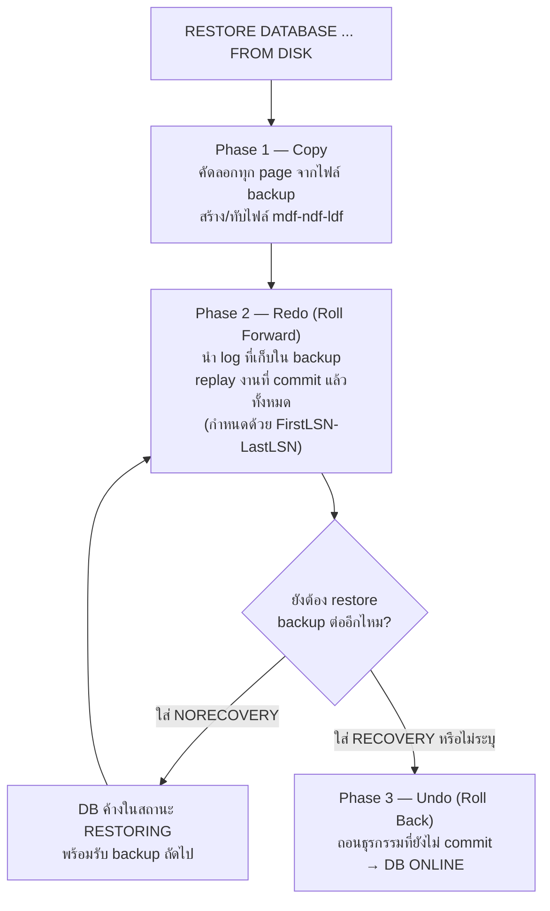

# Section 1 — กลไก Restore: 3 ขั้นตอน, ตัวเลือก Recovery และการเตรียมการ

`RESTORE` ที่รันสำเร็จในหนึ่งคำสั่งจริง ๆ ทำงานสามขั้นภายใน — **Copy, Redo (Roll Forward), Undo (Roll Back)** — เข้าใจสามขั้นนี้แล้วคุณจะรู้เองว่าเมื่อไรต้องใส่ `NORECOVERY`, ทำไม restore log ต้องต่อเรียง LSN ข้ามไม่ได้ และ `STANDBY` เปิดให้อ่านข้อมูลกลางทางทำงานอย่างไร อีกครึ่งของ Section นี้คือ**การเตรียมการก่อนกด restore** — จุดที่ทำถูกจะช่วยคุณกู้ถึงวินาทีสุดท้าย ทำผิดจะกู้ได้แค่ backup เมื่อวาน

## 1.1 สาม Phase ของ Restore



หัวใจที่ต้องจำ:

- **Copy + Redo** ทำงานทุกครั้ง; **Undo เกิดเฉพาะเมื่อคุณสั่ง RECOVERY** (หรือไม่ระบุ — RECOVERY เป็นค่า default)
- ทิศทางเดียว — restore ที่ผ่าน RECOVERY แล้ว**ต่อ log ต่อไม่ได้** (ต้องเริ่มใหม่จาก full) นี่คือเหตุผลที่มือใหม่กู้ไม่สำเร็จบ่อยสุด: ใส่ RECOVERY ผิดจังหวะ
- ADR (Accelerated Database Recovery) ทำให้ redo/undo บางขั้นเร็วขึ้นหลายเท่าบนฐานข้อมูลที่เปิด ADR (รวมถึง tempdb ใน SQL Server 2025)

## 1.2 RECOVERY / NORECOVERY / STANDBY

| ตัวเลือก | สถานะฐานข้อมูลหลังจบ | ใช้เมื่อไร |
|:---------|:----------------------|:-----------|
| `NORECOVERY` | RESTORING — รอ backup ถัดไป | ทุกขั้นยกเว้นขั้นสุดท้ายของ chain |
| `RECOVERY` | ONLINE — ใช้งานได้ | ขั้นสุดท้าย (diff ตัวล่าสุด / log ตัวสุดท้าย) |
| `STANDBY = 'undo_file'` | ONLINE แบบ **read-only** — อ่านได้แต่ต่อ restore log ต่อได้อีก | ตรวจข้อมูลกลางทาง, warm standby, log shipping standby |

```sql
-- ตัวอย่างกึ่งทาง: กู้ full แล้วเปิดดูข้อมูลแบบ read-only ก่อนตัดสินใจต่อ
RESTORE DATABASE [AW2025_Inspect]
FROM DISK = N'C:\SQLBackups\AW2025.bak'
WITH FILE = 1,
     STANDBY = N'C:\SQLBackups\AW2025_Inspect_undo.dat',
     MOVE N'AdventureWorks2025'     TO N'D:\Data\AW_Inspect.mdf',
     MOVE N'AdventureWorks2025_log' TO N'D:\Data\AW_Inspect_log.ldf';
-- อ่านได้เลย:
SELECT TOP 5 * FROM [AW2025_Inspect].Production.Product;
-- ต่อ chain ได้อีก:
RESTORE LOG [AW2025_Inspect]
FROM DISK = N'C:\SQLBackups\AW2025.bak'
WITH FILE = 2, RECOVERY;
```

ข้อควรระวัง STANDBY: ไฟล์ undo ต้องมีที่เก็บ; การเปิด read-only ระหว่าง standby ห้ามขัดแย้งกับ schema ที่ log ถัดไปจะแก้ (จะได้ error ขณะ apply log ต่อ) และระบบที่มี transaction ค้างเยอะจะ undo file โต

สถานะฐานข้อมูลที่ควรคุ้นเคยช่วง restore:

| สถานะ | หมายความว่าอะไร | เกิดเมื่อไร |
|:-------|:-----------------|:-----------|
| ONLINE | ใช้งานปกติ | หลัง RECOVERY สำเร็จ |
| RESTORING | กู้อยู่/รอ backup ต่อ | ระหว่าง restore sequence หรือหลัง BACKUP LOG WITH NORECOVERY |
| RECOVERY_PENDING | รอการกู้คืน — ใช้งานไม่ได้ | restore ไม่จบ, ไฟล์เสียหาย, ไม่มี log ครบ |
| RECOVERING | กำลัง redo/undo | ช่วง startup หรือหลัง restore ตัวสุดท้าย |
| SUSPECT | กู้ไม่ได้/เสียหาย | recovery fail |

ตรวจสถานะทุกฐานข้อมูลได้เสมอ:

```sql
SELECT name, state_desc, is_in_standby FROM sys.databases ORDER BY name;
```

เดโมที่เห็นสถานะจริงทีละขั้น (NORECOVERY → STANDBY → RECOVERY): [Scripts/01_RestorePhases_NORECOVERY_STANDBY.sql](Scripts/01_RestorePhases_NORECOVERY_STANDBY.sql)

## 1.3 ประเภท Restore ที่ SQL Server รองรับ

| ประเภท | คำสั่งหลัก | หมายเหตุ |
|:--------|:-----------|:----------|
| Complete restore ทั้ง DB | `RESTORE DATABASE` | ครอบคลุมงานส่วนใหญ่ |
| File/Filegroup restore | `RESTORE DATABASE ... FILEGROUP='...'` | ฐานใหญ่หลาย filegroup (ดู [Section 3](../03_Special_Restores/README.md)) |
| Page restore | `RESTORE DATABASE ... PAGE='1:300'` | เฉพาะ FULL/BULK_LOGGED (ดู [Section 3](../03_Special_Restores/README.md)) |
| Piecemeal (partial) restore | `RESTORE DATABASE ... WITH PARTIAL, NORECOVERY` | เปิดใช้งานบาง filegroup ก่อนรอบนอก |
| Log restore | `RESTORE LOG` | รวม point-in-time (STOPAT/STOPATMARK) — [Section 4](../04_Point_In_Time/README.md) |
| Revert to snapshot | `RESTORE DATABASE ... FROM DATABASE_SNAPSHOT` | กลับจุดเดิมที่ snapshot นั้น (Enterprise) |

## 1.4 การเตรียมการก่อน Restore — ทำตามลำดับนี้เสมอ

### ขั้นที่ 1 — ตรวจประวัติและเลือก backup set

```sql
-- ก้อนไหนมีอะไรบ้าง (ทำจาก msdb โดยไม่ต้องเปิดไฟล์)
SELECT s.backup_set_id, s.name, s.type,
       s.backup_start_date, s.backup_finish_date,
       s.first_lsn, s.last_lsn, s.differential_base_lsn,
       f.physical_device_name
FROM msdb.dbo.backupset AS s
JOIN msdb.dbo.backupmediafamily AS f ON f.media_set_id = s.media_set_id
WHERE s.database_name = N'AdventureWorks2025'
ORDER BY s.backup_finish_date;
```

ถ้าไฟล์ .bak มาจากที่อื่น (ไม่มีประวัติใน msdb) — `RESTORE HEADERONLY` + `RESTORE FILELISTONLY` อ่านจากไฟล์ตรง (Module 6 Section 2)

### ขั้นที่ 2 — Tail-log backup ก่อนแตะอะไรทั้งนั้น

ฐานข้อมูล FULL/BULK_LOGGED ที่ยังเข้าถึง log ได้ — เก็บงานถึงวินาทีสุดท้ายก่อน restore เสมอ:

```sql
-- DB ยัง online: เก็บ tail และเตรียมเข้าโหมด restore
BACKUP LOG [AdventureWorks2025]
TO DISK = N'C:\SQLBackups\AW_tail.trn'
WITH NORECOVERY, CHECKSUM;

-- DB เสียหาย (data file พัง): ยังเก็บได้เพราะ log อยู่
BACKUP LOG [AW2025_Broken]
TO DISK = N'C:\SQLBackups\AW_Broken_tail.trn'
WITH NO_TRUNCATE, CHECKSUM;
```

- `NORECOVERY` — เก็บ tail แล้วพา DB เข้าสู่ RESTORING เพื่อรอ restore ทันที (ใช้เมื่อ DB ปกติ)
- `NO_TRUNCATE` — ใช้เมื่อ DB กำลังพัง; มีผลเทียบเท่า `COPY_ONLY + CONTINUE_AFTER_ERROR`, ไม่ตัด log
- DB อยู่สถานะ **OFFLINE/EMERGENCY** → tail-log backup ทำไม่ได้ทุกกรณี
- SIMPLE recovery → ไม่มี tail-log (ไม่มี log chain) — ผลสุทธิ์คือกู้ได้ถึง backup ล่าสุดเท่านั้น

### ขั้นที่ 3 — ปลดผู้ใช้และยก transaction ออก

Restore ต้องการ exclusive access — มีใครเชื่อมต่อค้างจะได้ `Msg 3101`:

```sql
ALTER DATABASE [AdventureWorks2025]
SET SINGLE_USER WITH ROLLBACK IMMEDIATE;   -- เตะทุก session + rollback งานค้าง
-- ... RESTORE ...
ALTER DATABASE [AdventureWorks2025] SET MULTI_USER;
```

- `WITH ROLLBACK IMMEDIATE` — เตะทันที (เหมาะเหตุฉุกเฉิน)
- `WITH ROLLBACK AFTER 30` — ให้เวลา 30 วินาทีก่อนเตะ (เหมาะ maintenance ตามรอบ)
- ตรวจว่าใครค้างก่อนตัดสินใจ: `sys.dm_exec_sessions` + `sys.dm_tran_session_transactions`

```sql
-- ใครใช้ DB นี้อยู่ (ตัดสินใจก่อนเตะ)
SELECT s.session_id, s.login_name, s.host_name, s.program_name,
       t.transaction_begin_time
FROM sys.dm_exec_sessions AS s
LEFT JOIN sys.dm_tran_session_transactions AS st ON st.session_id = s.session_id
LEFT JOIN sys.dm_tran_active_transactions AS t
       ON t.transaction_id = st.transaction_id
WHERE s.database_id = DB_ID(N'AdventureWorks2025') AND s.is_user_process = 1;
```

### ขั้นที่ 4 — Restore ด้วยลำดับที่วางไว้

ดูตัวอย่างครบ chain ทั้งหมดใน [Section 2](../02_Restore_Scenarios/README.md) — กฎข้อเดียว: **NORECOVERY ทุกขั้นยกเว้นขั้นสุดท้าย**

## 1.5 "จะ restore ได้แค่ไหน" — Recovery Model กับ RPO มองจากจุดกู้

| Recovery model | กู้ได้ล่าสุดถึงจุดไหน | ต้องมีอะไรในมือ |
|:----------------|:----------------------|:-----------------|
| **SIMPLE** | จุด full/diff backup ล่าสุดเท่านั้น | ไฟล์ full (+diff) |
| **FULL** + log chain สมบูรณ์ | ถึง **วินาทีที่เกิดเหตุ** (tail-log) หรือจุดใดก็ได้ในอดีต (STOPAT) | full/diff + log ทุกอันตามลำดับ + tail |
| **FULL** log chain ขาด (เคยสลับ SIMPLE/ลืม backup) | ถึงจุด log อันสุดท้ายของ chain เดิม | ตรวจ chain ขาดจาก msdb ก่อนเกิดเหตุ — restore แก้ chain ขาดไม่ได้ |

ข้อสรุปเชิงตัวเลข: **RPO จริงของคุณ = ช่วง log backup** — log backup ทุก 5 นาทีคือการซื้อ RPO 5 นาที; ทุกตัวเลือก restore รุ่นใหม่ (ADR, AG) ไม่ได้แทนที่ log chain เดินเป็นประจำ

## 1.6 Restore Progress — รู้ว่ากู้ไปถึงไหน

```sql
SELECT r.command, r.percent_complete,
       DATEDIFF(SECOND, r.start_time, GETDATE()) AS elapsed_sec,
       r.estimated_completion_time,
       a.text
FROM sys.dm_exec_requests AS r
CROSS APPLY sys.dm_exec_sql_text(r.sql_handle) AS a
WHERE r.command LIKE 'RESTORE%' OR r.command LIKE 'BACKUP%';
```

## 1.7 เจอ Error อะไรตอน Restore — วิเคราะห์เร็ว

| สถานการณ์ | ข้อความโดยย่อ | ทางแก้ |
|:----------|:---------------|:--------|
| มีคนใช้ DB อยู่ | Msg 3101 — Exclusive access could not be obtained | `ALTER DATABASE ... SET SINGLE_USER WITH ROLLBACK IMMEDIATE` ก่อน |
| ทับ DB ที่มีอยู่โดยไม่มี tail | error ขอ tail-log backup | ทำ tail-log หรือใช้ `WITH REPLACE` อย่างมีสติ |
| log ผิดลำดับ | Msg 4305 — The log in this backup set terminates at LSN ... too early | เลือก backup set ถัดไปที่ถูกลำดับ (ตรวจ HEADERONLY) |
| ลืม MOVE ตอนกู้ข้ามเครื่อง | cannot create file (path ต้นทางไม่มีบนเครื่องปลายทาง) | อ่าน FILELISTONLY แล้ว `MOVE` ทุกไฟล์ |
| DB ขึ้นแต่ข้อมูลไม่ตรง | — | ตรวจว่าเลือก `FILE = n` อันถูกและ chain ครบ (audit จาก msdb) |

## 1.8 ฝึกคิดลำดับเองก่อนดูเฉลย — 4 สถานการณ์เปิดวันทำงาน

ความเร็วในวันเกิดเหตุมาจากการซ้อมมองโจทย์แล้วออกลำดับทันที ลองเขียนลำดับคำสั่งเองก่อนเปิดเฉลยด้านล่าง:

**โจทย์ 1 — user รายงานว่าลบตารางยอดขายไปเมื่อ 10:42 ฐานข้อมูลยังใช้งานได้ปกติ**

> เฉลย: หยุด access → tail-log backup (`NORECOVERY`) → กู้บนชื่อใหม่ (full NORECOVERY → log STOPAT 10:41:59 → tail STOPAT 10:41:59 RECOVERY) → INSERT...SELECT ข้อมูลกลับ → เปิด access — ห้ามกู้ทับตัวจริงเพราะงานหลัง 10:42 ยังรวดเร็วกว่าเสียหาย

**โจทย์ 2 — disk ที่เก็บ data file เสียหมด ฐานข้อมูลเข้าสู่ RECOVERY_PENDING**

> เฉลย: tail-log ด้วย `NO_TRUNCATE` (log ไฟล์อยู่ disk อื่น — ยังเก็บได้) → เปลี่ยน disk/เตรียม path → full NORECOVERY → diff → log ทุกอัน NORECOVERY → tail RECOVERY → DBCC CHECKDB ยืนยัน → MULTI_USER

**โจทย์ 3 — จะกู้ DB ไปใช้เป็นแหล่งข้อมูลย้อนหลัง (read-only) ประจำเดือน**

> เฉลย: restore full ด้วย `MOVE` ไป path ใหม่ + `STANDBY = '<undo file>'` ถ้าต้องการต่อ log ถึงจุดปลายเดือน หรือ `RECOVERY` ตรง ๆ ถ้าจุดตัดคือปลาย backup — ตั้งชื่อชัดเจน (เช่น AW2025_AsOf_112026) เพื่อไม่สับสนกับตัวจริง

**โจทย์ 4 — กู้จาก encrypted backup ที่มาจากเครื่องอื่น แล้ว error เรื่อง certificate**

> เฉลย: ขั้น 1 `CREATE MASTER KEY` บน master ของปลายทาง → ขั้น 2 `CREATE CERTIFICATE ... FROM FILE` นำเข้า .cer/.pvk ตัวเดิม → ขั้น 3 restore ใหม่ — ถ้ายัง fail ตรวจว่า .pvk เป็นของ certificate ตัวเดิมจริง ไม่ใช่ตัวที่สร้างใหม่ชื่อซ้ำ

หากตอบได้ครบทั้งสี่ คุณพร้อมเข้าแล็บจริง — แล็บจะทำโจทย์ 1 (STOPAT) โจทย์ 4 (encrypted) และเพิ่มโจทย์ page restore ให้ครบ

### 🚀 SQL Server 2025 & Modern Notes
- **Restore from URL** — ทุกคำสั่ง RESTORE ใน Section นี้ใช้ `FROM URL = 'https://...'` หรือ `FROM URL = 's3://...'` แทน DISK ได้ตรง ๆ ([Restore from URL](https://learn.microsoft.com/sql/t-sql/statements/restore-statements-transact-sql?view=sql-server-ver17#restore-from-url))
- **ADR บน tempdb (2025)** — recovery ของงาน temp เร็วขึ้น ([ADR](https://learn.microsoft.com/sql/relational-databases/accelerated-database-recovery-concepts?view=sql-server-ver17#adr-improvements-in-sql-server-2025))
- **ZSTD decompression (2025)** — restore จากไฟล์ ZSTD เร็วกว่าไฟล์ MS_XPRESS ที่ ratio เดียวกัน
- `WITH REPLACE` ทับ database ที่ยังมีอยู่ — ใช้อย่างระวัง (เอกสารเตือนชัดว่ามัน bypass การตรวจความปลอดภัยหลายชั้น รวมถึงป้องกันการทับ DB ที่ยังไม่ได้ tail-log)

> อ้างอิง: [Restore and Recovery Overview](https://learn.microsoft.com/sql/relational-databases/backup-restore/restore-and-recovery-overview-sql-server?view=sql-server-ver17), [RESTORE Statements](https://learn.microsoft.com/sql/t-sql/statements/restore-statements-transact-sql?view=sql-server-ver17), [Tail-Log Backups](https://learn.microsoft.com/sql/relational-databases/backup-restore/tail-log-backups-sql-server?view=sql-server-ver17)
