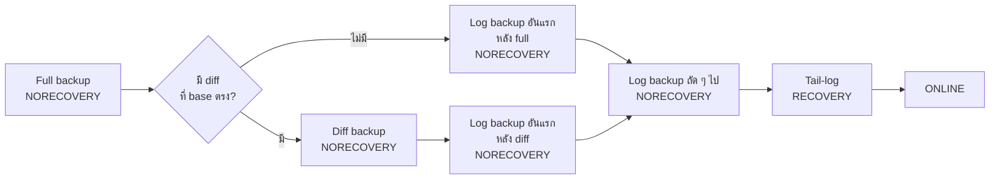

# Section 2 — สถานการณ์การกู้คืน: Full, Differential และ Log Chain

Section นี้เดินผ่านทุกสถานการณ์การกู้แบบ "เต็มฐานข้อมูล" ที่คุณจะเจอจริง: กู้จาก full อย่างเดียว, full + differential, และ chain สมบูรณ์ full → diff → log ตามลำดับ **LSN** ทั้งหมดทำบน sandbox ที่สร้างขึ้นเอง เพื่อให้คุณลองผิดลองถูกได้เต็มที่ก่อนวันที่ระบบจริงพัง

## 2.1 กู้จาก Full Backup — สามโหมดจบหนึ่งคำสั่ง

```sql
-- (a) จบทันที (RECOVERY เป็นค่า default)
RESTORE DATABASE [AW2025_Restored]
FROM DISK = N'C:\SQLBackups\AW2025.bak'
WITH FILE = 1,
     MOVE N'AdventureWorks2025'     TO N'D:\Data\AW_Restored.mdf',
     MOVE N'AdventureWorks2025_log' TO N'D:\Data\AW_Restored_log.ldf';

-- (b) เขียนทับฐานข้อมูลที่ยังมีอยู่ชื่อเดียวกัน (ระวัง: จะเสียงานที่ไม่เคย backup)
RESTORE DATABASE [AdventureWorks2025]
FROM DISK = N'C:\SQLBackups\AW2025.bak'
WITH FILE = 1, REPLACE;

-- (c) กู้เป็นขั้นแรกของ chain — ยังไม่เปิดใช้
RESTORE DATABASE [AdventureWorks2025]
FROM DISK = N'C:\SQLBackups\AW2025.bak'
WITH FILE = 1, NORECOVERY;
```

คำสั่งที่ควรรู้คู่ตัว: `RESTRICTED_USER` (เปิดให้เฉพาะ db_owner/db_backupoperator หลังกู้ — ให้ทีมคุณเช็กข้อมูลก่อนปล่อย user ทั้งหมด), `STATS = 10` (เห็นความคืบหน้า), `CHECKSUM` (ตรวจขณะกู้)

## 2.2 กู้ด้วย Differential — เร่ง chain ให้สั้นลง

Differential กู้ทับบน full ที่เป็น **base ของมัน** เสมอ — ถ้า full ที่กู้ไม่ใช่ base (เคยมี full ระหว่างกลาง) จะได้ error ทันที:

```sql
RESTORE DATABASE [AdventureWorks2025]
FROM DISK = N'C:\SQLBackups\AW2025.bak'
WITH FILE = 1, NORECOVERY;

RESTORE DATABASE [AdventureWorks2025]
FROM DISK = N'C:\SQLBackups\AW2025.bak'
WITH FILE = 2, RECOVERY;        -- diff ตัวล่าสุด จบด้วย RECOVERY
```

- จุดขายเชิงเวลา: แทน apply log 100 ไฟล์ ใช้ diff ก้อนเดียว + log 10 ไฟล์หลัง diff
- ตรวจว่า diff ไหนใช้กับ full ไหนได้: ดู `DifferentialBaseLSN` ใน `RESTORE HEADERONLY` — ต้องตรงกับ `LastLSN` ของ full ที่เป็น base

## 2.3 Log Chain — กู้ตามลำดับ LSN ข้ามอันไม่ได้

Log backup แต่ละอันมีขอบเขต `FirstLSN`–`LastLSN` — log อันถัดไปต้องต่อจาก `LastLSN` อันก่อน (หรือทับซ้อนได้ถ้ามี copy-only ปน) engine จะตรวจให้เอง:

```sql
-- แผน: full(F) → log1(L1) → log2(L2) → log3(L3)
RESTORE DATABASE [AW2025] FROM DISK = N'C:\SQLBackups\AW.bak' WITH FILE = 1, NORECOVERY;
RESTORE LOG     [AW2025] FROM DISK = N'C:\SQLBackups\AW.bak' WITH FILE = 2, NORECOVERY;   -- L1
RESTORE LOG     [AW2025] FROM DISK = N'C:\SQLBackups\AW.bak' WITH FILE = 3, NORECOVERY;   -- L2
RESTORE LOG     [AW2025] FROM DISK = N'C:\SQLBackups\AW.bak' WITH FILE = 4, RECOVERY;     -- L3 จบ
```

- **ข้ามอันหนึ่ง = กู้ไม่ได้** — engine จะตวง error เรื่อง LSN ไม่ตรงลำดับทันที
- log backup อันที่ถูกใช้ **ต้องไม่ใช่ COPY_ONLY** (copy-only ไม่ถูกนับใน chain)
- ตรวจลำดับที่มีอยู่จริง: `msdb.dbo.backupset.first_lsn/last_lsn` หรือ `RESTORE HEADERONLY`

```sql
-- วางแผนการกู้ล่วงหน้าจาก msdb: ใครต่อใครถึงจะครบ
SELECT s.name, s.type, s.first_lsn, s.last_lsn, s.differential_base_lsn,
       s.backup_start_date
FROM msdb.dbo.backupset AS s
WHERE s.database_name = N'AdventureWorks2025'
  AND s.backup_finish_date >= DATEADD(DAY, -2, GETDATE())
ORDER BY s.backup_finish_date;
```

อ่านผล LSN เป็นภาพ — ตารางตัวอย่างของ chain จริง:

| Backup | Type | FirstLSN | LastLSN | ต่อได้เมื่อ |
|:-------|:-----|:---------|:--------|:-----------|
| AW_Full | Full | 190:8:1 | 195:64:2 | เป็นจุดเริ่มเสมอ |
| AW_Log1 | Log | 195:64:2 | 197:12:1 | FirstLSN = LastLSN ของ Full |
| AW_Log2 | Log | 197:12:1 | 199:40:3 | FirstLSN = LastLSN ของ Log1 |
| AW_Diff | Diff | 195:64:2 | 198:2:1 | base = LastLSN ของ Full; กู้แทน Log1 ได้ |

สคริปต์เดโม chain ครบ (สร้าง F+L1+D+L2+tail แล้วกู้กลับ ตรวจ LSN และลองผิดลำดับโดยจงใจ): [Scripts/02_DiffLogChain_Restore.sql](Scripts/02_DiffLogChain_Restore.sql)

## 2.4 เปรียบเทียบสถานการณ์ — เลือกเส้นทางกู้ให้ตรงโจทย์

| สถานการณ์ | เส้นทาง | ข้อควรระวัง |
|:----------|:--------|:-------------|
| ผู้ใช้ลบตารางเมื่อ 10:42 ระบบรวดเร็วต้องคืนทันที | กู้ DB สำเนาชื่ออื่นถึง 10:41:59 (STOPAT) → ดึงข้อมูลกลับ import เฉพาะตาราง | ทำที่ DB สำเนา อย่ากู้ทับตัวจริงก่อนแน่ใจ — ดู [Section 4](../04_Point_In_Time/README.md) |
| Disk data เสียหมด ต้องกู้เต็ม | tail-log → full NORECOVERY → diff → log ทุกอัน → tail RECOVERY | อย่าลืม tail — มันคืองานที่ยังไม่ถูกสำรอง |
| ต้องกู้เร็วขึ้นในเวลาจำกัด | full + diff ล่าสุด + log หลัง diff | จำกัดด้วย diff ที่เป็น base ตรงกัน |
| กู้บน server ใหม่ทั้งหมด | ตรวจ edition/version ปลายทาง ≥ ต้นทาง, จัด MOVE ตาม file list | backup จาก version ใหม่ restore version เก่าไม่ได้ |



## 2.5 กู้บนชื่อใหม่เพื่อ "ดึงข้อมูลบางส่วนกลับ" (รูปแบบที่ใช้บ่อยที่สุด)

เหตุการณ์ผิดพลาดมนุษย์ส่วนใหญ่แก้ด้วย "กู้สำเนา → ยกข้อมูลกลับ" ไม่ใช่กู้ทับทั้งฐานข้อมูล:

```sql
-- 1) กู้บนชื่อใหม่ถึงเวลาก่อนเหตุ (STOPAT — รายละเอียดใน Section 4)
RESTORE DATABASE [AW2025_Recovered]
FROM DISK = N'C:\SQLBackups\AW2025.bak'
WITH FILE = 1, NORECOVERY,
     MOVE N'AdventureWorks2025'     TO N'D:\Recovery\AW_Rec.mdf',
     MOVE N'AdventureWorks2025_log' TO N'D:\Recovery\AW_Rec_log.ldf';
-- ... ต่อ log + STOPAT เจอข้อมูลที่ต้องการ ...

-- 2) ยกเฉพาะข้อมูลที่หายกลับตัวจริง (INSERT ... SELECT ข้าม DB)
INSERT INTO [AdventureWorks2025].Sales.SalesOrderHeader
     (/* คอลัมน์ */)
SELECT /* คอลัมน์เดียวกัน */
FROM [AW2025_Recovered].Sales.SalesOrderHeader AS src
WHERE NOT EXISTS (SELECT 1 FROM [AdventureWorks2025].Sales.SalesOrderHeader AS cur
                  WHERE cur.SalesOrderID = src.SalesOrderID);
```

- ข้อดี: ตัวจริงไม่หยุดนาน, ยกเลิกได้, เปรียบเทียบข้อมูลข้างกันได้ตลอด
- ระวัง IDENTITY และ foreign key — เขียนสคริปต์ให้ `SET IDENTITY_INSERT ... ON` เมื่อกู้ค่า id เดิม
- หลังจบลบ DB สำเนาทิ้งเพื่อไม่ให้ disk บวม

## 2.6 กู้ข้าม Server / จาก Cloud

- ต้องกู้บน SQL Server เวอร์ชัน **เท่ากับหรือใหม่กว่า** ต้นทางเสมอ
- จัด file location ด้วย `MOVE` ทุกไฟล์ (ดูรายชื่อจาก `RESTORE FILELISTONLY`) — รวม FILESTREAM containers
- จาก Azure Blob / S3: สร้าง credential ตามที่ Module 6 Section 3 แล้ว `RESTORE DATABASE ... FROM URL = '...'` ใช้ได้เหมือน DISK ทุกประการ (รวม stripe หลาย URL)
- ผู้ใช้/สิทธิ์ไม่เดินทางมากับไฟล์ .bak — วางแผนจัดการ orphaned users (Module 1 Section 3) และ certificate/TDE ที่เกี่ยวข้อง (หาก DB ต้นทางเปิด TDE ต้องนำ TDE certificate มาปลายทางก่อน — ถ้าไม่มีจะกู้ไม่ได้)

## 2.7 เจอ Error อะไร — ตารางวิเคราะห์เร็ว

| สถานการณ์ | ข้อความโดยย่อ | ทางแก้ |
|:----------|:---------------|:--------|
| log ผิดลำดับ | Msg 4305 — The log in this backup set terminates at LSN ... too early to apply | restore backup set ถัดไปที่ถูกลำดับ |
| ใช้ diff ที่ base ไม่ตรง | The differential backup cannot be restored ... | กู้ full ที่เป็น base ของ diff ตัวนั้นก่อน |
| ลืม NORECOVERY ก่อนตัวสุดท้าย | ไม่สามารถต่อ backup ต่อได้ (DB recovered แล้ว) | เริ่ม restore ใหม่จาก full ด้วยลำดับที่ถูก |
| กู้ทับโดยไม่มี tail | ขอ tail-log backup ก่อน | ทำ tail หรือยอมเสียด้วย `WITH REPLACE` อย่างมีสติ |
| กู้จาก version ใหม่บนเก่า | cannot be loaded on this server | อัปเกรดปลายทางก่อน |

## 2.8 เวิร์กโฟลว์จริงทีละขั้น — จาก "เหตุเกิด" ถึง "ข้อมูลกลับมา"

เรียงตามนาฬิกาจริงของเหตุการณ์ disk เสีย (ตัวอย่างเวลา 14:00–14:25):

| เวลา | ทำอะไร | คำสั่งหลัก | ผลที่ต้องเห็น |
|:-----|:--------|:-----------|:--------------|
| 14:05 | เข้าหน้างาน — จำกัด access กันงานใหม่เข้า DB เสีย | `ALTER DATABASE ... SET SINGLE_USER WITH ROLLBACK IMMEDIATE` | DB อยู่ในมือคุณคนเดียว |
| 14:06 | Tail-log backup | `BACKUP LOG ... WITH NO_TRUNCATE` | ไฟล์ tail สร้างสำเร็จ |
| 14:08 | ตรวจ chain จาก msdb และจด backup set ที่ต้องใช้ | query `backupset` + `HEADERONLY` | รายการลำดับ full→diff→log→tail |
| 14:10 | Restore full | `RESTORE DATABASE ... FILE=1, NORECOVERY` | "RESTORE DATABASE successfully processed..." |
| 14:12 | Restore diff (ถ้ามี) | `RESTORE DATABASE ... FILE=n, NORECOVERY` | ผ่านต่อจาก full |
| 14:14 | Restore log ทุกอันตามลำดับ | `RESTORE LOG ... NORECOVERY` | ผ่านต่อเนื่อง ไม่มี LSN error |
| 14:16 | Restore tail | `RESTORE LOG tail ... RECOVERY` | DB → ONLINE |
| 14:18 | ตรวจข้อมูล (โครงสร้าง + ข้อมูลล่าสุด) | คิวรีที่ user ร้องเรียนมา + `DBCC CHECKDB WITH NO_INFOMSGS` | ข้อมูลครบถึงเวลาเหตุ ไม่มี error |
| 14:20 | เปิด access กลับ | `SET MULTI_USER` | ผู้ใช้กลับมาทำงาน |
| 14:25 | เขียน incident report พร้อมเวลาจริง | — | RTO ที่วัดได้ = ~20 นาที |

ข้อควรจำสองจุดจากเวิร์กโฟลว์นี้:

- ทุกก้าว "เตรียมทีละขั้น + ยืนยันผล" สำคัญกว่าความเร็ว — กู้ผิดอันหนึ่งต้องเริ่มใหม่จาก full ทั้งหมด
- DBCC CHECKDB หลัง restore เสร็จเป็นขั้นตามมาที่ควรทำในเหตุการณ์เสียหาย (เช่นเคส hardware เสีย — ยืนยันว่าข้อมูลกู้มาสมบูรณ์จริง)

### 🚀 SQL Server 2025 & Modern Notes
- **Full/diff บน secondary (2025)** — จังหวะกู้จากไฟล์ที่ backup บน replica รองเหมือนเดิมทุกประการ ([Active secondaries](https://learn.microsoft.com/sql/database-engine/availability-groups/windows/active-secondaries-backup-on-secondary-replicas-always-on-availability-groups?view=sql-server-ver17#new-for-sql-server-2025))
- **Log shipping TLS 1.3** — เส้นทาง restore แบบ standby ผ่าน log shipping มี breaking change เรื่องการเข้ารหัส อ่านก่อน upgrade ([Breaking changes](https://learn.microsoft.com/sql/database-engine/breaking-changes-to-database-engine-features-in-sql-server-2025?view=sql-server-ver17))
- **ADR** — ฐานข้อมูลที่เปิด ADR กู้ขึ้น (redo/undo) เร็วขึ้นทั้งตอน restart และตอน restore เสร็จ ([ADR](https://learn.microsoft.com/sql/relational-databases/accelerated-database-recovery-concepts?view=sql-server-ver17))
- **Restore from URL/S3** — ทุกสถานการณ์ใน Section นี้ทำจากไฟล์บน cloud ได้ตรง ๆ (`FROM URL`) รวมถึง stripe หลาย URL

> อ้างอิง: [Complete Database Restores — Full Recovery Model](https://learn.microsoft.com/sql/relational-databases/backup-restore/complete-database-restores-full-recovery-model?view=sql-server-ver17), [Apply Transaction Log Backups](https://learn.microsoft.com/sql/relational-databases/backup-restore/apply-transaction-log-backups-sql-server?view=sql-server-ver17), [RESTORE Statements](https://learn.microsoft.com/sql/t-sql/statements/restore-statements-transact-sql?view=sql-server-ver17)
