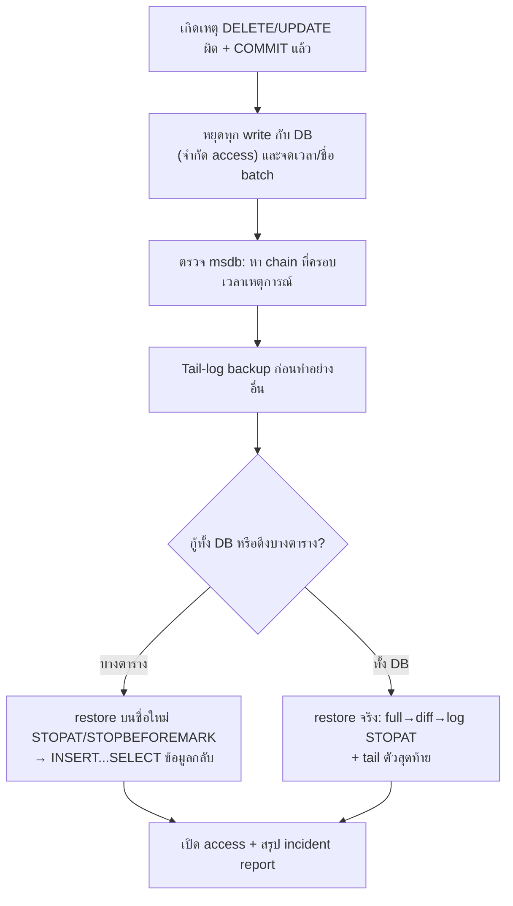

# Section 4 — Point-in-Time Restore: STOPAT และ Marked Transactions

เหตุการณ์ที่ทุก DBA เกลียดที่สุดคือ **ความผิดพลาดของมนุษย์ที่ commit ไปแล้ว** — ลบตารางผิด, UPDATE ลืม WHERE, script ราดยอดข้อมูลทิ้ง ถ้า recovery model เป็น FULL และ log chain ไม่ขาด คุณกู้กลับไป "วินาทีก่อนความผิดพลาด" ได้ด้วยสองเครื่องมือ: **STOPAT** (ระบุเวลา) และ **STOPATMARK** (ระบุจุดที่ฝังไว้ใน transaction) — Section นี้ใช้โครงเดโมเดิมของคอร์ส 20764D แล้วปรับให้รันได้ครบบนเครื่องเดียว

กติกาพื้นฐานของ point-in-time restore ทั้งหมด: ทำได้เฉพาะ **RESTORE LOG** (full/diff restore ไม่มี STOPAT), เวลาเป้าหมายต้องอยู่ในช่วงที่ **log chain ครอบคลุม** และจบด้วย RECOVERY ครั้งเดียวเท่านั้น

## 4.1 STOPAT — กู้กลับถึงเวลาที่กำหนด

โครงลำดับมาตรฐาน (กู้บน **ฐานข้อมูลสำเนาชื่อใหม่** เพื่อไม่ทับของจริงจนแน่ใจ):

```sql
-- ตรวจประวัติและระบุ chain ที่ครอบเวลาเหตุการณ์
SELECT name, type, backup_start_date, backup_finish_date, first_lsn, last_lsn
FROM msdb.dbo.backupset
WHERE database_name = N'AW2025'
ORDER BY backup_finish_date;

-- 1) full ที่มาก่อนเวลาเหตุการณ์
RESTORE DATABASE [AW2025_Recover]
FROM DISK = N'C:\SQLBackups\AW2025.bak'
WITH FILE = 1, NORECOVERY,
     MOVE N'AdventureWorks2025'     TO N'D:\Data\AW_Recover.mdf',
     MOVE N'AdventureWorks2025_log' TO N'D:\Data\AW_Recover_log.ldf';

-- 2) log ทุกอันหลัง full — STOPAT ให้ทุกอัน (ระบุเวลาเป้าหมายเดียวกัน)
RESTORE LOG [AW2025_Recover]
FROM DISK = N'C:\SQLBackups\AW2025_Log1.trn'
WITH NORECOVERY, STOPAT = N'2026-11-12T14:41:59';

RESTORE LOG [AW2025_Recover]
FROM DISK = N'C:\SQLBackups\AW2025_Log2.trn'
WITH RECOVERY, STOPAT = N'2026-11-12T14:41:59';   -- อันสุดท้ายจบด้วย RECOVERY
```

ข้อควรระวังที่ใช้ได้จริง:

- **เวลาเป้าหมายต้องมี log ครอบ** — log ตัวสุดท้ายที่คุณมีจบก่อนเวลาเหตุการณ์ → ต้องทำ tail-log backup ก่อน ไม่งั้นกู้ถึงแค่ปลาย log ที่มี
- ระบุ STOPAT ใน **ทุก** RESTORE LOG (ให้ทุกอันเห็นจุดตัดเดียวกัน) ไม่งั้นขั้นก่อนหน้าอาจกินเวลาเกินเป้า
- เวลาที่ใช้เป็นแบบ `datetime` — อ่านจาก job log, application log หรือ transaction timestamp (`sys.dm_exec_requests.start_time` ขณะเกิด)
- เวลาเป้าหมาย **ก่อน** จุดเริ่มของ log นั้น → engine ข้าม log นั้นไปได้ (restore เร็วขึ้น); เวลา **หลัง** จุดจบของ log ทั้งหมด → ต้องหา log เพิ่ม/tail
- STOPAT **ไม่จำเป็นต้องตรงเวลาที่เหตุเกิดพอดี** — ตั้งเวลา "หนึ่งวินาทีก่อนเหตุ" ปลอดภัยที่สุด

### ทำงานจริงทีละขั้นด้วยเวลาตัวอย่าง

| เวลา | เหตุการณ์ | ผลต่อข้อมูล |
|:-----|:-----------|:-------------|
| 14:00:00 | full backup | ข้อมูลถึง 14:00 ถูกเก็บ |
| 14:05:00 | user เพิ่มรายการขาย | งานอยู่ใน log |
| 14:10:00 | log backup รอบปกติ (จบ 14:10:02) | งานถึง 14:10 ถูกเก็บ |
| 14:15:00 | user เพิ่มรายการขายอีกกลุ่ม | ยังไม่ถูก backup |
| **14:20:00** | **script ผิด DROP TABLE (commit แล้ว)** | **ตารางหาย** |
| 14:25:00 | DBA เข้าจัดการ — tail-log backup | เก็บ log ถึง 14:25 |

การกู้: full (NORECOVERY) → log 14:10 (STOPAT 14:19:59, NORECOVERY) → tail (STOPAT 14:19:59, RECOVERY) — ได้ข้อมูลถึง **วินาทีก่อน DROP** รวมงาน 14:15 ที่ยังไม่เคยถูก backup เลย

เดโมที่จำลอง "UPDATE ราดยอดผิดพลาด" แล้วกู้กลับถึงวินาทีก่อนเหตุ (จดเวลาจริงทุกขั้นให้อัตโนมัติ): [Scripts/01_STOPAT_Restore.sql](Scripts/01_STOPAT_Restore.sql)

## 4.2 Marked Transactions — จุดตัดที่แม่นยำกว่านาฬิกา

เวลานาฬิกามีข้อจำกัด: งานที่เกิดติดกันในวินาทีเดียว หรือคุณไม่รู้เวลาที่แน่ชัด STOPATMARK ให้คุณ**ฝังจุดตัดใน transaction เอง**:

```sql
BEGIN TRANSACTION DeleteOldBatches
    WITH MARK N'ลบข้อมูล batch เก่า';
GO
DELETE FROM dbo.OldBatches WHERE created < '2025-01-01';
COMMIT TRANSACTION DeleteOldBatches;   -- mark ถูกเขียนลง log ตอน commit
```

- Mark ถูกบันทึกใน transaction log และใน **`msdb.dbo.logmarkhistory`** (ชื่อ, คำอธิบาย, database, user, เวลา, LSN)
- Restore ถึง mark: `RESTORE LOG ... WITH STOPATMARK = N'DeleteOldBatches'` — **รวม** transaction ที่ mark ด้วย (กู้ถึงหลัง commit ของ mark)
- Restore "ก่อน" mark: `WITH STOPBEFOREMARK = N'DeleteOldBatches'` — **ตัด** transaction นั้นทิ้ง (กู้ถึงก่อน mark) — เครื่องมือหลักของการกู้หลัง DELETE อันตราย
- ชื่อ mark ใช้ซ้ำได้ — ถ้าซ้ำ ให้ระบุจุดตัดด้วย `AFTER 'datetime'` เพื่อเลือกครั้งล่าสุดก่อนเวลานั้น
- ทั้ง mark name และ description ใช้อ้างอิงใน STOPATMARK ได้ (ตามตัวอย่างทางการของ Microsoft ที่ใช้ description)

```sql
-- ตรวจ mark ที่เคยฝังไว้
SELECT mark_name, description, database_name, mark_time, lsn
FROM msdb.dbo.logmarkhistory
ORDER BY mark_time DESC;

-- กู้กลับก่อนจุด mark (ตัด DELETE ทิ้ง)
RESTORE LOG [AW2025_Recover]
FROM DISK = N'C:\SQLBackups\AW2025_Log.trn'
WITH STOPBEFOREMARK = N'DeleteOldBatches', RECOVERY;
```

เงื่อนไขของ mark ที่ทำงานถูกต้อง:

- ฐานข้อมูลต้อง FULL/BULK_LOGGED และ mark ต้องถูก **COMMIT** ก่อน log backup ที่ครอบมัน
- mark ถูกบันทึกลง log ของ **ทุกฐานข้อมูลที่ transaction แตะ** ใน instance นั้น
- mark กินพื้นที่ log เล็กน้อย — ใช้เฉพาะ transaction ที่สำคัญกับ recovery strategy จริง ๆ (ตามเอกสาร Microsoft)

เดโมที่เทียบ STOPATMARK (รวม DELETE) กับ STOPBEFOREMARK (ตัด DELETE) บนสำเนาสองชุด: [Scripts/02_MarkedTransaction_StopAtMark.sql](Scripts/02_MarkedTransaction_StopAtMark.sql)

### กู้หลายฐานข้อมูลให้ตรงจุดเดียวกัน (related databases)

เมื่อระบบประกอบด้วยหลายฐานข้อมูลที่อ้างถึงกัน (เช่น ERP + warehouse) การกู้ให้ "สอดคล้องกันทางตรรกะ" ต้องใช้ mark คู่กันทั้งชุด — จุดสำคัญคือ mark ต้องถูกเขียนลง log **ของทุกฐานข้อมูล** — รูปแบบมาตรฐานจากเอกสารคือ stored procedure ที่มี `BEGIN TRAN ... WITH MARK` และถูกเรียกภายใต้ transaction เดียวกันข้ามทุก DB:

```sql
-- ทุกฐานข้อมูลมี procedure เดียวกัน (ตามเอกสาร sp_SetMark / sp_MarkAll)
CREATE PROCEDURE sp_SetMark @name nvarchar(128)
AS
BEGIN TRANSACTION @name WITH MARK
UPDATE ERP.dbo.Marks SET one = 1
COMMIT TRANSACTION;
GO

-- transaction ที่เรียก mark ทุกฐานข้อมูล (ผ่าน linked server เมื่อข้ามเครื่อง)
CREATE PROCEDURE sp_MarkAll @name nvarchar(128)
AS
BEGIN TRANSACTION
EXEC ERP.dbo.sp_SetMark @name
EXEC Warehouse.dbo.sp_SetMark @name
COMMIT TRANSACTION;
GO
```

ข้อจำกัดที่เอกสารระบุชัด: กู้ฐานข้อมูลที่เกี่ยวข้องได้ **เฉพาะถึง mark เท่านั้น ไม่ใช่ถึงเวลาใด ๆ** — การ commit แบบ two-phase ของ marked transaction ทำให้จุด mark ทุก log สอดคล้องกันพอดี ([Restore databases to marked transaction](https://learn.microsoft.com/sql/relational-databases/backup-restore/use-marked-transactions-to-recover-related-databases-consistently?view=sql-server-ver17))

## 4.3 SSMS Restore Timeline — เครื่องมือช่วยเลือกจุดกู้

ใน SSMS: คลิกขวา **Databases → Restore Database…** → เลือก source → ไปหน้า **Timeline** → เลือก **Specific date and time** แล้วลากแถบไปจุดเวลา:

- SSMS อ่านประวัติ msdb (จาก server ที่เก็บ chain นั้น) แล้ว**เลือกชุด backup ให้เอง** (full/diff/log ที่จำเป็น)
- แถวสถานะ "Partial" แสดงเมื่อ chain ไม่ครอบคลุมเวลาที่เลือก — สัญญาณว่าขาด log
- ปุ่ม **Verify backup contents** ให้เห็น backup set ที่จะถูกใช้ทีละอัน
- ข้อจำกัด: timeline ใช้ได้เมื่อประวัติอยู่ใน msdb ของ server ปัจจุบัน — ไฟล์ .bak ข้ามเครื่องที่ไม่มีประวัติต้องใช้ T-SQL + HEADERONLY เอง

> เคล็ดเชิงระบบ: กู้เพื่อ "ดึงข้อมูลบางตารางกลับ" ให้ restore บนชื่อ DB ใหม่ (สำเนา) เสมอ แล้ว `INSERT ... SELECT` ข้อมูลที่ต้องการกลับตัวจริง — เร็วกว่า ปลอดภัยกว่า และยกเลิกได้

## 4.4 Playbook ของเหตุการณ์ "ลบข้อมูลโดยบังอาจ"



รายละเอียดที่แผนผังยุบไว้ — ทำตามลำดับจริงเวลาเกิดเหตุ:

1. **หยุดการเขียนก่อน** — `ALTER DATABASE ... SET SINGLE_USER WITH ROLLBACK IMMEDIATE` หรือจำกัดเฉพาะทีม — เพราะข้อมูลที่เขียนต่อหลังเหตุจะซับซ้อนขึ้นเรื่อย ๆ
2. **จดเวลา** จาก application log / transaction timestamp — ใช้เป็น STOPAT
3. **tail-log backup** ก่อนอะไรก็แล้วแต่ — ถ้าเกิดผิดพลาดในขั้นนี้ งานล่าสุดจะหาย
4. **กู้บนชื่อใหม่** ด้วย chain ที่ครอบเวลาเหตุ (มักจบด้วย tail + STOPAT)
5. **ตรวจข้อมูล** บนสำเนาแล้วเทียบกับตัวจริง
6. **ยกข้อมูลกลับ** (INSERT...SELECT เฉพาะตาราง) หรือสลับตัวจริงด้วย restore จริงถ้าโจทย์ต้องการทั้งฐานข้อมูล
7. เขียน incident report — เวลาที่ใช้จริงกลายเป็นตัวเลข RTO ขององค์กร

### 🚀 SQL Server 2025 & Modern Notes
- **ADR เร่ง redo/undo ทุกเวอร์ชัน** — restore ที่ apply log เยอะ ๆ บนฐานข้อมูลที่เปิด ADR จบเร็วขึ้น; ADR บน tempdb (2025) ครอบงาน temp ด้วย ([ADR](https://learn.microsoft.com/sql/relational-databases/accelerated-database-recovery-concepts?view=sql-server-ver17))
- **Restore from URL/S3** — ไฟล์ log บน object storage กู้ต่อ STOPAT ได้เหมือน DISK ทุกประการ — จัดเก็บ log backup บน immutable blob (2025) ทำให้แผนนี้ปลอดภัยจากการโดนลบ
- การกู้ด้วย **snapshot backup** (SQL Server 2022+, `RESTORE ... WITH METADATA_ONLY`) คือทางเลือกเร็วสุดเมื่อองค์กรใช้ SAN snapshot — แต่ไม่มี point-in-time ระดับวินาทีเหมือน log chain
- Marked transactions ยังต้องการ FULL/BULK_LOGGED + log chain เหมือนเดิมทุกรุ่น — ไม่มีอะไรมาแทนความสม่ำเสมอของ log backup

> อ้างอิง: [Restore to a Point in Time](https://learn.microsoft.com/sql/relational-databases/backup-restore/restore-a-sql-server-database-to-a-point-in-time-full-recovery-model?view=sql-server-ver17), [RESTORE Statements — STOPAT/STOPATMARK](https://learn.microsoft.com/sql/t-sql/statements/restore-statements-transact-sql?view=sql-server-ver17), [Restore databases to marked transaction](https://learn.microsoft.com/sql/relational-databases/backup-restore/use-marked-transactions-to-recover-related-databases-consistently?view=sql-server-ver17)
