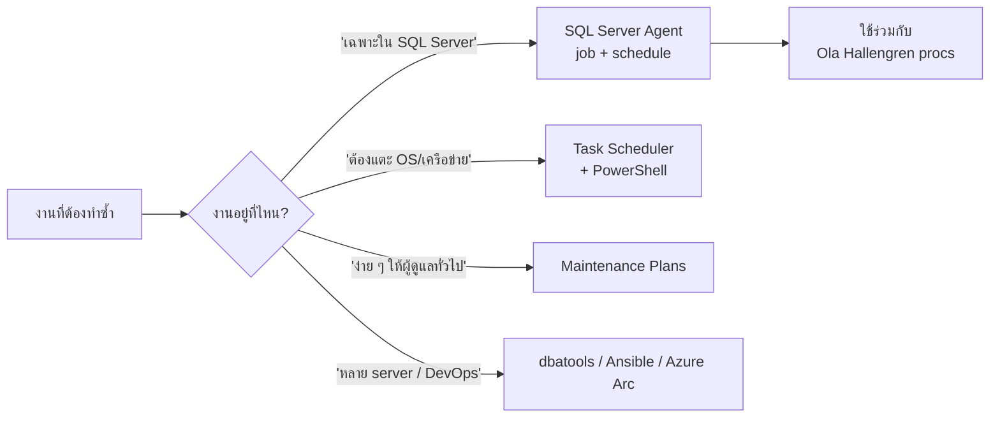
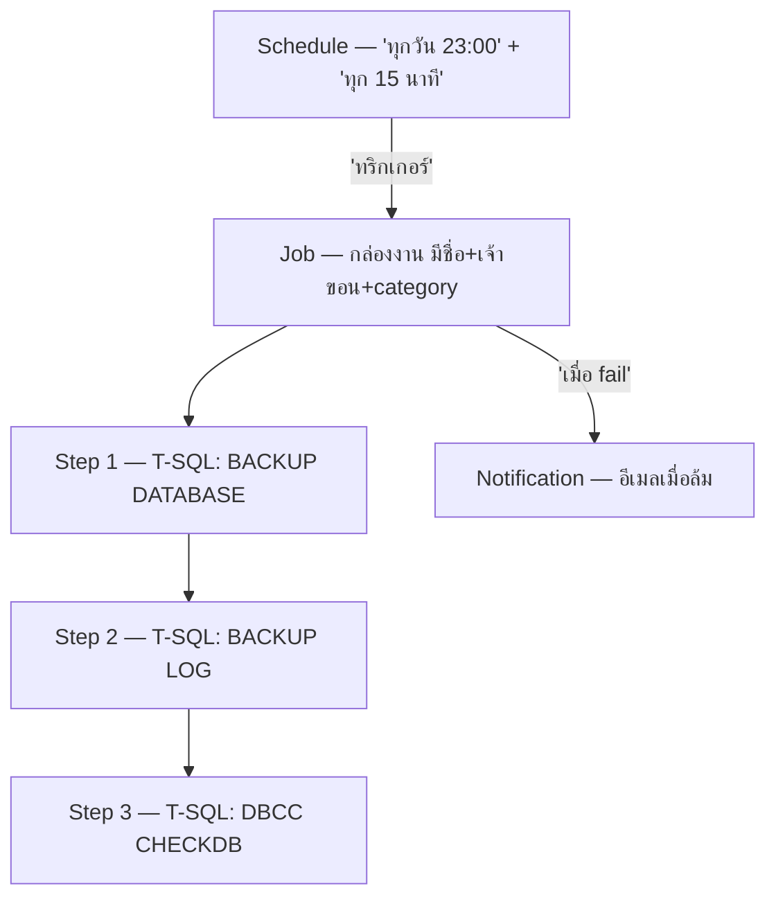

# Section 1 — ภาพรวม Automation และ SQL Server Agent

งาน DBA มีสองประเภทใหญ่: งานที่ต้องคิด (design, tuning, incident) และงานที่ต้อง "ทำซ้ำแบบเดิม ๆ ทุกวัน" — backup, CHECKDB, rebuild index, เก็บกวาด history ประเภทที่สองนี้ถ้ายังทำด้วยมือ นอกจากเสียเวลาแล้วยังเสี่ยงสูงสุดตอนคนลืม: backup ลืมรันสองวันแล้วเจอ disk crash คือหายนะที่ automation จะป้องกันได้ตั้งแต่ต้น

Section นี้ไม่ยังไม่สร้าง job แต่ตั้งฐานให้ถูกก่อน: เครื่องมือทางเลือกมีอะไรบ้าง และเลือกอย่างไร, SQL Server Agent ทำงานเป็นบริการ Windows อย่างไร ใช้ service account ใด และทำไมตัวเลือก `Agent XPs` ถึงมีความสัมพันธ์แบบ "เปิด-ปิดตามบริการ" กับ Agent

## 1.1 ประโยชน์ของ Automation ในงาน DBA

| ประโยชน์ | อธิบาย | ตัวอย่างผลกระทบเมื่อ "ลืมทำด้วยมือ" |
|:---------|:-------|:----------------------------------|
| **ความสม่ำเสมอ (Consistency)** | งานเดียวกันรันด้วยคำสั่ง/พารามิเตอร์ชุดเดียวกันทุกครั้ง | Backup ที่รันด้วยมือแต่ละคนใช้ option ไม่ตรงกัน บางครั้งลืม `WITH CHECKSUM` |
| **ครอบคลุมเวลาที่คนไม่อยู่** | Scheduler ทำงานตอนตี 2 ได้เท่ากับตอนบ่ายสาม | CHECKDB ที่ต้องรันทุกสัปดาห์ถูกเลื่อนหลายเดือนเพราะ "วันนี้ไม่ว่าง" |
| **ลดความผิดพลาดของมนุษย์** | ไม่มีการพิมพ์ชื่อฐานข้อมูลผิด / path ผิด | Backup ไปทับไฟล์สำคัญเพราะพิมพ์ path ผิด |
| **มีหลักฐานย้อนหลัง (Audit)** | Agent เก็บ history ทุกการรัน: สำเร็จ/ล้ม/ใช้เวลาเท่าไร | ไม่มีใครรู้ว่า backup ครั้งล่าสุดสำเร็จเมื่อไหร่จนวันที่ต้อง restore |
| **ปรับสเกลได้** | job เดียวใช้ซ้ำกับ server อื่นได้ / กระจายแบบ multiserver | มี server 10 ตัว = ทำด้วยมือ 10 เท่า |
| **ตอบสนองอัตโนมัติ** | Job รันเมื่อ alert เกิด เช่น backup ทันทีเมื่อเจอ error | ระบบพังก่อนคนจะเห็น |

กฎของหลายองค์กร ("สิ่งที่ทำซ้ำสามครั้งต้องกลายเป็น script") ในงาน DBA ยิ่งเข้มกว่านั้น: **งานรักษาความปลอดภัยของข้อมูลเช่น backup ต้องเป็น automation เสมอ** มาตรฐานเช่น SOX/HIPAA ก็ตรวจข้อนี้เป็นเรื่องปกติ

## 1.2 ทางเลือกเครื่องมือ Automation — เลือกอย่างไร

SQL Server ecosystem มีตัวเลือกหลายชั้น เครื่องมือที่ดีที่สุดคือตัวที่ "เล็กที่สุดที่ทำงานได้" (least machinery):

| เครื่องมือ | ธรรมชาติ | จุดแข็ง | จุดอ่อน | เหมาะกับ |
|:-----------|:---------|:-------|:--------|:---------|
| **SQL Server Agent** | บริการ Windows/Linux ที่มาพร้อม SQL Server เก็บทุกอย่างใน `msdb` | Scheduler แม่น, job หลาย step, history + notification ในตัว, multiserver (MSX/TSX), ผูกกับ alerts ได้ | อยู่ใน instance เดียวเท่านั้น (ยกเว้น MSX/TSX), จัดการหลาย server ต้องเพิ่มเครื่องมือ | งาน maintenance ทั้งหมดของ SQL Server — คำตอบหลักของโมดูลนี้ |
| **Maintenance Plans** | Designer ใน SSMS ที่สร้าง Agent jobs แบบ SSIS package ให้ | คลิกครั้งเดียวได้ backup/shrink/CHECKDB/rebuild, มี wizard | ควบคุมละเอียดน้อย, พฤติกรรมต่อ database แบบ generic, debug ยาก | สภาพแวดล้อมเล็ก/ผู้ดูแลไม่ใช่ DBA เต็มเวลา |
| **Windows Task Scheduler + PowerShell** | Scheduler ระดับ OS รัน .ps1 ที่ใช้ `SqlServer` module / dbatools | แตะสิ่งนอก SQL Server (copy ไฟล์, FTP, ควบคุม service), รวมกับ pipeline อื่นได้ | ต้องจัดการ credentials/ความปลอดภัยเอง, history แยกจาก SQL Server | งาน hybrid เช่น backup เสร็จแล้ว copy ขึ้น NAS |
| **Ola Hallengren's Maintenance Solution** | ชุด stored procedures T-SQL ฟรี (DatabaseBackup, DatabaseIntegrityCheck, IndexOptimize) ติดตั้งใน SQL Server แล้วเรียกจาก Agent jobs | มาตรฐาน de facto ของวงการ, จัดการทุก database ใหม่อัตโนมัติ, logging ละเอียด | ต้องอ่านเอกสาร parameter พอสมควร | งานจริงเกือบทุกขนาด — pattern ที่เราจะเทียบใน Section 2 |
| **dbatools / Ansible / Azure automation** | Automation จากภายนอก (PowerShell ของชุมชน, IaC, cloud) | Version control ได้, ทำ fleet-wide, idempotent | ต้องมี infrastructure ของเครื่องมือเอง, ความรู้เพิ่ม | องค์กรที่มี DevOps/fleet ใหญ่ — คุยละเอียดใน Section 4 |



> **จุดตายที่ต้องจำ**: Maintenance Plans ก็สร้าง Agent jobs อยู่ดี (`System Database Backups.Subplan_1` ที่เห็นในสภาพแวดล้อมทั่วไปคือ output ของ Maintenance Plan) และผู้เชี่ยวชาญส่วนใหญ่เลือกเขียน T-SQL steps เองหรือใช้ชุดของ [Ola Hallengren](https://ola.hallengren.com) เพราะควบคุมและ troubleshoot ได้ดีกว่ามาก

## 1.3 SQL Server Agent Service — บริการหลังบ้าน

SQL Server Agent เป็น **Windows service แยกจาก Database Engine** (`SQLSERVERAGENT` สำหรับ default instance, `SQLAgent$<Instance>` สำหรับ named instance) ที่เชื่อมกลับมาที่ engine ด้วย SQL connection ของตัวเอง ทำงานบน Linux/container ได้เช่นกัน (บริการ `mssql-server-agent`)

ตรวจสถานะและ service account ได้จาก DMV:

```sql
SELECT servicename, service_account, startup_type_desc, status_desc,
       is_clustered, immediate_restart
FROM sys.dm_server_services
WHERE servicename LIKE N'SQL Server Agent%';
```

✅ **สังเกต**: บน install ปกติคุณจะเห็น service account เป็น **`NT SERVICE\SQLSERVERAGENT`** ซึ่งเป็น *virtual account* ที่ผูกกับ **per-service SID** (`NT SERVICE\SQLSERVERAGENT` ตัวนี้เอง) — เป็นรูปแบบ default ของ SQL Server 2008 เป็นต้นมา

### Service Account: ใช้อะไรดี

| ทางเลือก | คำอธิบาย | ข้อควรระวัง |
|:---------|:---------|:------------|
| **Virtual account `NT SERVICE\SQLSERVERAGENT`** (default) | Windows จัดการรหัสผ่านให้เอง ไม่ต้องหมุนรหัสผ่าน | ถูก map เป็น login ใน SQL Server ผ่าน per-service SID และเป็นสมาชิก **sysadmin** โดยอัตโนมัติ |
| **Managed service account (gMSA)** | Account ของ AD ที่ Windows หมุนรหัสผ่านให้ | ต้องมี domain — เหมาะองค์กรที่มีนโยบายจัดการ account กลาง |
| **Domain/local user account** | แบบเก่า จัดการรหัสผ่านเอง | ต้องหมุนรหัสผ่านทุกที่ที่ใช้; ห้ามใช้ account ที่มนุษย์ login เป็นบ้าน |
| **LocalSystem / NetworkService** | ยิ่งใหญ่เกินจำเป็น | **ห้ามใช้ใน production** — มีสิทธิ์กว้างกว่าที่ Agent ต้องใช้ |

หลักสำคัญ: **Agent service account ต้องเป็นสมาชิก sysadmin ของ instance** เพราะ job steps ที่เจ้าของเป็น sysadmin จะรันใน context ของ account นี้ (ลึกกว่านั้นจะได้เรียนใน Module 9) การเปลี่ยน account ทำผ่าน **SQL Server Configuration Manager** (ไม่ใช่ `services.msc` เฉย ๆ) เพื่อให้ SQL Server ตั้งค่า SPN/SID ให้ครบ

> **แล็บของคอร์สนี้ใช้ default ทั้งหมด** — `NT SERVICE\SQLSERVERAGENT` บน Windows หรือบริการในตัวของ container ไม่ต้องมี domain

### สิ่งที่ Agent ต้องเข้าถึงใน OS

- โฟลเดอร์ backup และ output file ที่ job เขียน (สร้างโฟลเดอร์และ GRANT ให้ service account เองถ้าเลิกใช้ default path)
- `PreloadRegistry` / WMI สำหรับ WMI alerts (Module 10)
- สิทธิ์ "Log on as a service" — virtual account ได้โดยอัตโนมัติ

## 1.4 ตัวเลือก Agent XPs — กุญแจที่เปิดโมดูลนี้

Agent ทำงานผ่าน extended stored procedures (`xp_sqlagent_*`, `xp_sqlagent_enum_jobs` ฯลฯ) ที่ถูกควบคุมด้วย server configuration option ชื่อ **`Agent XPs`** กฎการทำงานที่นักเขียนเอกสารของ Microsoft กำหนดไว้คือ:

- เมื่อ **Agent service เริ่มทำงาน** → engine เปิด `Agent XPs` ให้เองและป้องกันไม่ให้ปิด
- เมื่อ **Agent service หยุด** → `Agent XPs` ถูก **disable อัตโนมัติ** ทำให้ทุกคำสั่งที่เรียก Agent (สร้าง job, `sp_start_job` ฯลฯ) พังทันทีด้วย error **"Agent XPs component is turned off as part of the security configuration for this server"**

ถ้าเจอสถานการณ์นี้ (เช่น Agent เคยหยุดจากการหยุดเครื่อง) เปิดกลับด้วยสคริปต์:

```sql
USE master;
GO
EXEC sp_configure 'show advanced options', 1;
RECONFIGURE;
GO
EXEC sp_configure 'Agent XPs', 1;   -- 0 = ปิด, 1 = เปิด
RECONFIGURE;
GO
```

สคริปต์เดโมฉบับเต็ม (ตรวจสถานะบริการ + เปิดตัวเลือก + อ่านค่ากลับมาแสดง) อยู่ที่ [Scripts/01_Enable_Agent_XPs.sql](Scripts/01_Enable_Agent_XPs.sql)

> ถ้าติดตั้งด้วยตัวเองตาม [Module 00](../../../Module_00_Getting_Started/README.md) แล้วเลือก Database Engine Services + SQL Server Agent คุณจะไม่เจอปัญหานี้ — ตัวเลือกถูกเปิดโดย installer แล้ว

## 1.5 ตั้งค่าพื้นฐานของ Agent ที่ควรรู้

จุดตั้งค่าหลักอยู่ที่ SSMS: **Object Explorer → SQL Server Agent → Properties** — หน้าที่ใช้บ่อยในโมดูลนี้และโมดูลถัดไป:

| หน้า (Page) | ตั้งอะไร | ใช้ตอนไหน |
|:------------|:---------|:----------|
| **General** | พฤติกรรม restart อัตโนมัติเมื่อ engine/Agent ล้ม, ที่อยู่ Agent error log | หลังติดตั้งใหม่ |
| **Job System** | Shutdown timeout ของ job, จำกัด job history (ดู Section 3) | เจอ job รันเกินเวลา shutdown |
| **Alert System** | Mail profile ที่ Agent ใช้ส่งอีเมล, fail-safe operator | ก่อนตั้ง notification (Module 10) |
| **History** | จำนวนแถว job history ที่เก็บ, ล้างประวัติเก่า | Section 3 ของโมดูลนี้ |

ระดับ T-SQL คุณจะใช้ `msdb.dbo.sp_set_sqlagent_properties` เป็นตัวแทนของหน้าจอเหล่านี้ (พารามิเตอร์หลายตัว ใช้เฉพาะที่จำเป็น) — เราจะใช้จริงตอนปรับ history retention ใน Section 3

### ตรวจความพร้อมก่อนเข้า Section ถัดไป

```sql
-- 1) Agent รันอยู่และ account ใด
SELECT servicename, service_account, status_desc
FROM sys.dm_server_services
WHERE servicename LIKE N'SQL Server Agent%';

-- 2) ตัวเลือก Agent XPs เปิดอยู่
SELECT name, value_in_use
FROM sys.configurations
WHERE name = N'Agent XPs';

-- 3) ยังไม่มี jobs หรือมีแล้ว (ของระบบติดตั้งมาเองเช่น syspolicy_purge_history ปกติ)
SELECT job_id, name, enabled, date_modified
FROM msdb.dbo.sysjobs
ORDER BY name;
```

**Expected:** (1) status = `Running`, (2) value_in_use = 1, (3) ถ้าติดตั้งสดจะเห็นเฉพาะ `syspolicy_purge_history` ซึ่งเป็น job ในตัวของ Policy-Based Management — เห็นตัวนี้แปลว่า Agent และ msdb schema พร้อมใช้แล้ว

## 1.6 โครงสร้างของ "งานอัตโนมัติ" ที่จะสร้างในโมดูลนี้

สิ่งที่จะประกอบกันตั้งแต่ Section 2 เป็นต้นไป มีสามชิ้นหลัก (จำเป็นต้องเห็นภาพรวมก่อนลงรายละเอียด):



- **Job** = คอนเทนเนอร์ของงาน — เก็บชื่อ, เจ้าขอน, category, ตัวเลือก notification
- **Job Step** = งานย่อยหนึ่งชิ้นที่รันด้วย subsystem ใด subsystem หนึ่ง (T-SQL, CmdExec, PowerShell, SSIS …) พร้อมกฎไหลต่อ (`on_success` / `on_fail`)
- **Schedule** = เวลาทริกเกอร์ — ผูกเข้ากับ job ได้หลายอัน และ share ข้าม job ได้ (ดู Section 2)
- **Notification** = แจ้ง operator ทางอีเมลเมื่อ job จบ/ล้ม (พึ่ง Database Mail จาก Module 10)

### 🚀 SQL Server 2025 & Modern Notes

- **TLS 1.3 / TDS 8.0**: SQL Server Agent (และส่วนประกอบอื่นอย่าง sqlcmd, bcp, SQL Writer) รองรับการเข้ารหัสระดับ strict ของ SQL Server 2025 — เมื่อ enforce `Force Encryption` แบบ strict, Agent ยังเชื่อมต่อ engine ได้โดยไม่ต้องตั้งค่าเพิ่ม ([What's new](https://learn.microsoft.com/sql/sql-server/what-s-new-in-sql-server-2025?view=sql-server-ver17))
- **Virtual account ยังเป็นคำแนะนำ default** — เอกสาร [Select an Account for the SQL Server Agent Service](https://learn.microsoft.com/sql/ssms/agent/select-an-account-for-the-sql-server-agent-service?view=sql-server-ver17) แนะนำ per-service SID / gMSA ยังคงเป็นทางเลือกสำหรับ domain
- **Maintenance Plans เหมาะงานง่ายเท่านั้น** — สำหรับงานจริง แนวปฏิบัติปัจจุบันคือ T-SQL jobs หรือ [Ola Hallengren's Maintenance Solution](https://ola.hallengren.com) ซึ่งเราจะสร้าง job ตามแพตเทิร์นของเขาใน Section 2
- **Agent on Linux/containers**: รัน job ได้ แต่ปรับค่า agent ผ่าน `mssql-conf` (เช่น `sqlagent.enabled = true`) และ CmdExec รันผ่าน shell ของ OS แทน cmd.exe
- ตัวเลือก notification แบบ **Pager และ net send** กำลังถูกถอดออกจาก SQL Server Agent — ระบบใหม่ควรออกแบบด้วย email เท่านั้น ([SQL Server Agent alerts](https://learn.microsoft.com/sql/relational-databases/system-stored-procedures/sp-add-alert-transact-sql?view=sql-server-ver17))

> อ้างอิง: [SQL Server Agent overview](https://learn.microsoft.com/sql/ssms/agent/sql-server-agent), [Select an Account for the SQL Server Agent Service](https://learn.microsoft.com/sql/ssms/agent/select-an-account-for-the-sql-server-agent-service?view=sql-server-ver17), [Agent XPs configuration option](https://learn.microsoft.com/sql/database-engine/configure-windows/agent-xps-server-configuration-option?view=sql-server-ver17), [sys.dm_server_services](https://learn.microsoft.com/sql/relational-databases/system-dynamic-management-views/sys-dm-server-services-transact-sql?view=sql-server-ver17)
