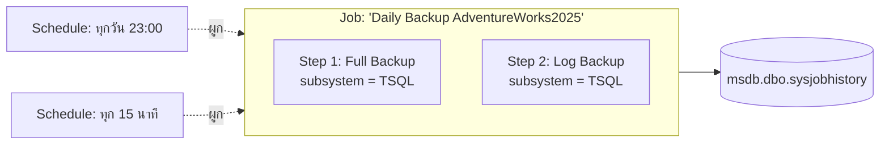

# Section 2 — Agent Jobs: Steps, Subsystems และ Schedules

หัวใจของ SQL Server Agent คือ **Job** — กล่องงานที่ประกอบด้วย steps หนึ่งขึ้นไป ทริกเกอร์ด้วย schedule หรือเหตุการณ์ และเก็บประวัติการรันทุกครั้งใน `msdb` Section นี้คุณจะสร้าง job ด้วย T-SQL ล้วน ๆ ตั้งแต่ `sp_add_job` จนถึง schedule แบบ recurring — เพราะเมื่อทำเป็นสคริปต์แล้ว คุณจะสร้าง job เดิมให้ server ใหม่ได้ในคำสั่งเดียว และทบทวนว่า job ทำอะไรได้โดยไม่ต้องเปิดหน้าจอ

เราจะปิดท้ายด้วยงานจริงสามชุดที่ DBA สร้างเกือบทุกที่: **backup job**, **DBCC CHECKDB job** และ **index maintenance** ตามแพตเทิร์นของ Ola Hallengren

## 2.1 กายวิภาคของ Job: Job → Step → Schedule → Category



องค์ประกอบทั้งหมดเก็บใน `msdb`:

| องค์ประกอบ | ตารางหลัก | หน้าที่ |
|:-----------|:----------|:--------|
| **Job** | `msdb.dbo.sysjobs` | คอนเทนเนอร์ — ชื่อ, เจ้าขอน (owner), เปิด/ปิดใช้งาน, ระดับ notification |
| **Job Step** | `msdb.dbo.sysjobsteps` | งานย่อยที่รันด้วย **subsystem** หนึ่ง พร้อมกฎไหลต่อเมื่อสำเร็จ/ล้ม |
| **Schedule** | `msdb.dbo.sysschedules` + `sysjobschedules` | เวลาทริกเกอร์ — ผูกได้หลายอันต่อ job และ share ข้าม job ได้ |
| **Category** | `msdb.dbo.syscategories` | หมวดหมู่จัดระเบียบ (Database Maintenance, REPL-* ฯลฯ) — ช่วยกรองในหน้าจอ |
| **History** | `msdb.dbo.sysjobhistory` | บันทึกการรันแต่ละครั้ง (ลึกใน Section 3) |

## 2.2 สร้าง Job พื้นฐาน — sp_add_job

สคริปต์เดโมฉบับเต็ม: [Scripts/01_Create_Job_Steps_Schedule.sql](Scripts/01_Create_Job_Steps_Schedule.sql)

```sql
USE msdb;
GO

-- 1) หมวดหมู่ (ถ้าต้องการเกิน [Uncategorized (Local)] ที่มีให้แล้ว)
IF NOT EXISTS (SELECT 1 FROM dbo.syscategories
               WHERE name = N'Fabrikam Maintenance' AND category_class = 1)
    EXEC dbo.sp_add_category @class = N'JOB', @type = N'LOCAL',
                             @name = N'Fabrikam Maintenance';
GO

-- 2) ตัว job — ยังไม่มี step เท่ากับ "กล่องเปล่า"
DECLARE @jobId BINARY(16);

IF EXISTS (SELECT 1 FROM dbo.sysjobs WHERE name = N'Fabrikam - Demo Job')
    EXEC dbo.sp_delete_job @job_name = N'Fabrikam - Demo Job',
                           @delete_unused_schedule = 1;

EXEC dbo.sp_add_job
    @job_name              = N'Fabrikam - Demo Job',
    @enabled               = 1,
    @description           = N'Demo job สร้างใน Module 8 Section 2',
    @category_name         = N'Fabrikam Maintenance',
    @owner_login_name      = N'sa',
    @notify_level_eventlog = 0,       -- 0=ไม่บันทึก eventlog, 2=เมื่อ fail
    @notify_level_email    = 0,       -- 0=ไม่แจ้ง, 1=success, 2=fail, 3=always
    @job_id                = @jobId OUTPUT;
GO
```

พารามิเตอร์ที่ต้องรู้ของ `sp_add_job`:

| พารามิเตอร์ | ค่าและความหมาย |
|:------------|:---------------|
| `@job_name` | ชื่อเฉพาะภายใน instance (สร้างซ้ำจะ error 14261) — สคริปต์ idempotent จึงลบของเดิมก่อนเสมอ |
| `@enabled` | 1 = ทำงานตาม schedule ได้, 0 = พักการใช้งาน (job ยังรัน manual ได้ด้วย `sp_start_job`) |
| `@owner_login_name` | เจ้าขอน job — คุม context การรันของ T-SQL step (Module 9); default = ผู้สร้าง |
| `@notify_level_email` | 0=ไม่แจ้ง, 1=เมื่อสำเร็จ, 2=เมื่อล้ม, 3=ทั้งสองกรณี — ต้องมี operator + Database Mail (Module 10) |
| `@notify_level_netsend` / `@notify_level_page` | ตัวเลือกเดิมสำหรับ net send / pager — **กำลังถูกถอด อย่าใช้ในงานใหม่** |
| `@delete_level` | 1 = ลบ job ทิ้งหลังรันเสร็จ (ใช้กับงานครั้งเดียวจริง ๆ), 0 = เก็บไว้ |

> **จุดละเอียด**: `@owner_login_name` รับชื่อ **login** (ไม่ใช่ user) และเจ้าขอนที่เป็น sysadmin จะทำให้ T-SQL step รันในบริบทของ Agent service account — เจ้าขอนที่ไม่ใช่ sysadmin จะรันในบริบทของตัวเอง กฎนี้คือหัวใจของ Module 9

## 2.3 Job Steps — sp_add_jobstep และ Subsystems

แต่ละ step รันผ่าน **subsystem** ที่กำหนดชนิดงาน:

| Subsystem | ค่า `@subsystem` | ทำอะไร | หมายเหตุ |
|:----------|:-----------------|:-------|:---------|
| **Transact-SQL** | `TSQL` | รัน batch T-SQL ในฐานข้อมูลที่ระบุ (`@database_name`) | subsystem เดียวที่ **ไม่ต้องใช้ proxy** แม้เจ้าขอนไม่ใช่ sysadmin |
| **CmdExec** | `CMDEXEC` | รันคำสั่ง OS (cmd.exe / shell) เช่น copy ไฟล์ backup | ต้องมี proxy ถ้าเจ้าขอนไม่ใช่ sysadmin (Module 9) |
| **PowerShell** | `POWERSHELL` | รัน script PowerShell ด้วย `SqlServer` module | Windows ใช้ PowerShell 5+; บน Linux ข้อจำกัดตามรุ่น |
| **SSIS** | `SSIS` | รัน .dtsx package (ผลจาก Import/Export Wizard หรือ Maintenance Plan) | ต้องติดตั้ง Integration Services |
| **Analysis Services** | `ANALYSISQUERY` / `ANALYSISCOMMAND` | รัน MDX/XMLA กับ SSAS | สำหรับ OLAP environment |
| **Replication** | `SNAPSHOT` / `LOGREADER` / `DISTRIBUTION` / `MERGE` / `QUEUE` | Agent ของระบบ Replication | สร้างโดย wizard ปกติ ไม่ควรแก้มือ |

พารามิเตอร์ flow ที่ทุก step ใช้กำหนดการวิ่งของ job:

```sql
EXEC dbo.sp_add_jobstep
    @job_name           = N'Fabrikam - Demo Job',
    @step_name          = N'Step 1 - นับข้อมูล',
    @subsystem          = N'TSQL',
    @database_name      = N'AdventureWorks2025',
    @command            = N'SELECT COUNT(*) AS SalesOrders FROM Sales.SalesOrderHeader;',
    @on_success_action  = 3,     -- 1=จบ success, 2=จบ fail, 3=ไป step ถัดไป, 4=ไป step ที่กำหนด
    @on_success_step_id = 0,
    @on_fail_action     = 2,     -- จบด้วยสถานะ fail เมื่อ step นี้ล้ม
    @retry_attempts     = 2,     -- ลองใหม่สูงสุด 2 ครั้งเมื่อ step ล้ม
    @retry_interval     = 5;     -- เว้น 5 นาทีระหว่างการ retry
GO
```

- `@on_success_action` / `@on_fail_action`: **1** = จบ job แบบสำเร็จ, **2** = จบ job แบบล้ม, **3** = ไป step ถัดไป, **4** = กระโดดไป `@on_success_step_id` / `@on_fail_step_id`
- `@retry_attempts` + `@retry_interval`: แก้ปัญหาชั่วคราวได้ (เช่น deadlock, file lock) — อย่าใช้กลบบั้งปู้ปัญหาจริง
- `@output_file_name`: เขียนผลลัพธ์ของ step ลงไฟล์ (Agent service account ต้องเขียนโฟลเดอร์นั้นได้) — ทางเลือกเมื่ออยากเก็บ log ข้าม history retention
- `@proxy_name`: ใช้ proxy account สำหรับ subsystem นอก T-SQL (Module 9)

## 2.4 Schedules — sp_add_jobschedule

Schedule คือ "นาฬิกา" ที่ผูกเข้า job; หนึ่ง job มีได้หลาย schedule และ schedule หนึ่ง share ให้หลาย job ได้ด้วย `sp_attach_schedule`:

```sql
-- Recurring: ทุกวัน ตี 1 ของวันถัดไป
EXEC dbo.sp_add_jobschedule
    @job_name        = N'Fabrikam - Demo Job',
    @name            = N'Nightly at 01:00',
    @freq_type       = 4,               -- 4 = Daily
    @freq_interval   = 1,               -- ทุกวัน
    @freq_subday_type = 1,              -- 1 = ครั้งเดียวต่อวัน ณ เวลาที่กำหนด
    @active_start_time = 010000,        -- HHMMSS = 01:00:00
    @active_end_date = 99991231;        -- ไม่มีวันสิ้นสุด
GO

-- One-off: รันครั้งเดียวคืนสุดสัปดาห์หน้า (เช่นก่อน upgrade)
EXEC dbo.sp_add_jobschedule
    @job_name        = N'Fabrikam - Demo Job',
    @name            = N'One-off before upgrade',
    @freq_type       = 1,               -- 1 = รันครั้งเดียว
    @active_start_date = 20260120,      -- YYYYMMDD
    @active_start_time = 220000;
GO
```

ค่าที่ใช้บ่อยของ `@freq_type`:

| ค่า | ความหมาย | ใช้เมื่อ |
|:----|:---------|:--------|
| 1 | **One-time** — ครั้งเดียว ณ วัน/เวลา | งานพิเศษ, งานก่อน-หลัง maintenance window |
| 4 | **Daily** — ทุก `@freq_interval` วัน | ทุกวัน / ทุก 2 วัน |
| 8 | **Weekly** — วันที่เลือกใน `@freq_interval` (บิต: 1=อา, 2=จ, 4=อ, 8=พ, 16=พฤ, 32=ศ, 62=จันทร์-ศุกร์, 63=ทุกวัน) | เฉพาะวันทำการ |
| 16 | **Monthly** — วันที่ n ของเดือน | เช่นทุก 1 ค่ำ |
| 32 | **Monthly relative** — เช่น "จันทร์แรกของเดือน" | เลี่ยงวันสิ้นเดือนที่หลากหลาย |
| 64 | **Auto-start** — รันเมื่อ Agent เริ่มทำงาน | job ประจำหลัง failover/startup |
| 128 | **Idle CPU** — รันเมื่อ CPU ว่าง | งานหนักที่ยอมรอ |

และ `@freq_subday_type` คุม "ความถี่ย่อยในหนึ่งวัน": **1** = ณ เวลาเดียว, **2** = ทุก x วินาที, **4** = ทุก x นาที, **8** = ทุก x ชั่วโมง (คู่กับ `@freq_subday_interval`) — log backup "ทุก 15 นาที" ในแล็บคือ `@freq_subday_type = 4, @freq_subday_interval = 15`

## 2.5 แปลง Job ที่มีอยู่เป็นสคริปต์ (Script Job as CREATE)

งานที่คุณสร้างด้วย SSMS GUI ก็กลับมาเป็น T-SQL ได้เสมอ ซึ่งเป็นวิธีที่มืออาชีพใช้เก็บ job เข้า source control:

1. คลิกขวา job → **Script Job as** → **CREATE To** → **New Query Editor Window** (หรือ File)
2. จะได้สคริปต์ที่เริ่มด้วย `BEGIN TRANSACTION` + `sp_add_job` + `sp_add_jobstep` + `sp_add_jobschedule` + `sp_add_jobserver` + `COMMIT` — โครงเดียวกับที่เราเขียนเองด้านบน (จะเห็น `IF (@@ERROR <> 0 ...) GOTO QuitWithRollback` ครอบแต่ละขั้นด้วย)
3. ลบ `@schedule_uid` แบบ hard-coded ก่อน deploy ที่ server อื่น (UID อ้าง schedule เก่าที่ไม่มีอยู่) และเปลี่ยน `@owner_login_name` จาก domain ที่อาจไม่มีใน server ปลายทาง

> `sp_add_jobserver @job_id = @jobId, @server_name = N'(local)'` ที่ท้ายสคริปต์คือบรรทัดที่ "ปล่อย job ให้รันบน server นี้" — ลืมบรรทัดนี้ = job มีอยู่แต่รันไม่ได้ เป็นข้อผิดพลาดคลาสสิกเมื่อเขียนสคริปต์เอง (เห็นใน job ของ Maintenance Plan เดิมด้วย)

## 2.6 งานจริงที่ 1: Backup Job (Full + Log ทุก 15 นาที)

แล็บของโมดูลนี้สร้างฉบับเต็มแล้ว (Exercise 1) — ส่วนนี้อธิบายรูปแบบที่ใช้จริง: ชื่อไฟล์ backup ใส่วันที่เพื่อเก็บหลายรุ่น และ log backup **append** เข้าไฟล์เดียวต่อวัน (ไม่ใช้ INIT เพื่อไม่ตัด log chain):

```sql
-- แนวคิดของ step full backup (ทุกวัน 23:00) — ไฟล์แต่ละวันแยกกัน
DECLARE @cmd nvarchar(max) = N'
BACKUP DATABASE [AdventureWorks2025]
TO DISK = N''D:\Backups\AdventureWorks2025_Full_'
    + CONVERT(nvarchar(8), GETDATE(), 112) + N'.bak''
WITH COMPRESSION, CHECKSUM, STATS = 5;';
```

- `CONVERT(..., 112)` = วันที่รูปแบบ `20261112` — ทำให้แต่ละวันมีไฟล์ของตัวเอง
- `WITH COMPRESSION` ใช้ compression algorithm default ของ instance; SQL Server 2025 ตั้งให้เป็น ZSTD ได้ (ดู Module 6)
- step log backup ทุก 15 นาทีใช้ไฟล์ประจำวันเดียวกัน `..._Log_<วันที่>.trn` **โดยไม่มี INIT** เพื่อ append เข้า media set เดิม

> เส้นทางที่แล็บใช้ปลอดภัยกับทุก environment: อ่าน default backup path จาก `SERVERPROPERTY('InstanceDefaultBackupPath')` (SQL Server 2019+) แล้วฝังลงคำสั่ง step แบบไดนามิก — ดูแล็บ Exercise 1

## 2.7 งานจริงที่ 2: DBCC CHECKDB Job

CHECKDB ต้องรันสม่ำเสมอ (แนะนำอย่างน้อยรายสัปดาห์) เพราะ corruption ที่จับได้เร็วกู้ง่ายกว่ามาก จุดที่ต้องตัดสินใจใน job:

```sql
-- Step: CHECKDB — เก็บเฉพาะเมื่อเจอปัญหา (NO_INFOMSGS) และใช้ TEMPDB แทน memory เพื่อลดกระทบ
DBCC CHECKDB (N'AdventureWorks2025')
    WITH NO_INFOMSGS, PHYSICAL_ONLY, TABLOCK, MAXDOP = 4;
```

| Option | เมื่อไหร่ใช้ |
|:-------|:-------------|
| `NO_INFOMSGS` | เก็บเฉพาะข้อความจริง — ต้องมีเสมอใน job |
| `PHYSICAL_ONLY` | ตรวจเฉพาะโครงสร้างกายภาพ เร็วกว่ามาก — ใช้ทุกคืนเพื่อกัน disk/ไฟล์เสีย |
| `TABLOCK` | ลดการแย่ง lock ระหว่าง CHECKDB กับงานอื่น |
| แบบเต็ม (ไม่ใส่ PHYSICAL_ONLY) | รายสัปดาห์/รายเดือนใน window กว้าง — เจอ logical corruption ได้ด้วย |

จุดสำคัญคือ `DBCC CHECKDB` คืนสถานะ fail ให้ step เมื่อเจอ consistency error (severity 21+ style) — job จะล้มตาม `@on_fail_action` ทันที และถ้าตั้ง notification ไว้ (Module 10) DBA จะได้อีเมลโดยไม่ต้องอ่าน log เอง

## 2.8 งานจริงที่ 3: Index Maintenance — แพตเทิร์น Ola Hallengren

ทั้ง backup/CHECKDB/index ในระดับ production ทั่วโลกส่วนใหญ่ใช้ [Ola Hallengren's Maintenance Solution](https://ola.hallengren.com) — ชุด stored procedures ฟรี ติดตั้งใน `master` แล้วเรียกจาก Agent jobs:

```sql
-- (หลังติดตั้ง MaintenanceSolution.sql จาก ola.hallengren.com ลง master)

-- Backup ทุก user database, บีบอัด, ตรวจ checksum, เก็บ 7 วัน
EXECUTE dbo.DatabaseBackup
    @Databases      = 'USER_DATABASES',
    @Directory      = N'D:\Backups',
    @BackupType     = 'FULL',
    @Compress       = 'Y',
    @CheckSum       = 'Y',
    @CleanupTime    = 604800;            -- ลบ backup เก่ากว่า 7 วัน

-- CHECKDB ทุก user database
EXECUTE dbo.DatabaseIntegrityCheck
    @Databases      = 'USER_DATABASES',
    @CheckCommands  = 'CHECKDB';

-- Index maintenance ตาม fragmentation threshold
EXECUTE dbo.IndexOptimize
    @Databases      = 'USER_DATABASES',
    @FragmentationLow = NULL,
    @FragmentationMedium = 'INDEX_REORGANIZE,INDEX_REBUILD_ONLINE',
    @FragmentationHigh   = 'INDEX_REBUILD_ONLINE',
    @Indexes        = 'ALL_INDEXES',
    @UpdateStatistics = 'ALL';
```

สคริปต์ [Scripts/02_Ola_Maintenance_Pattern.sql](Scripts/02_Ola_Maintenance_Pattern.sql) แสดงการห่อหุ้มแพตเทิร์นนี้เป็น job จริงด้วย `sp_add_job*` ทั้งชุด (โดยไม่ต้องดาวน์โหลดของ Ola จริงก็อ่านโครงสร้างได้) — โครงเดียวกันนี้แหละที่ใช้กับของจริง เพียงเปลี่ยนคำสั่งใน step เป็นเรียก proc ของ Ola

> **ทำไมไม่ใช้ Maintenance Plan สำหรับงานเหล่านี้?** Maintenance Plan ก็เรียก `BACKUP DATABASE` / `DBCC CHECKDB` ได้เหมือนกัน แต่คุม per-database options, ชื่อไฟล์แบบ custom, cleanup และ logging ได้แคบกว่ามาก — นี่คือเหตุผลที่ตัวอย่างโครงหลักของโมดูลนี้ใช้ T-SQL steps เอง

### 🚀 SQL Server 2025 & Modern Notes

- **ZSTD compression (SQL Server 2025+)** — backup job ของคุณใช้บีบอัดใหม่ได้ด้วย `WITH COMPRESSION, ALGORITHM = ZSTD` หรือตั้ง instance default ด้วย `backup compression algorithm` (ดูรายละเอียดใน Module 6) — เร็วกว่า MS_XPRESS เดิม ([Backup compression](https://learn.microsoft.com/sql/relational-databases/backup-restore/backup-compression-sql-server?view=sql-server-ver17))
- **Backup บน secondary replicas** — ตั้งแต่ SQL Server 2025, full + differential backup รันบน secondary ของ Availability Group ได้ ไม่ใช่ copy-only เท่านั้น — job backup บน AG จึงยืดหยุ่นขึ้น
- **PowerShell job step ยังใช้ Windows PowerShell เวอร์ชันติดตั้งในเครื่อง** — งานใหม่ แนะนำสร้าง CmdExec step ที่เรียก `pwsh -File script.ps1` (PowerShell 7) แทนพึ่ง subsystem เดิม หรือใช้ Task Scheduler ด้วย PowerShell 7 โดยตรง
- **net send / pager parameters** (`@notify_level_netsend`, `@notify_level_page`) กำลังถูกถอด — job script ที่ port มาจากของเก่าให้ลบออกได้เลย ([sp_add_job](https://learn.microsoft.com/sql/relational-databases/system-stored-procedures/sp-add-job-transact-sql?view=sql-server-ver17))
- **Ola Hallengren's Maintenance Solution** รองรับ SQL Server 2025 และ backup compression ZSTD — คือ baseline ที่มืออาชีพอ้างถึงเมื่อคุยเรื่อง maintenance ([ola.hallengren.com](https://ola.hallengren.com))

> อ้างอิง: [sp_add_job](https://learn.microsoft.com/sql/relational-databases/system-stored-procedures/sp-add-job-transact-sql?view=sql-server-ver17), [sp_add_jobstep](https://learn.microsoft.com/sql/relational-databases/system-stored-procedures/sp-add-jobstep-transact-sql?view=sql-server-ver17), [sp_add_jobschedule](https://learn.microsoft.com/sql/relational-databases/system-stored-procedures/sp-add-jobschedule-transact-sql?view=sql-server-ver17), [DBCC CHECKDB](https://learn.microsoft.com/sql/t-sql/database-console-commands/dbcc-checkdb-transact-sql?view=sql-server-ver17), [Ola Hallengren's Maintenance Solution](https://ola.hallengren.com)
