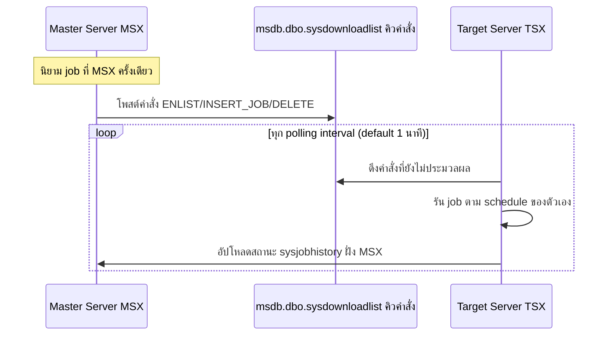

# Section 4 — Multiserver Jobs: MSX/TSX และทางเลือกยุคใหม่

เมื่อ fleet ของคุณมี SQL Server มากกว่าหนึ่งตัว คำถามเริ่มเปลี่ยนจาก "ทำ backup job ยังไง" เป็น "ทำ backup job ที่ **ทุกเครื่องพร้อมกัน** ยังไง" SQL Server มีคำตอบในตัวตั้งแต่รุ่นเก่าคือ **Multiserver Administration** — server หนึ่งเป็น **Master (MSX)** นิยาม job ครั้งเดียว แล้วดันงานลง **Target Servers (TSX)** ทุกตัวให้รันเอง

Section นี้อธิบายกลไก MSX/TSX อย่างละเอียดพอจะสร้างจริงได้ (แล็บ Exercise 4 — optional ทำด้วย container ที่สอง) และปิดด้วยภาพทางเลือกยุคใหม่ (dbatools, Ansible, Azure Arc) เพื่อให้คุณเลือกเครื่องมือตามขนาดทีมได้ ไม่ใช่ตามความเคยชิน

## 4.1 สถาปัตยกรรม Master / Target



หลักการทำงานที่ต้องจำ:

- **นิยาม job อยู่ที่ MSX เท่านั้น** — แก้ job ที่ MSX แล้ว MSX โพสต์คำสั่งอัปเดตลงคิวให้ TSX ดึงไปแก้ตาม (แก้ข้าง TSX โดยตรงไม่ได้)
- **คิวกลางคือ `msdb.dbo.sysdownloadlist`** ฝั่ง MSX — TSX poll คิวนี้ตาม interval (ตั้งในหน้า Agent Properties → Multi Server Administration, default 1 นาที) แล้วดึงงานไปประมวลผล สถานะความคืบหน้าอยู่ที่คอลัมน์ `status` ของแถวคำสั่ง (0 = รอดึง) — ดูคิวด้วย `sp_help_downloadlist`
- **ผลการรันถูกอัปโหลดกลับ MSX** — ที่ MSX คุณเห็นประวัติรวมของทุก TSX ในที่เดียว (นี่คือจุดขายหลัก)
- TSX ต้องเป็นสมาชิก **`TargetServersRole`** ใน msdb ของ MSX — wizard ทำให้อัตโนมัติตอน enlist
- MSX ต้องมี operator ชื่อ **`MSXOperator`** ก่อนจะรับ enlistment ได้ (ไม่มีจะเจอ error 14363 "The MSX server is not prepared for enlistments")

## 4.2 ความต้องการของสภาพแวดล้อม

| เงื่อนไข | รายละเอียด |
|:---------|:-----------|
| **Edition ของ MSX** | Standard หรือ Enterprise เท่านั้น (Express ทำ MSX ไม่ได้ — error 14362); TSX ใช้ได้ทุก edition รวม Express |
| **Account** | SQL Server Agent service account ต้องมีสิทธิ์เชื่อมข้ามเครื่อง (ใน domain: ใช้ domain account / gMSA; ไม่มี domain ใช้ SQL Authentication ที่ MSX สร้างให้ TSX) |
| **การเข้ารหัส** | การเชื่อมต่อ MSX↔TSX **เปิด TLS encryption + certificate validation มาให้แล้ว default** — ใน container/lab ต้องเตรียม certificate หรือระบุ `Encrypt=Optional` ให้ชัด (แล็บ optional แสดงทางเลือก) |
| **เวลา (Clock)** | เครื่องทั้งหมด sync เวลากัน (NTP) — เวลาเหลื่อมทำให้ schedule วิ่งไม่ตรงทั้ง fleet |
| **Azure SQL MI** | Multi Server Administration **ไม่รองรับ** บน Azure SQL Managed Instance |

## 4.3 สร้างสภาพแวดล้อม MSX/TSX ด้วย T-SQL

สคริปต์เดโมฉบับเดินได้: [Scripts/01_MSX_TSX_Demo.sql](Scripts/01_MSX_TSX_Demo.sql) (รันบน instance สองตัว — แล็บ optional ใช้ container `sql2025b` port 1434)

**ขั้นที่ 1 — เตรียม MSX** (บน server แม่):

```sql
USE msdb;
GO
-- operator บังคับของระบบ multiserver
IF NOT EXISTS (SELECT 1 FROM dbo.sysoperators WHERE name = N'MSXOperator')
    EXEC dbo.sp_add_operator @name = N'MSXOperator',
        @enabled = 1, @email_address = N'dba-team@fabrikam.example';
GO
```

**ขั้นที่ 2 — enlist TSX** (บน server ลูก): `sp_msx_enlist` เพิ่ม "เครื่องปัจจุบัน" เข้ารายชื่อ target ของ MSX ที่ระบุ:

```sql
USE msdb;
GO
-- รันบน TSX: เอาเครื่องนี้ไปขึ้นทะเบียนกับ MSX
EXEC dbo.sp_msx_enlist
    @msx_server_name = N'MSX-SERVER',           -- ชื่อ server แม่ (หรือ host:port)
    @location        = N'Building A, Rack 3';   -- คำอธิบายตำแหน่ง ใช้ตอนจัดกลุ่ม
GO
```

**ขั้นที่ 3 — สร้าง multiserver job ที่ MSX**: สร้าง job ปกติด้วย `sp_add_job` (อย่าเรียก `sp_add_jobserver`!) แล้วกระจายด้วย `sp_apply_job_to_targets`:

```sql
USE msdb;
GO
-- นิยาม job ที่ MSX (step/schedule เหมือน job ปกติ)
EXEC dbo.sp_add_job @job_name = N'Fleet - Daily user DB backup', @enabled = 1;
EXEC dbo.sp_add_jobstep @job_name = N'Fleet - Daily user DB backup',
    @step_name = N'Backup', @subsystem = N'TSQL', @database_name = N'master',
    @command = N'BACKUP DATABASE [AdventureWorks2025] TO DISK = N''C:\Backups\AW2025_Full.bak'' WITH COMPRESSION, CHECKSUM;';

-- กระจายไป TSX ระบุชื่อ (@target_servers = รายชื่อคั่นด้วย comma)
-- หรือใช้ @target_server_groups = N'<ชื่อกลุ่ม>' เพื่อกระจายทั้งกลุ่ม
EXEC dbo.sp_apply_job_to_targets
    @job_name            = N'Fleet - Daily user DB backup',
    @target_servers      = N'MSX-SERVER\SQL2,MSX-SERVER\SQL3',
    @operation           = N'APPLY';
GO
```

**ขั้นที่ 4 — ตรวจการไหลของงาน** (บน MSX):

```sql
-- คิวคำสั่งที่รอ TSX ดึง (status 0 = ยังไม่ถูกดึง)
EXEC msdb.dbo.sp_help_downloadlist @job_name = N'Fleet - Daily user DB backup';

-- รายชื่อ TSX ทั้งหมด + สถานะ polling ล่าสุดของแต่ละเครื่อง
EXEC msdb.dbo.sp_help_targetserver;
```

**เลิกใช้งาน (Defect)**: บน TSX รัน `EXEC msdb.dbo.sp_msx_defect;` เพื่อถอนตัวจาก MSX (พารามิเตอร์ `@forced_defection = 1` เฉพาะกรณี MSX เสียถาวร) และบน MSX ลบ target ทิ้งด้วย `EXEC msdb.dbo.sp_delete_targetserver @server_name = N'TSX-NAME';` — แล็บจะใช้สองคำสั่งนี้ใน Clean-up

## 4.4 จัดระเบียบฟลีต — Target Server Groups และ Polling Interval

เมื่อ TSX มีหลายเครื่องแล้ว คำถามถัดมาคือ "job ตัวนี้ให้รันเฉพาะกลุ่มไหน" และ "TSX มาดึงงานบ่อยแค่ไหน" — ระบบมีคำตอบในตัว:

- **Target Server Group** — กลุ่มตรรกะของ TSX เก็บใน `msdb.dbo.systargetservergroups` + `systargetservergroupmembers` สร้างผ่านหน้าจอ MSX (SQL Server Agent → Multi Server Administration → Manage Target Servers → เปลี่ยนชื่อกลุ่ม/จัดสมาชิก) — แล้วกระจาย job ทั้งกลุ่มได้ด้วย `sp_apply_job_to_targets @target_server_groups = N'ชื่อกลุ่ม'` แทนการระบุชื่อเครื่องทีละตัว
- **Polling interval** — ความถี่ที่ TSX มาดึงคิว `sysdownloadlist` ตั้งได้ที่หน้าจอ Manage Target Servers (ค่า default 1 นาที) — ลด interval ให้งานไปถึงเร็วขึ้นได้แต่ต้องเผื่อโหลดด้าน MSX เมื่อ TSX จำนวนมาก (เอกสารเตือน: อย่าตั้ง MSX บน production เครื่องหนักอยู่แล้ว)
- **Event forwarding** — อีกความสามารถคู่กันของระบบนี้: ให้ TSX ส่งเหตุการณ์ (alert) ขึ้น MSX รวมให้ดูที่เดียว (หน้าจอ Agent Properties → Advanced ของ TSX) — เสริมให้ "รายงานสถานะทั้งฟลีตมาที่เดียว" แม้ job ยังรัน local

## 4.5 Troubleshoot สภาพแวดล้อม MSX/TSX — error ที่พบและความหมาย

เหตุผลที่แล็บระบุให้ Exercise นี้เป็น optional คือขั้น enlist ต้องแตะ certificate จริง ตารางนี้ช่วยอ่านสาเหตุเมื่อเจอข้อความ error จากระบบ (ตามรายการ Database Engine events 14000–14999):

| Error | ข้อความสรุป | สาเหตุ/ทางแก้ |
|:------|:-------------|:---------------|
| 14363 | The MSX server is not prepared for enlistments (ต้องมี operator 'MSXOperator') | สร้าง operator ชื่อ MSXOperator บน MSX ก่อน (ขั้นที่ 1 ในเดโม) |
| 14362 | The MSX server must be running the Standard or Enterprise edition | MSX เป็น Express — เปลี่ยน MSX เป็น Standard/Enterprise |
| 14360 | %s is already configured as TSX machine | เครื่องถูก enlist ไว้แล้ว — ถอนด้วย `sp_msx_defect` ก่อนจึง enlist ใหม่ได้ |
| 14306 | The target server (TSX) version is not compatible with the master server (MSX) version | เวอร์ชัน engine ของ TSX ใหม่/เก่ากว่าที่ MSX รองรับ — ปรับเวอร์ชันให้ตรงกัน |
| TLS/certificate error ตอน enlist | การเชื่อม MSX↔TSX เปิด TLS + certificate validation default | เตรียม certificate ให้ Agent ของทั้งสองเครื่อง — เห็นรายละเอียดใน [Set Encryption Options on Target Servers](https://learn.microsoft.com/sql/ssms/agent/set-encryption-options-on-target-servers) |

ประโยคเดียวที่จำง่ายของการ troubleshoot multiserver: **ตรวจจากทิศทางการเดินของข้อมูล** — เครื่องไม่ขึ้นใน `sp_help_targetserver` = ปัญหาฝั่ง enlistment; job ขึ้นแล้วแต่ไม่วิ่ง = ดู `sp_help_downloadlist` ว่าคำสั่งยังค้างในคิวไหม (แปลว่า TSX ไม่มา poll); วิ่งแล้วแต่ MSX ไม่เห็นผล = ฝั่งอัปโหลดสถานะของ TSX มีปัญหา

## 4.6 เมื่อไหร่ MSX/TSX ยังเป็นคำตอบที่ดี

จุดแข็งจริง ๆ ของ MSX/TSX: ระบบเดียวที่ "ในตัว" ของ SQL Server, ไม่ต้องติดตั้งอะไรเพิ่ม, ประวัติรวมที่ MSX, และ TSX แต่ละตัวยังรัน schedule ของตัวเองแม้ขาดการเชื่อมต่อ MSX ชั่วคราว

ข้อจำกัดที่ทำให้ระบบใหญ่เลิกใช้: จัดการเวอร์ชัน job ไม่ได้ (ไม่มี source control), ไม่เข้ากับ deployment pipeline สมัยใหม่, แก้เก่าแก้อย่างเดียว และ MSX กลายเป็น single point of failure ของกระบวนการจัดการงาน

## 4.7 ทางเลือกยุคใหม่ — บรรยายเทียบกันชัด

| ทางเลือก | ธรรมชาติ | จุดแข็ง | ข้อควรระวัง |
|:---------|:---------|:-------|:------------|
| **dbatools (PowerShell)** | โมดูลชุมชนมาตรฐาน de facto ของ SQL Server — สั่ง fleet จากเครื่อง admin ด้วย `Get-DbaAgentJob`, `Invoke-DbaQuery -SqlInstance $list`, `Invoke-DbaMaintenanceSolution` | จัดการได้ทุกอย่างไม่ใช่แค่ job, script ทำ source control ได้, รองรับจำนวน server ใหญ่ | ต้องมีเครื่อง/runner + credentials กลาง; ไม่มี scheduler ในตัว (ใช้ Agent หรือ Task Scheduler คู่กัน) |
| **Ansible** | Infrastructure-as-Code รัน playbook ผ่าน SSH/WinRM ที่เรียก sqlcmd หรือ ps | idempotent, จัดการทั้ง OS + DB ในระบบเดียว, ทีม DevOps คุ้นเคย | ต้องมี control node + นิยาม role ที่ดี; ไม่เฉพาะ SQL — ความลึกขึ้นกับคุณเขียนเอง |
| **Azure Arc + Azure Monitor** | Onboard SQL Server on-prem เข้า Azure แล้วได้ assessment ความพร้อม/ความปลอดภัย + การตรวจจับแบบรวม | ภาพรวม fleet รวมกับ cloud, policy/compliance กลาง | ต้องยอมเชื่อม Azure; ไม่ใช่ scheduler — ยังต้องมี Agent ทำงานหนัก |
| **SQL Server Agent (MSX/TSX)** | ในตัว SQL Server | ไม่ต้องติดตั้งเพิ่ม, ประวัติรวม, รันได้แม้ขาด net ชั่วคราว | ไม่มี versioning, single point of control |
| **Elastic jobs (Azure SQL Database)** | ส่วนเสริมของ Azure SQL Database สำหรับรัน T-SQL ข้ามหลาย database/server | คำตอบทางการสำหรับ Azure SQL DB ที่ไม่มี Agent | ใช้ได้เฉพาะ Azure SQL Database/MI ฝั่ง cloud |

แนวปฏิบัติปัจจุบันของทีม DBA ที่จัดการหลายเครื่อง: **Agent ยังรัน job ทุกเครื่องเสมอ** (job ต้องรัน local เพราะต้องแตะไฟล์/instance ตัวเอง) แต่การ **นิยามและ deploy** job ย้ายไปทำจากภายนอกด้วย dbatools script ที่ commit ใน git — คือ "MSX/TSX ทำให้เองไม่ได้" เรื่อง versioning

```powershell
# ตัวอย่างจิตวิญญาณ dbatools — deploy job ชุดเดียวให้ fleet (ติดตั้ง dbatools ตาม Module 00)
$servers = 'sql1.fabrikam.example','sql2.fabrikam.example','sql3.fabrikam.example';
Invoke-DbaQuery -SqlInstance $servers -File .\create_backup_job.sql;
Get-DbaAgentJob -SqlInstance $servers | Where-Object name -like 'Fleet*' |
    Select-Object SqlInstance, Name, Enabled, LastRunDate;
```

### 🚀 SQL Server 2025 & Modern Notes

- **TLS 1.3 / TDS 8.0**: การเชื่อม MSX↔TSX ของ SQL Server 2025 รองรับการเข้ารหัสรุ่นใหม่แบบ strict — เอกสาร [Create a multiserver environment](https://learn.microsoft.com/sql/ssms/agent/create-a-multiserver-environment) ยืนยันว่า encryption + certificate validation เปิด default อยู่แล้ว ต้องเตรียม certificate ที่ถูกต้องตั้งแต่แรก
- **Multi Server Administration ไม่รองรับ Azure SQL Managed Instance** — ฟลีตที่ประกอบด้วย MI ให้ใช้ SQL Agent jobs ต่อ instance + automation ภายนอก (dbatools/Azure automation) แทน
- **dbatools** คือทางเลือกจัดการ fleet ที่คอมมูนิตีใช้จริง — คำสั่งอย่าง `Get-DbaAgentJob`, `Set-DbaAgentJob`, `Invoke-DbaMaintenanceSolution` ครอบคลุมงานที่เราเขียน T-SQL ในโมดูลนี้ ([dbatools.io](https://dbatools.io))
- **เวลา sync เป็นเรื่องจริงจังใน container lab** — container ที่สอง (`sql2025b`) ต้องอยู่นาฬิกาเดียวกับ host ไม่งั้น schedule ที่ดันจาก MSX จะวิ่งเพี้ยนเทียบกับเครื่องอื่น

> อ้างอิง: [Create a multiserver environment](https://learn.microsoft.com/sql/ssms/agent/create-a-multiserver-environment), [sp_msx_enlist](https://learn.microsoft.com/sql/relational-databases/system-stored-procedures/sp-msx-enlist-transact-sql?view=sql-server-ver17), [sp_msx_defect](https://learn.microsoft.com/sql/relational-databases/system-stored-procedures/sp-msx-defect-transact-sql?view=sql-server-ver17), [sp_apply_job_to_targets](https://learn.microsoft.com/sql/relational-databases/system-stored-procedures/sp-apply-job-to-targets-transact-sql?view=sql-server-ver17)
