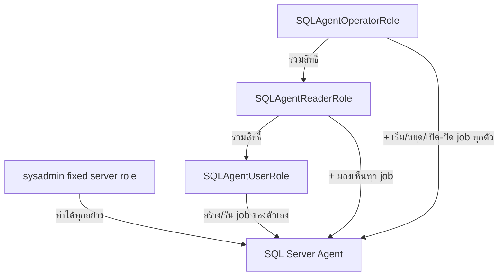
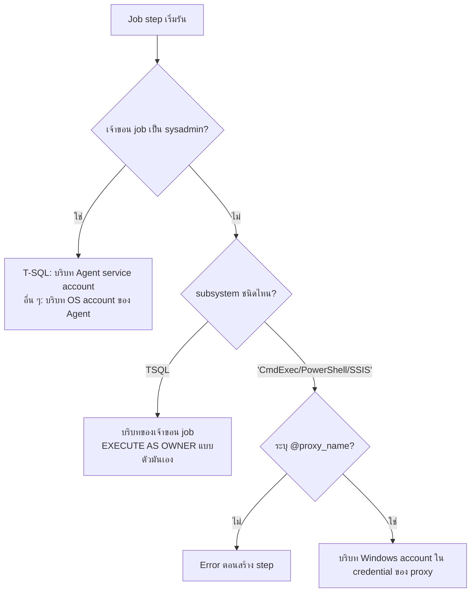

# Section 1 — บริบทความปลอดภัยของ SQL Server Agent (Security Context)

Job ของ SQL Server Agent ทำงานได้กว้างกว่างานที่ user ทั่วไปทำได้ — มันเรียก `BACKUP DATABASE`, `DBCC CHECKDB`, แม้กระทั่งคำสั่ง OS ดังนั้นคำถามแรกของ "Agent security" ไม่ใช่ "ให้ใครรัน job ได้" แต่คือ **"job step หนึ่ง ๆ รันในบริบท (context) ของใคร"** — คำตอบมีเงื่อนไขซ้อนกันหลายชั้น และเข้าใจผิดชั้นเดียวก็ทำให้ job ทำงานไม่ได้หรือทำงานกว้างเกินไป

Section นี้ครอบคลุมสองเรื่อง: (1) ใครมีสิทธิ์ใช้ Agent และสิทธิ์จำกัดเพียงใด — ตอบด้วย fixed database roles สามตัวใน msdb, (2) การรัน job เกิดในบริบทใด — ตอบด้วยกฎของ owner, `EXECUTE AS` และบทบาทของ proxy (ที่จะลึกใน Section 3)

## 1.1 ใครใช้ Agent ได้ — สาม Fixed Database Roles ใน msdb

เมื่อ user ที่ไม่ใช่ sysadmin เชื่อมต่อ SQL Server แล้วไม่ได้อยู่ใน role ข้อใดข้อหนึ่งด้านล่าง โหนด **SQL Server Agent** ใน SSMS จะ **ไม่แสดงเลย** — นี่คือด่านแรกของระบบ:



| Role | สร้าง/แก้/ลบ job | มองเห็น | รัน/หยุด job | ข้อจำกัดเด่น |
|:-----|:-----------------|:--------|:-------------|:--------------|
| **SQLAgentUserRole** (เล็กสุด) | เฉพาะ **job/schedule ที่ตัวเองเป็นเจ้าขอน** | เห็นเฉพาะของตัวเอง; รายชื่อ operator ใน `sp_notify_operator`; รายชื่อ proxy ในหน้าจอ Job Step เท่านั้น | เฉพาะของตัวเอง | ใช้ multiserver jobs ไม่ได้, เปลี่ยนเจ้าขอน job ไม่ได้, ลบ job history ต้องได้ `EXECUTE` บน `sp_purge_jobhistory` เพิ่ม |
| **SQLAgentReaderRole** | เหมือน UserRole (ของตัวเอง) | **เห็น job/schedule/operator ของทุกคน** รวม multiserver jobs + history ของทุก job | เฉพาะของตัวเอง | แก้ properties ของ job คนอื่นไม่ได้ |
| **SQLAgentOperatorRole** (ใหญ่สุด) | เหมือน UserRole (ของตัวเอง) | เห็น alerts + proxies + operator + job ทุกตัว | **เริ่ม/หยุด/เปิด-ปิด job ทุกตัว** ผ่าน `sp_start_job`/`sp_stop_job`/`sp_update_job` (พารามิเตอร์เดียวที่ใช้ได้คือ `@enabled` + ชื่อ/id), ลบ history ของ job ทุกตัว | แก้/ลบ job ของคนอื่นไม่ได้ |

กลไกสำคัญ: สิทธิ์ของสาม role นี้ **ซ้อนกันแบบ concentric** — ReaderRole รวมสิทธิ์ของ UserRole อัตโนมัติ และ OperatorRole รวมทั้งสอง — ดังนั้นอย่าเพิ่ม user ทั้งสาม role เพราะได้สิทธิ์ของตัวใหญ่สุดอย่างเดียวพอ นอกจากนี้สิทธิ์ใช้ **proxy** ก็ถ่ายทอดตาม role: proxy ที่ UserRole ถูกให้ใช้ Reader/Operator ใช้ได้ตามไปด้วย

มอบสิทธิ์ให้ user:

```sql
USE msdb;
GO
-- ยังไม่มี login/user → สร้างก่อน (Module 1)
IF EXISTS (SELECT 1 FROM sys.server_principals WHERE name = N'Lab09JobUser')
    DROP LOGIN Lab09JobUser;
CREATE LOGIN Lab09JobUser
    WITH PASSWORD = N'Pa$$w0rd2025', CHECK_POLICY = ON, CHECK_EXPIRATION = OFF;
GO
IF EXISTS (SELECT 1 FROM sys.database_principals WHERE name = N'Lab09JobUser')
    DROP USER Lab09JobUser;
CREATE USER Lab09JobUser FOR LOGIN Lab09JobUser;

ALTER ROLE SQLAgentUserRole ADD MEMBER Lab09JobUser;
GO
```

✅ **สังเกต**: หลัง `ALTER ROLE`, user Lab09JobUser เชื่อมต่อใหม่จะเห็นโหนด SQL Server Agent พร้อมสร้าง job ของตัวเองได้ — แต่จะยังสร้าง job step ชนิด CmdExec ไม่ได้ (ต้องมี proxy — Section 3)

## 1.2 Job Step รันในบริบทของใคร

กฎของ SQL Server Agent ที่ต้องจำเป็นสองชุด (แหล่งทางการ: [Implement SQL Server Agent security](https://learn.microsoft.com/sql/ssms/agent/implement-sql-server-agent-security)):

### กฎชุดที่ 1 — Job เจ้าขอนเป็น sysadmin

| รายการ | บริบทการรัน |
|:--------|:------------|
| **Job step ชนิด T-SQL** | รันในบริบทของ **SQL Server Agent service account** (`NT SERVICE\SQLSERVERAGENT` — เป็น sysadmin อยู่แล้ว) |
| **Job step ชนิดอื่น** (CmdExec/PowerShell/SSIS) | รันในบริบทของ **OS account ของ Agent service** |
| อาจระบุบริบทเองได้ | ใน `sp_add_jobstep` มีพารามิเตอร์ `@database_user_name` (เฉพาะ T-SQL step) ให้ sysadmin กำหนดว่า step รันเป็น user อื่นในฐานข้อมูลนั้น |

### กฎชุดที่ 2 — Job เจ้าขอนไม่ใช่ sysadmin

| รายการ | บริบทการรัน |
|:--------|:------------|
| **Job step ชนิด T-SQL** | รันในบริบทของ **เจ้าขอน job** — พฤติกรรมเทียบได้กับ `EXECUTE AS OWNER`: สิทธิ์เท่าที่เจ้าขอนมี ถึงแม้ step จะ query ตารางที่ user ปกติเข้าถึงไม่ได้ก็ตาม หากเจ้าขอนถูกถอนสิทธิ์/ถูกลบ job จะล้มทันที |
| **Job step ชนิดอื่น** | **ต้องมี proxy** — สร้าง step โดยไม่ระบุ `@proxy_name` จะ error ทันที; ระบุ proxy แล้วจะรันในบริบท Windows account ของ credential ที่ proxy อ้าง (Section 2–3) |



> **หลับตาไม่ได้เรื่องหนึ่ง**: เจ้าขอน job ที่ไม่ใช่ sysadmin **ถึงแม้จะเป็นแค่สมาชิก SQLAgentUserRole ก็ตาม** ยังรัน T-SQL step ในฐานะตัวเองได้ — ดังนั้นอย่าให้ user ที่มีสิทธิ์อ่านข้อมูลอ่อนไหว "สร้าง job ไว้แล้วหนึ่งปี" เพราะสิทธิ์ที่ job ใช้คือสิทธิ์ปัจจุบันของเจ้าขอนตลอดอายุ job ควรทบทวนเจ้าขอน job อยู่เสมอ (`msdb.dbo.sysjobs` คอลัมน์ `owner_sid`)

## 1.3 มองข้าม SSMS: อะไรเปลี่ยนเมื่อให้ role ต่างกัน

มุมมองที่จับต้องได้ของสาม role เหล่านี้คือสิ่งที่ผู้ใช้เห็นใน **Object Explorer** หลังเชื่อมต่อ:

| สมาชิก role | เห็นโหนด SQL Server Agent? | เห็นอะไรภายในโหนด |
|:------------|:---------------------------|:-------------------|
| ไม่มี role ใดในสาม + ไม่ใช่ sysadmin | **ไม่เห็นเลย** (โหนดหายจาก Object Explorer) | — |
| SQLAgentUserRole | เห็น | เฉพาะโหนด **Jobs** — และมีแต่ job ของตัวเอง |
| SQLAgentReaderRole | เห็น | **Jobs** — รวม job ของทุกคน (อ่านอย่างเดียว) |
| SQLAgentOperatorRole | เห็น | **Jobs, Alerts, Operators, Proxies** (ไม่เห็น Error Logs) |
| sysadmin | เห็น | ทุกโหนดทุกอย่าง |

จุดประยุกต์: เวลามีคนบ่นว่า "ทำไมหน้าจอผมไม่มี Agent" ให้เช็คสิทธิ์ใน msdb ก่อนเป็นข้อแรก — เป็นอาการของ "ไม่ได้อยู่ใน role" มากกว่าเป็นปัญหาติดตั้ง

เกี่ยวกับ **การเปลี่ยนเจ้าขอน job**: user ทั่วไปเปลี่ยนไม่ได้ (กันยกระดับตัวเอง); sysadmin เปลี่ยนได้ด้วย `sp_update_job @owner_login_name = N'...';` — เป็นหน้าที่ของ DBA เวลาพนักงานลาออก ต้องย้ายเจ้าขอน job ทุกตัวของเขาไปทีมก่อนลบ login ไม่งั้น job เดิมจะรันในบริบท login ที่ไม่มีตัวจริงอีกและพังทันที

## 1.4 Audit เจ้าขอน job — query ที่ควรรันเป็นระยะ

```sql
USE msdb;
GO
-- รายงานเจ้าขอนทุก job + จำแนกว่าเจ้าขอนเป็น sysadmin หรือไม่
SELECT j.name AS job_name,
       sp.name AS owner_login,
       sp.type_desc AS owner_type,
       CASE WHEN IS_SRVROLEMEMBER('sysadmin', sp.name) = 1 THEN N'sysadmin'
            ELSE N'non-sysadmin' END AS owner_class,
       j.enabled,
       (SELECT COUNT(*) FROM dbo.sysjobsteps AS js WHERE js.job_id = j.job_id) AS steps
FROM dbo.sysjobs AS j
JOIN sys.server_principals AS sp ON sp.sid = j.owner_sid
ORDER BY owner_class, j.name;
```

สิ่งที่มองหาในผลลัพธ์:

- **job ของบุคคลที่ลาออกไปแล้ว** (owner login ไม่มีในระบบแล้วจะเห็นเป็น SID ที่ map ไม่ได้) — ย้ายเจ้าขอนทันที
- **job หลายตัวของ sysadmin เดียว** — กลุ่มเสี่ยงเพราะรันด้วยสิทธิ์เต็ม; พิจารณาย้ายเป็น job เจ้าขอน non-sysadmin + proxy ตาม Module นี้
- **job ที่ enabled แต่ไม่มี schedule** — มักเป็นของทิ้งจากการทดสอบ; ตัดสินใจว่าจะลบหรือปิด

## 1.5 เดโม: พิสูจน์บริบทการรันด้วย SYSTEM_USER

วิธีพิสูจน์กฎชุดข้างบนที่เห็นได้ตาเปล่าคือให้ job step เขียน `SYSTEM_USER` ลงตาราง log แล้วดูว่าค่าที่บันทึกเป็นใคร สคริปต์เดโม: [Scripts/01_Agent_Roles_Job_Owner.sql](Scripts/01_Agent_Roles_Job_Owner.sql) — ทำดังนี้:

1. สร้างฐานข้อมูลทดลอง `LabEnv` พร้อมตาราง `dbo.AgentIdentityLog` (เก็บ `SYSTEM_USER` + เวลา) และ proc `dbo.RecordAgentIdentity`
2. สร้าง job **ที่เจ้าขอนเป็น sysadmin** (sa) มี step เดียวเรียก proc นั้น → รัน → `SYSTEM_USER` ที่เห็นคือ **`NT SERVICE\SQLSERVERAGENT`** (Agent service account) ไม่ใช่ sa
3. สร้าง login `Lab09JobUser` + user ใน msdb (SQLAgentUserRole) และ user ใน LabEnv (เพิ่ม `INSERT` บนตาราง + `EXECUTE` บน proc ให้เฉพาะพอ) ให้ login นี้สร้าง job ของตัวเอง (ผ่าน `EXECUTE AS LOGIN` ใน session เดียวกันหรือ SSMS connection ที่สอง) → รัน → `SYSTEM_USER` ที่เห็นคือ **`Lab09JobUser`**

```sql
-- โครงหลักของเดโม (ฉบับเต็มในสคริปต์):
USE LabEnv;
GO
CREATE TABLE dbo.AgentIdentityLog
(
    LogID        int IDENTITY PRIMARY KEY,
    LogTime      datetime2 NOT NULL DEFAULT SYSDATETIME(),
    RunAsIdentity sysname  NOT NULL
);
GO
CREATE PROCEDURE dbo.RecordAgentIdentity
AS
    INSERT INTO dbo.AgentIdentityLog (RunAsIdentity) SELECT SYSTEM_USER;
GO
```

จุดสอนสำคัญของเดโมนี้: `SYSTEM_USER` ภายใน job step คือ "ใคร" ในสายตา engine ตอนรัน — และมัน **ไม่ใช่** login ที่กด Start Job เสมอไป

## 1.6 ข้อจำกัดที่ผู้ใช้ SQLAgentUserRole จะเจอ

ลองสร้าง job ด้วย login ใน UserRole แล้วคุณจะเจอพฤติกรรมเหล่านี้ (แล็บ Exercise 1 จะทำจริง):

| สิ่งที่ลอง | ผลลัพธ์ |
|:-----------|:--------|
| สร้าง job ของตัวเอง (`sp_add_job`) | สำเร็จ — job ถูกมอบเจ้าขอนให้ login ของคุณอัตโนมัติ |
| สร้าง step T-SQL ใน job ของตัวเอง | สำเร็จ — แต่รันได้เฉพาะเท่าสิทธิ์ของคุณ |
| สร้าง step CmdExec โดยไม่ระบุ proxy | **Error** — subsystem นอก T-SQL ต้องมี proxy |
| มองเห็น/แก้ job ของ sysadmin อื่น | มองไม่เห็นเลย (job ของคนอื่นไม่ถูก enumerate ให้) |
| ให้เจ้าขอนเป็นคนอื่น (`@owner_login_name` เป็น login อื่น) | **Error** — เปลี่ยนเจ้าขอนไม่ได้ |
| ลบ job history ของตัวเอง (`sp_purge_jobhistory`) | ต้องได้ `EXECUTE` บน proc เพิ่มเป็นการเฉพาะ |

กฎเหล่านี้จึงทำให้ "ให้นักพัฒนาสร้าง job เอง" ปลอดภัยพอสมควร: พวกเขาแตะได้เฉพาะงานตัวเอง รันในบริบทตัวเอง และแตะ OS ไม่ได้ถ้าไม่ได้รับ proxy — เหลือแค่เรื่องเดียวที่ DBA ต้องจัดให้: proxy (Section 3)

### 🚀 SQL Server 2025 & Modern Notes

- **PBKDF2 password hashing (SQL Server 2025)** — รหัสผ่านของ SQL logins (รวม logins ที่เรามอบ Agent roles ให้) ถูก hash ด้วย PBKDF2+SHA512 ตาม NIST SP 800-63b ตั้งแต่ 2025 โดยไม่ต้องตั้งค่าอะไร — กระทบ login/application role โดยตรง ([What's new in SQL Server 2025](https://learn.microsoft.com/sql/sql-server/what-s-new-in-sql-server-2025?view=sql-server-ver17))
- **Security cache improvements (2025)** — การเปลี่ยนสิทธิ์ (GRANT/ALTER ROLE) ทำ invalidate cache เฉพาะ login ที่กระทบ งานที่รันถี่อย่าง Agent jobs จึงไม่โดนแรงจากการจัดการสิทธิ์ของทีมอื่น
- **โครงสร้าง Agent security ไม่เปลี่ยน** — SQLAgentUserRole/Reader/Operator, owner context และ proxy ทำงานเหมือนรุ่นก่อนทั้งหมด เอกสาร [SQL Server Agent fixed database roles](https://learn.microsoft.com/sql/ssms/agent/sql-server-agent-fixed-database-roles) ยังเป็นแหล่งอ้างอิงหลัก
- **Azure SQL Managed Instance** มี Agent + roles เหล่านี้เหมือนกัน แต่บางตัวเลือก (multiserver, แก้ agent properties) ปรับไม่ได้ — ออกแบบสิทธิ์บน MI ด้วยรูปแบบเดียวกันนี้ได้เลย

> อ้างอิง: [Implement SQL Server Agent security](https://learn.microsoft.com/sql/ssms/agent/implement-sql-server-agent-security), [SQL Server Agent fixed database roles](https://learn.microsoft.com/sql/ssms/agent/sql-server-agent-fixed-database-roles), [ALTER ROLE](https://learn.microsoft.com/sql/t-sql/statements/alter-role-transact-sql?view=sql-server-ver17), [SYSTEM_USER](https://learn.microsoft.com/sql/t-sql/functions/system-user-transact-sql?view=sql-server-ver17)
