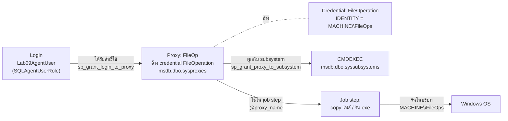

# Section 3 — Proxies: ปล่อยสิทธิ์แบบจำกัดให้ Job Steps ข้าม Subsystem

ใน Section 1 เราเห็นแล้วว่า user ทั่วไป (สมาชิก SQLAgentUserRole) สร้าง T-SQL step ได้เอง แต่ **CmdExec/PowerShell/SSIS ทำไม่ได้** — เพราะงานพวกนั้แตะ OS ตรง ๆ ถ้าปล่อยให้ทุกคนทำได้จะยกสิทธิ์ OS ให้ทุกคนโดยพลการ **Proxy** คือทางออกที่ควบคุมสองมิติพร้อมกัน: ใคร (login ใด) ใช้ได้ + ทำอะไรได้ (subsystem ใด) — โดยขณะรัน งานจะ "สวม" Windows account ของ credential ที่ proxy อ้าง ไม่ใช่บริบทของสายตาสาธารณะ

Section นี้สร้าง proxy ครบวงจรจากเดโมต้นฉบับของ Microsoft (Mod09): **credential → proxy → ผูก subsystem → ผูก login → job step รันด้วย proxy** และจบด้วยการพิสูจน์ข้อความ error เมื่อสิทธิ์ไม่ครบ

## 3.1 โครงสร้างของ Proxy



องค์ประกอบทั้งหมด (เก็บใน msdb):

| Object | Catalog ที่ดูได้ | สร้างด้วย | หน้าที่ |
|:-------|:----------------|:----------|:--------|
| Credential | `master.sys.credentials` | `CREATE CREDENTIAL` | ห่อ Windows account + secret (Section 2) |
| Proxy | `msdb.dbo.sysproxies` | `sp_add_proxy` | สะพานระหว่าง credential กับ subsystem + login |
| Subsystem | `msdb.dbo.syssubsystems` | (มีในตัว — อ่านเท่านั้น) | ชนิดงานที่ step รันได้ (CMDEXEC, PowerShell, SSIS ฯลฯ) |
| การมอบสิทธิ์ login | `msdb.dbo.sysproxylogin` | `sp_grant_login_to_proxy` | login ใดได้ใช้ proxy ใด |

## 3.2 ขั้นที่ 1 — สร้าง Proxy และผูก Subsystem

สคริปต์เดโมฉบับเต็ม: [Scripts/01_Create_Proxy_Demo.sql](Scripts/01_Create_Proxy_Demo.sql) — สมมติว่า credential `FileOperation` จาก Section 2 มีอยู่แล้ว

```sql
USE msdb;
GO
-- ลบของเดิมก่อน (idempotent)
IF EXISTS (SELECT 1 FROM dbo.sysproxies WHERE name = N'FileOp')
    EXEC dbo.sp_delete_proxy @proxy_name = N'FileOp';

-- สร้าง proxy ที่อ้าง credential
EXEC dbo.sp_add_proxy
    @proxy_name      = N'FileOp',
    @credential_name = N'FileOperation',
    @enabled         = 1;
GO

-- ดู proxy ทั้งหมด พร้อม credential ที่อ้าง
SELECT sp.name AS proxy_name, sp.enabled,
       c.name AS credential_name, c.identity_desc
FROM msdb.dbo.sysproxies AS sp
JOIN sys.credentials AS c ON c.credential_id = sp.credential_id;
-- Expected: แถว FileOp + FileOperation

-- ดูรายการ subsystem ทั้งหมดที่ Agent มีให้
SELECT subsystem_id, subsystem, subsystem_name
FROM msdb.dbo.syssubsystems
ORDER BY subsystem_id;
-- Expected: CMDEXEC, PowerShell, SSIS, Replication agents ฯลฯ — จำ subsystem code ไว้อ้างถัดไป
```

จากนั้น **ผูก proxy เข้ากับ subsystem** — สำคัญที่สุดของขั้นนี้คือ `sp_grant_proxy_to_subsystem` รับ `@subsystem_id` หรือ `@subsystem_name`; เพื่อไม่ให้เดา id ผิดเวอร์ชัน เราอ่าน id จาก `syssubsystems` ด้วยค่า code `CMDEXEC`:

```sql
USE msdb;
GO
DECLARE @cmdexecId int =
    (SELECT subsystem_id FROM dbo.syssubsystems WHERE subsystem = N'CMDEXEC');

EXEC dbo.sp_grant_proxy_to_subsystem
    @proxy_name   = N'FileOp',
    @subsystem_id = @cmdexecId;   -- หรือ @subsystem_name = N'CmdExec'
GO
```

✅ **สังเกต**: proxy หนึ่งตัวผูกได้หลาย subsystem และหนึ่ง subsystem รับได้หลาย proxy — การผูกคือ "สิ่งที่ proxy นี้ใช้ได้" ไม่ใช่ "สิ่งที่ subsystem นี้ยอมรับ"

## 3.3 ขั้นที่ 2 — มอบ Proxy ให้ Login

Proxy สร้างแล้วยังใช้ไม่ได้จนกว่าจะมอบให้ login ผู้ใด ด้วย `sp_grant_login_to_proxy`:

```sql
USE msdb;
GO
-- login ต้องมีจริง (สร้างตาม Section 1.1 ถ้ายังไม่มี)
IF EXISTS (SELECT 1 FROM dbo.sysproxylogin
           WHERE proxy_id = (SELECT proxy_id FROM dbo.sysproxies WHERE name = N'FileOp')
             AND sid = SUSER_SID(N'Lab09JobUser'))
    EXEC dbo.sp_revoke_login_from_proxy @proxy_name = N'FileOp',
                                        @login_name = N'Lab09JobUser';

EXEC dbo.sp_grant_login_to_proxy
    @proxy_name = N'FileOp',
    @login_name = N'Lab09JobUser';
GO

-- ตรวจการมอบสิทธิ์ทั้งหมด
SELECT p.name AS proxy_name, sp.name AS granted_login
FROM msdb.dbo.sysproxylogin AS pl
JOIN msdb.dbo.sysproxies AS p ON p.proxy_id = pl.proxy_id
JOIN sys.server_principals AS sp ON sp.sid = pl.sid;
-- Expected: FileOp → Lab09JobUser
```

รูปแบบอื่นของ `sp_grant_login_to_proxy` (มอบเป็นกลุ่มได้): `@msdb_role = N'SQLAgentUserRole'` (มอบให้ทั้ง role — **ระวัง**: ตามเอกสาร fixed database roles สิทธิ์ proxy ถ่ายทอดไปยัง role ใหญ่ขึ้นอัตโนมัติ ทั้ง Reader/Operator จะได้ใช้ตามไปด้วย) หรือ `@proxy_id`, `@nt_account`, `@fixed_server_role` แทน `@login_name` ตามจำนวนวิธีระบุตัวตน

## 3.4 ขั้นที่ 3 — Job Step ที่รันด้วย Proxy

เมื่อสิทธิ์ครบแล้ว login (หรือ sysadmin แทนเขา) สร้าง step ที่ระบุ `@proxy_name`:

```sql
USE msdb;
GO
IF EXISTS (SELECT 1 FROM dbo.sysjobs WHERE name = N'Lab09 - Copy file via proxy')
    EXEC dbo.sp_delete_job @job_name = N'Lab09 - Copy file via proxy',
                           @delete_unused_schedule = 1;

EXEC dbo.sp_add_job @job_name = N'Lab09 - Copy file via proxy', @enabled = 1,
    @owner_login_name = N'Lab09JobUser';

EXEC dbo.sp_add_jobstep
    @job_name     = N'Lab09 - Copy file via proxy',
    @step_name    = N'Copy file (runs as MACHINE\FileOps)',
    @subsystem    = N'CMDEXEC',
    @command      = N'echo %USERNAME% executed at %DATE% %TIME%',
    @proxy_name   = N'FileOp',        -- จุดเปลี่ยนสำคัญ: step รันในบริบท Windows account
    @on_success_action = 1,
    @on_fail_action    = 2;

EXEC dbo.sp_update_job @job_name = N'Lab09 - Copy file via proxy', @start_step_id = 1;
EXEC dbo.sp_add_jobserver @job_name = N'Lab09 - Copy file via proxy',
                          @server_name = N'(local)';

EXEC dbo.sp_start_job @job_name = N'Lab09 - Copy file via proxy';
GO
-- รอ 5-10 วินาที แล้วดู history — ข้อความใน output จะโชว์ %USERNAME%
-- ที่เป็นของ Windows account (FileOps) ไม่ใช่ Agent service account:
EXEC msdb.dbo.sp_help_jobhistory @job_name = N'Lab09 - Copy file via proxy', @mode = 'FULL';
```

**Expected:** history แสดงข้อความ `FileOps executed at ...` — พิสูจน์ว่า step รันในบริบทของ account ใน credential จริง (บน Windows; บน Linux container ข้อความ echo จะแสดงตัวแปรเปล่าหรือ user ของ container เพราะ CmdExec รันผ่าน shell — หัวข้อนี้ Windows-first)

## 3.5 เมื่อสิทธิ์ไม่ครบ — ข้อผิดพลาดที่เจอและวิธีอ่าน

แล็บ Exercise 2 จะทำให้พังโดยจงใจ สรุปพฤติกรรมที่จะเจอ (เพื่อแก้เร็วตอนทำงานจริง):

| สถานการณ์ | เกิดอะไร | ทางแก้ |
|:----------|:---------|:--------|
| User ไม่ได้ GRANT ใช้ proxy แต่สร้าง step ระบุ `@proxy_name` | error ตอน `sp_add_jobstep` แจ้งว่า login ไม่มีสิทธิ์ใช้ proxy | `sp_grant_login_to_proxy` |
| User สร้าง step CMDEXEC โดยไม่ระบุ proxy | error ตอนสร้าง — subsystem นอก T-SQL ต้องมี proxy เสมอ (ยกเว้นเจ้าขอน sysadmin) | สร้าง proxy ครบ หรือเปลี่ยนเจ้าขอน |
| Proxy ยังไม่ถูกผูกกับ subsystem ที่ใช้ | error แจ้งว่า proxy ไม่สามารถใช้กับ subsystem นั้น | `sp_grant_proxy_to_subsystem` |
| Credential ที่ proxy อ้างถูกลบ/รหัสผ่านหมดอายุ | step สร้างได้แต่ **รันล้มตอน execute** — จุดนี้หายากที่สุด | ตรวจ `sys.credentials` + หมุนรหัสผ่านด้วย `ALTER CREDENTIAL` |
| Windows account ไม่มีสิทธิ์ใน OS เหมาะพอ | รันแล้ว error จาก OS (เช่น "Access is denied" ตอนเขียนไฟล์) | จัดสิทธิ์ NTFS ให้ account ใน credential เท่าที่จำเป็น |

ล้างย้อนได้ทั้งสาย:

```sql
USE msdb;
GO
EXEC dbo.sp_revoke_login_from_proxy @proxy_name = N'FileOp',
                                    @login_name = N'Lab09JobUser';
DECLARE @cmdexecId int =
    (SELECT subsystem_id FROM dbo.syssubsystems WHERE subsystem = N'CMDEXEC');
EXEC dbo.sp_revoke_proxy_from_subsystem @proxy_name   = N'FileOp',
                                        @subsystem_id = @cmdexecId;
EXEC dbo.sp_delete_proxy @proxy_name = N'FileOp';
GO
-- แล้วจึง DROP CREDENTIAL FileOperation (Section 2 clean-up)
```

> **บรรทัดล่างของโมดูลนี้**: โมเดลความปลอดภัยของ Agent อ่านเป็นสามคำถามซ้อนกัน — (1) ใครมีสิทธิ์สร้าง/รัน job? → msdb fixed roles; (2) T-SQL step รันเป็นใคร? → เจ้าขอน (sysadmin → service account); (3) งานที่แตะ OS รันเป็นใคร? → credential ที่ห่อ account จริง ผ่าน proxy ที่จำกัดด้วย subsystem + login

### 🚀 SQL Server 2025 & Modern Notes

- **โครงสร้าง proxy/credential ไม่เปลี่ยน** — สคริปต์ `sp_add_proxy` / `sp_grant_proxy_to_subsystem` / `sp_grant_login_to_proxy` จากรุ่นก่อนรันได้บน SQL Server 2025 ทั้งหมด ([sp_add_proxy](https://learn.microsoft.com/sql/relational-databases/system-stored-procedures/sp-add-proxy-transact-sql?view=sql-server-ver17))
- **Managed identity ผ่าน Azure Arc (2025)** — งาน outbound ไป Azure จำนวนมากที่เดิมต้องเปิด proxy + credential สามารถทำด้วย identity ที่ Azure จัดการได้ ทำให้ proxy กลับไปรับหน้าที่จริงคือ "งานที่ต้องแตะ OS ในเครื่อง"
- **PBKDF2 (2025)** — รหัสผ่านของ SQL logins (เจ้าขอน job ทั้งหลาย) hash แบบ PBKDF2+SHA512 default — ปรับความเข้มงวดของนโยบายรหัสผ่านได้ตามหัวข้อ Module 1
- **TDS 8.0 / TLS 1.3 (2025)** — Agent เชื่อม engine ด้วยการเข้ารหัส strict ได้; ในทางปฏิบัติไม่กระทบ config ของ proxy แต่กระทบ certificate ที่ต้องเตรียมบน instance

> อ้างอิง: [Create a SQL Server Agent proxy](https://learn.microsoft.com/sql/ssms/agent/create-a-sql-server-agent-proxy), [sp_add_proxy](https://learn.microsoft.com/sql/relational-databases/system-stored-procedures/sp-add-proxy-transact-sql?view=sql-server-ver17), [sp_grant_proxy_to_subsystem](https://learn.microsoft.com/sql/relational-databases/system-stored-procedures/sp-grant-proxy-to-subsystem-transact-sql?view=sql-server-ver17), [sp_grant_login_to_proxy](https://learn.microsoft.com/sql/relational-databases/system-stored-procedures/sp-grant-login-to-proxy-transact-sql?view=sql-server-ver17), [Implement SQL Server Agent security](https://learn.microsoft.com/sql/ssms/agent/implement-sql-server-agent-security)
