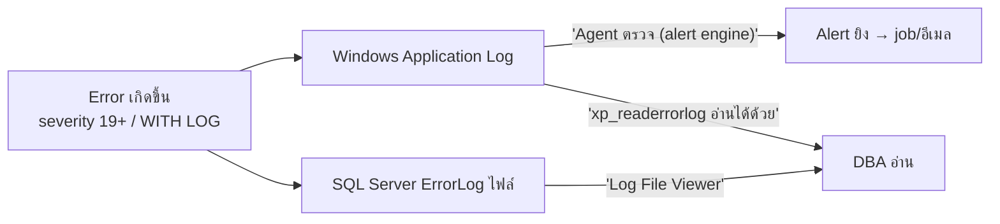

# Section 1 — Errors และ SQL Server Error Log

ทุกอย่างในโมดูลนี้เริ่มจากเหตุการณ์เดียวคือ **error** — SQL Server บันทึก error ทุกชนิดด้วยโครงสร้างเดียวกัน (error number, severity, state) และระดับ severity เป็นตัวกำหนดสองอย่างสำคัญพร้อมกัน: ใคร "จับ" มันด้วย TRY...CATCH ได้ และมันถูกเขียนลง **SQL Server Error Log / Windows Application Log** หรือไม่ — ซึ่งเป็นข้อจำกัดที่ alert ของ Module นี้พึ่งพาโดยตรง

Section นี้ปูพื้นเรื่อง severity, การสร้าง custom error message, RAISERROR กับ THROW และการอ่าน/จัดการ Error Log เอง เพราะการอ่าน log เป็นทักษะ DBA ที่ใช้ทุกวันจริง ๆ ไม่ว่าจะเป็น alert หรือไม่ก็ตาม

## 1.1 Error Message และ Severity Levels

ทุก error มีสามส่วน: **error number** (id ของข้อความ), **severity** (0–25 — ความรุนแรง) และ **state** (ตำแหน่งในโค้ดที่เกิด ใช้ช่วย debug) ข้อความของระบบทั้งหมดเก็บใน `sys.messages` (catalog ใน master แต่อ่านได้จาก database ไหนก็ได้):

```sql
SELECT message_id, severity, language_id, text
FROM sys.messages
WHERE message_id IN (1205, 911, 9002, 823);
-- 1205 = deadlock victim, 911 = database not exist,
-- 9002 = transaction log full, 823 = I/O error อ่าน/เขียน page ไม่สำเร็จ
```

ตารางความรุนแรงที่ DBA ต้องท่องได้ (หมายเหตุสำคัญเรื่อง alert อยู่ท้ายตาราง):

| Severity | ระดับ | ความหมาย | จับด้วย TRY...CATCH ได้? | เขียนลง Application Log? |
|:---------|:------|:---------|:-------------------------|:--------------------------|
| 0–10 | Informational | ข้อความแจ้งเท่านั้น (คำสั่งยังทำงาน) | ไม่ (ไม่เป็น error จริง) | ไม่เว้นแต่ `WITH LOG` |
| 11–16 | User errors | error ปกติของโปรแกรม (syntax, ไม่มี object, สิทธิ์ไม่พอ ฯลฯ) | **ได้** | ไม่เว้นแต่ `WITH LOG` |
| 17–18 | Resource / software | ขาด resource (เช่น log เต็ม 9002 severity 17) หรือ engine เจออะไรผิดปกติ | ได้ (เกือบทั้งหมด) | ไม่เว้นแต่ `WITH LOG` |
| 19 | **ต้องใช้ sysadmin ประกาศ** | fatal ที่ระดับ process | ได้ | **เขียนอัตโนมัติ** |
| 20–25 | **Fatal** | ยุติ connection ทันที — 20–22 เฉพาะ process, 23–25 เกี่ยวกับฐานข้อมูล/เครื่องทั้งหมด | **ไม่ได้** | **เขียนอัตโนมัติ** |

สองกฎที่ alert ของโมดูลนี้พึ่งพา: (1) ข้อความ severity **19–25** เขียนลง Windows Application Log เสมอ; (2) `RAISERROR` ที่ใส่ `WITH LOG` กับข้อความ custom ที่ตั้ง `@with_log='TRUE'` จะถูกเขียนด้วยเช่นกัน — ตามเอกสาร [sp_add_alert](https://learn.microsoft.com/sql/relational-databases/system-stored-procedures/sp-add-alert-transact-sql?view=sql-server-ver17) ที่ยืนยันว่า **alert จับได้เฉพาะข้อความที่ถึง Application Log**

## 1.2 Custom Error Message — sp_addmessage

คุณสร้าง error ของตัวเองได้ โดยต้องใช้เลข **50001 ขึ้นไป** (ต่ำกว่านั้นสงวนให้ระบบ):

```sql
USE master;
GO
-- ลบของเดิมถ้ามี (idempotent)
IF EXISTS (SELECT 1 FROM sys.messages WHERE message_id = 50001)
    EXEC dbo.sp_dropmessage @msgnum = 50001;

-- ข้อความ custom severity 16 ที่ถูกเขียนลง log ด้วย (@with_log = 'TRUE')
EXEC dbo.sp_addmessage
    @msgnum  = 50001,
    @severity = 16,
    @msgtext = N'Inventory level for product %s has fallen below threshold %d.',
    @lang    = 'us_english',
    @with_log = 'TRUE';       -- TRUE = เขียนลง Windows Application Log เมื่อถูก raise
GO

-- ใช้งาน (placeholder %s/%d ต้องเติมด้วย RAISERROR — THROW ไม่ใช้ placeholder ได้)
RAISERROR (50001, 16, 1, N'AW-1000', 5);
-- Expected: ข้อความของเราแสดง + ถูกเขียนลง Windows Application Log (เพราะ @with_log)

-- แก้ข้อความ:
EXEC dbo.sp_altermessage 50001, @parameter = 'WITH_LOG', @parameter_value = 'true';

-- ลบเมื่อไม่ใช้:
-- EXEC dbo.sp_dropmessage @msgnum = 50001;
```

| พารามิเตอร์ | ความหมาย |
|:------------|:---------|
| `@msgnum` | เลขข้อความ — user-defined ต้อง ≥ 50001 |
| `@severity` | 0–18 สำหรับข้อความที่ user raise ได้ (19–25 ใช้ได้เฉพาะ sysadmin) |
| `@msgtext` | ข้อความ — ใส่ placeholder `%s` / `%d` ได้ (เติมตอน RAISERROR) |
| `@with_log` | `'TRUE'` = ทุกครั้งที่ raise ข้อความนี้ จะถูกเขียนลง Application Log — **ต้องเปิดถ้าจะให้ alert จับ** |

> จำแนกเรื่อง `WITH LOG`: severity ของ `@with_log` ตั้งที่ "ตัวข้อความ" (`sp_addmessage`/`sp_altermessage` ให้เปิด-ปิดได้ทีหลัง) หรือ "ตอน raise" (`RAISERROR ... WITH LOG`) — ทั้งสองทางถึง Application Log เหมือนกัน

## 1.3 RAISERROR vs THROW — เลือกใช้ให้เหมาะ

สองคำสั่งยิง error ใน T-SQL ทั้งคู่ใช้งานคู่กันได้ จุดต่างที่มีผลจริง:

| คุณสมบัติ | RAISERROR | THROW |
|:----------|:----------|:------|
| Severity | **กำหนดได้** 1–18 (19+ เฉพาะ sysadmin พร้อม WITH LOG) | กำหนดไม่ได้ — คงที่ **16** |
| Re-raise ของเดิม | ไม่ได้ (ต้องเก็บ ERROR_MESSAGE เอง) | **ได้** — `THROW;` ตัวเดียวใน CATCH โยน error เดิมพร้อม severity/number เดิม |
| Placeholder `%s`/`%d` | ได้ | ไม่ได้ (format ข้อความเองหรือผ่าน FORMATMESSAGE) |
| `WITH LOG` | ได้ | ไม่มี (THROW severity 16 ไม่เข้า Application Log) |
| ใช้กับ `sys.messages` | ได้ (อ้างเลขข้อความ + placeholder) | ได้ผ่าน `FORMATMESSAGE` |
| จุดวาง `;` | ไม่จำเป็น | **ต้องมี semicolon ปิด statement ก่อนหน้า** |

```sql
-- THROW ระดับ 16 แบบข้อความทันที (จับ TRY/CATCH ได้ ไม่เข้า Application Log)
BEGIN TRY
    THROW 50001, N'Batch stopped: invalid parameter.', 1;
END TRY
BEGIN CATCH
    SELECT ERROR_NUMBER() AS err, ERROR_MESSAGE() AS msg, ERROR_SEVERITY() AS sev;
END CATCH;

-- Re-throw ของเดิมใน CATCH (จุดขายของ THROW)
BEGIN TRY
    SELECT 1/0;
END TRY
BEGIN CATCH
    THROW;    -- โยน error เดิม (8134 divide by zero, severity 16) ออกไปทั้งก้อน
END CATCH;

-- RAISERROR ที่เข้า Application Log → จุดเริ่มของ alert ในแล็บ
RAISERROR (N'Fabrikam: daily reconciliation finished with warnings.', 17, 1) WITH LOG;
-- Expected: ข้อความ severity 17 ถึง Windows Application Log
--           (RAISERROR ... WITH LOG ใช้ได้เฉพาะ sysadmin หรือผู้ได้สิทธิ์ ALTER TRACE —
--            สำหรับ user ทั่วไปให้ใช้ข้อความ custom ที่ตั้ง @with_log='TRUE' แทน)
```

> **กฎสิทธิ์ที่ต้องจำ**: `RAISERROR ... WITH LOG` และ `xp_logevent` ต้องการสิทธิ์ sysadmin การเขียน log นั้นจึงทำได้สองทางโดยไม่ต้องเปิดสิทธิ์กว้าง — ใช้ข้อความ custom ที่ตั้ง `@with_log='TRUE'` ตั้งแต่ sp_addmessage (user ทั่วไป raise ได้) หรือให้ sysadmin เป็นคน raise ใน job

## 1.4 xp_logevent และ severity 19+ — เขียนลง log ด้วยมือเพื่อทดสอบ

อีกหนึ่งช่องทางเขียนข้อความลง log คือ `xp_logevent` — extended stored procedure ของ master ที่ **เขียนข้อความลง SQL Server Error Log และ Windows Application Log ตรง ๆ** โดยไม่ส่งผลต่อการ flow ของโปรแกรม (ไม่เป็น exception ให้ TRY/CATCH จับ):

```sql
-- รันจาก database ใดก็ได้ (proc อยู่ใน master — อ้าง 3-part name เสมอ)
EXEC master.dbo.xp_logevent 60001, N'Fabrikam: nightly maintenance checkpoint OK.', 'INFORMATIONAL';
-- ระดับที่ใส่ได้: INFORMATIONAL (default), WARNING, ERROR
```

สามข้อที่เอกสารระบุเกี่ยวกับมัน (และมีผลต่อ alert โดยตรง):

1. ต้องเป็น sysadmin จึงเรียกได้
2. ข้อความถูกเขียนลง Application Log → **alert ที่จับ message_id/severity ตรงกันจะยิงได้** — เป็นเครื่องมือทดสอบ alert ที่สะอาดที่สุดเพราะไม่ยุ่งกับ error จริงของแอป
3. ข้อความจาก `xp_logevent` นับว่าเกิดใน **master** — alert ที่ระบุ `@database_name` เป็น database อื่นจะ **ไม่จับ** (กฎเดียวกับที่ Section 3 ย้ำในตอน troubleshoot)

ตัวอย่างคู่ที่ควรลองในแล็บ — เขียน "เหตุการณ์" ลง log ด้วย xp_logevent เทียบกับ RAISERROR WITH LOG:

```sql
-- (A) xp_logevent — ข้อความลง log เงียบ ๆ ไม่มี exception
EXEC master.dbo.xp_logevent 60001, N'Fabrikam: test event via xp_logevent.', 'WARNING';

-- (B) RAISERROR WITH LOG — ข้อความลง log + เป็น error จริงใน session (TRY/CATCH จับได้)
BEGIN TRY
    RAISERROR (N'Fabrikam: test error via RAISERROR WITH LOG.', 17, 1) WITH LOG;
END TRY
BEGIN CATCH
    PRINT N'caught: ' + ERROR_MESSAGE();
END CATCH;

-- ทั้งสองถึง log — ตรวจ:
EXEC xp_readerrorlog 0, 1, N'Fabrikam: test';
```

| วิธี | เข้า Application Log? | เป็น exception ให้แอปจับ? | ใครใช้ได้ |
|:-----|:----------------------|:---------------------------|:----------|
| `xp_logevent` | ได้ | ไม่ (ไม่หยุดการทำงาน) | sysadmin |
| `RAISERROR ... WITH LOG` | ได้ | ได้ (severity ≥ 11) | sysadmin หรือ ALTER TRACE |
| ข้อความ custom `@with_log='TRUE'` | ได้ | ได้ | ทุกคนที่รัน RAISERROR ตาม severity ที่ตนมีสิทธิ์ |

> **state ของ error** (พารามิเตอร์ที่ 3) คือตัวเลข 1–255 ที่ไม่มีความหมายต่อ engine แต่มีความหมายกับ **คน debug** — นิยมตั้งค่าให้ต่างกันตามจุดในโค้ดที่ raise error เดียวกัน เพื่อเวลาเห็น "state 14" จะรู้ว่า error นั้นถูกยิงจากบรรทัดไหน

## 1.5 อ่าน SQL Server Error Log

Error Log ของ Database Engine (ไฟล์ `ERRORLOG`, `ERRORLOG.1` … `ERRORLOG.6`) บันทึกทั้งเรื่องของระบบ (startup, restart, recovery, backup ที่ถามว่าทำเสร็จ, alert ที่ยิง) อ่านได้สองทาง:

**ทาง T-SQL** — `xp_readerrorlog` (พารามิเตอร์: เลข archive 0=ปัจจุบัน, 1=SQL log / 2=Agent log, ข้อความ filter 1, ข้อความ filter 2, วันเริ่ม, วันจบ):

```sql
-- 10 บรรทัดล่าสุดของ log ปัจจุบัน
EXEC xp_readerrorlog 0, 1;

-- หาเหตุการณ์ "deadlock" ใน log ปัจจุบัน
EXEC xp_readerrorlog 0, 1, N'deadlock';

-- error log ของ SQL Server Agent (ไฟล์แยกของ Agent เอง)
EXEC xp_readerrorlog 0, 2;
```

**ทาง SSMS** — Object Explorer → **Management → SQL Server Logs** → ดับเบิลคลิก เปิด **Log File Viewer** ที่ดูได้ทั้ง SQL log + Agent log + Windows Application/Security พร้อมกัน กรองและ export ได้



> ข้อความ severity ต่ำ ๆ (11–18) ไม่เขียนลง Error Log เป็นค่า default — จึงอย่าหวังว่า "จะเห็น error ทั้งหมดใน log"; สิ่งที่เขียนคือเหตุการณ์ระดับ server เท่านั้น

## 1.6 จัดการ Error Log — การหมุนไฟล์และจำนวนไฟล์ที่เก็บ

Error Log หมุนไฟล์ (cycle) ในสองกรณี: เมื่อ **restart SQL Server** และเมื่อสั่งด้วยมือ — ไฟล์เก่าถูกเลื่อนเลข (ERRORLOG → ERRORLOG.1 → …) และไฟล์ท้ายสุดถูกลบ:

```sql
-- หมุนไฟล์ทันที (เหมาะเมื่อ log ใหญ่และต้องการเริ่มไฟล์ใหม่)
EXEC msdb.dbo.sp_cycle_errorlog;
-- (ของ Agent: EXEC msdb.dbo.sp_cycle_agent_errorlog;)

-- ดูไฟล์ทั้งหมดที่มี
EXEC xp_readerrorlog 6, 1;    -- archive 6 จะ error ถ้าเก็บไม่ถึง 7 ไฟล์ — ปกติ

-- เปลี่ยนจำนวนไฟล์ error log ที่เก็บ (default = 7: ปัจจุบัน + 6 archives)
-- เขียน registry ของ instance ผ่าน proc ที่ออกแบบมาสำหรับค่า config:
EXEC xp_instance_regwrite
    N'HKEY_LOCAL_MACHINE',
    N'SOFTWARE\Microsoft\MSSQLServer\MSSQLServer',
    N'NumErrorLogs',
    REG_DWORD,
    30;   -- เก็บไฟล์ย้อนหลัง 30 ไฟล์ — เข้าค่าใหม่ตอน cycle/restart ครั้งถัดไป
```

ใน SSMS ทำได้ที่: คลิกขวา **SQL Server Logs → Configure** (ใส่จำนวนไฟล์) และคลิกขวา → **Recycle** (หมุนไฟล์) — เท่ากับคำสั่งด้านบนทุกประการ

> **แนวปฏิบัติ**: ให้ตั้งจำนวนไฟล์เพิ่มจาก 7 เมื่อเครื่องมีเหตุการณ์รายวันมาก (เช่น failover บ่อย) — เจอปัญหา 3 วันย้อนหลังแล้วไฟล์ถูกหมุนทิ้งไปแล้ว คือความจำเป็นจริงของตัวเลขนี้

### 🚀 SQL Server 2025 & Modern Notes

- **Alert จับได้เฉพาะข้อความที่ถึง Windows Application Log** — กฎนี้ไม่เปลี่ยนใน SQL Server 2025 และเอกสาร [sp_add_alert](https://learn.microsoft.com/sql/relational-databases/system-stored-procedures/sp-add-alert-transact-sql?view=sql-server-ver17) ระบุชัดทั้งสี่ช่องทาง (severity 19+, WITH LOG, sp_altermessage, xp_logevent)
- **Severity 19–25 ต้อง sysadmin ประกาศ** — ทั้ง RAISERROR/ข้อความ custom ระดับนั้น; 20–25 เป็น fatal ที่ยุติ connection — ออกแบบ alert ให้ยิงที่ severity 17–19 พร้อมข้อความ custom จึงเป็นแนวที่ควบคุมได้จริง
- **SQL Trace / Profiler deprecated** — การจับเหตุการณ์ error ระดับ query ยุคนี้ใช้ **Extended Events** (session `system_health` จับ error 1641+ ให้อยู่แล้ว) — Error Log ยังจำเป็นสำหรับเหตุการณ์ระดับ server ([Extended Events](https://learn.microsoft.com/sql/relational-databases/extended-events/extended-events?view=sql-server-ver17))
- **TLS 1.3/TDS 8.0 (2025)** — Agent ที่รัน alert engine เชื่อมต่อ engine ด้วยการเข้ารหัสรุ่นใหม่ได้ ไม่กระทบกลไก alert เอง

> อ้างอิง: [sys.messages](https://learn.microsoft.com/sql/relational-databases/system-catalog-views/messages-for-errors-catalog-views-sys-messages?view=sql-server-ver17), [sp_addmessage](https://learn.microsoft.com/sql/relational-databases/system-stored-procedures/sp-addmessage-transact-sql?view=sql-server-ver17), [RAISERROR](https://learn.microsoft.com/sql/t-sql/language-elements/raiserror-transact-sql?view=sql-server-ver17), [THROW](https://learn.microsoft.com/sql/t-sql/language-elements/throw-transact-sql?view=sql-server-ver17), [sp_cycle_errorlog](https://learn.microsoft.com/sql/relational-databases/system-stored-procedures/sp-cycle-errorlog-transact-sql?view=sql-server-ver17), [View the SQL Server error log](https://learn.microsoft.com/sql/tools/configuration-manager/viewing-the-sql-server-error-log?view=sql-server-ver17)
