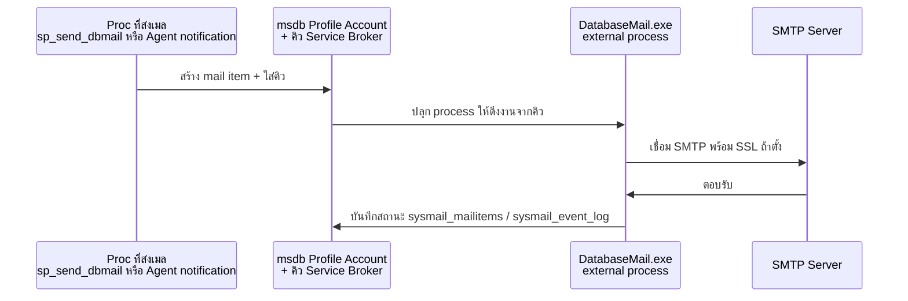

# Section 2 — Database Mail: ช่องทางอีเมลของ SQL Server

ทุก notification ที่จะสร้างใน Section 3 เดินทางออกจาก SQL Server ด้วยกลไกเดียวคือ **Database Mail** — ระบบส่งอีเมลในตัวที่ทำงานแบบ SMTP (คุยกับ mail server ด้วยโปรโตคอลมาตรฐาน) โดยเก็บการตั้งค่าทั้งหมดใน `msdb` ไม่ต้องติดตั้ง Outlook หรือโปรแกรมฝั่ง client เลย

จุดที่ต้องเข้าใจก่อนลงมือคือ Database Mail มีสองเลเยอร์: **Account** (ข้อมูล SMTP จริงของ mail server หนึ่ง ๆ) กับ **Profile** (กลุ่ม account ที่ใช้เรียงลำดับ failover) — Agent และ proc ต่าง ๆ เรียกผ่าน **profile** เสมอ ทำให้เปลี่ยน mail server โดยไม่ต้องแก้งานที่อ้าง

## 2.1 สถาปัตยกรรมการส่งอีเมล



ประเด็นสำคัญจากภาพนี้:

- **ส่งแบบ asynchronous** — `sp_send_dbmail` รับงานแล้วคืนทันที; การส่งจริงอาจล่าช้าหรือ fail — ตรวจผลเสมอที่ `msdb.dbo.sysmail_event_log` และ `sysmail_mailitems`
- Database Mail ต้องเปิดใช้ก่อนด้วยตัวเลือก `Database Mail XPs` (ปิด default เพื่อความปลอดภัย)
- บริการส่งจริงคือ external process `DatabaseMail.exe` ที่ Agent/Service Broker ปลุกให้ทำงาน — `sysmail_start_sp`/`sysmail_stop_sp` ควบคุมเมื่อต้อง troubleshoot

## 2.2 ขั้นตอนสร้างครบ — Account → Profile → Principal

สคริปต์เดโมฉบับเต็ม (ตั้งค่ากับ smtp4dev สำหรับห้องเรียน): [Scripts/01_DatabaseMail_Setup.sql](Scripts/01_DatabaseMail_Setup.sql)

> **ต้องรู้ก่อน**: ทั้งหมดรันบน `msdb` และต้องเป็น sysadmin (หรือได้สิทธิ์ db_owner ของ msdb + DatabaseMailUserRole กับสิทธิ์จัดการ)

```sql
USE msdb;
GO
-- (0) เปิดใช้ Database Mail (advanced option)
EXEC sp_configure 'show advanced options', 1; RECONFIGURE;
EXEC sp_configure 'Database Mail XPs', 1; RECONFIGURE;
GO
```

**(1) Mail Account** — ข้อมูลการติดต่อ SMTP:

```sql
-- ลบของเดิมก่อน (idempotent — ต้องลบผูกอื่นก่อนเมื่อมีของจริง, ด้วย sysmail_delete_*_sp)
IF EXISTS (SELECT 1 FROM dbo.sysmail_account WHERE name = N'Fabrikam Mail Account')
    EXEC dbo.sysmail_delete_account_sp @account_name = N'Fabrikam Mail Account';

EXEC dbo.sysmail_add_account_sp
    @account_name    = N'Fabrikam Mail Account',
    @description     = N'Account หลักของห้องเรียน (smtp4dev)',
    @email_address   = N'sqlserver@fabrikam.example',   -- ผู้ส่ง
    @display_name    = N'Fabrikam SQL Server',
    @replyto_address = N'dba-team@fabrikam.example',
    @mailserver_name = N'localhost',                     -- SMTP server
    @mailserver_type = N'SMTP',
    @port            = 25,                               -- smtp4dev default
    @username        = NULL,                             -- ถ้า server ต้อง auth
    @password        = NULL,
    @use_default_credentials = 0,
    @enable_ssl      = 0;                                -- smtp4dev local ไม่ใช้ SSL
GO
```

**(2) Mail Profile** — กล่องห่อ account ให้ระบบอ้าง:

```sql
IF EXISTS (SELECT 1 FROM dbo.sysmail_profile WHERE name = N'Fabrikam DBA Profile')
    EXEC dbo.sysmail_delete_profile_sp @profile_name = N'Fabrikam DBA Profile';

EXEC dbo.sysmail_add_profile_sp
    @profile_name = N'Fabrikam DBA Profile',
    @description  = N'Profile สำหรับ notification ของ Agent และ proc ภายใน';
GO
```

**(3) ผูก account เข้า profile** (ลำดับ = ลำดับ failover เมื่อ account แรกตอบไม่ทัน):

```sql
EXEC dbo.sysmail_add_profileaccount_sp
    @profile_name    = N'Fabrikam DBA Profile',
    @account_name    = N'Fabrikam Mail Account',
    @sequence_number = 1;
GO
```

**(4) มอบสิทธิ์ใช้ profile** — จุดที่หลายคนพลาด:

```sql
-- public = TRUE ให้ user ทุกคนใน DatabaseMailUserRole ใช้ profile นี้ได้
EXEC dbo.sysmail_add_principalprofile_sp
    @profile_name    = N'Fabrikam DBA Profile',
    @principal_name  = N'public',
    @is_default      = 1;     -- เป็น default ของผู้ใช้ทั่วไป
GO
```

✅ **สังเกต**: `@principal_name = N'public'` = profile **แบบ public** (ทุก user ใน role DatabaseMailUserRole ใช้ได้) — ใส่ชื่อ user เฉพาะตัว (สร้าง user ใน msdb ก่อน) เพื่อทำ profile แบบ **private** ที่ user นั้นคนเดียวเห็น; `@is_default = 1` หมายถึงคนที่ไม่ระบุ profile ใน `sp_send_dbmail` จะใช้อันนี้

**(5) มอบสิทธิ์ให้ user ส่งเมลได้**:

```sql
-- user ที่จะส่งเมลเองต้องอยู่ใน role นี้ของ msdb
ALTER ROLE DatabaseMailUserRole ADD MEMBER Lab10DBA;   -- ถ้ามี user Lab10DBA
GO
```

**(6) ตั้ง profile ให้ SQL Server Agent** — Agent ส่ง notification ต้องรู้ profile ของตัวเอง:

```sql
EXEC dbo.sp_set_sqlagent_properties
    @databasemail_profile = N'Fabrikam DBA Profile';
GO
```

(สมมูลหน้าจอ SSMS: Agent Properties → **Alert System** → เลือก Database Mail profile + restart Agent)

## 2.3 ทดสอบส่งอีเมลและตรวจผล

```sql
-- ส่งทดสอบตรง ๆ (user ที่มีสิทธิ์ใช้ profile)
EXEC dbo.sp_send_dbmail
    @profile_name = N'Fabrikam DBA Profile',
    @recipients   = N'dba-team@fabrikam.example',
    @subject      = N'Test from Database Mail',
    @body         = N'ถ้าเห็นอีเมลนี้ ช่องทาง SMTP ใช้ได้แล้ว';

-- ตรวจสถานะการส่ง — ทำหลังส่ง 5-10 วินาที
SELECT mailitem_id, sent_status,          -- 0=new 1=sending 2=sent 3=failed 4=retrying
       recipients, subject, sent_date
FROM dbo.sysmail_mailitems
ORDER BY mailitem_id DESC;

-- เมื่อมีปัญหา — log ของ Database Mail บอกความจริงทั้งหมด
SELECT log_id, event_type,          -- error/warning/information/success
       description, log_date
FROM dbo.sysmail_event_log
ORDER BY log_id DESC;
```

**Expected:** `sent_status = 2` (sent) และอีเมลถึงกล่องปลายทาง; ถ้า `sent_status = 3` ให้สังเกต `sysmail_event_log` — คำอธิบายจะระบุว่า SMTP server ตอบอะไร (refuse, auth fail, DNS fail) — นี่คือจุดแรกที่ต้องมองเสมอเมื่อ notification ไม่ถึง

## 2.4 การตั้งค่า SMTP สำหรับห้องเรียน — smtp4dev

ห้องเรียน/แล็บไม่ควรใช้ mail server จริง (และไม่มี mail server จริงให้ใช้) — [smtp4dev](https://github.com/rnwood/smtp4dev) เป็น fake SMTP server ฟรีที่ "รับอีเมลทุกที่อยู่" แล้วเปิดดูในเว็บ UI:

```bash
# Docker — SMTP ฟังที่ port 25 ของ host, เว็บดูเมลที่ http://localhost:5000
docker run --rm -p 5000:80 -p 25:25 -v smtp4dev-data:/smtp4dev rnwood/smtp4dev:latest
```

- ใช้ค่าใน `sysmail_add_account_sp` เป็น `@mailserver_name = N'localhost', @port = 25, @enable_ssl = 0` ตามตัวอย่างข้างบน
- ทุกอีเมลที่ SQL Server ส่งจะโผล่ใน UI — เห็น header/body ของจริง เหมาะพิสูจน์ทั้ง notification และ format ของเมล
- ในสภาพแวดล้อมจริงแทนที่ด้วย SMTP ขององค์กร/ผู้ให้บริการ (ตั้ง `@port = 587`, `@enable_ssl = 1`, `@username/@password` ตามที่ผู้ให้บริการกำหนด)

## 2.5 ความปลอดภัยและการดูแลรักษา

### สิทธิ์ของ Database Mail

| องค์ประกอบ | ใครใช้ได้ |
|:-----------|:----------|
| ส่งเมล (`sp_send_dbmail`) | สมาชิก **DatabaseMailUserRole** ใน msdb (หรือ sysadmin) |
| จัดการ account/profile | sysadmin (หรือตามที่มอบเพิ่ม) |
| Profile แบบ public | ใช้ได้ทุกคนใน DatabaseMailUserRole |
| Profile แบบ private | เฉพาะ principal ที่ถูกเพิ่มด้วย `sysmail_add_principalprofile_sp` |

> ค่า `@recipients` ใน `sp_send_dbmail` ถูกตรวจรูปแบบอีเมลเสมอ — ใช้ `@file_attachments` แนบไฟล์ได้ (ไฟล์ต้องอ่านได้โดย DatabaseMail.exe และขนาดต้องไม่เกิน `MaxFileSize`)

### Retention และ Logging

Database Mail เก็บประวัติการส่ง/การทำงานใน msdb และตั้งค่าการดูแลผ่าน `sysmail_configure_sp`:

```sql
-- ตั้งค่าเก็บอีเมลย้อนหลัง 14 วัน (default 30 วัน) และ log ระดับ extended
EXEC dbo.sysmail_configure_sp @parameter_name = N'RetentionPeriod',
                              @parameter_value = N'14';
EXEC dbo.sysmail_configure_sp @parameter_name = N'LoggingLevel',
                              @parameter_value = N'2';   -- 1=Normal 2=Extended 3=Verbose

-- ล้างของเก่าด้วยมือ (จำเป็นเมื่อลด retention แล้วอยากจัดของเดิมทิ้งเลย)
EXEC dbo.sysmail_delete_mailitems_sp @sent_before = DATEADD(day, -14, GETDATE());
GO
```

| ค่า (parameter) | default | ความหมาย |
|:----------------|:--------|:---------|
| `RetentionPeriod` | 30 วัน | เก็บ mail items/log กี่วัน (มี job ระบบล้างตามเวลา) |
| `LoggingLevel` | Normal | 1 = เฉพาะ error/เหตุการณ์สำคัญ, 2 = ละเอียดขึ้น, 3 = verbose ทุกการทำงาน |
| `AccountRetryAttempts` | 1 | จำนวนครั้งลอง SMTP server ถัดไปใน profile ก่อนจบว่า fail |
| `AccountRetryDelay` | 60 วินาที | เวลาหยุดระหว่าง retry |
| `MaxFileSize` | 1,000,000 bytes | ขนาดไฟล์แนบสูงสุด |

### 🚀 SQL Server 2025 & Modern Notes

- **Database Mail ยังเป็นกลไกเดียวทางการของ SQL Server on-prem/MI** — โครงสร้าง account/profile/DatabaseMailUserRole ไม่เปลี่ยนใน 2025 ([Database Mail](https://learn.microsoft.com/sql/relational-databases/database-mail/database-mail?view=sql-server-ver17))
- **Azure SQL Database ไม่มี Database Mail** — ระบบแจ้งเตือนฝั่ง cloud ใช้ Azure Monitor (Section 4); Azure SQL Managed Instance มี Database Mail ให้ใช้เหมือน on-prem
- **TLS ของ SMTP** — เมื่อ mail server ต้องการ STARTTLS/TLS เต็มรูป ตั้ง `@enable_ssl = 1`; การเชื่อมจาก DatabaseMail.exe ยังเป็น TCP ตรงถึง SMTP host ตามค่า port ที่ตั้ง
- **Pager/net send กำลังถูกถอด (2025)** — notification ใหม่ควรออกแบบด้วย **email เท่านั้น** หรือเรียก API ภายนอกผ่าน job step (เช่น PowerShell ยิง webhook ไป Teams/Slack)
- แนวทางใหม่ของหลายทีม: notification ถูกเก็บเป็น event ในระบบ observability (Grafana/Log analytics/Azure Arc assessments) แทนเมลล้วน — Database Mail ยังจำเป็นเพราะเป็นช่องทางที่ Agent พึ่งโดยตรง

> อ้างอิง: [Database Mail](https://learn.microsoft.com/sql/relational-databases/database-mail/database-mail?view=sql-server-ver17), [sysmail_add_account_sp](https://learn.microsoft.com/sql/relational-databases/system-stored-procedures/sysmail-add-account-sp-transact-sql?view=sql-server-ver17), [sysmail_add_profile_sp](https://learn.microsoft.com/sql/relational-databases/system-stored-procedures/sysmail-add-profile-sp-transact-sql?view=sql-server-ver17), [sp_send_dbmail](https://learn.microsoft.com/sql/relational-databases/system-stored-procedures/sp-send-dbmail-transact-sql?view=sql-server-ver17), [Database Mail log and audits](https://learn.microsoft.com/sql/relational-databases/database-mail/database-mail-log-and-audits?view=sql-server-ver17)
