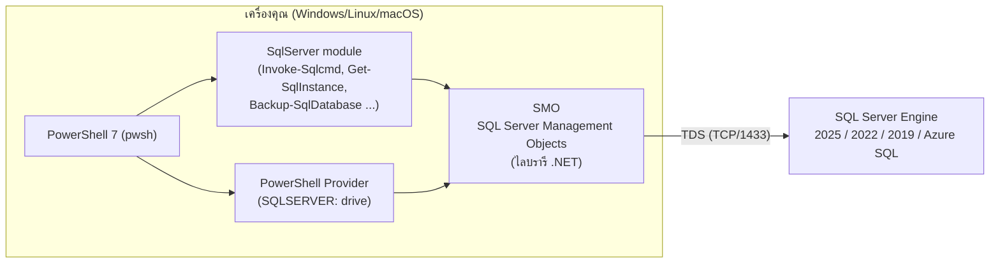
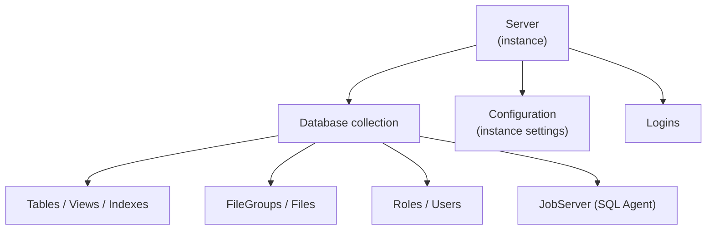

# Section 1 — พื้นฐาน PowerShell และการสำรวจ SQL Server ด้วย PowerShell

งาน DBA จำนวนมากเป็นงานที่ "ทำซ้ำเหมือนเดิมทุกครั้ง": ตรวจสถานะ instance, รายงานขนาด database, สร้าง login/user ตาม ticket, ตรวจ backup ล่าสุด การคลิกผ่าน SSMS ทีละ server ใช้ได้ดีกับหนึ่งเครื่อง แต่พอมี 10–100 เครื่อง SSMS กลายเป็นคอขวด และมือคุณกลายเป็น single point of failure **PowerShell** คือภาษา automation ทางการของ Microsoft ที่พูดคุยกับ SQL Server ได้โดยตรง ทำให้งานที่เคยคลิก 20 จุด กลายเป็นสคริปต์หนึ่งไฟล์ที่รันซ้ำได้ ตรวจสอบย้อนหลังได้ และกระจายไปทุกเซิร์ฟเวอร์ได้พร้อมกัน

โมดูลเดิม (20764D) สอน PowerShell ผ่านโมดูล `SQLPS` บน Windows PowerShell 2.0/5.x ซึ่งล้าสมัยไปแล้ว ใน Section นี้เราจะวางรากฐานใหม่บน **PowerShell 7.x (cross-platform) + `SqlServer` module** ซึ่งเป็นชุดเครื่องมือทางการในปัจจุบัน โดยครอบคลุม 5 เรื่อง: (1) PowerShell คืออะไรและเวอร์ชันไหนควรใช้ (2) การห่มตัวเองด้วย `Get-Help`/`Get-Command` (3) pipeline และ "objects ไม่ใช่ข้อความ" (4) **SMO** — ไลบรารี .NET ที่เป็นหัวใจของการจัดการ SQL Server ด้วย PowerShell (5) **SQLSERVER: drive** — PowerShell Provider ที่เดินโครงสร้าง SQL Server เหมือนไฟร์ซิสเทม และ (6) `Invoke-Sqlcmd` พื้นฐาน

> **การเตรียมตัว**: ต้องมี PowerShell 7+ และติดตั้ง `SqlServer` module เรียบร้อย (ดู [Module 00](../../../Module_00_Getting_Started/README.md)):
>
> ```powershell
> Install-Module -Name SqlServer -Scope CurrentUser -Force
> ```
>
> สคริปต์ประกอบอยู่ใน [`Scripts/`](Scripts/) ทั้งหมด ออกแบบให้รันได้ทันทีเทียบกับ default instance `localhost` และ database `AdventureWorks2025`

## 1. PowerShell คืออะไร — และเวอร์ชันไหนคือเวอร์ชันที่ถูกต้อง

PowerShell เป็น shell + scripting language แบบ object-oriented สร้างบน .NET จุดต่างสำคัญจาก shell แบบข้อความ (cmd.exe, bash) คือ **command คืนค่าเป็น object ไม่ใช่บรรทัดข้อความ** — ทำให้เรา filter/sort/join ข้อมูลได้โดยไม่ต้อง parse string

ในโลกของ SQL Server DBA มี "รุ่น" ที่ต้องแยกให้ออก เพราะหลักสูตรเก่าและสคริปต์ตามอินเทอร์เน็ตจำนวนมากยังอ้างถึงของเก่า:

| รุ่น | คืออะไร | สถานะปัจจุบัน |
|:-----|:---------|:--------------|
| **SQLPS** | โมดูล PowerShell ที่แถมมากับ SQL Server 2016 และก่อนหน้า (และ SSMS 18 ลงมา) | **เก่า อย่าใช้** — ชื่อ cmdlet ไม่ตรง, ไม่อัปเดตแล้ว ให้ใช้ `SqlServer` module แทน |
| **Windows PowerShell 5.1** | shell ที่มากับ Windows (ผ่าน cmd `powershell.exe`) | ยังใช้ได้เฉพาะ OS automation เก่า ๆ; Microsoft พัฒนาต่อแล้วที่ PowerShell 7 |
| **PowerShell 7.x** | cross-platform (Windows/Linux/macOS, ผ่าน `pwsh.exe`) บน .NET รุ่นใหม่ | **มาตรฐานปัจจุบัน** — ใช้ในคอร์สนี้ทั้งหมด |
| **SqlServer module** | โมดูล PowerShell ทางการสำหรับ SQL Server (`Install-Module SqlServer`) | ติดตั้งจาก PowerShell Gallery อัปเดตได้อิสระ ใช้ได้ทั้ง 5.1 และ 7 |
| **SQL Server ISE** | PowerShell ISE (หน้าต่างแก้สคริปต์ของ Windows) | **Deprecated** — ใช้ **VS Code + PowerShell extension** แทน (Section 2) |



ข้อดีของ PowerShell 7.x ที่กระทบงาน SQL DBA โดยตรง:

1. **Cross-platform** — สคริปต์เดียวรันบน Windows และ Linux (SQL Server บน Linux มีแต่ mssql-conf/PowerShell ไม่มี SSMS) 
2. **`$PSVersionTable` บอกทุกอย่าง** — ตรวจเวอร์ชันตัวเองก่อนเสมอ: `pwsh -NoProfile -Command '$PSVersionTable.PSVersion'`
3. **รองรับ `SqlServer` module รุ่นล่าสุด** ที่มี cmdlet ใหม่เช่น `Read-SqlXEvent` (ใช้ใน Module 12)

## 2. ห่มตัวเองด้วย Get-Help / Get-Command / Get-Member

PowerShell มีคำสั่งนับพัน ไม่มีใครจำได้หมด เครื่องมือเรียนรู้ในตัวคือสาม cmdlet นี้:

| Cmdlet | ใช้ทำอะไร | ตัวอย่าง |
|:-------|:----------|:---------|
| `Get-Command` | ค้นหาคำสั่งจากชื่อ/verb/noun/module | `Get-Command -Module SqlServer -Verb Backup` |
| `Get-Help` | อ่านเอกสารช่วยเหลือของคำสั่ง (ต้องมี help file) | `Get-Help Backup-SqlDatabase -Examples` |
| `Get-Member` | ดู property/method ของ object ที่ command คืนมา | `Get-SqlInstance ... \| Get-Member -MemberType Property` |

ก่อนใช้ครั้งแรกให้อัปเดต help ในเครื่อง (ทำครั้งเดียวต้องเปิด shell แบบ admin):

```powershell
Update-Help -Module SqlServer -ErrorAction SilentlyContinue
```

จากนั้นรันสคริปต์ [`Scripts/01_GetHelp_Explore.ps1`](Scripts/01_GetHelp_Explore.ps1) ทีละ Task — Task หลัก ๆ:

```powershell
# ดูคำสั่งทั้งหมดใน SqlServer module จัดกลุ่มตาม verb
Get-Command -Module SqlServer |
    Group-Object Verb |
    Sort-Object Name |
    Select-Object Name, Count |
    Format-Table

# อ่าน help แบบมีตัวอย่าง (สำคัญที่สุดสำหรับ cmdlet ที่เพิ่งเจอ)
Get-Help Invoke-Sqlcmd -Examples

# ดู object จริง ๆ หน้าตาเป็นอย่างไร
Get-ChildItem SQLSERVER:\SQL\localhost\DEFAULT\Databases |
    Get-Member -MemberType Property
```

✅ **สังเกต**: `Get-Command` คืนคำสั่งเกือบ 100 ตัวใน SqlServer module — สังเกตว่าทุกชื่อมีรูปแบบ `Verb-Noun` เสมอ (`Get-SqlInstance`, `Backup-SqlDatabase`, `Invoke-Sqlcmd`) การเดาชื่อจึงง่าย: อยาก restore ให้ลอง `Get-Command -Module SqlServer -Verb Restore` ก่อนหาใน Google เสมอ

**Expected:** `Get-Member` ต่อท้าย pipeline จะเผยว่า "database" ที่เราเห็นใน Object Explorer คือ object ประเภท `Microsoft.SqlServer.Management.Smo.Database` ซึ่งมี property เช่น `Size`, `RecoveryModel`, `CompatibilityLevel`, `LastBackupDate` — เป็นข้อมูลเดียวกับที่หน้าจอ SSMS ดึงมาแสดง เพียงแต่ตอนนี้เราเขียนโปรแกรมกับมันได้

> เทคนิค: เมื่อไม่แน่ใจว่า object ให้ค่าอะไรได้บ้าง `Get-Member -MemberType Property` หรือท่องเข้า `Select-Object *` ดูค่าจริงทุก property ได้เร็วกว่าเปิด MSDN

## 3. Pipeline — objects ไม่ใช่ข้อความ

Pipeline (`|`) ใน PowerShell ส่งต่อ **object ทั้งก้อน** ระหว่างคำสั่ง ไม่ใช่บรรทัดข้อความ นี่คือเหตุผลที่สคริปต์ PowerShell อ่านเหมือนภาษาธรรมชาติ: "เอา databases ทั้งหมด **ที่** ใหญ่กว่า 1 GB **จัดเรียง**ตามขนาด **เลือกแสดง**เฉพาะชื่อกับขนาด **คัดรูปแบบ**เป็นตาราง"

รัน [`Scripts/02_Pipeline_Basics.ps1`](Scripts/02_Pipeline_Basics.ps1) — โครงหลัก:

```powershell
# 1) กรองด้วย Where-Object
Invoke-Sqlcmd -ServerInstance $ServerInstance -TrustServerCertificate -Database $Database `
    -Query "SELECT name, size * 8 / 1024 AS SizeMB FROM sys.master_files WHERE type = 0" |
    Where-Object { $_.SizeMB -gt 100 } |
    Sort-Object SizeMB -Descending |
    Format-Table -AutoSize

# 2) รวมข้อมูลด้วย Measure-Object
Get-ChildItem $env:USERPROFILE |
    Measure-Object -Property Length -Sum |
    Select-Object Count, Sum

# 3) รูปแบบผลลัพธ์: Format-Table, Format-List, Export-Csv, ConvertTo-Json
```

✅ **สังเกต**:

- `Invoke-Sqlcmd` คืนผลเป็น **DataRow objects** จึง filter ด้วย property ได้ทันที (`$_.SizeMB`) โดยไม่ต้อง parse ข้อความ
- **Format-* ต้องเป็นคำสั่งสุดท้ายของ pipeline เสมอ** — พอท่องผ่าน `Format-Table` แล้ว object เปลี่ยนเป็น "formatted object" ที่ filter ต่อไม่ได้ ถ้าต้องการกรองต่อให้ใช้ `Select-Object` ก่อนแล้วเก็บไว้ในตัวแปร
- `Export-Csv` / `ConvertTo-Json` / `Out-File` ใช้ "ถ่ายของ" ไปที่อื่น — ในสคริปต์สำรวจ instance (ท้าย Section นี้) เราจะใช้ชุดนี้จริง

ตาราง cmdlet pipeline ที่ใช้บ่อยในงาน DBA:

| Cmdlet | หน้าที่ | ตัวอย่างงาน DBA |
|:-------|:--------|:-----------------|
| `Where-Object` | กรองแถวตามเงื่อนไข | DB ที่อยู่ SIMPLE recovery, DB ที่ไม่มี backup |
| `Sort-Object` | เรียงลำดับ | DB เรียงตามขนาด |
| `Select-Object` | เลือกคอลัมน์ / เลือก N แถวแรก | รายงาน 10 DB ใหญ่สุด |
| `Measure-Object` | นับ/ผลรวม/เฉลี่ย | ผลรวมขนาดไฟล์ทั้ง instance |
| `Group-Object` | จัดกลุ่มนับ | นับ DB ต่อ compatibility level |
| `Format-Table` / `Format-List` | จัดรูปแบบการแสดงผล | รายงานบนหน้าจอ |
| `Export-Csv` / `Out-File` / `ConvertTo-Json` | เก็บเป็นไฟล์ | ส่งรายงานให้ทีม/เก็บ baseline |

## 4. SMO — SQL Server Management Objects

**SMO** (SQL Server Management Objects) คือไลบรารี .NET ที่ห่อ API การจัดการ SQL Server เป็น object hierarchy ทั้งหมด **SSMS ตัวเองก็ใช้ SMO ในการแสดง Object Explorer** — ทุกอย่างที่ SSMS ทำได้ทาง UI แปลว่าเรียกใช้ผ่าน SMO ได้ด้วย PowerShell โครงสร้างลำดับชั้น:



จุดสำคัญ 3 อย่างของการทำงานกับ SMO:

1. **Object เป็นแบบ lazy** — property ไม่ได้ถูกอ่านมาหมดตั้งแต่สร้าง object ใหม่ แต่ query เมื่อถูกเรียกใช้ (จึงควรเก็บ object ในตัวแปรก่อนแล้วค่อยใช้ ไม่ใช่เรียกซ้ำหลายรอบ)
2. **แก้ค่าแล้วต้องเรียก `.Alter()` เสมอ** — การกำหนด `$db.RecoveryModel = 'Full'` เพียงแก้ข้อมูลใน memory; `.Alter()` คือส่ง T-SQL `ALTER DATABASE` ไปยัง server รูปแบบนี้ซ้ำกันทุก object ของ SMO (Configuration, Database, Login ฯลฯ)
3. **`.Create()`, `.Drop()` ก็ตามชื่อ** — เพราะทุก object มี method lifecycle ชุดเดียวกัน

วิธีได้ SMO Server object มี 2 ทางที่เราใช้ตลอดโมดูลนี้:

```powershell
Import-Module SqlServer

# ทาง A: ผ่าน PowerShell Provider (SQLSERVER: drive) — Section ถัดไป
$srv = Get-Item SQLSERVER:\SQL\localhost\DEFAULT

# ทาง B: New-Object ตรง ๆ
$srv = New-Object Microsoft.SqlServer.Management.Smo.Server "localhost"
```

✅ **สังเกต**: `$srv | Select-Object *` แสดง property ระดับ instance ทั้งหมด (`Name`, `Product`, `Version`, `Edition`, `IsIntegratedSecurityOnly` ...) — เทียบเท่ากับหน้า Server Properties ของ SSMS

## 5. PowerShell Provider — เดิน SQL Server ด้วย SQLSERVER: drive

**PowerShell Provider** คือกลไกที่ "นำโครงสร้างข้อมูลอะไรก็ตาม มาจำลองเป็นไฟร์ซิสเทม" ให้เดินด้วยคำสั่ง `Set-Location`/`Get-ChildItem` เหมือนเดินโฟลเดอร์ ตัวอย่างที่มากับ PowerShell เอง: `C:` (filesystem), `HKLM:` (registry), `Env:` (ตัวแปรแวดล้อม) SqlServer module เพิ่ม **`SQLSERVER:` drive** ที่เดินโครงสร้าง instance/database ได้โดยอัตโนมัติเมื่อ import module

```powershell
Import-Module SqlServer

# ดู drive ทั้งหมด — SQLSERVER: ถูกสร้างให้อัตโนมัติ (ไม่ต้อง New-PSDrive)
Get-PSDrive

# เดินเข้าไปยัง default instance บน localhost
Set-Location SQLSERVER:\SQL\localhost\DEFAULT

# โครงใต้ instance
Get-ChildItem

# ถ้าเป็น named instance: SQLSERVER:\SQL\localhost\INSTANCENAME
# ถ้าเป็น server อื่น:        SQLSERVER:\SQL\SERVERNAME\DEFAULT
```

โครงสร้างใต้ `SQLSERVER:\SQL\<host>\<instance>` เหมือน Object Explorer เป๊ะ:

| Path | เทียบเท่าใน SSMS |
|:-----|:-----------------|
| `SQLSERVER:\SQL\localhost\DEFAULT\Databases` | Object Explorer > Databases |
| `...\Databases\AdventureWorks2025\Tables` | Tables ของ database |
| `...\Logins` | Security > Logins |
| `...\JobServer\Jobs` | SQL Server Agent > Jobs |
| `SQLSERVER:\SQLRegistration` | Registered Servers |

รันสคริปต์ [`Scripts/03_SQLSERVER_Provider.ps1`](Scripts/03_SQLSERVER_Provider.ps1) — ปรับปรุงจาก demo `InspectSqlInstances.ps1` ของคอร์สเดิม (เดิมใช้ `Import-Module SQLPS` — เราเปลี่ยนเป็น `Import-Module SqlServer` และตัด `New-PSDrive` ที่ไม่จำเป็นใน PowerShell 7 ออก):

```powershell
# Task หลัก: รายงาน database เรียงตามขนาด แล้วเก็บเป็นไฟล์
Get-ChildItem SQLSERVER:\SQL\localhost\DEFAULT\Databases |
    Select-Object Name, Status, CompatibilityLevel, RecoveryModel,
                  @{N = 'SizeMB'; E = { [math]::Round($_.Size / 1MB, 1) } },
                  LastBackupDate |
    Sort-Object SizeMB -Descending |
    Format-Table -AutoSize

# เก็บรายงานเป็น CSV
Get-ChildItem SQLSERVER:\SQL\localhost\DEFAULT\Databases |
    Select-Object Name, RecoveryModel, CompatibilityLevel, Size |
    Sort-Object Size -Descending |
    Export-Csv "$env:TEMP\Databases.csv" -NoTypeInformation -Encoding UTF8
```

✅ **สังเกต**: `LastBackupDate` มาจาก `msdb.dbo.backupset` เบื้องหลัง — สคริปต์ 6 บรรทัดนี้คือรายงาน "DB ไหนไม่มี backup" ที่ใช้ได้จริงในที่ทำงาน (เทียบกับ `NULL` = ยังไม่เคย backup)

> **ข้อจำกัดควรรู้**: SQLSERVER: drive ใช้ Windows Authentication โดย default (เป็นความปลอดภัยที่ดี) ถ้าต้องเชื่อมต่อแบบ SQL auth ต้องสร้าง PSDrive เองพร้อม `-Credential` — และกรณี default instance บนชื่อ host อื่น ใช้ `SQLSERVER:\SQL\HOSTNAME\DEFAULT` เสมอ (ไม่มี `\DEFAULT` สำหรับ localhost เพียงอย่างเดียว)

> อ้างอิง: [SQL Server PowerShell provider](https://learn.microsoft.com/sql/powershell/navigate-the-sql-server-powershell-drive?view=sql-server-ver17)

## 6. Invoke-Sqlcmd — รัน T-SQL จาก PowerShell

`Invoke-Sqlcmd` คือ "sqlcmd.exe ในรูปแบบ cmdlet" — รัน batch T-SQL แล้วคืนผลเป็น object เข้า pipeline ต่อได้ เหมาะกับงานที่ T-SQL เหมาะที่สุด (DMVs, config, DDL) แล้วใช้ PowerShell จัดการผลต่อ

รัน [`Scripts/04_Invoke_Sqlcmd.ps1`](Scripts/04_Invoke_Sqlcmd.ps1) — รูปแบบที่ใช้ตลอดคอร์ส:

```powershell
# พารามิเตอร์พื้นฐาน
Invoke-Sqlcmd `
    -ServerInstance 'localhost' `
    -Database 'AdventureWorks2025' `
    -TrustServerCertificate `
    -Query "SELECT @@SERVERNAME AS ServerName, @@VERSION AS Version;"

# ใช้ -Variable ส่งค่าเข้า T-SQL (sqlcmd-style substitution ด้วย $(ชื่อตัวแปร))
$query = 'SELECT name FROM sys.databases WHERE name LIKE ''$(pattern)'';'
Invoke-Sqlcmd -ServerInstance 'localhost' -TrustServerCertificate `
    -Query $query `
    -Variable "pattern=A%"

# เขียนผลลงไฟล์ CSV
Invoke-Sqlcmd -ServerInstance 'localhost' -TrustServerCertificate -Database 'AdventureWorks2025' `
    -Query "SELECT TOP (10) name, size * 8 / 1024 AS SizeMB FROM sys.master_files WHERE type = 0 ORDER BY size DESC" |
    Export-Csv "$env:TEMP\TopDBs.csv" -NoTypeInformation
```

จุดที่ผู้เริ่มต้นพลาดบ่อย:

1. **`-TrustServerCertificate`** — SqlServer module รุ่นใหม่ (v22+) เปิด encryption โดย default ทำให้การเชื่อมต่อ local/self-signed cert พังด้วย error "certificate chain not trusted" บน instance ทดลองเราใส่ได้เลย ส่วน production ที่จริงควรติดตั้ง certificate ที่ trust ได้แล้วใช้ encryption จริง
2. **`GO` ไม่ใช่ T-SQL** — `GO` เป็น batch separator ของ SSMS/sqlcmd เท่านั้น เมื่อเขียนใน `-Query` ให้ใช้ `;` หรือเรียก `Invoke-Sqlcmd` หลายครั้ง (สคริปต์ .sql ที่มี `GO` ให้ใช้ `-InputFile` ซึ่งรองรับ sqlcmd ครบ)
3. **เก็บผลในตัวแปรก่อนใช้ต่อ** — `$result = Invoke-Sqlcmd ...; $result.Count; $result[0].name` จะ debug ง่ายกว่าท่องต่อทันที
4. **SQL auth** — `-Username sa -Password '...'` หรือ `-Credential (Get-Credential)`; Windows auth คือค่า default เมื่อไม่ใส่ (แนะนำ)

> อ้างอิง: [Invoke-Sqlcmd](https://learn.microsoft.com/powershell/module/sqlserver/invoke-sqlcmd), [SQL Server PowerShell](https://learn.microsoft.com/sql/powershell/sql-server-powershell?view=sql-server-ver17)

## 7. กลไกที่ทุกสคริปต์ใช้ร่วมกัน — พารามิเตอร์, splatting, error handling

สคริปต์ในโมดูลนี้ (และที่คุณจะเขียนต่อในที่ทำงาน) มีกลไกพื้นฐานสามชุดที่ควรเห็นตั้งแต่ตอนเรียน เพื่อไม่ต้องไปถอดรหัสจากสคริปต์หน้างานจริง

**พารามิเตอร์ของสคริปต์** — ทุกสคริปต์ใน `Scripts/` เริ่มด้วย `param(...)` ทำให้รันด้วยค่า default ได้ (`.\script.ps1`) หรือ override ตอนเรียก (`.\script.ps1 -ServerInstance 'localhost,1434'`):

```powershell
param(
    [string]$ServerInstance = 'localhost',
    [string]$Database       = 'AdventureWorks2025'
)
```

**Splatting** — เมื่อพารามิเตอร์ยาว ให้รวมเป็น hashtable แล้วส่งด้วย `@` อ่านง่ายกว่า backtick ต่อบรรทัด:

```powershell
$common = @{
    ServerInstance         = $ServerInstance
    Database               = $Database
    TrustServerCertificate = $true
}
Invoke-Sqlcmd @common -Query "SELECT @@SERVERNAME AS Srv;"
```

**Error handling** — กฎสำคัญคือ "cmdlet พลาดแล้วไม่หยุดรันโดย default" — มันเขียน error ลง stream แล้วไปต่อ ให้ควบคุมด้วย:

```powershell
# วิธีที่ 1: บังคับ error ให้หยุดรันแล้วจับใน try/catch
try {
    Invoke-Sqlcmd -ServerInstance $ServerInstance -TrustServerCertificate `
        -Query "SELECT 1/0 AS Oops;" -ErrorAction Stop
}
catch {
    Write-Warning "จับ error ได้: $($_.Exception.Message.Split([char]10)[0])"
}

# วิธีที่ 2: เข้มงวดทั้ง script (วางไว้บนสุดในงานที่ไม่อยากให้ "ลืมต่อ")
$ErrorActionPreference = 'Stop'
```

หัวใจเชิงนิยาม: `ErrorAction Stop` ทำให้ non-terminating error กลายเป็น terminating exception ที่ `catch` จับได้ — สคริปต์งาน backup/config ในโมดูลนี้ใช้รูปแบบ try/catch เสมอ เพื่อ log เหตุและตัดสินใจ retry หรือ revert ต่อ

**ตัวแปรและชนิดข้อมูล** ที่เจอทุกสคริปต์:

| รูปแบบ | ความหมาย |
|:--------|:----------|
| `$variable = 'value'` | กำหนดตัวแปร (ชนิดอนุโลมตามค่า) |
| `[int]$x`, `[string]$s` | cast ชนิดชัดเจน — กันความเข้าใจผิดเรื่อง `1` vs `'1'` |
| `$(expression)` | subexpression ใน string แบบ double-quoted (`"rows: $($r.Count)"`) |
| `'$(name)'` + `-Variable` | sqlcmd-style substitution ของ Invoke-Sqlcmd (Task 3 ของ 04_Invoke_Sqlcmd.ps1) |
| `$null` | ค่าว่าง — เทียบเสมอด้วย `$null -eq $x` |
| `@(...)`, `@{...}` | array / hashtable |

✅ **สังเกต**: ข้อแตกต่างที่มือใหม่โดนบ่อยที่สุดคือ string ของ PowerShell — **single quote = literal** (ไม่ตีความ `$`), **double quote = interpolate** (แทรกค่าตัวแปร) จำสองข้อนี้ไว้กัน bug กลุ่มใหญ่ที่สุดของสคริปต์ที่ผสม T-SQL กับตัวแปร

## 8. เช็กลิสต์ท้าย Section

รันสคริปต์ทั้ง 4 ใน `Scripts/` แล้วต้องตอบได้:

- [ ] `$PSVersionTable.PSVersion` เป็น 7.x และ `Get-Module SqlServer -ListAvailable` เจอ module
- [ ] `Get-ChildItem SQLSERVER:\SQL\localhost\DEFAULT\Databases` เห็น AdventureWorks2025
- [ ] เขียน pipeline กรอง DB ตามขนาด แล้ว export เป็น CSV ได้เอง
- [ ] เรียก `.Alter()` บน SMO object โดยเข้าใจว่ามันทำอะไร (จะใช้จริงใน Section 2)

### 🚀 SQL Server 2025 & Modern Notes
- **SQLPS module เก่าให้เลิกใช้** — หลักสูตร 20764D เดิมใช้ `Import-Module SQLPS` บน Windows PowerShell; ปัจจุบัน `SqlServer` module (PowerShell Gallery) เป็นทางการและอัปเดตสม่ำเสมอ ([SqlServer module](https://learn.microsoft.com/powershell/module/sqlserver/))
- **PowerShell ISE deprecated** — ใช้ Visual Studio Code + PowerShell extension แทน (จะตั้งค่าใน Section 2) ([PowerShell ISE lifecycle](https://learn.microsoft.com/powershell/scripting/components/ise-intro))
- **Encryption by default ใน SqlServer module v22+** — ต้อง `-TrustServerCertificate` กับ self-signed cert หรือจัด certificate ให้เครื่อง client trust; สอดคล้องกับมาตรฐานการเข้ารหัสที่เข้มขึ้นของ SQL Server 2025 (TDS 8.0 + TLS 1.3) ([Invoke-Sqlcmd](https://learn.microsoft.com/powershell/module/sqlserver/invoke-sqlcmd))
- **`Read-SqlXEvent`** — cmdlet ใน SqlServer module ที่อ่าน XEL file/live XE session ได้ตรง ๆ (จะเห็นใน Module 12) ([Read-SqlXEvent](https://learn.microsoft.com/powershell/module/sqlserver/read-sqlxevent))
