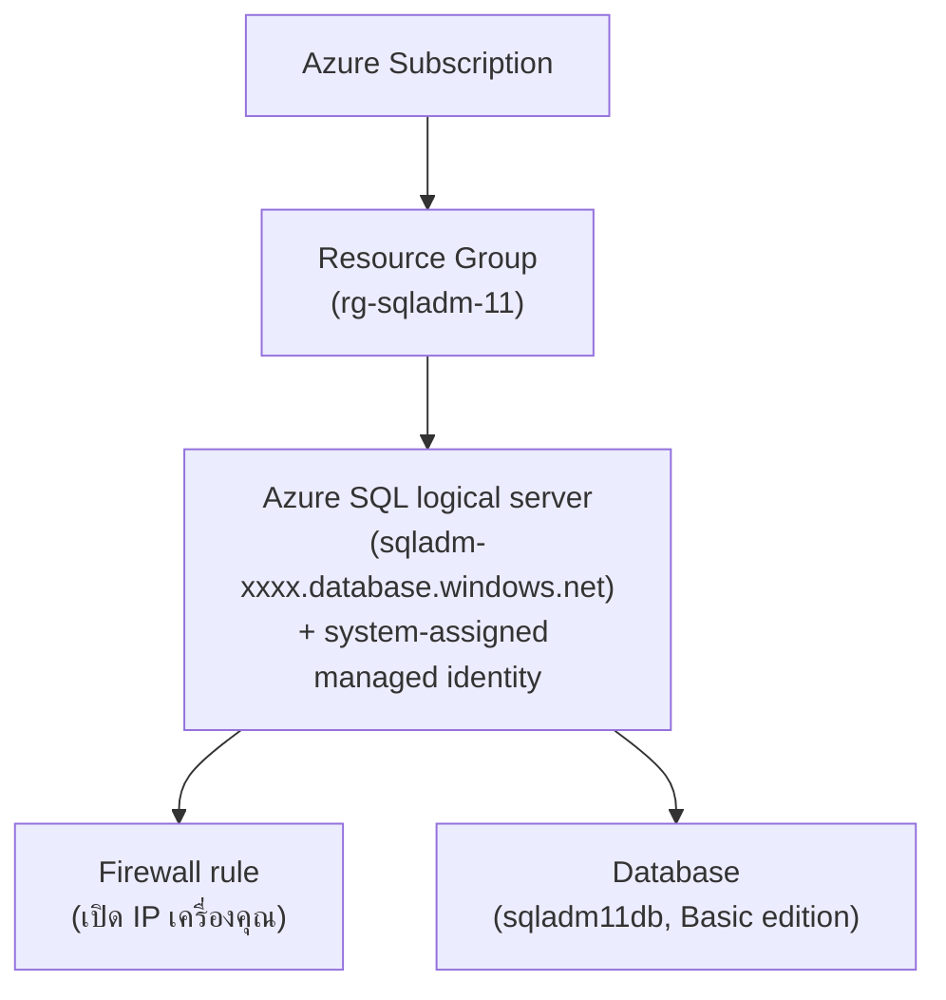

# Section 4 — Azure SQL ด้วย PowerShell (Az module) และข้อแตกต่างจาก on-premises

โลกของ DBA ปัจจุบันมักผสมกัน: SQL Server บนเครื่องจริง/VM + **Azure SQL Database** สำหรับ workload บางส่วน สิ่งที่ต้องฝึกคือการสร้าง/จัดการทรัพยากร Azure ด้วย PowerShell เพราะเป็นวิธีที่ทำซ้ำได้ เขียนเป็นสคริปต์ส่งมอบ (infrastructure as code ระดับพื้นฐาน) และใช้ได้ทั้งการจำลองสภาพแวดล้อมในห้องเรียนและของจริงในองค์กร Section นี้ใช้ **Az module** — โมดูล PowerShell ทางการของ Azure (cross-platform บน PowerShell 7 ด้วย) สร้าง "logical server + database" ของ Azure SQL หนึ่งชุด ทดลองเชื่อมต่อด้วยเครื่องมือที่เราเรียนมาแล้ว (`Invoke-Sqlcmd`), อธิบาย **managed identity** และปิดท้ายด้วยข้อแตกต่างสำคัญเมื่อใช้ SMO/SqlServer module กับ Azure SQL

> **ค่าใช้จ่าย (อ่านก่อนสร้างจริง)**: Azure SQL Database เก็บเงินตามชั่วโมงการใช้งาน (สมรรถนะ Basic เริ่มระดับราคาต่ำมาก แต่เก็บเงินต่อเนื่องเสมอ) หากเรียนแล้วไม่ใช้ ให้ลบ resource group ทันทีด้วย [`Scripts/04_Cleanup_Az.ps1`](Scripts/04_Cleanup_Az.ps1) ในแล็บของโมดูลนี้เรากำหนดให้ Exercise Azure เป็น **optional** เพราะต้องมี subscription ของตัวเอง

## 1. Az module — เชื่อมต่อและตรวจ context

Az module เป็นชุดโมดูลหลายตัว (`Az.Accounts`, `Az.Sql`, `Az.Resources` ...) ติดตั้งครั้งเดียวใช้ร่วมกับ PowerShell 7 ได้เลย รันสคริปต์ [`Scripts/01_Connect_AzAccount.ps1`](Scripts/01_Connect_AzAccount.ps1):

```powershell
# ติดตั้งครั้งแรก (ครั้งเดียวต่อเครื่อง)
Install-Module Az -Scope CurrentUser -Repository PSGallery -Force

# เชื่อมต่อ (เปิดหน้า browser ให้ล็อกอิน)
Connect-AzAccount

# ตรวจว่าอยู่ subscription ไหน
Get-AzContext |
    Select-Object Account, SubscriptionName, Tenant |
    Format-List

# เลือก subscription (ถ้ามีหลายตัว)
Set-AzContext -Subscription '<Subscription-Id-หรือ-ชื่อ>'
```

✅ **สังเกต**: `Connect-AzAccount` รองรับหลายวิธีพิสูจน์ตัวตน — interactive browser, service principal (สำหรับ automation), managed identity (เมื่อรันอยู่บน VM/เว็บของ Azure: `Connect-AzAccount -Identity`) ในห้องเรียนใช้ interactive พอ

โครงสร้างทรัพยากรที่เราจะสร้าง:



> **จำไว้**: "logical server" ของ Azure SQL ไม่ใช่ VM — เป็น service ที่ Microsoft จัดการ OS/patching ให้ เราเชื่อมต่อผ่าน `<server>.database.windows.net` พอร์ต 1433

> อ้างอิง: [Install Azure PowerShell](https://learn.microsoft.com/powershell/azure/install-az-ps), [Az.Sql module](https://learn.microsoft.com/powershell/module/az.sql/)

## 2. สร้าง logical server + database ด้วย New-AzSqlServer / New-AzSqlDatabase

รันสคริปต์ [`Scripts/02_New_AzSqlServer_Db.ps1`](Scripts/02_New_AzSqlServer_Db.ps1) — สอง cmdlet หลักคือ `New-AzSqlServer` (สร้าง logical server) และ `New-AzSqlDatabase` (สร้าง database ใน server นั้น):

```powershell
$ResourceGroup = 'rg-sqladm-11'
$Location      = 'southeastasia'      # ภูมิภาคใกล้คุณ
$ServerName    = "sqladm-$(Get-Random -Maximum 99999)"   # ชื่อต้อง unique ทั่วโลก

# 1) กลุ่มทรัพยากร (ที่รวมของทุกอย่าง - ลบครั้งเดียวจบทุกอย่าง)
New-AzResourceGroup -Name $ResourceGroup -Location $Location

# 2) logical server - พร้อม system-assigned managed identity (-AssignIdentity)
$securePwd = ConvertTo-SecureString 'Pa$$w0rd2025' -AsPlainText -Force
$adminCred = New-Object System.Management.Automation.PSCredential('sqladmin2025', $securePwd)

$server = New-AzSqlServer `
    -ResourceGroupName $ResourceGroup `
    -ServerName $ServerName `
    -Location $Location `
    -ServerVersion '12.0' `
    -SqlAdministratorCredentials $adminCred `
    -AssignIdentity

# 3) เปิดไฟร์วอลล์ให้ IP ของเครื่องคุณ (Azure SQL ปิดทุกอย่างโดย default)
New-AzSqlServerFirewallRule `
    -ResourceGroupName $ResourceGroup -ServerName $ServerName `
    -FirewallRuleName 'AllowMyIP' `
    -StartIpAddress '<YOUR_PUBLIC_IP>' -EndIpAddress '<YOUR_PUBLIC_IP>'

# 4) สร้าง database (ระดับสมรรถนะ Basic - ถูกที่สุดสำหรับการเรียน)
New-AzSqlDatabase `
    -ResourceGroupName $ResourceGroup -ServerName $ServerName `
    -DatabaseName 'sqladm11db' -Edition Basic
```

✅ **สังเกต**:

- `Get-Random` ต่อท้ายชื่อ server — ชื่อต้องเป็น DNS ที่ไม่ซ้ำกับคนทั้งโลก (`sqladm-48213.database.windows.net`)
- **`-AssignIdentity`** บน `New-AzSqlServer` สร้าง **system-assigned managed identity** ให้ server — ค่า Identity ที่คืนมาจะมี PrincipalId ตรวจด้วย `$server.Identity`
- รหัสผ่าน admin ต้องผ่านความซับซ้อนของ Azure (`Pa$$w0rd2025` ผ่าน)

### Managed identity — แนวคิดที่ใช้ทั้งสองโลก

**Managed identity** คือ identity ประเภทหนึ่งของ Microsoft Entra ID ที่ Azure จัดการ credential ให้เอง (ไม่มีรหัสผ่านให้เราเก็บ/หมดอายุ) ใช้พูดคุยกับ service อื่นได้โดยไม่ต้องเก็บ secret:

| บริบท | managed identity ใช้ทำอะไร |
|:-------|:---------------------------|
| Azure SQL logical server (`-AssignIdentity`) | Entra-only authentication, ส่ง audit/backup ไป Azure Storage, เข้ารหัสด้วย customer-managed key |
| SQL Server 2025 on-premises (**ผ่าน Azure Arc**) | ใช้ managed identity ทำ EKM กับ Azure Key Vault และ backup to URL — นี่คือของใหม่สำคัญของ 2025: server ที่เชื่อมต่อ Arc ใช้ identity ได้โดยไม่ต้องเก็บ secret ใน SQL Server |

นี่เป็นเหตุผลที่สคริปต์เราใส่ `-AssignIdentity` ตั้งแต่สร้าง server เลย — เปิดทางไว้ก่อน แล้วใช้ตอนต้องการ

> อ้างอิง: [New-AzSqlServer](https://learn.microsoft.com/powershell/module/az.sql/new-azsqlserver), [Managed identities in Microsoft Entra for Azure SQL](https://learn.microsoft.com/azure/azure-sql/database/authentication-azure-ad-user-assigned-managed-identity?view=azuresql), [What's new in SQL Server 2025](https://learn.microsoft.com/sql/sql-server/what-s-new-in-sql-server-2025?view=sql-server-ver17)

## 3. เชื่อมต่อ Azure SQL ด้วยเครื่องมือชุดเดิม (Invoke-Sqlcmd / SMO)

รันสคริปต์ [`Scripts/03_Invoke_Sqlcmd_Azure.ps1`](Scripts/03_Invoke_Sqlcmd_Azure.ps1) — ข้อดีของ `SqlServer` module คือ cmdlet ชุดเดียวใช้กับ on-premises และ Azure SQL:

```powershell
$Fqdn = 'sqladm-xxxxx.database.windows.net'

# SQL authentication (เหมือน on-prem) - หรือใช้ -AccessToken สำหรับ Entra auth
Invoke-Sqlcmd `
    -ServerInstance $Fqdn `
    -Database 'sqladm11db' `
    -Username 'sqladmin2025' `
    -Password 'Pa$$w0rd2025' `
    -Query "SELECT @@SERVERNAME AS Server, @@VERSION AS Version;"

# สร้างตาราง/รัน DDL เหมือน on-premises
Invoke-Sqlcmd -ServerInstance $Fqdn -Database 'sqladm11db' `
    -Username 'sqladmin2025' -Password 'Pa$$w0rd2025' `
    -Query "CREATE TABLE dbo.DemoAzure (Id int PRIMARY KEY, Note nvarchar(50));"

# ตรวจสถานะด้วย cmdlet ฝั่ง Azure
Get-AzSqlDatabase -ResourceGroupName 'rg-sqladm-11' -ServerName 'sqladm-xxxxx' |
    Select-Object DatabaseName, Edition, Status, CurrentServiceObjectiveName
```

### ความต่าง SMO / SqlServer module บน Azure SQL ที่ต้องรู้

| ความสามารถ | SQL Server on-prem | Azure SQL Database |
|:------------|:-------------------|:-------------------|
| `Invoke-Sqlcmd`, T-SQL, SMO (โครง metadata) | ได้ | **ได้** (เกือบเหมือนกัน) |
| `Backup-SqlDatabase` (BACKUP DATABASE) | ได้ | **ไม่มี** — Azure ทำ automatic backup ให้เอง (point-in-time restore ตั้ง retention) |
| `Restore-SqlDatabase` | ได้ | ไม่มี — ใช้ restore จาก built-in backups / point-in-time restore ผ่าน `Restore-AzSqlDatabase` |
| Event sessions (Module 12) | `ON SERVER` / `ON DATABASE` | เฉพาะ **`ON DATABASE`** (database-scoped) เท่านั้น |
| `Get-SqlInstance` | อ่านจากเครื่อง service ได้ | ใช้ไม่ได้แบบเดียวกัน — ใช้ `Get-AzSqlServer` / `Get-AzSqlDatabase` ฝั่ง Azure แทน |
| sp_configure ระดับ instance | ได้ | ไม่มี instance config — ตั้งต่อ database ผ่าน `ALTER DATABASE ... SET` / `ALTER DATABASE SCOPED CONFIGURATION` |

> **แนวปฏิบัติที่ดี**: เขียนสคริปต์ให้รับ `-ServerInstance` เป็นพารามิเตอร์เสมอ (เหมือนสคริปต์ทุกตัวในโมดูลนี้) — สคริปต์เดียวกันจะรันกับ localhost หรือ Azure ได้โดยไม่แก้โค้ด

## 4. คำสั่ง Az.Sql ชุดใช้ประจำ — รวมในตารางเดียว

หลังเข้าใจลำดับ "resource group → logical server → database" งานที่เหลือในชีวิตประจำวันเรียกใช้จากชุดเล็ก ๆ นี้ (ทุกตัวอยู่ในโมดูล `Az.Sql` ที่เราติดตั้งไว้):

| Cmdlet | ใช้ทำอะไร | เทียบเท่าฝั่ง on-prem |
|:--------|:----------|:------------------------|
| `Get-AzSqlServer` | รายการ logical server ทั้ง subscription/ทั้ง resource group | `Get-SqlInstance` |
| `Get-AzSqlDatabase` | database ทั้งหมดใน server + edition/สถานะ | `Get-SqlDatabase` |
| `New-AzSqlServer` / `New-AzSqlDatabase` | สร้าง server/database | `CREATE DATABASE` |
| `New-AzSqlServerFirewallRule` | เปิด IP เข้าถึง | Windows Firewall + `Add-SqlFirewallRule` |
| `Set-AzSqlDatabase` | เปลี่ยน edition/ขนาด (-Edition, -VCore) / `-AssignIdentity` | `ALTER DATABASE` |
| `Remove-AzSqlDatabase` | ลบ database เดียว (เก็บ server ไว้) | `DROP DATABASE` |
| `Remove-AzSqlServer` / `Remove-AzResourceGroup` | ลบ server/ลบทั้งชุด | (ไม่มี — ยุคนี้ลบทรัพยากรเป็น "ชุด") |

ตัวอย่างที่ควรพิมพ์ทีละบรรทัดเพื่อจับโครงสร้าง:

```powershell
# server ทั้งหมดใน resource group ของแล็บ
Get-AzSqlServer -ResourceGroupName 'rg-sqladm-11' |
    Select-Object ServerName, Location, ServerVersion

# database ทั้งหมดของ server (รวม master — อย่าลบ!)
Get-AzSqlDatabase -ResourceGroupName 'rg-sqladm-11' -ServerName 'sqladm-xxxxx' |
    Select-Object DatabaseName, Edition, Status

# เปลี่ยนระดับสมรรถนะ database (ระวังต้นทุน - Basic -> S0 เก็บเงินสูงขึ้นหลายเท่า)
# Set-AzSqlDatabase -ResourceGroupName 'rg-sqladm-11' -ServerName 'sqladm-xxxxx' `
#     -DatabaseName 'sqladm11db' -Edition Standard -RequestedServiceObjectiveName S0
```

✅ **สังเกต**: `Get-AzSqlDatabase` ตอบ "database ไหน edition อะไร status อะไร" ได้ในบรรทัดเดียว — โจทย์ที่บน on-prem ต้อง query `sys.databases` เอง

## 5. การควบคุมการเข้าถึงแบบถูกหลัก — firewall, Entra admin, และ least privilege

สามเรื่องที่ผู้เริ่มใช้ Azure SQL พลาดกันมากที่สุด:

1. **Firewall คือด่านแรก** — logical server ปิดการเข้าถึงทุก IP ตั้งแต่สร้าง การเปิด rule ให้ "0.0.0.0–255.255.255.255" หรือใช้ checkbox "Allow Azure services" แบบไม่คิด คือจุดเริ่มของ incident ใน production ใช้ rule เฉพาะ IP/ช่วงที่จำเป็น หรือ (ที่ดีกว่า) Private Link/VNet integration — ในคอร์สเราเปิดเฉพาะ IP ของเครื่องคุณเท่านั้น
2. **การพิสูจน์ตัวตนมีสองโมเดล** — SQL authentication (login+password ที่ตั้งตอนสร้าง server) หรือ **Microsoft Entra ID** (user/group ของ Entra + สามารถเปิด "Entra-only authentication" ปิด SQL auth ทิ้งได้ทั้งหมด) — แนวทางปัจจุบันของ Microsoft คือใช้ Entra + Entra-only เมื่อเป็นไปได้ ดูหน้า [Microsoft Entra-only authentication](https://learn.microsoft.com/azure/azure-sql/database/authentication-azure-ad-only-authentication?view=azuresql)
3. **Admin ตัวเดียวไม่พอสำหรับบริการ** — service ฝั่ง app ที่จะเขียนลง database ควรใช้ identity ของมันเอง (managed identity) ไม่ใช่แชร์ login admin ของ server — นี่คือหลัก least privilege เดียวกับที่เราทำระดับ login/role ใน Module 1-3

> จำความเชื่อมโยง: `-AssignIdentity` ที่เราใส่ตอนสร้าง server ไม่ได้เป็นเพียง "ของใหม่เท่ ๆ" — มันคือรากของโมเดล identity ที่ Microsoft ผลักไปทุกผลิตภัณฑ์ และกลับมาหา SQL Server 2025 on-premises ผ่าน Azure Arc (managed identity สำหรับ EKM/backup to URL) ซึ่งเจาะลึกใน Module 4

## 6. Backup/Restore บน Azure SQL — โมเดลที่ "ต่างจากที่เราถืออุปกรณ์เอง"

ข้อแตกต่างเชิงปรัชญาที่ DBA on-prem ต้องปรับความเข้าใจ: บน Azure SQL Database คุณ**ไม่รัน `BACKUP DATABASE` เอง** — Azure ทำ automatic backups (full + diff + log ตามรอบ) ให้ตลอด และสนับสนุน **point-in-time restore** ย้อนไปได้ภายในช่วง retention ที่ตั้งไว้ (ระดับหลักสูตรให้จำว่าปรับได้สูงสุด 35 วัน — ดูค่าเฉพาะรุ่นในหน้า [automatic backups](https://learn.microsoft.com/azure/azure-sql/database/automatic-backups-overview?view=azuresql)):

| งาน | บน SQL Server on-prem | บน Azure SQL Database |
|:-----|:------------------------|:------------------------|
| สำรองข้อมูล | `BACKUP DATABASE` / `Backup-SqlDatabase` | Azure ทำให้เอง (ตั้ง retention) |
| กู้คืนจุดเวลา | restore จาก backup chain ที่คุณจัดการ | point-in-time restore ผ่าน portal/PowerShell |
| เก็บข้ามภูมิภาค | ตั้งเอง (backup to URL ฯลฯ) | ตั้ง redundancy ของ backup storage |
| Long-term retention | จัดการเอง | `Set-AzSqlDatabaseBackupShortTermRetentionPolicy` / LTR policies |

ผลต่อทักษะ PowerShell: งานกลุ่ม "backup/verify/restore" ที่คุณเพิ่งทำใน Section 3 ด้วย `Backup-SqlDatabase` บน Azure จะกลายเป็นการจัดการ **retention policies และการเรียก restore** แทน ตัวอย่างรูปร่างคำสั่ง (โครงเชิงแนวคิด — ตรวจพารามิเตอร์รุ่นปัจจุบันเสมอ):

```powershell
# โครง: restore point-in-time ด้วย Restore-AzSqlDatabase (แสดงแนวคิด - อ่าน docs รุ่นปัจจุบันก่อนใช้)
# Restore-AzSqlDatabase -ResourceGroupName $rg -ServerName $server -DatabaseName 'sqladm11db-restored' `
#     -PointInTime $utcTime -FromDeletedDatabaseBackup:$false
```

จุดที่ควรประทับใจจากเรื่องนี้: **หน้าที่ของ DBA เปลี่ยนจาก "รัน backup" เป็น "พิสูจน์ว่ากู้คืนได้"** — คุณยังต้อง test restore (เหมือน Exercise 3 ของแล็บ Module 11) แต่เครื่องมือและขอบเขตต่างกัน

## 7. ทำความสะอาด — ลบทรัพยากรให้จบ

เพราะ Azure เก็บเงินต่อเวลา cleanup คือขั้นตอนบังคับ รัน [`Scripts/04_Cleanup_Az.ps1`](Scripts/04_Cleanup_Az.ps1):

```powershell
# ลบทั้ง resource group = จบทุกอย่างภายในครั้งเดียว
Remove-AzResourceGroup -Name 'rg-sqladm-11' -Force

# ตรวจว่าจริงหายแล้ว
Get-AzResourceGroup -Name 'rg-sqladm-11' -ErrorAction SilentlyContinue
```

✅ **สังเกต**: การวางทุกทรัพยากรใน resource group เดียวเป็น pattern ที่ใช้กับ environment ทดลอง — ลบทีเดียวจบทั้งชุด ลดความเสี่ยง "ลืมปิด server แล้วโดนเก็บเงินเงียบ ๆ"

### 🚀 SQL Server 2025 & Modern Notes
- **Managed identity สำหรับ SQL Server 2025 on-premises** — ผ่าน Azure Arc-enabled SQL Server: ใช้กับ EKM (Azure Key Vault) และ backup to URL โดยไม่ต้องเก็บ secret ใน database ([What's new in SQL Server 2025](https://learn.microsoft.com/sql/sql-server/what-s-new-in-sql-server-2025?view=sql-server-ver17))
- **SqlServer module ใช้กับ Azure SQL DB ได้** — `Invoke-Sqlcmd`, SMO, `Read-SqlTableData`/`Write-SqlTableData` ทำงานกับ `*.database.windows.net` ตรง ๆ; ของที่ไม่มีคือ BACKUP/RESTORE DATABASE และ instance-level `sp_configure` ([Azure SQL Database vs SQL Server](https://learn.microsoft.com/azure/azure-sql/database/transact-sql-tsql-differences-sql-database?view=azuresql))
- **Event sessions บน Azure SQL DB เป็น database-scoped** — เตรียมพร้อมไว้สำหรับ Module 12: `CREATE EVENT SESSION ... ON DATABASE` ([Extended Events in Azure SQL](https://learn.microsoft.com/azure/azure-sql/database/xevent-db-diff-from-svr?view=azuresql))
- **Az module cross-platform** — รันบน PowerShell 7 ทั้ง Windows/Linux/macOS เหมือน SqlServer module จึงเขียน "สคริปต์คู่ on-prem + cloud" จากเครื่องเดียว ([Install Az](https://learn.microsoft.com/powershell/azure/install-az-ps))
