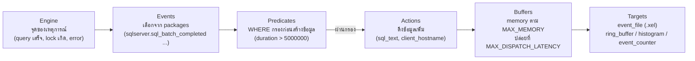

# Section 1 — แนวคิด Extended Events (สถาปัตยกรรม, Packages, Events, Targets)

เมื่อ DBA ต้องการ "ดูว่า SQL Server กำลังทำอะไรอยู่ในระดับเหตุการณ์" — ใครรัน statement อะไร, query ไหนช้ากี่มิลลิวินาที, deadlock เกิดตอนไหนเพราะอะไร — เครื่องมือทางการในปัจจุบันมีชื่อเดียวคือ **Extended Events (XE)** เป็นระบบติดตามเหตุการณ์ที่ถูกสร้างไว้ใน engine ตั้งแต่ SQL Server 2008 ออกแบบให้เบา (ไม่กระทบ performance เมื่อตั้งค่าถูก), ยืดหยุ่น (เลือกเหตุการณ์และปลายทางได้หลายพันชุด) และเป็น **เครื่องมือเดียวที่ Microsoft รับรองให้ใช้ต่อ**

Section นี้วางแนวคิดให้ครบก่อนลงมือเขียน session: เทียบ XE กับ Profiler/SQL Trace ที่ deprecated แล้ว, อ่านสถาปัตยกรรมของ XE pipeline (events → predicates → actions → buffers → targets), และรู้จัก catalog DMVs ที่ใช้สำรวจ "มี event อะไรให้ใช้บ้าง" — ซึ่งเป็นทักษะที่ทำให้คุณออกแบบ session เองได้แทนการก็อปสคริปต์ตามอินเทอร์เน็ต

> **เชื่อมโยง**: Module 13 (Performance Monitoring) ใช้ DMVs ดู "ภาพสด" ของระบบ ส่วน Extended Events คือการจับ **เหตุการณ์รายเหตุการณ์ (event-level)** เพื่อวิเคราะห์ย้อนหลังได้หลักฐานชัดเจน — ทั้งสองเรียงกันเป็นคู่ troubleshooting มาตรฐาน และถ้าจะทำ audit ของ actions ที่ user ทำ (เพื่อความปลอดภัย) ให้ดู SQL Server Audit ใน Module 4 ซึ่งเป็น XE เวอร์ชันจัดระเบียบเฉพาะ audit

## 1. XE vs SQL Trace vs Profiler — เครื่องมือไหนคือทางที่ถูก

อดีตมีเครื่องมือแทร็กเหตุการณ์สองแบบ: **SQL Trace** (กลไก engine เก่า ใช้ `sp_trace_create` ฯลฯ) และ **SQL Server Profiler** (GUI ที่ห่อ SQL Trace) ทั้งสองถูกประกาศ **deprecated** มานานและถือว่าเข้าข่ายของที่ Microsoft ระบุชัดใน SQL Server 2025 ว่า deprecated — ยังเปิดใช้ได้บางส่วนในเวอร์ชันปัจจุบันแต่ "ไม่ควรสร้างงานใหม่ด้วย" และจะถูกเอาออกในอนาคต

| ประเด็น | SQL Trace / Profiler (เก่า) | Extended Events (ปัจจุบัน) |
|:--------|:-----------------------------|:----------------------------|
| สถานะทางการ | **Deprecated** — ห้ามใช้กับงานใหม่ | มาตรฐานที่ Microsoft รับรอง |
| กระทบ performance | หนัก (ต้อง serial ข้อมูลทุก event) | เบามาก — filter ก่อนเก็บ, async buffers |
| จำนวน event | Trace events ~180 ตัว | XE events **หลายพัน** ตัว (ขึ้นกับ version) |
| การกรอง | ตั้ง trace filter ได้จำกัด | **predicates** กรองด้วยเงื่อนไขเต็มรูปแบบ |
| ปลายทางข้อมูล | ไฟล์ trace (.trc) | event_file (.xel), ring_buffer, histogram, event_counter ฯลฯ |
| ผ่าน sysadmin เท่านั้น | ใช้ (ALTER TRACE) | ใช้ `VIEW SERVER STATE` + permissions แบบ granular (2022+) ได้ |
| GUI | Profiler (ยังอยู่ใน SSMS เพื่อ compat) | **XEvent Profiler** ใน SSMS 20/21 (Management > XEvent Profiler) |

สองข้อแนะนำเชิงปฏิบัติ:

1. **อย่าเขียน session ใหม่ด้วย `sp_trace_*` หรือทำ trace file `.trc` ใหม่** — อ่านเข้าใจไว้เพราะจะเจอในระบบเก่า (และ `sys.fn_trace_gettable` ที่ใช้อ่าน .trc ก็ deprecated ตามไปด้วย ให้เปลี่ยนไปอ่าน .xel ด้วย `sys.fn_xe_file_target_read_file`)
2. **"Profiler ที่คุณคุ้นเคย" มีตัวแทนในโลก XE ชื่อ XEvent Profiler** — ใน SSMS: Object Explorer > Management > **XEvent Profiler** > มี session template `Standard`/`QuickSessionStandard` ให้ right-click > **Launch** — ให้ประสบการณ์เหมือน Profiler แต่วิ่งบน XE จริง ใช้ได้ตั้งแต่ SSMS 17+ จนถึงรุ่น 20/21

> อ้างอิง: [Extended Events vs SQL Trace and Profiler](https://learn.microsoft.com/sql/relational-databases/extended-events/extended-events-related-to-previously-supported-sql-trace-and-sql-server-profiler-classes?view=sql-server-ver17), [Use the SSMS XEvent Profiler](https://learn.microsoft.com/sql/relational-databases/extended-events/use-the-ssms-xe-profiler?view=sql-server-ver17)

## 2. สถาปัตยกรรม — เหตุการณ์เดินทางจาก engine ไป target อย่างไร

เมื่อ XE session กำลังรัน ทุกเหตุการณ์ที่ engine fire จะเดินทางผ่าน pipeline ตามลำดับ การเข้าใจลำดับนี้สำคัญเพราะมันบอกว่า "ของที่กรองทิ้งแล้วหมดค่าใช้จ่ายเกือบทั้งหมด" และ "action คือสิ่งที่ระวังค่าใช้จ่าย":



อ่านจากซ้ายไปขวาตามค่าใช้จ่ายที่เกิดขึ้น:

1. **Event เกิดทุกจุดใน engine** แต่ถ้าไม่มี session รอรับ มันเป็นแค่ hook ว่าง ๆ เกือบไม่มีต้นทุน
2. **Predicate (WHERE)** ทำงานก่อนที่ข้อมูล event จะถูกจัดเก็บ — กรองเร็วและถูก จึงเป็นคำสั่งหลักของการทำ XE ให้เบา: *กรองให้เจ็บแรงที่ predicate แล้วเก็บน้อยลง*
3. **Action** คือการ "หยิบข้อมูลเพิ่ม" ณ จุดเกิด event (เช่นดึงข้อความ SQL ทั้ง batch) — มีต้นทุน จึงใส่เฉพาะที่จะใช้จริง
4. **Buffer** เป็น async: thread ที่ query ทำงานอยู่เพียงยัดข้อมูลใส่ buffer แล้ววิ่งต่อ (แต่ตั้ง `NO_EVENT_LOSS` แล้ว buffer เต็มจะทำให้รอ — ระวัง) ข้อมูลถูกดันไป target ทุก `MAX_DISPATCH_LATENCY` วินาที
5. **Target** คือที่เก็บถาวร/ชั่วคราว — แต่ละปลายทางมีข้อดีต่างกัน (หัวข้อ 6)

## 3. Packages — ที่มาของชื่อ object ทุกชิ้น

ทุกสิ่งใน XE (event, action, target, predicate) อยู่ภายใน **package** — โมดูลเก็บของที่ compile มากับ engine สองตัวที่ใช้จริงเกือบทุกงาน:

| Package | คืออะไร | ตัวอย่างของในนั้น |
|:--------|:--------|:-------------------|
| `sqlserver` | events/actions ของ Database Engine | `sqlserver.sql_batch_completed`, `sqlserver.lock_acquired` |
| `package0` | infra พื้นฐานของระบบ XE | `package0.event_file`, `package0.ring_buffer`, `package0.histogram` |

นี่คือเหตุผลที่ syntax ต้องเขียนชื่อเต็ม เช่น `ADD EVENT sqlserver.rpc_completed` และ `ADD TARGET package0.event_file` — รันสคริปต์ [`Scripts/01_Explore_XE_Metadata.sql`](Scripts/01_Explore_XE_Metadata.sql) เพื่อสำรวจของทั้งหมดใน instance ของคุณ:

```sql
-- ดู packages ทั้งหมด
SELECT name, guid, description FROM sys.dm_xe_packages ORDER BY name;

-- ดู event ทั้งหมดที่พร้อมใช้
SELECT p.name AS package_name, o.name AS event_name, o.description
FROM sys.dm_xe_objects AS o
JOIN sys.dm_xe_packages AS p ON p.guid = o.package_guid
WHERE o.object_type = 'event'
ORDER BY p.name, o.name;
```

✅ **สังเกต**: event มีหลายพันตัว (รวมของเฉพาะทางเช่น XQuery, DTS, CLR) — ในทางปฏิบัติ DBA ใช้ชุดแค่ราว 20-30 ตัวเป็นหลัก ตารางด้านล่างคือชุดที่ใช้บ่อยในคอร์สนี้:

| Event (package.name) | จับอะไร | ใช้เมื่อไร |
|:----------------------|:---------|:-----------|
| `sqlserver.sql_batch_completed` | batch T-SQL เสร็จ (พร้อม duration, cpu_time, reads) | วัด query ช้า / workload ทั่วไป |
| `sqlserver.rpc_completed` | stored proc ผ่าน RPC เสร็จ | ตาม app ที่เรียก proc (มี parameters) |
| `sqlserver.sql_batch_starting` / `rpc_starting` | ตอน "เริ่ม" ไม่ใช่ "เจอรื" | ดูลำดับเวลา / จับ event ค้าง |
| `sqlserver.lock_acquired` / `lock_released` | ล็อกทีละรายการ | วิเคราะห์ contention (ใช้แบบระวัง — เกิดถี่มาก) |
| `sqlserver.error_reported` | error ทุก severity | จับ error เฉพาะหมายเลข/severity |
| `sqlserver.transaction_log` | ทุก operation ใน transaction log | ตาม page splits (`LOP_DELETE_SPLIT`) |
| `sqlserver.wait_info` | แต่ละ wait เมื่อจบ (พร้อม duration) | ทำ wait analysis แบบ per-session |
| `sqlserver.deadlock_monitor` / xml deadlock report (ผ่าน system_health) | deadlock graphs | วิเคราะห์ deadlock (ดู Section 2) |

> ข้อแตกต่างที่ต้องจำ: `sql_batch_completed` มี fields `duration`/`cpu_time`/`logical_reads` มาให้ในตัว (เป็น data ไม่ใช่ action) — หน่วยของ `duration` คือ **ไมโครวินาที** (5 วินาที = 5000000) ข้อผิดพลาดคลาสสิกของมือใหม่คือเขียน `WHERE duration > 5` แล้วหา query ช้าไม่เจอ

## 4. Actions — ข้อมูลเพิ่มที่ดึง ณ จุดเกิด

Event fields ให้ข้อมูลของตัว event เอง แต่บางทีเราต้องการบริบท: statement ข้อความจริง, ชื่อเครื่อง client, session id, login ใคร — **actions** ทำงานนี้:

| Action (sqlserver.*) | ให้อะไร |
|:----------------------|:---------|
| `sql_text` | ข้อความ T-SQL ทั้ง batch |
| `tsql_stack` | call stack ของ T-SQL (ลึก แต่ต้องแปล XML) |
| `client_hostname` | ชื่อเครื่องที่ยิงมา |
| `client_app_name` | Application Name จาก connection string |
| `session_id` | SPID |
| `database_name` | ชื่อ database ปัจจุบัน |
| `username` / `client_pid` | login name / process id ของ client |

ระวังค่าใช้จ่าย: `sql_text` ดึงข้อความ (อาจใหญ่) ทุก event ที่ผ่าน predicate — ใส่กับ event ที่เกิดถี่พันครั้ง/วินาที เช่น `lock_acquired` แล้วกรองไม่เข้มจะหนักทั้งระบบ หลักเลือกใช้: **ใส่เท่าที่จะแก้คำถามของคุณจริง** และเรียง predicate ให้กรอง event ที่ถี่ที่สุดก่อน

## 5. Predicates — WHERE ของโลก XE

Predicate เขียนใน `WHERE` ของ `ADD EVENT` เป็น expression เรียบง่าย (เทียบค่า, และ/หรือ) ซึ่งประเมิน**ก่อน** event ถูกเก็บ:

```sql
ADD EVENT sqlserver.sql_batch_completed (
    ACTION (sqlserver.sql_text, sqlserver.client_hostname)
    WHERE ( duration > 5000000        -- 5 วินาที (ไมโครวินาที)
        AND logical_reads > 10000 )
)
```

ข้อควรรู้ของ predicate:

- เทียบได้กับ **event field** โดยตรง (`duration`, `logical_reads`) และกับ **global predicate sources** ของ package เช่น `sqlserver.database_name` (ชื่อ database ปัจจุบันของ session) ซึ่งมากกว่า event fields ตัวเดิม
- expression จำกัด 3,000 ตัวอักษร (documented) — ถ้าซับซ้อนกว่านั้นให้จับกว้างกว่าแล้ว filter ตอน query ผล
- เทียบค่า map ตัวเลขกับ string ได้ เช่น `operation = N'LOP_DELETE_SPLIT'` ของ event `transaction_log`

## 6. Targets — เลือก "เก็บที่ไหน" ให้ถูกงาน

| Target | เก็บอย่างไร | เหมาะกับ | ข้อจำกัด |
|:--------|:------------|:----------|:-----------|
| `package0.event_file` | ไฟล์ .xel บน disk มี rollover (max_file_size, max_rollover_files) | **หลักของทุกงานวิเคราะห์** — กู้ดูย้อนหลังได้เสมอ ข้อมูลไม่หาย | ต้องมีที่ disk และ path ที่ service เขียนได้ |
| `package0.ring_buffer` | memory (default ~4 MB, แนะนำตั้ง `max_memory` ≤ 1024 KB เพื่อกัน XML โต) | มองของสดทันทีจาก DMV โดยไม่แตะ disk | หมุนวน — เก่าหาย, อ่านผ่าน XML แล้วช้าเมื่อข้อมูลเยอะ |
| `package0.histogram` | นับ count ต่อค่า (source เป็น event field/action) | สรุปแบบเร็ว เช่น "page split ที่ index ไหนมากสุด" | เห็นแค่ count+key ไม่เห็น event เต็ม |
| `package0.event_counter` | นับจำนวน event รวม | เช็กว่า "มีเกิดจริงไหม" แบบเบาที่สุด | ไม่เก็บรายละเอียดเลย |

หนึ่ง session ใส่หลาย target ได้ (เช่น event_file เก็บลึก + histogram ทำสรุป แต่ target แต่ละชนิดใส่ได้ตัวเดียวต่อ session)

> อ้างอิง: [Extended Events targets](https://learn.microsoft.com/sql/relational-databases/extended-events/targets-for-extended-events-in-sql-server?view=sql-server-ver17)

## 7. Types และ Maps — แปลค่าตัวเลขเป็นข้อความที่อ่านได้

Event fields จำนวนมากเป็น **map types** — เก็บเป็นตัวเลข key ที่ map ผ่านตาราง text ใน `sys.dm_xe_map_values` ตัวอย่างคลาสสิก: `wait_info` เก็บ `wait_type` เป็น key; `lock_acquired` เก็บ mode เป็น key; `transaction_log` เก็บ `operation` เป็น key

```sql
-- แปล wait_type key -> ชื่อ
SELECT map_key, map_value
FROM sys.dm_xe_map_values
WHERE name = 'wait_types'          -- ชื่อ map
  AND object_package_guid = (SELECT guid FROM sys.dm_xe_packages WHERE name = 'sqlserver')
ORDER BY map_key;

-- แปล operation ของ transaction_log (LOP_* codes)
SELECT map_key, map_value
FROM sys.dm_xe_map_values
WHERE name = 'log_op'
  AND object_package_guid = (SELECT guid FROM sys.dm_xe_packages WHERE name = 'sqlserver')
ORDER BY map_key;
```

✅ **สังเกต**: เมื่ออ่านข้อมูลจาก target ด้วย XML, ค่า map จะมีทั้ง `/value` (ตัวเลข key) และ `/text` (ชื่อที่แปลแล้ว) — เขียน query ดึง `/text` เสมอเพื่อให้อ่านง่าย (เห็นจริงใน Section 2 กับ `wait_info`)

รันสคริปต์ [`Scripts/02_Types_Maps.sql`](Scripts/02_Types_Maps.sql) เพื่อดูตาราง map ที่ใช้บ่อย (wait types, lock modes, log operations) พร้อมตัวอย่างค่า

## 8. DMVs ที่ใช้งานจริง — สรุปชุดเรียกใช้บ่อย

| DMV | ใช้ทำอะไร |
|:----|:----------|
| `sys.dm_xe_packages` / `sys.dm_xe_objects` | ค้นว่ามี event/action/target อะไรให้ใช้ |
| `sys.dm_xe_object_columns` | ดู fields/customizable attributes ของ event หรือ target |
| `sys.dm_xe_map_values` | แปล key → ข้อความ (wait types, lock modes, log ops) |
| `sys.dm_xe_sessions` / `sys.dm_xe_session_targets` | สถานะ session ที่กำลังรัน + ข้อมูลใน target (ring_buffer/histogram) |
| `sys.server_event_sessions` | metadata session ทุกตัว (รวม `max_duration` — ฟีเจอร์ 2025, ดู Section 2) |

## 9. แผนที่ตัดสินใจ — โจทย์ → event → target

เมื่อเจอโจทย์จริง จุดตัดสินใจมีสามคำถามตามลำดับ: "เกิดอะไรที่ต้องตาม?" → "จะเก็บละเอียดแค่ไหน?" → "เก็บนานแค่ไหน?" ตารางต่อไปนี้คือแผนที่เริ่มต้นสำหรับโจทย์ที่พบบ่อย (ทุกแถวมีสคริปต์/แล็บรองรับใน Section 2 หรือแล็บ):

| โจทย์ | Event ที่จับ | Predicate ตั้งต้น | Target ที่ควรใช้ |
|:--------|:--------------|:-------------------|:------------------|
| Query ช้าเกินเกณฑ์ | `sql_batch_completed` + `rpc_completed` | `duration > 5000000` | event_file (วิเคราะห์ย้อนหลัง) |
| Deadlock | (ใช้ `system_health` ที่มีอยู่แล้ว) | — | event_file ของ system_health |
| Wait analysis ต่อ session | `wait_info` | `duration > 10000` | event_file |
| Page split ต่อ index | `transaction_log` | `operation = N'LOP_DELETE_SPLIT'` + `sqlserver.database_name` | histogram (`alloc_unit_id`) |
| ใครยิง error บ่อย | `error_reported` | `severity > 10` | event_file |
| จับ statement ของ user คนใดคนหนึ่ง | `sql_batch_completed`/`rpc_completed` | `sqlserver.client_app_name = N'...'` หรือ `sqlserver.username` | event_file |
| ตรวจว่า event เกิดจริงไหม (เช็กเงียบ ๆ) | event ที่สนใจ | — | `event_counter` |

ข้อควรจำตอนเลือก event: **ยิ่ง event ถี่ ยิ่งต้องกรองแรง** — `lock_acquired` ที่ไม่กรองอะไรเลยเกิดเป็นหมื่นต่อวินาทีบนระบบ busy และจะกิน buffer/disk อย่างรวดเร็ว ส่วน event เชิงเหตุการณ์หายาก เช่น `xml_deadlock_report` หรือ `blocked_process_report` เก็บไว้ได้เบาสบาย

## 10. สิ่งที่จะเจอครั้งแรกที่ลงมือสร้าง session

ก่อนไป Section 2 นี่คือสิ่งที่มือใหม่เจอและมักตกใจ:

- **Error เรื่องสิทธิ์** — สร้าง session โดยไม่มี `CREATE ANY EVENT SESSION` (หรือ sysadmin) จะถูกปฏิเสธทันที อย่า "ขอ sysadmin ไปก่อน" — ขอสิทธิ์ที่ถูกต้องดีกว่า
- **ring_buffer XML โตจนถูกตัด** — ring_buffer default ~4 MB; เมื่อ XML เกิน จะถูก truncate ทำให้แถว event เสียโครง — ตั้ง `SET max_memory = 1024` ตามคำแนะนำทางการ (เจาะใน Section 2)
- **NO_EVENT_LOSS ไม่ฟรี** — ตั้ง `EVENT_RETENTION_MODE = NO_EVENT_LOSS` แล้ว buffer เต็มจะ "ให้ query ที่กำลังทำงานรอ" — จากเอกสารทางการ: อาจกระทบประสิทธิภาพที่ตรวจพบได้ ระบบปกติจึงใช้ ALLOW_SINGLE_EVENT_LOSS (default) ที่ยอมเสีย event เดี่ยวเพื่อไม่ให้ workload ตั้ง
- **Azure SQL DB ต้อง ON DATABASE** — คำสั่งเดียวกันแต่ scope ต่าง และ metadata เปลี่ยนจาก `sys.server_event_sessions` เป็น `sys.database_event_sessions*` — ตั้งแต่เริ่มเขียนให้ตั้งสมมติฐานให้ชัดว่าเขียนของ platform ไหน
- **ชื่อ session ไม่ควรมี space/ซ้ำกับของเดิม** — ใช้ชื่อแบบ PascalCase ที่บอกจุดประสงค์ (`LongQueries`, `TrackPageSplits`) เพราะชื่อคือคนเดียวที่จะบอกเวลาตรวจ `sys.dm_xe_sessions` ว่า session นี้คืออะไร

✅ **สังเกต (เช็กลิสต์ก่อนเขียน CREATE EVENT SESSION ทุกครั้ง)**:

1. Event ใด + field ของมันชื่ออะไร (query `sys.dm_xe_object_columns` เพื่อยืนยัน — ห้ามเดาชื่อ field)
2. Predicate กรองเหตุการณ์ถี่ที่สุดออกได้ไหม
3. Action ใส่เฉพาะที่จะใช้
4. Target ไหน (file ถ้าต้องย้อนหลัง / histogram ถ้าต้องการสรุปนับ)
5. ทุก session ต้องมีทางออก: MAX_DURATION (2025), Agent job หรือวินัย STOP ทางมือ

## 11. ศัพท์ของโลก XE ที่ใช้ใน Module นี้ (สรุปเร็ว)

| ศัพท์ | ความหมายในบริบท XE |
|:-------|:---------------------|
| **Session** | นิยามการจับ event หนึ่งชุด (event + predicate + action + target + options) สร้างด้วย `CREATE EVENT SESSION` |
| **Package** | กลุ่มของ objects (`sqlserver` = ของ engine, `package0` = infra/targets) — เหตุผลที่ชื่อเต็มมี prefix เสมอ |
| **Event** | จุดเหตุการณ์ใน engine เช่น `sqlserver.sql_batch_completed` มี fields ติดมาในตัว |
| **Field (data)** | ข้อมูลของ event เอง ใน XML อยู่ใต้ `data[@name="..."]` |
| **Action** | ข้อมูลเพิ่มที่ดึง ณ จุดเกิด เช่น `sqlserver.sql_text` — ใน XML อยู่ใต้ `action[@name="..."]` |
| **Predicate** | `WHERE` ที่กรอง event ก่อนเก็บ — ประเมินก่อน action เสมอ |
| **Target** | ปลายทางข้อมูล: `event_file` (.xel), `ring_buffer` (memory), `histogram` (นับ per key), `event_counter` (นับรวม) |
| **Map type** | field ที่เก็บ key ตัวเลข แปลข้อความผ่าน `sys.dm_xe_map_values` (หรือดึง node `/text` จาก XML) |
| **Dispatch** | การดันข้อมูลจาก buffer ไป target — คุมด้วย `MAX_DISPATCH_LATENCY` |
| **Rollover** | การหมุนไฟล์ .xel เมื่อเต็ม `max_file_size` วนตาม `max_rollover_files` |
| **system_health** | session ในตัวที่เปิดอัตโนมัติ เก็บ deadlock/error รุนแรง/latch ฯลฯ |

ศัพท์ขยายเพิ่มเติมรวมอยู่ที่ [Glossary.md](../../../Glossary.md) (หมวด Monitoring & Diagnostics) — ใช้ตรวจความเข้าใจตัวเองก่อนขึ้น Section 2

### 🚀 SQL Server 2025 & Modern Notes
- **SQL Trace + SQL Server Profiler deprecated** — งานแทร็กเหตุการณ์ใหม่ทั้งหมดให้เขียน XE; อ่านไฟล์ .trc เก่าด้วย `fn_trace_gettable` ก็ deprecated เช่นกัน ให้แปลงกระบวนการไปใช้ `sys.fn_xe_file_target_read_file` กับ .xel ([Extended Events related to SQL Trace](https://learn.microsoft.com/sql/relational-databases/extended-events/extended-events-related-to-previously-supported-sql-trace-and-sql-server-profiler-classes?view=sql-server-ver17))
- **XEvent Profiler ใน SSMS 20/21** — เครื่องมือ GUI "Profiler เหมือนเดิม" ที่วิ่งบน XE; อยู่ที่ Management > XEvent Profiler ([Use the SSMS XEvent Profiler](https://learn.microsoft.com/sql/relational-databases/extended-events/use-the-ssms-xe-profiler?view=sql-server-ver17))
- **สิทธิ์แบบ granular (2022+)** — สร้าง session ใช้ `CREATE ANY EVENT SESSION` / `ALTER ANY EVENT SESSION` และอ่านผลใช้ `VIEW SERVER PERFORMANCE STATE` — ไม่ต้องแจก sysadmin เพื่อ monitor ([CREATE EVENT SESSION](https://learn.microsoft.com/sql/t-sql/statements/create-event-session-transact-sql?view=sql-server-ver17))
- **Azure SQL Database: session เป็น `ON DATABASE` เท่านั้น** — syntax เดียวกันแต่ scope ต่าง; ดูต่อใน Section 2 ([Extended Events in Azure SQL](https://learn.microsoft.com/azure/azure-sql/database/xevent-db-diff-from-svr?view=azuresql))
