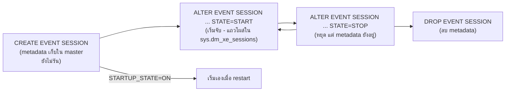

# Section 2 — สร้างและใช้งาน Extended Events Sessions จริง

Section ที่แล้วคุณรู้จักแผนที่ของโลก XE (packages, events, targets) แล้ว ตอนนี้ถึงเวลาเขียน **event session** — นิยามที่ระบุ "จับ event ไหน กรองอย่างไร (predicate) ดึงบริบทอะไร (action) เก็บที่ไหน (target) ตั้ง memory/latency แบบไหน" เราจะเดินจาก syntax ของ `CREATE EVENT SESSION` แบบตัวต่อตัวไปสู่สถานการณ์ที่ DBA ใช้จริง: จับ query ช้า, ทำ wait analysis ต่อ session, ดึง deadlock ย้อนหลังจาก `system_health`, ตาม page splits ด้วย histogram และปิดท้ายด้วยวินัยการใช้งานที่กัน "session รั่ว" — รวมถึงฟีเจอร์ **time-bound sessions** ของ SQL Server 2025 ที่หยุดเองตามเวลา

สคริปต์ทั้ง 7 ไฟล์ใน [`Scripts/`](Scripts/) รันได้บน SQL Server 2025 (บน 2019/2022 ทำงานได้เหมือนกันยกเว้นไฟล์ 06 ที่เป็นฟีเจอร์ 2025) เตรียมโฟลเดอร์ `C:\SQLBackups\XE\` สำหรับไฟล์ .xel ก่อน (หรือแก้ path ในพารามิเตอร์ท้ายไฟล์)

## 1. CREATE EVENT SESSION — กายวิภาคทีละส่วน

โครง syntax ย่อ (ตาม [CREATE EVENT SESSION](https://learn.microsoft.com/sql/t-sql/statements/create-event-session-transact-sql?view=sql-server-ver17)):

```sql
CREATE EVENT SESSION <session_name> ON SERVER       -- Azure SQL DB: ON DATABASE
{
    ADD EVENT <package>.<event_name> [ (
        [ SET <customizable_attribute> = <value> [ , ...n ] ]   -- บาง event มี attribute ตั้งค่าได้
        [ ACTION ( <action_name> [ , ...n ] ) ]
        [ WHERE <predicate_expression> ]
    ) ] [ , ...n ]
    [ ADD TARGET <package>.<target_name> [ ( SET <target_parameter> = <value> [ , ...n ] ) ] ]
    [ WITH ( <event_session_options> [ , ...n ] ) ]
}
```

ตัวอย่างเต็มที่จะใช้ใน [`Scripts/01_Long_Query_Session.sql`](Scripts/01_Long_Query_Session.sql) — จับ batch/procedure ที่รันเกิน 5 วินาที เก็บลง event_file + ring_buffer:

```sql
CREATE EVENT SESSION [LongQueries] ON SERVER
ADD EVENT sqlserver.sql_batch_completed (
    ACTION ( sqlserver.sql_text, sqlserver.client_hostname, sqlserver.session_id )
    WHERE duration > 5000000          -- ไมโครวินาที: 5,000,000 = 5 วินาที
),
ADD EVENT sqlserver.rpc_completed (
    ACTION ( sqlserver.sql_text, sqlserver.session_id )
    WHERE duration > 5000000
)
ADD TARGET package0.event_file (
    SET filename        = N'C:\SQLBackups\XE\LongQueries.xel',
        max_file_size   = 10,         -- MB ต่อไฟล์
        max_rollover_files = 5        -- หมุนวนได้ 5 ไฟล์ (รวม ~50 MB)
)
ADD TARGET package0.ring_buffer (
    SET max_memory = 1024             -- KB (แนะนำ <= 1024 กัน XML โตจนตัด)
)
WITH ( MAX_MEMORY            = 4 MB,
       EVENT_RETENTION_MODE  = ALLOW_SINGLE_EVENT_LOSS,
       MAX_DISPATCH_LATENCY  = 10 SECONDS,
       TRACK_CAUSALITY       = OFF,
       STARTUP_STATE         = OFF );
```

อ่านแต่ละอย่างว่าคุมอะไร:

| องค์ประกอบ | ความหมาย | ค่าที่ควรเริ่มด้วย |
|:------------|:----------|:-------------------|
| `ON SERVER` / `ON DATABASE` | scope ของ session (Azure SQL DB ใช้ DATABASE เท่านั้น) | SERVER บน on-prem |
| `WHERE duration > ...` | **predicate** — กรองก่อนเก็บ (ถูกที่สุด) | จริงใจกับเกณฑ์ของโจทย์ |
| `ACTION (sql_text ...)` | ดึงบริบทเพิ่ม ณ จุดเกิด | ใส่เท่าที่ใช้จริง |
| `event_file SET filename/max_file_size/max_rollover_files` | ไฟล์ .xel + การหมุนวน | 10 MB / 5 ไฟล์ เริ่มได้ |
| `ring_buffer SET max_memory` | buffer ใน memory | 1024 KB (คำแนะนำจาก docs) |
| `MAX_MEMORY` (WITH) | memory ของ event buffers รวม | 4 MB (default) |
| `EVENT_RETENTION_MODE` | ทำอย่างไรเมื่อ buffer เต็ม | ALLOW_SINGLE_EVENT_LOSS (default, เบา) |
| `MAX_DISPATCH_LATENCY` | เวลาสูงสุดที่ข้อมูลรอใน buffer ก่อนยิงไป target (default 30 วินาที) | 10 วินาทีสำหรับงานที่อยากเห็นเร็ว |
| `TRACK_CAUSALITY` | ใส่ activity id ให้ต่อเหตุการณ์ข้าม task | OFF เว้นแต่จะ join เหตุการณ์เชื่อมกัน |
| `STARTUP_STATE` | เริ่มอัตโนมัติเมื่อ restart | OFF (ระวัง ON ทิ้งไว้ใน prod) |

> `SET` ของ event (customizable attributes) มีเฉพาะ event บางตัว — ตรวจรายการที่มีจริงด้วย `SELECT * FROM sys.dm_xe_object_columns WHERE object_name = '<event>' AND column_type = 'customizable'` ก่อนใช้เสมอ (Task 7 ของ [01_Explore_XE_Metadata.sql](../01_XE_Concepts/Scripts/01_Explore_XE_Metadata.sql) แสดงรูปแบบ)

สถานะชีวิตของ session (ตาม [Extended Events sessions](https://learn.microsoft.com/sql/relational-databases/extended-events/sql-server-extended-events-sessions?view=sql-server-ver17)):



สังเกตใน system catalog: หลัง `CREATE` session ปรากฏใน `sys.server_event_sessions` (metadata) แต่ยังไม่อยู่ใน `sys.dm_xe_sessions` (DMV ของ session ที่กำลังรัน) — จำไว้ใช้ตรวจ "session ฉันหยุด/รันอยู่?"

> **สิทธิ์**: สร้าง session ต้องมี `CREATE ANY EVENT SESSION` (SQL Server 2022+) หรือ `ALTER ANY EVENT SESSION` — รวมถึงเปิด/ปิด/ลบ การอ่านผลของ session ต้อง `VIEW SERVER PERFORMANCE STATE` ขึ้นไป (รายละเอียดระดับ role ดู Module 13)

## 2. รันสคริปต์ 01 — จับ long-running queries ตั้งแต่ต้นจนจบ

รัน [`Scripts/01_Long_Query_Session.sql`](Scripts/01_Long_Query_Session.sql) ทีละ Task: สร้าง session (idempotent: DROP ก่อนถ้ามี) → START → ยิง batch ที่ช้าเกินเกณฑ์ (ใช้ `WAITFOR DELAY` หลอก duration ให้ชัวร์บนเครื่องทดลอง) → อ่านผลจาก ring_buffer สด → STOP → DROP

```sql
-- หลัง START ยิง query ที่ช้าเกิน 5 วินาที (batch รวม WAITFOR = duration ~6 วินาที)
WAITFOR DELAY '00:00:06';
SELECT 'slow batch demo' AS demo;

-- และ RPC ผ่าน stored proc
EXEC AdventureWorks2025.dbo.uspLongQueryDemo;   -- proc ในไฟล์: มี WAITFOR 6 วินาทีข้างใน
```

อ่านผลจาก **ring_buffer** ผ่าน DMV (อยู่ใน memory ไม่ต้องแตะไฟล์):

```sql
WITH xe AS (
    SELECT CAST(st.target_data AS XML) AS xe_data
    FROM sys.dm_xe_session_targets AS st
    JOIN sys.dm_xe_sessions AS s
      ON st.event_session_address = s.address
    WHERE s.name = N'LongQueries'
      AND st.target_name = 'ring_buffer'
)
SELECT TOP (20)
       x.xe_xml.value('(@name)[1]', 'nvarchar(60)')            AS event_name,
       x.xe_xml.value('(@timestamp)[1]', 'datetime2(3)')       AS [timestamp],
       x.xe_xml.value('(data[@name="duration"]/value)[1]', 'bigint') / 1000.0 AS duration_ms,
       x.xe_xml.value('(action[@name="session_id"]/value)[1]', 'int') AS session_id,
       x.xe_xml.value('(action[@name="sql_text"]/value)[1]', 'nvarchar(max)') AS sql_text
FROM xe
CROSS APPLY xe_data.nodes('RingBufferTarget/event') AS x(xe_xml);
```

✅ **สังเกต**:

- โครง XML สะท้อน session definition — `data[@name="duration"]` เป็น **event field**, `action[@name="sql_text"]` เป็น **action** (อยู่ใต้ tag ต่างกัน)
- `duration` ต้องหาร 1000 เป็นมิลลิวินาที (ค่าดิบเป็นไมโครวินาที)
- อ่านจาก ring_buffer ได้เฉพาะของที่ยังไม่ถูกหมุนออก — ข้อมูลถาวรอยู่ใน event_file (Task ต่อไป)

## 3. อ่านผลจาก event_file — fn_xe_file_target_read_file และการ shred XML

รัน [`Scripts/02_Parse_File_Target.sql`](Scripts/02_Parse_File_Target.sql) — DMF `sys.fn_xe_file_target_read_file` อ่านไฟล์ .xel (รองรับ wildcard) คืนแต่ละ event เป็น XML แล้ว shred ต่อได้ทันที:

```sql
WITH raw AS (
    SELECT CAST(event_data AS XML) AS xe_xml
    FROM sys.fn_xe_file_target_read_file(
             N'C:\SQLBackups\XE\LongQueries*.xel', NULL, NULL, NULL)
)
SELECT c.value('(@name)[1]', 'nvarchar(60)')            AS event_name,
       c.value('(@timestamp)[1]', 'datetime2(3)')        AS [timestamp],
       c.value('(data[@name="duration"]/value)[1]', 'bigint') / 1000.0 AS duration_ms,
       c.value('(data[@name="cpu_time"]/value)[1]', 'bigint') / 1000.0 AS cpu_ms,
       c.value('(data[@name="logical_reads"]/value)[1]', 'bigint') AS logical_reads,
       c.value('(action[@name="client_hostname"]/value)[1]', 'nvarchar(60)') AS client_hostname,
       c.value('(action[@name="sql_text"]/value)[1]', 'nvarchar(max)') AS sql_text
FROM raw
CROSS APPLY raw.xe_xml.nodes('/event') AS n(c)
ORDER BY duration_ms DESC;
```

จุดเทคนิคที่ใช้ตลอด:

- `(@name)[1]` = **attribute** บน element `<event>`; `data[@name="..."]/value` = field ของ event; `action[@name="..."]/value` = action
- field ที่เป็น map type มี node พ่วง `/text` — ดึง `text` แทน `value` จะได้ชื่อที่อ่านได้ (เห็นจริงกับ `wait_type` ในไฟล์ 03)
- `MAX_DISPATCH_LATENCY` กำหนดว่า event จะขึ้นไฟล์ช้าเร็วแค่ไหน — ถ้ารัน query แล้วอ่านไฟล์ทันทีและยังไม่เจอ event ให้รอจนครบ latency (หรือ STOP session จะ flush ทั้งหมด)

> **ทางเลือกสมัยใหม่ผ่าน PowerShell**: cmdlet `Read-SqlXEvent` ของ SqlServer module อ่านไฟล์ .xel / live session ได้โดยตรง (`Read-SqlXEvent -FileName C:\SQLBackups\XE\LongQueries.xel`) — เหมาะกับงานประมวลผลนอก SQL Server ([Read-SqlXEvent](https://learn.microsoft.com/powershell/module/sqlserver/read-sqlxevent))

> อ้างอิง: [sys.fn_xe_file_target_read_file](https://learn.microsoft.com/sql/relational-databases/system-functions/sys-fn-xe-file-target-read-file-transact-sql?view=sql-server-ver17)

## 4. สร้าง session ผ่าน SSMS UI

ถ้าอยากได้ "UI แบบ New Session Wizard" ใน Object Explorer: **Management > Extended Events > Sessions > New Session...** (หรือ New Session Wizard สำหรับแนะนำทีละหน้า) ขั้นสำคัญ:

1. **General** — ตั้งชื่อ session + template (มี template สำเร็จรูป เช่น "Query detail tracking")
2. **Events** — ค้น event จากช่อง Event library, เลือกแล้วกด Configure ตั้ง `SET`/actions/predicate ต่อ
3. **Data Storage** — เลือก target (event_file ตั้ง filename/size) — SSMS จะเติม path default ให้
4. **Advanced** — MAX_MEMORY, EVENT_RETENTION_MODE, **MAX_DISPATCH_LATENCY**, STARTUP_STATE (และ MAX_DURATION บน SQL Server 2025)
5. จบด้วยปุ่ม **"Start the event session immediately after creating the session"**

เมื่อ session กำลังรัน: right-click session > **Watch Live Data** เปิดหน้าต่างดูของสด (เหมือนแท็บผลของ Profiler เก่า) — เหมาะกับการเดโม/จับตอน reproduce; อย่าทิ้งไว้ตลอดบน production

## 5. system_health — session ในตัวที่ควรไปดูก่อนเสมอ

SQL Server มี session **`system_health`** ที่เปิดอัตโนมัติตั้งแต่เปิด service (STARTUP_STATE=ON) เก็บเหตุการณ์เชิงระบบที่เจ็บปวดที่สุด: error severity ≥ 20, **deadlock graph (`xml_deadlock_report`)**, latch wait > 15 วินาที, spinlock wait > 500 ms และข้อมูล health ring buffer ของ engine — จากตัวอย่างระบบที่ทำงานปกติ session นี้มักมีไฟล์ .xel ค้างในโฟลเดอร์ LOG ของ instance อยู่แล้ว

รัน [`Scripts/04_System_Health_Deadlocks.sql`](Scripts/04_System_Health_Deadlocks.sql) — อ่านย้อนหลังด้วย wildcard `system_health*.xel` (ชื่อ relative จะ resolve ที่โฟลเดอร์ LOG ของ instance) แล้วกรองเฉพาะ deadlock:

```sql
SELECT x.c.value('(@timestamp)[1]', 'datetime2(3)') AS event_time,
       x.c.query('.') AS deadlock_xml        -- เนื้อ deadlock graph ทั้งก้อน
FROM (
    SELECT CAST(event_data AS XML) AS xe_xml
    FROM sys.fn_xe_file_target_read_file('system_health*.xel', NULL, NULL, NULL)
) AS raw
CROSS APPLY raw.xe_xml.nodes('/event') AS x(c)
WHERE x.c.value('(@name)[1]', 'varchar(100)') = 'xml_deadlock_report'
ORDER BY event_time;
```

**Expected:** ถ้า instance คุณเคยเกิด deadlock (แล็บ Exercise 3 จะทำให้เกิด) จะได้แถวต่อการเกิดหนึ่งแถว — คลิก XML จะเห็น victim, process list, resource list ครบ อ่านเทคนิคการแปลผล deadlock graph เพิ่มได้จาก [Use the system_health session](https://learn.microsoft.com/sql/relational-databases/extended-events/use-the-system-health-session?view=sql-server-ver17)

## 6. สถานการณ์ใช้จริง — waits ต่อ session และ page splits

สองสคริปต์ต่อไปเป็น "แบบใช้ซ้ำ" จริง:

- [`Scripts/03_Track_Waits_By_Session.sql`](Scripts/03_Track_Waits_By_Session.sql) — session จับ `sqlserver.wait_info` (wait แต่ละครั้งเมื่อจบ พร้อม duration และ wait_type ที่เป็น map) เก็บลง event_file แล้ว **aggregate ต่อ session_id + wait_type** เทียบกับ `sys.dm_os_wait_stats` แบบรวมทั้ง instance ของ Module 13 จุดเด่นคือตอบ "session ไหนรออะไรนานสุด" ระหว่างช่วงเวลาที่เราเลือก ไม่ใช่ค่าสะสมตั้งแต่ restart — ให้รัน workload จาก [`Scripts/07_Workload_Generator.sql`](Scripts/07_Workload_Generator.sql) ไปพร้อมกัน
- [`Scripts/05_Page_Splits_Histogram.sql`](Scripts/05_Page_Splits_Histogram.sql) — session จับ `sqlserver.transaction_log` กรอง `operation = N'LOP_DELETE_SPLIT'` (**mid-page split** — แบบที่ก่อ fragmentation) ของ database AdventureWorks2025 ด้วย predicate ตอนท้ายเขียน workload แทรกแถว key สุ่มลงตารางทดลอง แล้วอ่านผลจาก **histogram target** นับ count ต่อ `alloc_unit_id` แล้ว join `sys.allocation_units`/`sys.partitions`/`sys.indexes` เพื่อตบแต่งเป็นรายงาน "index ไหนแตกหน้ามากสุด"

> ทำไมจึงกรอง `LOP_DELETE_SPLIT` ไม่ใช่ event "page_splits": ไม่มี event เฉพาะชื่อ page_splits ใน XE — การแตกหน้าแบบกลาง page ปรากฏใน transaction log เป็น operation `LOP_DELETE_SPLIT` (แถวถูกลบออกจาก page เดิมเพื่อย้ายไปหน้าใหม่) ส่วน split ท้าย page (append-only) ไม่ก่อปัญหาจึงไม่จำเป็นต้องตาม

## 7. วินัยการใช้งาน + time-bound sessions (SQL Server 2025)

สามข้อที่แยก "XE ที่ช่วยงาน" ออกจาก "XE ที่ทำให้ปลอดภัย":

1. **กรองให้ถึง predicate เสมอ** — จับ `lock_acquired` ไม่กรอง หรือใส่ `sql_text` กับ event ที่เกิดวินาทีละพันครั้ง คือวิธีทำให้ระบบทั้ง instance ช้าลงเพราะเครื่องมือวัดเอง
2. **ตั้ง MAX_DISPATCH_LATENCY ให้งานเหมาะ** — default 30 วินาทีเหมาะงานวิเคราะห์ปกติ; ต่ำลง (เช่น 5) เมื่อต้องการผลเร็ว แต่ยิง disk ถี่ขึ้น; `INFINITE` เก็บไว้จน buffer เต็มเท่านั้น (ระวังข้อมูลหายเมื่อ STOP ไม่ทัน)
3. **ห้ามลืม STOP/DROP** — session ที่ลืมปิดกิน resource ต่อเนื่องและบานเป็นไฟล์ .xel เนื่องจาก STARTUP_STATE=ON ยิ่งฟื้นทุก restart ตรวจของค้างด้วย `SELECT name FROM sys.dm_xe_sessions;`

ตัวหยุดยอด (ระเบิด) ที่มากับ SQL Server 2025: **time-bound event sessions** — ระบุ `MAX_DURATION` แล้ว session จะหยุดเองเมื่อครบเวลา (มีใน Azure SQL DB/MI มาก่อน ขึ้นกับ SQL Server ตั้งแต่ 2025):

```sql
-- (SQL Server 2025+) session หยุดเองหลังเริ่ม 5 นาที
CREATE EVENT SESSION [LongQueriesTimeBound] ON SERVER
ADD EVENT sqlserver.sql_batch_completed ( ACTION ( sqlserver.sql_text )
                                          WHERE duration > 3000000 )
ADD TARGET package0.event_file ( SET filename = N'C:\SQLBackups\XE\LongQueriesTimeBound.xel' )
WITH ( MAX_DURATION = 5 MINUTES, MAX_MEMORY = 4 MB, MAX_DISPATCH_LATENCY = 10 SECONDS );

ALTER EVENT SESSION [LongQueriesTimeBound] ON SERVER STATE = START;

-- ตรวจ: max_duration เก็บเป็น "วินาที" ใน catalog (0 = ไม่จำกัด)
SELECT name, max_duration
FROM sys.server_event_sessions
WHERE name = N'LongQueriesTimeBound';
```

กติกา (จาก docs): หยุดก่อนเวลาด้วย `STATE = STOP` ได้ตลอด; เริ่มใหม่แล้วนับเวลาใหม่ตั้งแต่ต้น; **แก้ `MAX_DURATION` ได้เฉพาะตอน session หยุด** (`ALTER EVENT SESSION ... WITH (MAX_DURATION = ...)` หรือปลดล็อกด้วย `MAX_DURATION = UNLIMITED`); ค่าสูงสุด 24 วัน รันเต็มรูปแบบใน [`Scripts/06_Time_Bound_Session.sql`](Scripts/06_Time_Bound_Session.sql)

> สำหรับเวอร์ชันเก่ากว่า 2025 ควบคุมอายุ session ด้วย Agent job + `ALTER EVENT SESSION ... STATE=STOP` ตามตาราง — ยังจำเป็นต้องทำระบบสำรองถ้าต้อง support 2019/2022

### หมายเหตุ deprecation ที่ควรแจ้งทีม

- **SQL Trace procs** (`sp_trace_create`, `sp_trace_setevent` ฯลฯ) และ **`sys.fn_trace_gettable`** (อ่านไฟล์ .trc) — deprecated ทั้งหมด แทนด้วย XE: ไฟล์ .xel + `sys.fn_xe_file_target_read_file` (หรือ `Read-SqlXEvent`)
- **Profiler** — ยังเปิดใน SSMS เพื่อ compatibility แต่ใช้ **XEvent Profiler** (Management > XEvent Profiler > Launch) เป็นทางที่รองรับต่อ

## 8. สถิติการรันของ session และการ join กับ DMV เพื่อเทียบกับ "ภาพสด"

session ที่กำลังรันมีสถิติให้ดูในตัว — ใช้ตรวจว่า session ของคุณ "กินไหม ทิ้ง event ไหม":

```sql
SELECT s.name,
       s.total_regular_buffers,          -- จำนวน buffer ที่จัดให้ session
       s.dropped_event_count,            -- จำนวน event ที่ทิ้งเพราะ buffer เต็ม (ควร 0)
       s.create_time
FROM sys.dm_xe_sessions AS s
WHERE s.name = N'LongQueries';
```

ถ้า `dropped_event_count` ขยับขึ้น แปลว่า workload เร็วกว่าความสามารถของ buffer/target — ทางแก้คือเข้ม predicate, เพิ่ม MAX_MEMORY อย่างมีเหตุผล หรือลด action ที่ใหญ่ (`sql_text` เป็นตัวเต้มมากสุด)

และเมื่อได้ `session_id` จาก action ใน event แล้ว ควร join กลับ DMV เพื่อรวมบริบท (login, เครื่อง client, app):

```sql
-- ผล XE จาก target (มี session_id) เชื่อมกับ ภาพสดของ Module 13
WITH xe AS (
    SELECT x.c.value('(action[@name="session_id"]/value)[1]', 'int') AS session_id,
           x.c.value('(data[@name="duration"]/value)[1]', 'bigint') / 1000.0 AS duration_ms
    FROM ( SELECT CAST(event_data AS XML) AS xe_xml
           FROM sys.fn_xe_file_target_read_file(N'C:\SQLBackups\XE\LongQueries*.xel', NULL, NULL, NULL)
         ) AS raw
    CROSS APPLY raw.xe_xml.nodes('/event') AS x(c)
)
SELECT e.session_id, s.original_login_name, s.host_name, s.program_name,
       e.duration_ms
FROM xe AS e
JOIN sys.dm_exec_sessions AS s ON s.session_id = e.session_id
ORDER BY e.duration_ms DESC;
```

ข้อจำกัดที่ต้องจำ: `sys.dm_exec_sessions` เห็นเฉพาะ session "ณ ตอนนี้" — event เก่าของ session ที่ปิดไปแล้ว join ไม่เจอ ทางแก้คือใส่ action `client_hostname`/`client_app_name`/`username` ลงใน session ตั้งแต่แรก เพื่อไม่ต้องพึ่ง join สด

**ข้อจำกัด syntax ของ WITH(...) ที่เหลือให้รู้** (ตาม docs):

- `MAX_EVENT_SIZE` ตั้งได้เฉพาะ "ใหญ่กว่า MAX_MEMORY" — ตั้งน้อยกว่าจะ error (จากเอกสาร: ต้องการเก็บ event เดี่ยวที่ใหญ่กว่า MAX_MEMORY เท่านั้น)
- หนึ่ง session ใส่ target แต่ละชนิดได้ตัวเดียว (event_file สองตัว = error) แต่ผสมชนิดได้ (file + ring_buffer + histogram)
- เปลี่ยน definition ของ session ที่กำลังรันได้ด้วย `ALTER EVENT SESSION ... ADD/DROP EVENT/TARGET` โดยไม่ต้อง DROP สร้างใหม่ (แต่ MAX_DURATION ต้องแก้ตอนหยุด — หัวข้อ 7)

### 🚀 SQL Server 2025 & Modern Notes
- **Time-bound event sessions (2025)** — `WITH (MAX_DURATION = <n> SECONDS|MINUTES|HOURS|DAYS)` ให้ session หยุดเอง กัน session ลืมปิด; อ่านค่าย้อนได้จาก `sys.server_event_sessions.max_duration` ([Extended Events sessions](https://learn.microsoft.com/sql/relational-databases/extended-events/sql-server-extended-events-sessions?view=sql-server-ver17))
- **Permissions แบบ granular (2022+)** — `CREATE ANY EVENT SESSION` / `ALTER ANY EVENT SESSION` / อ่านผลผ่าน `VIEW SERVER PERFORMANCE STATE` แทนการแจก sysadmin ([CREATE EVENT SESSION](https://learn.microsoft.com/sql/t-sql/statements/create-event-session-transact-sql?view=sql-server-ver17))
- **SQL Trace/Profiler/fn_trace_gettable deprecated** — ทุก workflow เดิมแปลไปใช้ .xel + `sys.fn_xe_file_target_read_file` ([Extended Events vs SQL Trace](https://learn.microsoft.com/sql/relational-databases/extended-events/extended-events-related-to-previously-supported-sql-trace-and-sql-server-profiler-classes?view=sql-server-ver17))
- **ring_buffer MAX_MEMORY ควร ≤ 1024 KB** — คำแนะนำทางการเพื่อกัน XML output ถูกตัด ([CREATE EVENT SESSION](https://learn.microsoft.com/sql/t-sql/statements/create-event-session-transact-sql?view=sql-server-ver17))
- **Azure SQL DB: `ON DATABASE` เท่านั้น** — session เป็น database-scoped, metadata อยู่ใน `sys.database_event_sessions*` และ event_file เก็บลง Azure Storage ([Extended Events in Azure SQL](https://learn.microsoft.com/azure/azure-sql/database/xevent-db-diff-from-svr?view=azuresql))
