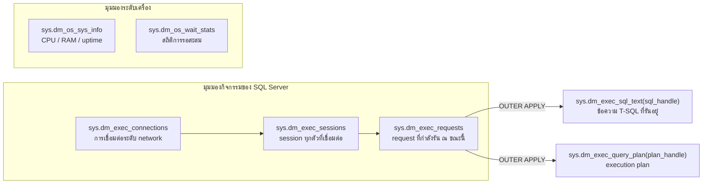

# Section 1 — ติดตามกิจกรรม SQL Server (Monitoring Activity)

เมื่อผู้ใช้บ่นว่า "ระบบช้า" คำถามแรกของ DBA ต้องตอบได้ภายในไม่กี่นาทีคือ: **ตอนนี้มีใครกำลังรันอะไรอยู่ ใคร block ใคร และ resource ไหนตึง** SQL Server เปิดเผยข้อมูลทั้งหมดนี้ผ่าน **Dynamic Management Views/Functions (DMVs/DMFs)** ซึ่งเป็น "หน้าต่าง" ที่อ่านสถานะภายในของ engine แบบเรียลไทม์ ร่วมกับเครื่องมือกราฟิกอย่าง **Activity Monitor** ใน SSMS และ **Windows Performance Monitor (perfmon)** ที่วัดการใช้ทรัพยากรเชิงระบบปฏิบัติการ

หัวข้อนี้จะเดินจาก "มองเห็น session/request ทั้งหมด" ไปจนถึง "จับ blocking และแปลผล wait statistics + counters" ซึ่งเป็นทักษะที่ใช้ทุกวันในงาน DBA จริง สคริปต์ประกอบอยู่ที่ `Scripts/` ทั้งหมดรันได้บน AdventureWorks2025

> **สิทธิ์ที่ต้องมี**: การ query DMVs ระดับ server ต้องใช้ `VIEW SERVER STATE` (หรือใน SQL Server 2022+ มี `VIEW SERVER PERFORMANCE STATE` สำหรับ DMV ด้าน performance) หากล็อกอินด้วย sysadmin อยู่แล้วก็ผ่านหมด — แต่ทางที่ถูกหลักคือให้ role แบบ least-privilege ดูหัวข้อ "สิทธิ์สำหรับ monitoring" ด้านล่าง

## 1. DMVs/DMFs คืออะไร

DMV (Dynamic Management View) และ DMF (Dynamic Management Function) คือ objects ที่ขึ้นต้นด้วย `sys.dm_*` ใน schema `sys` ซึ่งรายงาน **สถานะภายในของ Database Engine แบบสด ๆ** — ไม่ใช่ข้อมูล metadata แบบ catalog views (`sys.tables` ฯลฯ) แต่เป็นค่า runtime: request ที่กำลังรัน, wait statistics, สถิติ index/cache, สถานะ OS ที่ SQL Server เห็น

จุดสำคัญที่ต้องจำเมื่อใช้ DMVs:

1. **เป็นข้อมูลแบบ in-memory สะสมตั้งแต่ restart** — ค่าสะสมอย่าง `sys.dm_os_wait_stats` จะหายทั้งหมดเมื่อ restart instance และ reset ได้ด้วย `DBCC SQLPERF('sys.dm_os_wait_stats', CLEAR);`
2. **ค่าเกือบทั้งหมดเป็น "ค่าสะสม" ไม่ใช่ "ค่าต่อวินาที"** — ต้อง snapshot สองรอบแล้วหาผลต่างเอง (เจาะลึกใน Section 2)
3. **การ query DMVs เองก็กินทรัพยากรเล็กน้อย** — อย่า run loop เข้ม ๆ บน production โดยไม่คิด



### สิทธิ์สำหรับ monitoring แบบ least-privilege (SQL Server 2022+)

โมดูลเก่ามักให้ DBA ล็อกอินเป็น sysadmin เพื่อดู DMVs ซึ่งให้สิทธิ์เกินจำเป็นมาก ตั้งแต่ SQL Server 2022 มี fixed server roles ใหม่ใช้แทน (ทำงานต่อใน 2025):

| Server role | สิทธิ์ server-level | เหมาะกับใคร |
|:------------|:--------------------|:-------------|
| `##MS_ServerPerformanceStateReader##` | `VIEW SERVER PERFORMANCE STATE` | ทีม monitoring ที่ดูได้เฉพาะ DMVs ด้าน performance |
| `##MS_ServerStateReader##` | `VIEW SERVER STATE` + performance + security state | DBA ที่ต้องเห็นสถานะเซิร์ฟเวอร์ทั้งหมด (superset ของตัวบน) |
| `##MS_ServerStateManager##` | เท่า StateReader + `ALTER SERVER STATE` | คนที่ต้อง `DBCC FREEPROCCACHE`, `DBCC SQLPERF` ฯลฯ |

สอง role แรกยังให้ `VIEW DATABASE PERFORMANCE STATE` / `VIEW DATABASE STATE` ใน database ที่ user นั้นมีบัญชีด้วย ตัวอย่างการมอบสิทธิ์:

```sql
-- สร้าง login สำหรับเครื่องมือ/คน monitoring แล้วให้ role ตามงาน
CREATE LOGIN PerfReader WITH PASSWORD = 'Pa$$w0rd2025', CHECK_POLICY = ON;
ALTER SERVER ROLE [##MS_ServerPerformanceStateReader##] ADD MEMBER [PerfReader];
```

> อ้างอิง: [Server-level roles](https://learn.microsoft.com/sql/relational-databases/security/authentication-access/server-level-roles?view=sql-server-ver17)

## 2. ดูกิจกรรมปัจจุบันด้วย DMOs — จาก sp_who2 สู่ sys.dm_exec_*

สมัยก่อน DBA ใช้ `sp_who` / `sp_who2` ดู "ใครอยู่บนเซิร์ฟเวอร์" ซึ่งยังใช้ได้แต่**ค้างอยู่ในยุค SQL Server 2000** — output เป็น result set ที่ filter/ join ต่อไม่สะดวก และข้อมูลจำกัด DMVs ใน `sys.dm_exec_*` ให้ข้อมูลมากกว่าและ query ได้เหมือนตารางปกติ

| สิ่งที่อยากรู้ | วิธีเก่า (legacy) | วิธีสมัยใหม่ (ใช้แนะนำ) |
|:---------------|:------------------|:--------------------------|
| ใครเชื่อมต่ออยู่ | `sp_who2` (คอลัมน์ Login, HostName) | `sys.dm_exec_sessions` |
| กำลังรันคำสั่งอะไร | `sp_who2` (คอลัมน์ Cmd) แบบย่อ | `sys.dm_exec_requests` + `sys.dm_exec_sql_text()` |
| ใคร block ใคร | `sp_who2` (คอลัมน์ BlkBy) | `sys.dm_exec_requests.blocking_session_id` / `sys.dm_os_waiting_tasks` |
| การเชื่อมต่อ network | — (ไม่มี) | `sys.dm_exec_connections` |
| CPU/RAM ที่ SQL Server เห็น | — | `sys.dm_os_sys_info` |

> **หมายเหตุ**: `sp_who2` เป็น undocumented system procedure — ไม่เคยถูก documented อย่างเป็นทางการ ให้ใช้เฉพาะตอนเจอระบบเก่า ส่วน DMVs เป็น interface ทางการที่ document ครบทุกคอลัมน์

เปิดสคริปต์ [`Scripts/01_DMO_Activity.sql`](Scripts/01_DMO_Activity.sql) (ปรับจาก Demo 1 ของคอร์ส 20764D) แล้วรันทีละ Task:

### Task: ดู request ที่กำลังรันทั้งหมด

```sql
SELECT * FROM sys.dm_exec_requests;
```

จะเห็นแถวจำนวนมาก แต่ส่วนใหญ่เป็น **system requests** (background task เช่น lazy writer, checkpoint) คอลัมน์สำคัญ: `session_id`, `command`, `wait_type`, `wait_time`, `blocking_session_id`, `sql_handle`

### Task: กรองเฉพาะกิจกรรมผู้ใช้

```sql
SELECT * FROM sys.dm_exec_sessions WHERE is_user_process = 1;
```

คอลัมน์ `is_user_process` แยก session ของระบบออกจาก session ของผู้ใช้ ใช้เป็นตัวกรองมาตรฐานเสมอ

### Task: join สาม view เพื่อได้ "ใคร กำลังรันอะไร รออะไร"

```sql
SELECT s.original_login_name, s.program_name, r.command, t.text,
       r.wait_type, r.wait_time, r.blocking_session_id
FROM sys.dm_exec_requests AS r
JOIN sys.dm_exec_sessions AS s
  ON r.session_id = s.session_id
OUTER APPLY sys.dm_exec_sql_text(r.sql_handle) AS t
WHERE s.is_user_process = 1;
```

✅ **สังเกต**: `OUTER APPLY sys.dm_exec_sql_text()` แปลง `sql_handle` (ตัวชี้ batch ใน plan cache) ให้เป็นข้อความ T-SQL จริง — นี่คือเทคนิคหัวใจของการ troubleshoot แบบเรียลไทม์

### Task: หา statement ที่กำลังรัน (ไม่ใช่ทั้ง batch)

`sql_handle` ให้ข้อความทั้ง batch แต่ request อาจรันอยู่กลาง batch ใช้ offsets จาก `sys.dm_exec_requests` ตัดเฉพาะ statement ปัจจุบัน:

```sql
SELECT s.original_login_name, s.program_name, r.command,
       (SELECT TOP (1) SUBSTRING(t.text, r.statement_start_offset / 2 + 1,
                   ((CASE WHEN r.statement_end_offset = -1
                          THEN (LEN(CONVERT(nvarchar(max), t.text)) * 2)
                          ELSE r.statement_end_offset END)
                    - r.statement_start_offset) / 2 + 1)) AS CurrentStatement,
       r.wait_type, r.wait_time, r.blocking_session_id
FROM sys.dm_exec_requests AS r
JOIN sys.dm_exec_sessions AS s
  ON r.session_id = s.session_id
OUTER APPLY sys.dm_exec_sql_text(r.sql_handle) AS t
WHERE s.is_user_process = 1;
```

✅ **สังเกต**: pattern `SUBSTRING(text, start/2+1, (end-start)/2+1)` นี้เป็น pattern มาตรฐานที่ใช้ซ้ำได้ทุกที่ (offset เป็นหน่วย byte ของ nvarchar จึงต้องหาร 2)

### Task: ข้อมูลระดับเครื่องจาก sys.dm_os_sys_info

```sql
SELECT sqlserver_start_time, cpu_count, hyperthread_ratio,
       physical_memory_kb / 1024 / 1024 AS PhysicalMemoryGB,
       committed_kb / 1024 / 1024 AS CommittedGB,
       committed_target_kb / 1024 / 1024 AS CommittedTargetGB
FROM sys.dm_os_sys_info;
```

✅ **สังเกต**: `cpu_count` รวม hyperthread (คูณด้วย `hyperthread_ratio` แล้วหารสอง = จำนวน core จริง), `committed_kb` คือ memory ที่ SQL Server commit ไปแล้วเทียบกับ target — ถ้า committed ต่ำกว่า target นาน ๆ แปลว่ายังมี RAM เหลือให้ buffer pool

## 3. Activity Monitor ใน SSMS

**Activity Monitor** คือหน้าจอ monitoring แบบกราฟิกของ SSMS ที่**ทำงานบน DMVs ภายใน** — เปิดด้วยการ right-click ที่ชื่อ server ใน Object Explorer > **Activity Monitor** (หรือไอคอนบน toolbar) ทุกช่วง refresh interval (default 10 วินาที) มันจะ query ชุด DMVs แล้ว render ผลให้

| แท็บ | แสดงอะไร | DMV ที่อยู่เบื้องหลัง (โดยประมาณ) |
|:-----|:----------|:-----------------------------------|
| **Overview** | % Processor Time, Waiting Tasks, Batch Requests/sec, Page Life Expectancy | `sys.dm_os_ring_buffers`, `sys.dm_os_performance_counters` |
| **Processes** | session แต่ละตัว, command, **Blocked By (blocking_session_id)**, wait, CPU/RAM ที่ใช้ | `sys.dm_exec_requests` + `sys.dm_exec_sessions` |
| **Resource Waits** | wait จัดกลุ่มตาม category และ % ของ total wait | `sys.dm_os_wait_stats` |
| **Data File I/O** | I/O ต่อ database file: MB/s read/write, stalls | `sys.dm_io_virtual_file_stats` |
| **Recent Expensive Queries** | query ที่แพงล่าสุด (CPU/duration/logical reads) พร้อม plan | `sys.dm_exec_query_stats` + plan cache |

จุดใช้งานจริง:

- **แท็บ Processes คือที่แรกเมื่อมี blocking** — จัดเรียงตามคอลัมน์ **Blocked By** เจอหัวโซ่ (head blocker) ได้ทันที และ right-click > **Details** ดู statement ได้
- **Recent Expensive Queries** เหมาะกับ "เพิ่งช้า" ที่ยังอยู่ใน plan cache — double-click ดู plan แล้ว identify ตาราง/index ที่เกี่ยว
- **ระวัง overhead**: ถ้าตั้ง refresh < 10 วินาที queries ของ Activity Monitor เองกระทบ server ได้ (documented) — ปล่อย default ไว้ และ**อย่าเปิดค้างไว้ 24 ชั่วโมง**บน production

> หน้าต่างเสริมที่ควรรู้จักใน SSMS: **Performance Dashboard** (right-click server > Reports > Standard Reports > Performance Dashboard) ที่อ่าน DMVs เช่นกันแต่เน้น bottleneck แบบสรุป, และ **Live Query Statistics** สำหรับดู query ที่กำลังรันทีละ operator

> อ้างอิง: [Activity Monitor](https://learn.microsoft.com/sql/relational-databases/performance-monitor/activity-monitor?view=sql-server-ver17), [เปิด Activity Monitor](https://learn.microsoft.com/sql/relational-databases/performance-monitor/open-activity-monitor-sql-server-management-studio?view=sql-server-ver17), [Performance Dashboard](https://learn.microsoft.com/sql/relational-databases/performance/performance-dashboard?view=sql-server-ver17), [Live Query Statistics](https://learn.microsoft.com/sql/relational-databases/performance/live-query-statistics?view=sql-server-ver17)

## 4. Windows Performance Monitor (perfmon) และ SQL Server counters

**Performance Monitor (perfmon)** คือเครื่องมือของ Windows ที่วัด "counters" ของทุก process/object ในเครื่อง — SQL Server จดทะเบียน counter objects ของตัวเอง (`SQLServer:*` หรือ `MSSQL$<instance>:*` เมื่อเป็น named instance) จึงเห็นพฤติกรรมเชิงทรัพยากรที่ DMV ไม่ได้เล่าครบ เช่น I/O ระดับ disk, memory ของ OS ทั้งเครื่อง

เปิดด้วย `perfmon` จาก Run แล้ว:

1. **Performance Monitor** (live chart) — เพิ่ม counters ผ่านปุ่ม + เหมาะกับการดูปัญหาสด
2. **Data Collector Sets > User Defined** — สร้างชุด counters ให้เก็บเป็นไฟล์ `.blg` ตามกำหนดเวลา (สำหรับ baseline — เจาะใน Section 2)

### Counters สำคัญของ SQL Server

ตารางต่อไปนี้คือชุด counters ที่ DBA มักเปิดดูเป็นประจำ ค่า baseline ที่ให้เป็น**ค่าแนวทางเชิงประจักษ์ (rule of thumb)** จากชุมชน/เอกสาร — สิ่งที่ถูกต้องที่สุดเสมอคือเทียบกับ **baseline ของระบบคุณเอง** ที่เก็บตอนระบบปกติ (Section 2):

| Counter (Object \ Counter) | วัดอะไร | แนวทาง baseline (rule of thumb) |
|:---------------------------|:--------|:-------------------------------|
| `SQLServer:Buffer Manager` \ **Buffer cache hit ratio** | % ของ page ที่หาเจอใน buffer pool ไม่ต้องอ่าน disk | OLTP ทั่วไป > 90–95%; ต่ำกว่านั้นต่อเนื่อง = หน่วยความจำตึง หรือ workload อ่านข้อมูลใหม่ล้วน |
| `SQLServer:Buffer Manager` \ **Page life expectancy (PLE)** | วินาทีที่ page อยู่ใน buffer pool ก่อนถูกขับออก | ค่าเก่า 300 วินาทีเป็นเพียงหลักเกณฑ์ — ให้เทียบกับ baseline ของตัวเอง; ดิ่งฉับพลันบ่อย ๆ = scan ใหญ่/RAM ไม่พอ (ดูต่อ NUMA node ได้จาก instance ของ counter) |
| `SQLServer:Databases` \ **Log Growths** (instance = database) | จำนวนครั้งที่ log file เติบโตอัตโนมัติ | ควร = 0 ระหว่างช่วงเวลาทำงานปกติ — เกิดบ่อย = ตั้งขนาด log/autogrow ผิด |
| `SQLServer:General Statistics` \ **Active Temp Tables** | จำนวน temp table ที่กำลังใช้งาน | ไม่มีค่า "ถูก" — เทียบ baseline; สูงผิดปกติ = workload ใช้ temp object หนัก (ร่วมกับ tempdb contention) |
| `SQLServer:SQL Statistics` \ **Batch Requests/sec** | จำนวน batch ที่ server รับต่อวินาที (ภาระโดยรวม) | ไม่มีค่าสากล — ใช้เป็น "เข็มไมล์" ของ load เทียบ baseline กับตอนช้า |
| `SQLServer:SQL Statistics` \ **SQL Compilations/sec** | compile ใหม่ต่อวินาที | สูงต่อเนื่อง (เข้าใกล้ Batch Requests/sec) = plan cache ถูกทิ้ง/ parameter ไม่ reuse |
| `SQLServer:SQL Statistics` \ **SQL Re-Compilations/sec** | recompile ต่อวินาที | ควรต่ำมากกว่า Compilations; สูง = schema change/stats update/option ทำให้ plan ใช้ไม่ได้ |
| `SQLServer:Memory Manager` \ **Memory Grants Pending** | query ที่รอ memory grant | ควร = 0 ต่อเนื่อง; > 0 บ่อย ๆ = memory pressure สำหรับ query parallel/ใหญ่ |
| `PhysicalDisk` \ **Avg. Disk sec/Read, sec/Write** | latency ของ disk | < 10 ms ดี, 10–20 ms รับได้, > 20–25 ms ชั่วโมงนี้ต้องดู I/O path |
| `Processor(_Total)` \ **% Processor Time** | CPU ทั้งเครื่อง | ยั่งยืน < 75–80%; เต็มประจำ = ดู query แพง CPU หรือ capacity |

> อ้างอิง: [Monitor Resource Usage (System Monitor)](https://learn.microsoft.com/sql/relational-databases/performance-monitor/monitor-resource-usage-system-monitor?view=sql-server-ver17), [Start Performance Monitor](https://learn.microsoft.com/sql/relational-databases/performance/start-system-monitor-windows?view=sql-server-ver17)

เกร็ดสำคัญ: counters จาก `SQLServer:*` และจาก **`sys.dm_os_performance_counters` (DMV)** เป็นข้อมูลชุดเดียวกัน — ข้อดีของ DMV คือเก็บ snapshot เป็นตารางได้ทันทีด้วย T-SQL (ใช้ใน Section 2 และแล็บ) ดูรายการ counter ทั้งหมดได้จาก [`Scripts/04_Counters_DMV.sql`](Scripts/04_Counters_DMV.sql)

## 5. ตรวจ blocking จริง (สอง session)

Blocking เกิดเมื่อ session หนึ่งถือ lock บน resource และอีก session ต้องรอ ตัวอย่างคลาสสิก: session A เปิด transaction แล้ว UPDATE แต่ลืม COMMIT — session B ที่ SELECT แถวเดียวกันจะรอไปเรื่อย ๆ (จน timeout)

> หมายเหตุ SQL Server 2025: **Optimized Locking** (default ใน database ใหม่ที่มี feature เปิด) ลดจำนวน lock ที่ถือไว้ระหว่าง transaction ด้วย Lock after Qualification (LAQ) ทำให้ blocking บางรูปแบบเบาลง — แต่วิธีวินิจฉัยด้วย DMV ยังเหมือนเดิมทุกอย่าง

เตรียม environment ด้วยตารางทดลอง (สคริปต์สร้างให้เอง ไม่กระทบข้อมูล AdventureWorks2025):

```sql
USE AdventureWorks2025;
GO
IF SCHEMA_ID('Lab') IS NULL EXEC('CREATE SCHEMA Lab;');
GO
IF OBJECT_ID('Lab.BlockingDemo', 'U') IS NULL
BEGIN
    CREATE TABLE Lab.BlockingDemo
    (
        Id          int           NOT NULL CONSTRAINT PK_BlockingDemo PRIMARY KEY,
        ProductName nvarchar(50)  NOT NULL,
        Balance     int           NOT NULL
    );
    INSERT Lab.BlockingDemo (Id, ProductName, Balance)
    VALUES (1, N'Widget A', 100), (2, N'Gadget B', 50);
END
GO
```

**Session 1 — ผู้ block (รันจาก [`Scripts/02_Blocking_Demo_blocker.sql`](Scripts/02_Blocking_Demo_blocker.sql)):**

```sql
BEGIN TRANSACTION;
UPDATE Lab.BlockingDemo
SET Balance = Balance + 1
WHERE Id = 1;
-- ห้ามรัน COMMIT หรือ ROLLBACK ยัง — ปล่อย transaction ค้างไว้
```

**Session 2 — ผู้ถูก block (รันจาก [`Scripts/03_Blocking_Demo_blocked.sql`](Scripts/03_Blocking_Demo_blocked.sql)):**

```sql
SELECT * FROM Lab.BlockingDemo WHERE Id = 1;
-- query นี้จะ "ค้าง" — นี่คือ blocking!
```

**จากนั้นใน session ที่สาม** ใช้ DMV จับเหตุการณ์:

```sql
SELECT r.session_id, r.blocking_session_id, r.wait_type, r.wait_time,
       r.wait_resource, s.program_name, t.text AS BlockedText
FROM sys.dm_exec_requests AS r
JOIN sys.dm_exec_sessions AS s ON r.session_id = s.session_id
OUTER APPLY sys.dm_exec_sql_text(r.sql_handle) AS t
WHERE r.blocking_session_id <> 0;
```

✅ **สังเกต**:

- `blocking_session_id` = session ของ Session 1, `wait_type` = `LCK_M_S` (รอ shared lock)
- `wait_time` ไต่ขึ้นเรื่อย ๆ (มิลลิวินาที) — ยืนยันว่ายังรออยู่
- ไปดูตัวการ: `SELECT * FROM sys.dm_exec_sessions WHERE session_id = <blocking_session_id>;` แล้วดูว่ารันอะไรอยู่ด้วย `sys.dm_exec_sql_text`

**สรุปเหตุการณ์** — เลิกทดลองโดยรัน `COMMIT;` หรือ `ROLLBACK;` ใน Session 1 แล้ว Session 2 จะ query สำเร็จทันที ถ้า session ค้างจนต้องเคลียร์จริง ใช้ `KILL <session_id>` (ต้องเป็น sysadmin หรือ processadmin)

> ใน production จริง ให้ร่วมกับ **`sys.dm_os_waiting_tasks`** (ดู wait chain ที่ละเอียดกว่า) และ **Extended Events** (`sqlserver.blocked_process_report` + blocked process threshold) สำหรับเก็บหลักฐานย้อนหลัง — ดูเพิ่มใน Module 12

## 6. Wait Statistics — แปลว่าเซิร์ฟเวอร์ "รออะไร"

`sys.dm_os_wait_stats` สะสมทุกครั้งที่ task ต้องรอ ช่วยบอกทิศทงานวินิจฉัยอย่างรวดเร็ว:

```sql
SELECT TOP (15) wait_type,
       waiting_tasks_count,
       wait_time_ms,
       wait_time_ms / 1000.0 AS wait_sec,
       100.0 * wait_time_ms / SUM(wait_time_ms) OVER () AS pct_of_total,
       signal_wait_time_ms
FROM sys.dm_os_wait_stats
WHERE wait_time_ms > 0
  AND wait_type NOT IN (   -- กรอง wait จุดเสียงที่ไม่ต้องสนใจ
        N'SLEEP_TASK', N'BROKER_TASK_STOP', N'SQLTRACE_INCREMENTAL_FLUSH_SLEEP',
        N'XE_TIMER_EVENT', N'WAITFOR', N'DIRTY_PAGE_POLL',
        N'DISPATCHER_QUEUE_SEMAPHORE', N'HADR_FILESTREAM_IOMGR_IOCOMPLETION',
        N'XE_DISPATCHER_WAIT', N'LOGMGR_QUEUE')
ORDER BY wait_time_ms DESC;
```

Wait type ที่พบบ่อยและความหมายเชิงทิศทาง:

| Wait type | รออะไร | ชี้ไปที่ |
|:----------|:--------|:---------|
| `PAGEIOLATCH_SH/EX` | อ่าน page จาก disk | I/O ช้า หรือ RAM ไม่พอ (PLE ต่ำร่วมด้วย) |
| `LCK_M_S/X/U` | รอ row/page lock | Blocking — ไปหา head blocker |
| `CXPACKET` / `CXCONSUMER` | ประสานงาน parallel plan | ปกติไม่ใช่โรค — ดู query แพงที่ parallel |
| `WRITELOG` | เขียน transaction log | Log disk latency / commit ถี่เกิน |
| `SOS_SCHEDULER_YIELD` | รอ turn บน CPU | CPU ตึง |
| `THREADPOOL` | รอ worker thread | อันตราย — workload ล้น worker, ต้องแก้ทันที |
| `RESOURCE_SEMAPHORE` | รอ memory grant | ปรับ memory grant / query ใหญ่ |

> จำไว้: wait stats คือ **สัญญาณบอกทิศทาง** ไม่ใช่คำตอบสุดท้าย — ค่าสะสมตั้งแต่ restart อาจเจือด้วยเหตุการณ์เก่า ให้ snapshot สองช่วงแล้วดูผลต่าง (ทำใน Section 2/แล็บ)

## 7. สรุปชุดเครื่องมือของ Section นี้

| เครื่องมือ | ระดับ | เห็นอะไร | เมื่อไรควรใช้ |
|:-----------|:------|:----------|:--------------|
| `sys.dm_exec_*` | T-SQL | session/request/ข้อความ query | ทุกวัน — จุดเริ่ม troubleshoot เสมอ |
| Activity Monitor | SSMS UI | ภาพรวมสด + blocking | ad hoc บ่อยครั้ง (ระวัง overhead ถ้า refresh เร็ว) |
| Performance Monitor | Windows UI | counters เชิง resource | เมื่อสงสัย CPU/RAM/disk หรือทำ baseline |
| `sys.dm_os_performance_counters` | T-SQL | counters ชุดเดียวกับ perfmon | ทำ baseline อัตโนมัติในตาราง |
| `sys.dm_os_wait_stats` | T-SQL | สถิติการรอสะสม | ระบุทิศทางปัญหา (disk? lock? CPU?) |

### 🚀 SQL Server 2025 & Modern Notes
- **SQL Trace + SQL Server Profiler deprecated** — แม้ Activity Monitor ใช้งานได้ต่อ แต่การจับเหตุการณ์ใหม่ให้ใช้ Extended Events ([SSMS XEvent Profiler](https://learn.microsoft.com/sql/relational-databases/extended-events/use-the-ssms-xe-profiler?view=sql-server-ver17))
- **DMV permissions แยกประเภทแล้ว (2022+)** — DMV ด้าน performance ใช้ `VIEW SERVER PERFORMANCE STATE`, ด้านความปลอดภัยใช้ `VIEW SERVER SECURITY STATE` — ให้ role ตามหน้าที่แทน sysadmin ([DMV permissions](https://learn.microsoft.com/sql/relational-databases/system-dynamic-management-views/system-dynamic-management-objects?view=sql-server-ver17))
- **Optimized Locking** (2025) ลด lock memory/blocking แบบ LAQ; **tempdb space resource governance** (2025) ช่วยควบคุม workload ที่กิน tempdb ([What's new in SQL Server 2025](https://learn.microsoft.com/sql/sql-server/what-s-new-in-sql-server-2025?view=sql-server-ver17))
- **Query Store บน readable secondaries** ใน SQL Server 2025 ทำให้เห็น performance ของ workload ที่รันบน replica รองได้จากจุดเดียว ([Query Store for secondary replicas](https://learn.microsoft.com/sql/relational-databases/performance/query-store-for-secondary-replicas?view=sql-server-ver17))
- **Time-bound XE sessions** (2025) — session Extended Events หยุดเองตามเวลาที่ตั้ง ป้องกัน session ลืมปิดกิน resource
