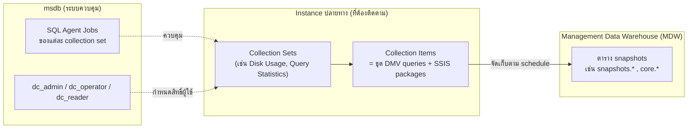
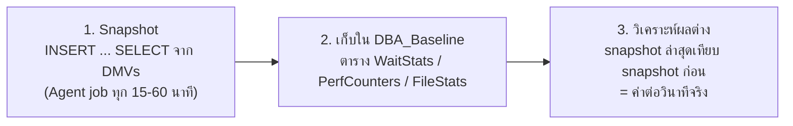
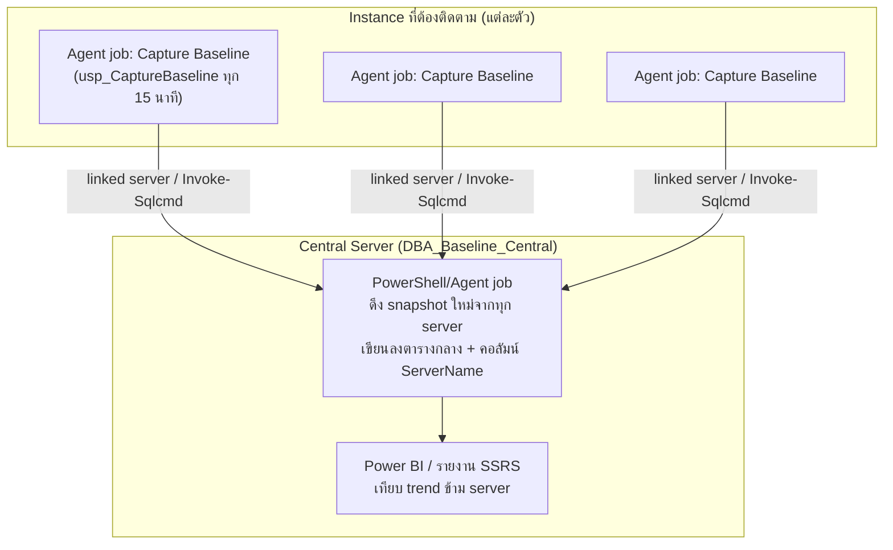

# Section 2 — การเก็บข้อมูลและสร้าง Baseline (Data Collection & Baseline)

ดูกิจกรรม "ตอนนี้" ได้จาก Section 1 แล้ว แต่คำถามระดับ DBA ระยะยาวคือ: **"ระบบนี้ปกติเป็นอย่างไร?"** — ถ้าไม่มีคำตอบที่อ้างอิงได้ เราจะบอกไม่ได้ว่า `Batch Requests/sec = 850` คือพีคของเซิร์ฟเวอร์นี้หรือเพิ่งเกิดขึ้น และไม่มีหลักฐานยืนยันผู้บริหารว่า "ระบบช้าขึ้นจริง" **Baseline** (ค่าอ้างอิงพฤติกรรมปกติ) จึงเป็นสิ่งที่ DBA ต้องมี และหัวข้อนี้สอนสองแนวทาง: แนวทางเดิม **SQL Server Data Collector + Management Data Warehouse** (ซึ่งปัจจุบันถือเป็น legacy) และแนวทางสมัยใหม่ที่ควบคุมเองได้เต็มที่ — **DMV snapshot script + Query Store + Azure Arc assessments**

## 1. สถาปัตยกรรม SQL Server Data Collector (แนวทางเดิม/legacy)

**Data Collector** คือระบบเก็บข้อมูล performance ในตัวของ SQL Server ตั้งแต่ SQL Server 2008 ทำงานโดย SQL Server Agent และเขียนข้อมูลลง **Management Data Warehouse (MDW)** — ฐานข้อมูลที่ใช้เก็บผลการเก็บรวบรวม



องค์ประกอบสำคัญ (ศัพท์ที่ต้องรู้เวลาอ่านเอกสารเก่า):

| องค์ประกอบ | อยู่ที่ไหน | หน้าที่ |
|:------------|:-----------|:---------|
| **Collection set** | msdb (`msdb.dbo.syscollector_collection_sets`) | กลุ่มของ collection items + กำหนดเวลา/โหมด (cached หรือ non-cached) |
| **Collection item** | msdb (`msdb.dbo.syscollector_collection_items`) | หน่วยเก็บจริง 1 หน่วย — เช่น query เดียวอ่าน DMV |
| **Collector Type** | msdb | กลไกเก็บ: T-SQL Query หรือ SSIS package |
| **Management Data Warehouse (MDW)** | database แยก | ที่เก็บข้อมูลจริง (ตาราง snapshots, core) |
| **dc_admin / dc_operator / dc_reader** | fixed database roles ใน msdb | สิทธิ์จัดการ / ใช้งาน / อ่านข้อมูล collector |
| **Proxy account** | SQL Agent credential | สิทธิ์ที่ collection set ใช้รันแทนผู้เรียก (อย่าใช้ sysadmin) |

ระบบให้ **standard collection sets** มา 3 ชุด:

| Collection set | เก็บอะไร | โหมด |
|:---------------|:---------|:------|
| **Disk Usage** | ขนาด data/log files ต่อ database และแนวโน้มการโต | Non-cached (รันเป็นรอบ) |
| **Query Statistics** | สถิติ query ที่แพง (จาก `sys.dm_exec_query_stats`) ทุก 15 นาที | Cached (บัฟเฟอร์ใน memory แล้ว flush เป็นรอบ) |
| **Server Activity** | CPU/RAM/disk จาก Windows + wait stats ของ SQL Server ทุก 60 วินาที | Cached |

### หมายเหตุความเป็น legacy (อ่านก่อนลงทุนกับระบบนี้)

- Data Collector **ยังทำงานได้**ใน SQL Server 2025 แต่ในทางปฏิบัติถือว่าเป็น **legacy** โดยชัดเจน — Microsoft ไม่ได้พัฒนาต่อและเอกสารสมัยใหม่เน้นเครื่องมืออื่น
- โมดูลเก่าสอน Data Collector คู่กับระบบ "utility" ควบคุมหลายเซิร์ฟเวอร์แบบเก่า — ในหลักสูตรนี้เราข้ามเส้นทางนั้นไป เพราะทางสมัยใหม่คือ Query Store + DMV baseline + Azure Arc
- **ทางสมัยใหม่ที่แทนที่ได้** (แนะนำให้เลือกตามโจทย์):
  - **Query Store** — "กล่องดำ" ระดับ database เก็บ plan/runtime stats ต่อ query เองในฐานข้อมูลของมัน (SQL Server 2025 รองรับบน readable secondaries ด้วย)
  - **DMV baseline script ของตัวเอง** — เก็บ snapshot ลงตาราง ควบคุม retention/schema ได้ 100% (ทำจริงในหัวข้อ 4)
  - **Azure Arc-enabled SQL Server + SQL assessments + Power BI** — สำหรับติดตาม farm หลายเซิร์ฟเวอร์แบบมี dashboard สำเร็จรูป
  - **Performance Monitor Data Collector Sets** — ถ้าต้องการ counters ระดับ OS ต่อเนื่อง ยังเป็นเครื่องมือมาตรฐานของ Windows (ไม่ใช่ SQL Data Collector)

> อ้างอิง: [Data Collection](https://learn.microsoft.com/sql/relational-databases/data-collection/data-collection?view=sql-server-ver17), [Management Data Warehouse](https://learn.microsoft.com/sql/relational-databases/data-collection/management-data-warehouse?view=sql-server-ver17), [Query Store](https://learn.microsoft.com/sql/relational-databases/performance/monitoring-performance-by-using-the-query-store?view=sql-server-ver17)

## 2. ออกแบบ topology: เก็บที่เครื่องตัวเอง หรือ central management server

โจทย์ของแนวทาง baseline ทุกแบบเหมือนกัน: เก็บข้อมูลจาก **หลาย instance** มาดูรวมกันได้ มีสองรูปแบบหลัก:

| รูปแบบ | โครงสร้าง | ข้อดี | ข้อจำกัด |
|:--------|:-----------|:-------|:----------|
| **Local (เก็บที่ตัวเอง)** | แต่ละ instance มี baseline table/MDW ของตัวเอง | ง่าย ไม่มี network dependency, fault ของเครื่องอื่นไม่กระทบ | ต้องเข้าทีละเครื่อง; ไม่เห็นภาพรวม farm |
| **Central management server** | instance กลางหนึ่ง รับ snapshot จากทุก instance ผ่าน Agent jobs / linked server / PowerShell | ดูรวมที่เดียว เทียบ cross-server ได้, retention กลางกำหนดครั้งเดียว | network latency/ความปลอดภัย, instance กลางล่ม = สูญข้อมูลใหม่ |

สำหรับ Data Collector (legacy) การ deploy MDW กลางคือทำ **central management server** — configure MDW ที่ instance กลางแล้วให้ instance อื่นชี้ data warehouse มาที่เดียวกัน

สำหรับแนวทางสมัยใหม่ การทำ central ทำได้หลายระดับ (เลือกตามขนาดองค์กร):

1. **เล็ก**: Agent job แต่ละเครื่อง snapshot ลง local table + ส่งผ่าน linked server/PowerShell ไปตารางกลางตามรอบ
2. **กลาง**: PowerShell ระดับส่วนกลาง (SqlServer module / dbatools) ดึง DMVs จากทุก server เขียนลง DB เดียว — ใช้ `Register-Servers`/Central Management Server ของ SSMS ช่วยรันกลุ่ม
3. **ใหญ่/คลาวด์**: Azure Arc + Azure Monitor + Power BI — มี dashboard, alert และ SQL assessments สำเร็จรูป

## 3. ตั้งค่า Data Collector อย่างย่อ (ถ้าต้องดูแลระบบเดิม)

> ⚠️ **ทำบน instance ทดลองเท่านั้น** — ขั้นตอนนี้เปิดระบบเก็บข้อมูลถาวร (Agent jobs + MDW) ต้องเข้าใจก่อนเปิดบน production

ขั้นตอนมาตรฐานผ่าน SSMS:

1. **สร้าง MDW**: right-click instance > **Tasks > Configure Management Data Warehouse** — เลือกสร้าง database ใหม่ (เช่น `MDW`) และ map ผู้ใช้เข้า role `mdw_admin`, `mdw_reader`, `mdw_writer` ของ database นั้น
2. **เปิด Data Collection**: right-click instance > **Tasks > Configure Data Collection** — ชี้ไปที่ MDW ที่สร้างไว้ + กำหนด cache directory
3. เสร็จแล้ว node **Management > Data Collection** จะแสดง collection sets 3 ชุด (Disk Usage, Query Statistics, Server Activity) พร้อม Agent jobs ที่สร้างให้อัตโนมัติ

แบบ T-SQL (เทียบเท่าขั้นตอนที่ 2 — สคริปต์เต็มอยู่ที่ [`Scripts/03_DataCollector_Legacy.sql`](Scripts/03_DataCollector_Legacy.sql)):

```sql
-- เปิด Data Collector (ต้อง configure MDW ก่อนจึงจะมี collection sets วิ่ง)
EXEC msdb.dbo.sp_syscollector_enable_collector;

-- ดู collection sets ที่มี + สถานะ
SELECT name, collection_mode, is_running, days_until_expiration
FROM msdb.dbo.syscollector_collection_sets;
```

รายงานที่ได้: right-click **database ใด ๆ > Reports > Standard Reports** จะพบรายงานที่อ่านจาก MDW — **Disk Usage** (แนวโน้มขนาดไฟล์), **Disk Usage by Table**, **Query Statistics History** (query แพงตามช่วงเวลา), **Server Activity History** (CPU/wait เทียบเวลา)

### ความปลอดภัยของ Data Collector

หลักการ: **อย่าให้ทุกคนเป็น sysadmin เพื่อแค่ใช้ collector** — ใช้สาม role ใน msdb:

| Role | สิทธิ์ | ให้ใคร |
|:------|:--------|:--------|
| `dc_admin` | สร้าง/แก้/ลบ collection sets ได้ทั้งหมด | ผู้ดูแลระบบ collector (เท่าที่จำเป็น) |
| `dc_operator` | เริ่ม/หยุด collection, ดู execution log | คนเปิด-ปิดการเก็บตามรอบ |
| `dc_reader` | อ่านข้อมูลใน MDW | ทีมวิเคราะห์/ทำรายงาน |

ส่วน **collection set ที่รันด้วยสิทธิ์ของใคร** — ทุก set มี proxy (SQL Agent proxy ผูก Credential) ให้กำหนดเป็นบัญชี domain/local ที่มีสิทธิ์น้อยที่สุดเท่าที่เก็บข้อมูลได้ หากไม่มี domain ให้ใช้ local service account ของ SQL Server Agent เองได้ในสภาพแวดล้อมทดลอง

## 4. ทำ baseline สมัยใหม่ด้วยตัวเอง (DMV snapshot + sys.dm_os_performance_counters + Query Store)

แนวทางที่เราจะใช้จริงในแล็บ: **snapshot DMVs ลงตารางของเราเอง** ข้อดี: รู้ทุกบรรทัด ปรับ schema/retention ได้ ไม่พึ่ง SSIS และไม่ต้องติดตั้งอะไรเพิ่ม แนวคิด 3 ขั้น:



### ขั้น 1: สร้างคลัง baseline — [`Scripts/01_DBA_Baseline_Setup.sql`](Scripts/01_DBA_Baseline_Setup.sql)

สคริปต์สร้าง database `DBA_Baseline` (แยกจาก AdventureWorks2025 เพื่อล้างง่าย) พร้อมตาราง snapshot และ stored procedure เก็บรอบใหม่ในครั้งเดียว:

- `dbo.WaitStats` — snapshot ของ `sys.dm_os_wait_stats` (กรอง benign waits แล้ว)
- `dbo.PerfCounters` — snapshot ของ `sys.dm_os_performance_counters` (ทุกแถว)
- `dbo.FileStats` — snapshot I/O ต่อ file จาก `sys.dm_io_virtual_file_stats`
- `dbo.usp_CaptureBaseline` — เรียกครั้งเดียว = เก็บ 1 รอบใหม่ทั้งหมด

### ขั้น 2: เก็บรอบละสองชุด แล้วดู "ผลต่าง" — [`Scripts/02_PerfCounters_Baseline.sql`](Scripts/02_PerfCounters_Baseline.sql)

หลักการสำคัญที่สุดของการอ่านค่า counter: ค่าส่วนใหญ่เป็น **สะสมตั้งแต่ restart** ดังนั้น "Batch Requests/sec วันนี้" ต้องมาจากการตัดกันสอง snapshot:

```sql
-- ตัวอย่างแนวคิด (เวอร์ชันเต็มในสคริปต์):
-- Snapshot รอบที่ n และ n-1 อยู่ใน dbo.PerfCounters ติด RunId กัน
SELECT cur.counter_name,
       cur.cntr_value - prev.cntr_value AS DeltaOverPeriod
FROM dbo.PerfCounters AS cur
JOIN dbo.PerfCounters AS prev
  ON prev.counter_name = cur.counter_name
 AND prev.instance_name = cur.instance_name
 AND prev.RunId = cur.RunId - 1
WHERE cur.object_name LIKE N'%SQL Statistics%'
  AND cur.counter_name = N'Batch Requests/sec';
```

✅ **สังเกต**: นี่คือวิธีที่เครื่องมือ monitoring ทั้งหมด (รวม perfmon) คำนวณ "ค่าต่อวินาที" — นำมาหารด้วยวินาทีระหว่าง snapshot ก็ได้ rate จริง

### ขั้น 3: เปิด Query Store คู่กัน

Baseline แบบ DMV เห็น "ค่ารวมระดับ instance" แต่ไม่เห็นว่า **query ไหน** แพง — ส่วนนั้น Query Store ทำให้แล้วโดยอัตโนมัติ:

```sql
ALTER DATABASE AdventureWorks2025 SET QUERY_STORE = ON;
-- ตั้งแต่ SQL Server 2022 Query Store เปิด default สำหรับ database ใหม่
-- รายงานใน SSMS: right-click database > Query Store > Regressed Queries ฯลฯ
```

> Query Store บน readable secondary replicas พร้อมใน SQL Server 2025 (ดูรายละเอียดในกล่อง Modern Notes ด้านล่าง) — ทำให้ baseline ของ workload บน replica รองไม่ตกหล่นอีกต่อไป

### ตารางสรุปเลือกเครื่องมือเก็บ baseline

| ความต้องการ | เครื่องมือที่เหมาะ |
|:-------------|:-------------------|
| เห็น query แพง/regression ต่อ database | Query Store (+ reports ใน SSMS) |
| ค่า counter ระดับ instance เทียบเวลา (CPU trend, Batch Requests/sec) | DMV snapshot ของตัวเอง หรือ perfmon Data Collector Set |
| แนวโน้มขนาดไฟล์/capacity planning | `sys.master_files` + `sys.dm_io_virtual_file_stats` snapshot |
| หลายเซิร์ฟเวอร์ + dashboard สำเร็จรูป | Azure Arc SQL assessments + Power BI (หรือ central DB กลางที่เขียนเอง) |
| ระบบเก่าที่มี Data Collector อยู่แล้ว | ดูแลต่อด้วยความเข้าใจ dc_* roles + MDW reports — อย่าลงทุนขยายเพิ่ม |

## 5. ออกแบบรอบการเก็บ (cadence) และ retention ให้เหมาะกับขนาดระบบ

Baseline ที่ดีต้องสมดุลระหว่าง "ละเอียดพอจะเห็นเหตุการณ์" กับ "ไม่กิน storage/ไม่หนักเกิน" — แนวทางที่ใช้ได้จริง:

| ประเภท snapshot | รอบแนะนำเริ่มต้น | Retention | เหตุผล |
|:-----------------|:------------------|:-----------|:--------|
| Wait stats (`dbo.WaitStats`) | ทุก 15 นาที | 30–60 วัน | เห็น "ช่วงเวลาแย่" ของวันได้; ผลต่างระหว่าง snapshot สองอันคือ wait จริงของช่วงนั้น |
| Perf counters (`dbo.PerfCounters`) | ทุก 15 นาที | 30–60 วัน | snapshot เต็มชุด (500+ แถว) ไม่หนัก; คุมขนาดด้วย retention มากกว่ารอบ |
| File stats (`dbo.FileStats`) | ทุกชั่วโมง | 90–180 วัน | ใช้กับ capacity planning ระยะยาว ไม่ต้องละเอียดรายนาที |
| Wait stats ช่วงเกิดเหตุ (แบบ "เข้ม") | ทุก 1–5 นาที ชั่วคราว | ลบเมื่อสอบเสร็จ | เปิดเพิ่มเฉพาะหน้างานที่มีปัญหา อย่าเปิดถาวร |

เรื่องขนาด: ชุด counters ของ instance ทั่วไปประมาณ 600–1,000 แถว/รอบ — ทุก 15 นาที 30 วัน ≈ 2–3 ล้านแถว ยังเล็กมากสำหรับ SQL Server แต่ควรมี job ลบข้อมูลเก่า (จาก `dbo.BaselineRun`) เป็นรายวัน

> จุดสำคัญที่มือใหม่พลาด: **อย่ารอจนเกิดปัญหาแล้วค่อยเริ่มเก็บ** — ค่า baseline มีประโยชน์เมื่อเทียบกับ "ปกติ" ซึ่งต้องเก็บตั้งแต่ตอนที่ทุกอย่างยังปกติ

## 6. ทางเลือก central แบบ DIY — เก็บหลายเซิร์ฟเวอร์เข้าตารางเดียว

ถ้ามี SQL Server 5–20 ตัว ไม่จำเป็นต้องซื้อเครื่องมือก่อน — โครงสร้างที่ทำงานได้จริงคือ:



ข้อควรระวังของแบบ central:

1. **คอลัมน์ `ServerName` ต้องมี**ในตารางกลาง (เพิ่มเข้าไปจาก `@@SERVERNAME` ตอนส่ง) — ไม่งั้นข้อมูลกองปนกัน
2. **สิทธิ์ข้าม server** — ใช้ login ที่มี `##MS_ServerPerformanceStateReader##` เท่านั้น อย่าใช้ sa (เชื่อมกับแนวคิด least privilege ใน Section 1)
3. เวลาที่เปรียบเทียบต้องเป็น **UTC** (`SYSUTCDATETIME()`) เพื่อไม่ต้องปวดหัว timezone ข้ามเครื่อง
4. Network/disk ของ central จะรับ load จากทุก server — กำหนดรอบ upload ช้ากว่ารอบ capture (เช่น capture 15 นาที, upload 1 ชั่วโมง)

## 7. Data Collector: cached กับ non-cached ต่างกันอย่างไร (สำหรับดูแลระบบเดิม)

ถ้าต้องรับช่วงดูแล Data Collector ที่มีอยู่แล้ว สองโหมดของ collection set นี้ต่างกันเชิงกลไก:

| โหมด | กลไก | ใช้กับ standard set ไหน | ข้อสังเกต |
|:------|:------|:-------------------------|:-----------|
| **Non-cached** | เก็บและ upload เป็นรอบ ตาม schedule เดียว | Disk Usage | ข้อมูลเดินทางถึง MDW ทันทีต่อรอบ |
| **Cached** | เก็บถี่ ๆ ลง buffer ใน memory ของ collector แล้ว flush/upload เป็นรอบใหญ่ | Query Statistics, Server Activity | เหมาะกับข้อมูลถี่; ต้องมี cache directory; ถ้า agent หยุด ข้อมูลใน buffer อาจหาย |

และจุดตรวจสุขภาพเมื่อรับช่วงระบบ: `msdb.dbo.syscollector_collector_execution_log` (runtime_status ปกติไหม, failure_count), ขนาด MDW vs รอบ collection, รายชื่อ user ใน `dc_admin` (มักสะสมมาจากคนเก่า ๆ ที่ควร prune)

## แบบฝึกหัดท้าย Section (ทำเต็มใน Labs/README.md)

1. รัน [`Scripts/01_DBA_Baseline_Setup.sql`](Scripts/01_DBA_Baseline_Setup.sql) แล้วเรียก `dbo.usp_CaptureBaseline` สองครั้ง (เว้นระยะ 5 นาที ระหว่างนั้นรัน workload ตามแล็บ)
2. รัน [`Scripts/02_PerfCounters_Baseline.sql`](Scripts/02_PerfCounters_Baseline.sql) ดูผลต่าง Batch Requests/sec ระหว่างสองรอบ
3. (Optional, legacy) รัน [`Scripts/03_DataCollector_Legacy.sql`](Scripts/03_DataCollector_Legacy.sql) เปิด Data Collector แล้วดู `syscollector_collection_sets`

### 🚀 SQL Server 2025 & Modern Notes
- **Data Collector/MDW = legacy** — ยังรันได้แต่ไม่ควรเป็นการลงทุนใหม่; ทางที่ Microsoft เน้นคือ Query Store, Extended Events และ Azure Arc ([Data Collection](https://learn.microsoft.com/sql/relational-databases/data-collection/data-collection?view=sql-server-ver17))
- **Query Store บน readable secondaries** ใน SQL Server 2025 (ก่อนหน้าเป็น preview ใน 2022) — สถิติ query ที่รันบน secondary ถูกส่งกลับมา persist ที่ primary, SSMS 21 Query Store reports มี dropdown เลือก Replica ([Query Store for secondary replicas](https://learn.microsoft.com/sql/relational-databases/performance/query-store-for-secondary-replicas?view=sql-server-ver17))
- **time-bound Extended Events sessions** (2025) — ใช้ XE เก็บเหตุการณ์เฉพาะช่วงเวลาแล้วให้ session หยุดเอง ปิดช่อง "ลืมปิด session" ที่กินทรัพยากร ([What's new in SQL Server 2025](https://learn.microsoft.com/sql/sql-server/what-s-new-in-sql-server-2025?view=sql-server-ver17))
- **tempdb space resource governance** (2025) — Resource Governor จำกัดการใช้ tempdb ต่อ workload group ได้ เสริม baseline ด้าน capacity ของ tempdb
- **Purview access policies discontinued ใน 2025** — สิทธิ์ monitoring แบบ least-privilege ให้ใช้ fixed server roles (`##MS_ServerPerformanceStateReader##` ฯลฯ) แทน
