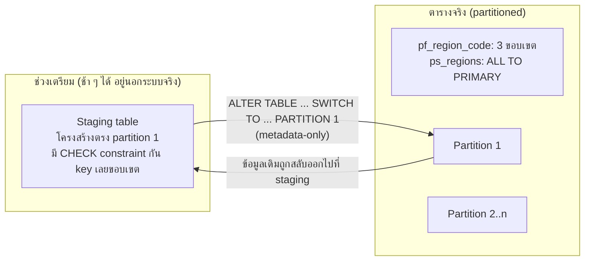
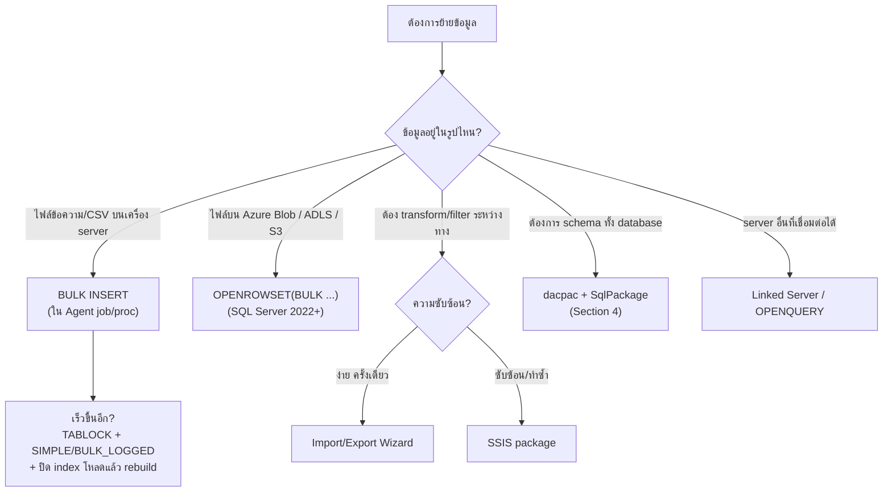

# Section 1 — ภาพรวมการถ่ายโอนข้อมูล (Data Transfer Overview)

งาน DBA ไม่ได้มีแค่ "ให้ฐานข้อมูลวิ่งเร็ว" แต่ต้องย้ายข้อมูลเข้า-ออกอย่างมีประสิทธิภาพด้วย: โหลดข้อมูลอ้างอิง (อัตราแลกเปลี่ยน, รหัสสกุลเงิน), ส่งออกให้ทีม data/BI, ย้ายสคีมาระหว่าง environment ผ่าน dacpac, หรือโหลดไฟล์ใหญ่หลายสิบล้านแถวทุกคืน SQL Server มีเครื่องมือถ่ายโอนข้อมูลหลากหลายระดับ ตั้งแต่ wizard คลิกไม่กี่ครั้งไปจนถึง T-SQL และ command-line utility ที่คุมพฤติกรรมได้ละเอียด — **เลือกเครื่องมือให้ถูกงาน และรู้วิธี "ปรับจูน" การโหลดให้เร็ว** คือทักษะของ Section นี้

หัวข้อนี้เป็นฐานของ Module 14 ทั้งหมด: Section 2 ลงลึก SSIS/Import-Export Wizard, Section 3 ลงลึก bcp/BULK INSERT/OPENROWSET, Section 4 ครอบ Data-tier Applications

## 1. การถ่ายโอนข้อมูลเข้า-ออก ในสายตา DBA

สถานการณ์จริงที่พบบ่อยและเครื่องมือที่เหมาะ:

| สถานการณ์ | โจทย์ | เครื่องมือแนะนำ |
|:-----------|:-------|:-----------------|
| ทีม data ขอไฟล์รายงานรายวัน | export ตาราง/ผล query เป็น CSV | `bcp queryout` หรือ SSIS |
| รับไฟล์ CSV จาก vendor ทุกคืน | import ไฟล์ลง staging table เร็ว ๆ | `BULK INSERT` (รันใน Agent job) |
| โหลดไฟล์ใหญ่มาก (หลาย GB) ทุกคืน | minimal logging, batch, partition switch | `BULK INSERT ... TABLOCK` + partition switching |
| อ่านไฟล์ที่เก็บบน cloud storage | อ่าน Azure Blob/S3 โดยไม่โหลดก่อน | `OPENROWSET(BULK ...)` (SQL Server 2022+) |
| ย้าย schema ระหว่าง dev/test/prod | deploy โครงสร้างเป็นเวอร์ชัน | dacpac ผ่าน SqlPackage (Section 4) |
| copy ข้อมูลก้อนเล็กแบบคลิก ๆ | แอดมินไม่ต้องเขียนโค้ด | Import/Export Wizard (Section 2) |
| ETL ซับซ้อน มี transformation, error handling, schedule | ออกแบบเป็น package ให้ทีมดูแล | SSIS (Section 2) |
| query ข้อมูลบน server อื่นแบบทันที | cross-server join นาน ๆ ครั้ง | Linked Server / OPENQUERY (Section 3) |

## 2. ตารางเทียบเครื่องมือ

| เครื่องมือ | รูปแบบการใช้ | ทิศทาง | จุดแข็ง | จุดอ่อน |
|:-----------|:--------------|:--------|:--------|:---------|
| **SSIS** | package (.dtsx) บน SSISDB หรือไฟล์ | เข้า/ออก/ETL เต็มรูป | transformation, error handling, schedule ผ่าน Agent, project deployment | ต้องติดตั้ง/พัฒนา package; legacy SSIS service deprecated ใน 2025 (ใช้ SSISDB catalog) |
| **Import/Export Wizard** | UI ใน SSMS | เข้า/ออก | เร็วสำหรับงานเดียวจบ, สร้าง SSIS package ให้ได้ | ไม่เหมาะกับงานเยอะแถว/ซ้ำ ๆ, จัดการ error คร่าว ๆ |
| **bcp** | command line (`bcp.exe`) | เข้า/ออก | เร็วมาก, ทำ script อัตโนมัติ, queryout/export ตรงไฟล์, format file | ไม่ทำ transformation; ต้องอยู่บนเครื่องที่มี client tools |
| **BULK INSERT** | T-SQL | เข้า | อ่านไฟล์ด้วย process ของ server, คุม options ละเอียด, รันใน job/proc ได้ | นำเข้าเท่านั้น; ไม่รองรับ S3 (เฉพาะ Azure Blob ผ่าน DATA_SOURCE) |
| **OPENROWSET(BULK ...)** | T-SQL | อ่าน/เข้า | อ่านไฟล์เป็น rowset กรอง/แปลงก่อนเข้าตารางได้, รองรับ Azure Blob + ADLS + **S3** (2022+), Parquet/Delta (2022+) | อ่านเท่านั้น (เข้าตารางต้องผ่าน INSERT...SELECT) |
| **dacpac/bacpac (SqlPackage)** | CLI + SSMS wizard | deploy schema/ข้อมูล | versioning, deploy ซ้ำได้, CI/CD ได้ | เน้น schema (dacpac); bacpac เหมาะย้ายทั้ง DB ไม่ใช่ ETL |
| **Linked Server** | T-SQL config ระดับ server | สองทาง (query) | query ข้าม server แบบสด, ใช้ 4-part name | performance ต่ำเมื่อ join ข้อมูลใหญ่ |

> คำเตือนเรื่องความทันสมัย: ตั้งแต่ SQL Server 2025 **legacy SSIS service** (การจัดการ package ผ่าน "Integration Services" ใน Object Explorer แบบเก่า) และโหมด **32-bit runtime** ถูกประกาศ deprecated — ทิศทางปัจจุบันคือ **project deployment ไปยัง SSISDB catalog** และการรันแบบ 64-bit ([What's new in SQL Server 2025](https://learn.microsoft.com/sql/sql-server/what-s-new-in-sql-server-2025?view=sql-server-ver17))

## 3. เพิ่มประสิทธิภาพการ bulk load

การโหลดข้อมูลเยอะ ๆ ให้เร็ว หัวใจอยู่ที่การ**ลดปริมาณการเขียน transaction log** และการ**ลดจำนวน lock/roundtrip** — ปัจจัยเรียงตามผลกระทบ:

### 3.1 Minimal logging

โหมดปกติ (fully logged) ทุกแถวที่ insert ถูกเขียน log เต็มรูปแบบ — โหลด 10 ล้านแถว = log บวมสิบล้านแถว Minimal logging บันทึกเฉพาะ extent/page ที่จัดสรร ทำให้เร็วขึ้นหลายเท่า เงื่อนไขทางการ ([Prerequisites for minimal logging in bulk import](https://learn.microsoft.com/sql/relational-databases/import-export/prerequisites-for-minimal-logging-in-bulk-import?view=sql-server-ver17)):

1. Database ต้องอยู่ recovery model **SIMPLE** หรือ **BULK_LOGGED** (FULL = ไม่มี minimal logging เด็ดขาด)
2. **ตารางปลายทางว่างหรือเป็น heap ที่ยังไม่มี clustered index** และใช้ `TABLOCK` — หรือกรณี `BULK INSERT`/`INSERT ... SELECT` ใส่ `TABLOCK` กับ heap/ตารางที่มี nonclustered index ไม่มาก
3. การคำนวณจริงซับซ้อนตามโครงสร้าง (clustered index ที่ถูกโหลดตามลำดับ key ก็อาจได้ minimal logging บางกรณี) — หลักปฏิบัติง่าย ๆ: **SIMPLE/BULK_LOGGED + TABLOCK + heap ว่าง** = ทำงานแบบ minimal logging เสมอ

> ข้อแลกเปลี่ยน: minimal logging ทำให้ backup log ระหว่างช่วงนั้น capture ได้น้อยลง (BULK_LOGGED ต้อง backup ครอบคลุม extent ที่โหลด) — วางแผนช่วง maintenance ให้ดี

### 3.2 Batch size และ ROWS_PER_BATCH

| Option (BULK INSERT/bcp) | ความหมาย | ใช้เมื่อ |
|:--------------------------|:----------|:---------|
| `BATCHSIZE = n` | แบ่งการ import เป็น batch ย่อย ละ n แถว (แต่ละ batch เป็น transaction ของตัวเอง) | กัน transaction ใหญ่เกิน, กัน log บวม, ทำ retry ต่อ batch |
| `ROWS_PER_BATCH = n` | "บอก" engine ว่าไฟล์มีประมาณ n แถวใน 1 batch เดียว (ไม่แบ่ง transaction) | ช่วย engine วางแผนจัดสรร/lock ดีขึ้น — ต่างจาก BATCHSIZE ตรงที่ไม่ commit เป็นรอบ |

### 3.3 ปิด index แล้ว rebuild

สำหรับตารางที่มี nonclustered index เยอะ การโหลดพร้อม index ทำให้ทุกแถวต้อง update index หลายชุด ทางที่มักเร็วกว่า: โหลดลง heap ก่อนแล้วสร้าง index ทีเดียวตอนจบ หรือในเคส update ตารางเดิม:

```sql
-- ปิด nonclustered index ก่อนโหลด (data ยังเข้าตารางได้ แต่ index นี้ไม่ถูก update)
ALTER INDEX idx_SalesDetails_ProductID ON Lab.SalesDetails DISABLE;

-- ... โหลดข้อมูล (BULK INSERT / INSERT ... SELECT) ...

-- เปิดกลับด้วยการ rebuild (สร้าง index ใหม่จากข้อมูลทั้งหมดในครั้งเดียว)
ALTER INDEX idx_SalesDetails_ProductID ON Lab.SalesDetails REBUILD;
```

> **ระวังหลุมพราง**: index ที่ `DISABLE` ยังอยู่ใน metadata แต่ใช้งานไม่ได้จน `REBUILD` — และถ้า disable **clustered index** ข้อมูลในตารางจะ "มองไม่เห็น" ทันที (SELECT คืน error) และ index อื่น ๆ ที่เกี่ยวจะถูก disable ตามด้วย

### 3.4 disable/enable constraints อย่างเข้าใจ (WITH CHECK CHECK)

โหลดข้อมูลที่มั่นใจว่าถูกต้องแล้ว ปิด constraint ช่วยความเร็วได้ — แต่คำสองคำนี้ต่างกันคนละโลก:

```sql
-- ปิด FK/ CHECK constraint
ALTER TABLE Lab.ExchangeRate NOCHECK CONSTRAINT FK_ExchangeRate_CurrencyCode_from;

-- ปิดใช้ได้ (enable) แต่ไม่ตรวจข้อมูลเก่า — constraint จะ "untrusted"
ALTER TABLE Lab.ExchangeRate CHECK CONSTRAINT FK_ExchangeRate_CurrencyCode_from;

-- enable พร้อมตรวจข้อมูลทั้งหมด — ได้ constraint แบบ trusted (นี่คือ "WITH CHECK CHECK")
ALTER TABLE Lab.ExchangeRate WITH CHECK CHECK CONSTRAINT FK_ExchangeRate_CurrencyCode_from;
```

ตรวจสถานะได้จากคอลัมน์ `is_disabled` (ปิดใช้อยู่หรือไม่) และ `is_not_trusted` (มีข้อมูลเก่าที่ไม่เคยถูกตรวจหรือไม่):

```sql
SELECT name, is_disabled, is_not_trusted
FROM sys.foreign_keys
WHERE parent_object_id = OBJECT_ID('Lab.ExchangeRate');
```

ข้อแลกเปลี่ยนที่หลายคนพลาด: constraint แบบ **untrusted ยังบังคับข้อมูลใหม่** แต่ optimizer**ไม่ใช้เป็นข้อมูลช่วยวางแผน** — join/การ eliminate partition อาจช้าลงโดยไม่มีใครรู้ตัว กฎข้อหนึ่งของ DBA: หลัง bulk load จบ ให้ enable แบบ `WITH CHECK CHECK` ทุกครั้งที่ทำได้ หรือถ้าต้อง import โดยไม่ใส่ `CHECK_CONSTRAINTS` ใน BULK INSERT ก็ต้องยอมรับผล untrusted

### 3.5 Parallel load และ partition switching

- **Parallel load**: แตกไฟล์เป็นหลายชิ้น (หรือใช้ `bcp -F/-L` เลือกช่วงแถว) แล้วรันหลาย session พร้อมกัน — heap + TABLOCK จะ scale ได้ดีมาก
- **Partition switching**: โหลดข้อมูลลงตาราง staging ตามสบาย แล้ว **สลับ (switch) ทั้งก้อนเข้าตารางจริง** — เป็น metadata-only operation เร็วระดับมิลลิวินาที ไม่ว่าข้อมูลกี่ล้านแถว ต้องจัดเรียงให้ตรงกันคือ staging table ต้องมีโครงสร้าง (index/constraint บน partition key) ตรงกับ partition ที่จะสลับ

ตัวอย่างครบ: สร้าง partition function + scheme + switch อยู่ในสคริปต์ [`Scripts/02_Partition_Switch.sql`](Scripts/02_Partition_Switch.sql) (ปรับจาก Demo 2 ของคอร์สเดิม) — สรุปแนวคิดดังนี้



หลักเงื่อนไขของ SWITCH ที่ต้องจำ:

1. **ตารางเป้าหมาย/ต้นทางต้องมีโครงสร้างเดียวกัน** (คอลัมน์, data type, index, nullability)
2. ข้อมูลใน staging ต้อง**ไม่ล้ำเขตของ partition ปลายทาง** — ใช้ CHECK constraint บังคับล่วงหน้า (engine จะเชื่อ constraint ที่ trusted โดยไม่ต้อง scan)
3. ถ้า target เป็น partitioned table ต้องระบุ `PARTITION n`
4. FK ที่อ้างมาที่ตาราง (หรือออกจากตาราง) ต้องถูก validate ก่อน switch ได้

รันสคริปต์เต็ม:

```sql
-- แก้หัวไฟล์: ปรับ schema Lab บน AdventureWorks2025 แล้วรันทั้งไฟล์
-- Scripts/02_Partition_Switch.sql
```

✅ **สังเกต**: หลัง `ALTER TABLE ... SWITCH TO ... PARTITION 1` — staging table ว่างเปล่าทันที ตารางจริงมีข้อมูลใหม่ทันที ไม่มีการย้ายแถวจริงเกิดขึ้น

### 3.6 เช็กลิสต์รวมก่อน bulk load ใหญ่

1. recovery model ของ DB ปลายทางเป็นอะไร และเจตนาใช้ minimal logging หรือไม่ (หัวข้อ 3.1)
2. ปลายทางเป็น heap/ว่างหรือมี index ต้อง DISABLE ก่อน (หัวข้อ 3.3)
3. constraint จะให้ตรวจระหว่างโหลด (`CHECK_CONSTRAINTS`) หรือรอ enable ด้วย `WITH CHECK CHECK` ทีหลัง — อย่าปล่อย untrusted ค้างไว้ (หัวข้อ 3.4)
4. ขนาด log + disk ที่เหลือ — คำนวณจากขนาดไฟล์ × ตัวคูณ log (FULL อาจ ×2–3)
5. มี transaction เปิดค้างอยู่ไหม (`DBCC OPENTRAN`) ก่อนเริ่ม
6. วางแผนว่าจะ retry อย่างไรถ้าแถวชุดกลาง fail (BATCHSIZE ช่วยได้)

## 4. ตัวอย่าง: เทียบโหลดแบบต่าง ๆ ด้วยสคริปต์

สคริปต์ [`Scripts/01_BulkLoad_Strategies.sql`](Scripts/01_BulkLoad_Strategies.sql) สร้าง database ทดลอง `LabLoad` (SIMPLE recovery — เพื่อไม่กระทบ recovery model ของ AdventureWorks2025) แล้ว:

1. สร้าง heap + โหลด 200,000 แถวด้วย `INSERT ... SELECT ... TABLOCK` แล้ววัดขนาด log ที่ใช้ (SIMPLE + TABLOCK + heap = minimal logging)
2. โหลดซ้ำใน transaction แบบไม่ใส่ TABLOCK — เทียบ log usage
3. สาธิต disable/enable FK พร้อม query `is_not_trusted`
4. สาธิต `ALTER INDEX ... DISABLE` + `REBUILD`

```sql
-- ตัวอย่างย่อจากสคริปต์: วัด log ของ database ปัจจุบัน
SELECT DB_NAME(database_id)                       AS DatabaseName,
       CAST(total_log_size_in_bytes / 1048576.0 AS decimal(12,2)) AS LogSizeMB,
       CAST(used_log_space_in_percent AS decimal(5,2))            AS UsedPercent
FROM sys.dm_db_log_space_usage;
```

✅ **สังเกต**: แถวที่โหลดแบบ TABLOCK + SIMPLE ใช้ log น้อยกว่าแบบ fully logged หลายเท่า — จำเงื่อนไขให้แม่นเพราะข้อสอบ/สัมภาษณ์ชอบถาม

## 5. เตรียมไฟล์ข้อมูลให้พร้อม bulk load

ปัญหา bulk load ส่วนใหญ่ไม่ได้เกิดที่ T-SQL แต่เกิดที่ **ไฟล์ต้นทาง** — ตรวจสี่เรื่องนี้ก่อนโหลดทุกครั้ง:

| เรื่อง | ตรวจอย่างไร | แก้อย่างไร |
|:--------|:-------------|:------------|
| **Encoding** | เปิดไฟล์ใน editor ดูปกติไหม; ไฟล์ UTF-8 ที่มีภาษาอื่น → ใช้ `CODEPAGE = '65001'` | แปลงไฟล์หรือระบุ codepage ให้ตรง |
| **Line ending** | Windows = CRLF, Linux = LF | `ROWTERMINATOR = '\r\n'` หรือ `'\n'` ให้ตรง (แตกต่างทำให้คอลัมน์ท้ายมี `\r` ติดมา) |
| **Header row** | มีแถวหัวตารางไหม | `FIRSTROW = 2` (โน้ต: engine ไม่ validate แถวที่ข้าม) |
| **Field quoting** | ข้อมูลมี comma/quote ในค่า? | ใช้ `FORMAT = 'CSV'` + `FIELDQUOTE` (BULK INSERT 2017+) หรือ format file |

ข้อผิดพลาดที่เจอบ่อยและความหมาย:

- **Msg 4861/4863** — หาไฟล์ไม่เจอ: path ผิดฝั่ง (อยู่เครื่อง client แต่ server อ่าน) หรือ service account ไม่มีสิทธิ์อ่านโฟลเดอร์
- **Msg 4864** — type conversion ล้มเหลว: ข้อมูลในไฟล์ไม่เข้ากับชนิดคอลัมน์ (เช่น วันที่รูปแบบต่าง หรือมีแถวว่าง)
- **Msg 547** — FK violation: เกิดเฉพาะเมื่อใส่ `CHECK_CONSTRAINTS` — ถ้าไม่ใส่ constraint จะถูกข้ามและกลายเป็น untrusted (ดูหัวข้อ 3.4)
- **การ delegation (Windows auth ข้ามเครื่อง)** — ไฟล์อยู่ UNC ที่สาม เชื่อมจาก client เครื่องหนึ่งไป server อีกเครื่อง → อาจได้ 4861; แก้ด้วย SQL auth หรือตั้ง delegation ให้ถูก ([Security considerations](https://learn.microsoft.com/sql/relational-databases/import-export/import-bulk-data-by-using-bulk-insert-or-openrowset-bulk-sql-server?view=sql-server-ver17))

## 6. ความสัมพันธ์กับ recovery model และแผน backup

ตารางนี้สรุปผลกระทบ "ฝั่ง backup" ของเทคนิคโหลดแบบต่าง ๆ — ต้องอ่านคู่กับ Module 5:

| สถานการณ์โหลด | ผลต่อ transaction log | สิ่งที่ต้องวางแผน |
|:----------------|:------------------------|:-------------------|
| FULL + โหลดปกติ | fully logged — log โตตามข้อมูล | ขยาย log ล่วงหน้า + backup log ถี่ขึ้นช่วงโหลด |
| SIMPLE/BULK_LOGGED + TABLOCK + heap | minimal logging | ช่วงที่โหลด อย่ากลางคันไปทำ log backup ที่อาจ fail/long; BULK_LOGGED ต้อง backup ครอบ extent ที่แก้ |
| โหลดลง staging แล้ว SWITCH | โหลดอยู่นอกระบบจริง — log ของ DB จริงแทบไม่โต | partition scheme ตรงกัน (หัวข้อ 3.5) |
| โหลดแล้ว rebuild index | REBUILD กิน log เพิ่ม (FULL) | ทำช่วง maintenance; คิด log space รวมของทั้งกระบวนการ |

## 7. เมื่อไรควรใช้อะไร — decision guide



### 🚀 SQL Server 2025 & Modern Notes
- **SSIS: legacy SSIS service + 32-bit mode deprecated** — ใช้ project deployment ไป SSISDB และรัน 64-bit ([What's new in SQL Server 2025](https://learn.microsoft.com/sql/sql-server/what-s-new-in-sql-server-2025?view=sql-server-ver17))
- **BULK INSERT ไม่รองรับ S3** (รองรับ Azure Blob ผ่าน `DATA_SOURCE` ตั้งแต่ 2017, ADLS Gen2 ตั้งแต่ 2019 CU11) ขณะที่ `OPENROWSET(BULK ...)` รองรับ **S3-compatible storage ตั้งแต่ SQL Server 2022** + Parquet/Delta ([Data virtualization guide](https://learn.microsoft.com/sql/relational-databases/polybase/data-virtualization-guide?view=sql-server-ver17))
- **Managed identity สำหรับ BULK INSERT/OPENROWSET บน SQL Server 2025** (ผ่าน Azure Arc) — ลดการเก็บ secret ใน database scoped credential ([Import bulk data](https://learn.microsoft.com/sql/relational-databases/import-export/import-bulk-data-by-using-bulk-insert-or-openrowset-bulk-sql-server?view=sql-server-ver17))
- **Fabric Mirroring** เป็นทางเลือก "ถ่ายโอนข้อมูลต่อเนื่อง" สมัยใหม่ (ระยะสั้น/preview) — replicate ฐานข้อมูล SQL Server ขึ้น OneLake แบบ near-real-time โดยไม่ต้องสร้าง replication เอง ([Mirroring in Fabric](https://learn.microsoft.com/fabric/database/mirrored-database/overview))
- ทุกการ bulk import ต้องการสิทธิ์ `ADMINISTER BULK OPERATIONS` (+ INSERT บนตารางปลายทาง) — บน Linux สิทธิ์นี้/role `bulkadmin` ใช้ได้ตั้งแต่ SQL Server 2022 CU24 และ 2025 CU3 ([Bulk import on Linux](https://learn.microsoft.com/sql/linux/sql-server-linux-bulk-operations?view=sql-server-ver17))
