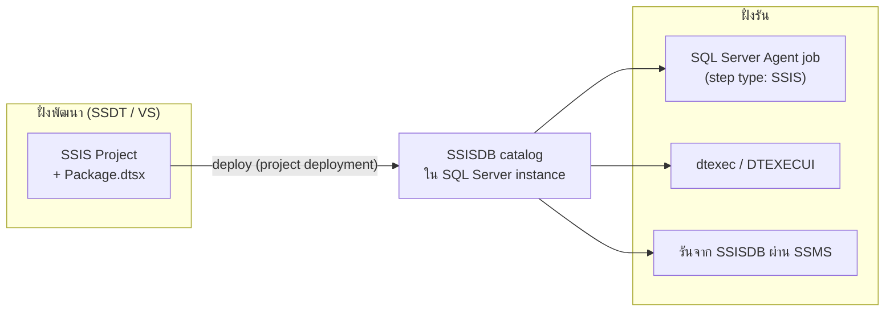
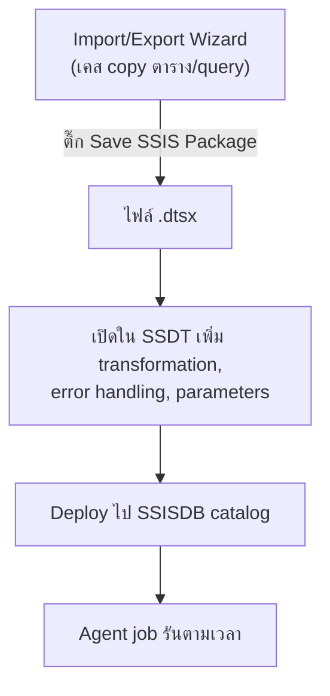
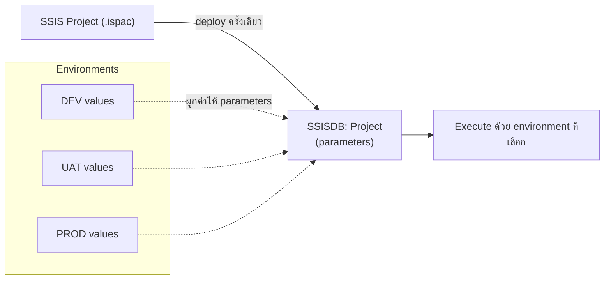

# Section 2 — SSIS และ Import/Export Wizard

เมื่องานถ่ายโอนข้อมูลเริ่ม "มีขั้นตอน มีเงื่อนไข มีตารางหลายใบ" T-SQL ล้วน ๆ เริ่มจัดการยาก — นั่นคือโลกของ **SQL Server Integration Services (SSIS)**: แพลตฟอร์ม ETL ของ Microsoft ที่วาง workflow เป็นแผนภาพ รันซ้ำได้ กำหนดเวลาผ่าน SQL Server Agent ได้ และ deploy เป็น "โปรเจกต์" ไปยังเซิร์ฟเวอร์ได้ ส่วน **Import/Export Wizard** คือหน้าตัดของ SSIS ที่ถูกใช้บ่อยที่สุด: เครื่องมือ UI ใน SSMS สำหรับ copy ข้อมูลเข้า-ออกแบบเร็ว และที่น่ารู้คือ **wizard ตัวนี้สร้าง SSIS package ให้ด้วย** ทำให้งานครั้งเดียวเปลี่ยนเป็นงานอัตโนมัติได้ไม่ยาก

## 1. SSIS overview

ส่วนประกอบหลักที่ต้องคุ้น:

| ศัพท์ | ความหมาย |
|:-------|:----------|
| **Package (.dtsx)** | หน่วยงานหนึ่งของ SSIS — ภายในมี **Control Flow** (ลำดับงาน) และ **Data Flow** (ท่อลำเลียงข้อมูล: source → transformation → destination) |
| **Connection Managers** | การเชื่อมต่อไปยังแหล่งข้อมูล (SQL Server, ไฟล์, Excel, OLE DB, ADO.NET ฯลฯ) ที่ทุก task ใช้ร่วมกัน |
| **Project Deployment Model** | รูปแบบ deploy ปัจจุบัน: ทั้งโปรเจกต์ (`.ispac`) ถูก deploy ไปยัง **SSISDB catalog** พร้อม parameters/environment กลาง |
| **SSISDB catalog** | ฐานข้อมูล catalog ใน instance (ต้องเปิดใช้งานครั้งแรกด้วย catalog creation) — เก็บ package, execution history, logs, รันแบบ scale-out ได้ |
| **Legacy SSIS service** | บริการจัดการ package เก่า (เก็บ .dtsx ใน file system / msdb) — **deprecated ใน SQL Server 2025** อย่าเริ่มงานใหม่ด้วยรูปแบบนี้ |



ทางลงมือเร็ว ๆ สำหรับแล็บนี้: ติดตั้ง SSIS ผ่าน SQL Server installer (เลือก feature "Integration Services") และสำหรับพัฒนา package ให้ติดตั้ง **SQL Server Data Tools (SSDT)** หรือ extension "SQL Server Integration Services Projects" ใน Visual Studio

> อ้างอิง: [SQL Server Integration Services](https://learn.microsoft.com/sql/integration-services/sql-server-integration-services?view=sql-server-ver17)

### 📌 สิ่งที่ deprecated ใน SQL Server 2025 (ต้องรู้ก่อนเริ่มโปรเจกต์)

| ของเก่า | สถานะ | ทางสมัยใหม่ |
|:---------|:-------|:-------------|
| Legacy SSIS service (จัดการ package ผ่าน Object Explorer node "Integration Services" แบบเก่า / เก็บใน msdb) | **Deprecated** | Project deployment ไป **SSISDB catalog** |
| 32-bit runtime ของ SSIS | **Deprecated** | รัน package แบบ 64-bit (`Run64BitRuntime = True`) |
| SDS connection type (SQL Server Data Streaming) | Deprecated | ใช้ ADO.NET / OLE DB source ปกติ |

## 2. Import/Export Wizard — ขั้นตอนจริงใน SSMS

เริ่มจากเคส "copy ตาราง" จากนั้นเคส "copy ผล query" — เตรียมตารางทดลองด้วยสคริปต์ [`Scripts/01_Wizard_Sample_Tables.sql`](Scripts/01_Wizard_Sample_Tables.sql) ก่อน (สร้าง `Lab.Suppliers` + ข้อมูล + view สำหรับเคส query)

### 2.1 เคส A — Copy ตารางทั้งใบ

1. ใน SSMS: right-click ฐานข้อมูล **AdventureWorks2025** > **Tasks** > **Export Data...** (ถ้า copy "เข้า" DB นี้ให้ right-click ที่ DB ปลายทางแล้วเลือก **Import Data...** — ตัว wizard ตัวเดียวกัน เพียงหมุนทิศทาง default)
2. **Choose a Data Source**: Data source = SQL Server Native Client / Microsoft OLE DB Driver, เลือก server + authentication + database ต้นทาง
3. **Choose a Destination**: อีกด้านหนึ่ง — อาจเป็น SQL Server อีก instance หรือ Flat File (CSV)
4. **Specify Table Copy or Query**: เลือก **Copy data from one or more tables or views**
5. **Select Source Tables and Views**: ติ๊กเลือก `Lab.Suppliers` — คลิก **Edit Mappings...** เพื่อเห็นการ map คอลัมน์ (ตรงนี้ wizard สร้างตารางปลายทางให้ถ้ายังไม่มี) และเลือก **Enable identity insert** ถ้าต้องการคงค่า identity
6. **Save and Run**: ติ๊ก **Run immediately** และ (จุดสำคัญ) ติ๊ก **Save SSIS Package** > เลือกเป็น file system เพื่อเก็บ `.dtsx` ไว้รันซ้ำ/นำไปแก้ต่อใน SSDT
7. Finish แล้วดู summary — จำนวนแถวที่ copy ต่อตาราง

### 2.2 เคส B — Copy ผลของ query

ขั้นที่ 4 เลือก **Write a query to specify the data to transfer** แล้ววาง query เช่น:

```sql
SELECT SupplierName, Country, IsActive
FROM Lab.Suppliers
WHERE IsActive = 1;
```

ที่หน้า **Select Source Tables and Views** ให้ตั้งชื่อ destination table (เช่น `Lab.ActiveSuppliers`) — wizard จะสร้างตารางปลายทางตามโครง result set แล้ว insert ผลเข้าไป

### 2.3 เคส C — ปลายทางเป็น Flat File (export เป็น CSV)

หน้า **Choose a Destination** เลือก **Flat File Destination** แล้วระวังสามช่องที่กำหนดรูปหน้าตาไฟล์:

| ช่อง | ค่าแนะนำ | ผลถ้าตั้งผิด |
|:------|:----------|:--------------|
| **Format** | Delimited | Ragged right ใช้กับคอลัมน์ความกว้างคงที่ ไม่ใช่ CSV |
| **Text qualifier** | `"` เมื่อข้อมูลมี comma ในค่า | ค่าที่มี comma จะแตกคอลัมน์ตอนอ่านกลับ |
| **Column names in the first data row** | ติ๊กถ้าต้องการ header | ไม่มี header ไฟล์อ่านยากขึ้น |

หน้า **Configure Columns...** ให้ปรับ width ต่อคอลัมน์ด้วย — default อาจสั้นเกินทำให้ข้อมูลถูกตัด (ระบบจะเตือนที่หน้า Review Data Type Mapping)

### 2.4 ข้อควรรู้

- Wizard ใช้ SSIS จริง ๆ ภายใน (DTExecUI) — ผลและข้อจำกัดจึงตาม SSIS: การจับ error ยังคร่าว ๆ ไม่มี staging/restart เหมือน package ที่ออกแบบเอง
- ตอนปลายทางเป็น **Flat File** สำคัญคือหน้าเลือก delimiter/encoding/`First data row` — บนเครื่อง Windows ปลายทางไฟล์จะเป็น CRLF
- ถ้า copy ข้าม instance อย่าลืมว่า identity/computed columns อาจต้อง map พิเศษ
- Wizard สร้าง `.dtsx` ได้ทั้ง **file system** และ **SQL Server (msdb แบบ legacy)** — สำหรับโปรเจกต์ใหม่ให้เลือก file system แล้วเอาเข้า SSDT/SSISDB ต่อ เพราะ msdb storage อยู่ในเส้นทาง legacy ที่ถูก deprecate

## 3. ส่องข้างใน package: Control Flow กับ Data Flow

สองชั้นหลักของทุก package ที่ต้องแยกให้ออก:

| ชั้น | ทำอะไร | คอมโพเนนต์ที่พบบ่อย |
|:-----|:--------|:----------------------|
| **Control Flow** | ลำดับงาน + เงื่อนไข + transaction ระดับ task | Execute SQL Task, Data Flow Task, File System Task, ForEach Loop Container, Sequence Container, Precedence Constraints (เส้นเชื่อม success/failure/completion) |
| **Data Flow** | ท่อลำเลียงแถวข้อมูล (อยู่ใน Data Flow Task หนึ่งอัน) | Sources: OLE DB, ADO.NET, Flat File, Excel — Transformations: Lookup, Derived Column, Data Conversion, Conditional Split, Sort, Merge Join — Destinations: เหมือน source |

ความแตกต่างเชิงแนวคิดที่คนเริ่มเรียนมักสับสน: Control Flow คือ "งานทำทีละอย่าง" ส่วน Data Flow คือ "ข้อมูลไหลผ่านท่อเป็นแถว ๆ" — transformation ใน Data Flow ทำงานแบบ streaming (ไม่ต้องเขียน loop เอง) และ buffer ขนาด (DefaultBufferMaxRows/DefaultBufferSize) คือปุ่มจูนประสิทธิภาพหลักของท่อใหญ่ ๆ

### Logging levels ของ SSISDB

เมื่อ deploy ไป SSISDB การตั้ง logging ทำที่ระดับ project/package ผ่าน **catalog execution**:

- **None** — ไม่เก็บ (เร็วสุด)
- **Basic** (default) — เก็บ start/end, error/warning ต่อ component
- **Performance** — Basic + สถิติเวลาต่อ component (ใช้ตอนหา bottleneck)
- **Verbose** — เก็บทุกอย่างรวม event ย่อย (แพงที่สุด ใช้เฉพาะสืบสวน)

ดูผลรันได้จาก SSMS: right-click catalog > **Reports** > **Standard Reports** > **All Executions** (เห็น status/error message ต่อ execution ได้ทันที)

## 4. จาก wizard สู่ SSIS package จริง

เมื่อติ๊ก "Save SSIS Package" ตอน Finish คุณจะได้ไฟล์ `.dtsx` (XML) ที่เปิดต่อใน SSDT ได้ — ในนั้นมี Data Flow Task หนึ่งอัน: **OLE DB Source → OLE DB Destination** ตามการตั้งค่าที่คุณทำใน wizard จุดที่มักต้องแก้ต่อหลังจาก wizard:

1. **Data Flow**: เพิ่ม transformation เช่น Derived Column, Lookup, Data Conversion
2. **Error output** ของ destination: เลือก Redirect row ส่งเข้าตาราง error แทนที่จะ fail ทั้ง package
3. **Parameters/Connection** ย้ายไปเป็น project parameter แล้ว deploy ไป SSISDB
4. **Scheduling**: สร้าง Agent job step ชนิด "SQL Server Integration Services Package" ชี้ไปที่ SSISDB



## 5. SSISDB: environments, parameters และการจัดการ configuration

จุดขายหลักของ project deployment คือการแยก "ค่าที่ต่างกันตาม environment" ออกจาก package:

- **Project parameters / Package parameters** — ค่าที่ package อ่าน เช่น connection string ของ server, โฟลเดอร์ไฟล์, ธงเปิด-ปิด logging
- **Environment** — ชุด environment variables ของ SSISDB (เช่น `DEV`, `UAT`, `PROD`) แต่ละตัวผูกค่าให้ parameter ได้คนละชุด
- **Sensitive parameters** — ประกาศเป็น sensitive เพื่อเก็บค่าแบบไม่เห็น plaintext (เช่น รหัสผ่าน)

ตอนรัน: right-click package ใน SSISDB > **Execute...** เลือก Environment ที่ต้องการ หรือผ่าน Agent job step โดยอ้าง environment เดียวกัน วิธีนี้ทำให้ `.ispac` เดียว deploy ข้าม environment ได้โดยไม่แก้ package



## 6. เมื่อไรใช้ wizard / เมื่อไรเขียนเอง

| สถานการณ์ | เลือก |
|:-----------|:-------|
| ย้ายข้อมูลก้อนเดียวครั้งเดียว ระหว่าง environment ทดสอบ | Import/Export Wizard |
| โหลด CSV ใหญ่ใน Agent job ทุกคืน ไม่มี transformation | BULK INSERT (Section 3) — เขียน T-SQL ง่ายกว่า |
| ETL หลายแหล่ง มี transform, ตรวจสอบ, retry | SSIS package ใน SSDT |
| ต้อง deploy schema เป็นเวอร์ชัน | dacpac/SqlPackage (Section 4) |

## แบบฝึกหัดท้าย Section

1. รัน [`Scripts/01_Wizard_Sample_Tables.sql`](Scripts/01_Wizard_Sample_Tables.sql)
2. Export `Lab.Suppliers` ไปเป็นไฟล์ CSV ด้วย wizard (ปลายทาง Flat File) — เปิดไฟล์ดู CRLF/delimiter
3. Import กลับเข้าเป็น `Lab.Suppliers_RoundTrip` ด้วย wizard แล้วเทียบจำนวนแถว
4. ทำซ้ำโดยติ๊ก Save SSIS Package แล้วเปิดไฟล์ `.dtsx` ใน SSDT ดู Data Flow ที่ wizard สร้างให้

### 🚀 SQL Server 2025 & Modern Notes
- **Legacy SSIS service และ 32-bit runtime deprecated** ใน SQL Server 2025 — project deployment ไป SSISDB + 64-bit เท่านั้น ([What's new in SQL Server 2025](https://learn.microsoft.com/sql/sql-server/what-s-new-in-sql-server-2025?view=sql-server-ver17))
- SSIS รุ่นใหม่ต่อยอดใน **Azure Data Factory (SSIS IR)** — รัน package เดิมบน Azure ได้โดยไม่แก้โค้ด ถ้าองค์กรขยับไป cloud
- ตัว wizard ยังเป็นจุดเริ่มต้นที่ดี — แต่งานซ้ำ ๆ แบบ "ไฟล์เข้าตาราง" ให้ชั่งน้ำหนัก BULK INSERT ก่อนเสมอ (ง่ายกว่า และไม่ต้องพึ่ง SSIS infrastructure)
- ถ้าเป้าหมายคือ "ข้อมูลต่อเนื่องไป analytics" ทางเลือก modern คือ **Fabric Mirroring** แทนการเขียน ETL เอง (ระยะสั้น/preview — ดู Module 14 Section 1)
