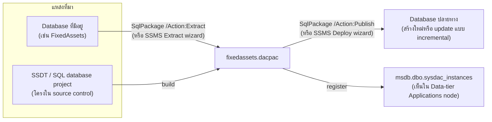

# Section 4 — Data-tier Applications (DAC): dacpac/bacpac และ SqlPackage

เครื่องมือที่ผ่านมาย้าย "ข้อมูลในไฟล์" แต่มีอีกงานหนึ่งที่ DBA เจอบ่อย: **ย้าย/ส่งมอบ "โครงสร้างฐานข้อมูล"** ระหว่าง environment (dev → test → prod) อย่างมีเวอร์ชัน ซ้ำได้ และตรวจ drift ได้ — นี่คือโลกของ **Data-tier Application (DAC)** ไฟล์ `.dacpac` คือแพ็กเกจ (zip) ที่บรรจุนิยาม schema ทั้งหมดของฐานข้อมูล ส่วน `.bacpac` คือ schema + ข้อมูล (ใช้ export/import ทั้ง database) ทั้งสองถูกจัดการด้วย **SqlPackage CLI** หรือ wizard ใน SSMS

หัวข้อนี้เชื่อมกับ Section 1-3: wizard/SSIS เหมาะกับ "ย้ายข้อมูล" แต่ dacpac เหมาะกับ "ย้ายโครงสร้างเป็นเวอร์ชัน" — งาน DevOps ของฐานข้อมูลจริง ๆ

## 1. DAC overview — dacpac กับ bacpac ต่างกันอย่างไร

| ไฟล์ | บรรจุอะไร | ใช้เมื่อ | คำสั่งหลัก (SqlPackage) |
|:------|:-----------|:---------|:-------------------------|
| **.dacpac** | โครงสร้าง/schema เท่านั้น (ตาราง, view, proc, index, ฯลฯ) + เวอร์ชัน | deploy schema ระหว่าง environment, เป็น "build artifact" ใน CI/CD | `/Action:Extract` (จาก DB), `/Action:Publish` (ลง DB) |
| **.bacpac** | schema + **ข้อมูล** ทั้ง database | ย้ายทั้ง database (เช่น ขึ้น cloud หรือย้าย server), archive | `/Action:Export`, `/Action:Import` |

องค์ประกอบที่ต้องคุ้น:

- **DAC instance registration** — เมื่อ deploy ผ่าน wizard/DAC อย่างเป็นทางการ จะมีการจดทะเบียน "DAC instance" ลง `msdb` (ตาราง `msdb.dbo.sysdac_instances`) เก็บชื่อ/เวอร์ชัน/วันที่ — เห็นใน Object Explorer ภายใต้ node **Management > Data-tier Applications**; ส่วน SqlPackage `/Action:Publish` ยังคงเป็นการ "publish" schema โดยตรง (deploy แบบ incremental ไม่บังคับ registration)
- **Versioning** — ไฟล์ dacpac มีคุณสมบัติ Application Name/Version/Description เก็บใน msdb เมื่อ register/deploy — ใช้จัดการ upgrade เป็นรอบ
- **Drift** — การแก้ schema ตรง ๆ บน database ที่ register ไว้ (นอก DAC) เรียก drift — SqlPackage มี `/Action:DriftReport` และ publish มี option ตรวจ drift ก่อน apply

> อ้างอิง: [Data-tier applications (DAC) overview](https://learn.microsoft.com/sql/tools/sql-database-projects/concepts/data-tier-applications/overview?view=sql-server-ver17), [Data-tier Applications](https://learn.microsoft.com/sql/relational-databases/data-tier-applications/data-tier-applications?view=sql-server-ver17)



## 2. Deploy dacpac — สองทาง

### 2.1 ผ่าน SSMS wizard (Deploy Data-tier Application)

1. Right-click instance ใน Object Explorer > **Tasks** > **Deploy Data-tier Application...**
2. เลือกไฟล์ `.dacpac` (ของแล็บ: `fixedassets.dacpac` ที่สร้างใน Step 2 ของสคริปต์ [`Scripts/02_SqlPackage_Commands.ps1`](Scripts/02_SqlPackage_Commands.ps1))
3. ตั้งชื่อ DAC instance + database ปลายทาง (สร้างใหม่ถ้ายังไม่มี)
4. Summary จะแสดง operations ที่จะเกิด — deploy = สร้าง database แล้วสร้าง object ตาม dacpac + register ลง msdb

> เคส "มี database อยู่แล้ว แค่อยากจดทะเบียนเป็น DAC" — ใช้ **Register Data-tier Application** (right-click database > Tasks > Register as Data-tier Application) เก็บสแนปชอต schema ลง msdb

### 2.2 ผ่าน SqlPackage CLI (ทางสมัยใหม่ ใช้ใน script/CI ได้)

SqlPackage เป็น cross-platform CLI (ดาวน์โหลดแยก หรือมากับ SSMS) — คำสั่งหลักที่ใช้:

| คำสั่ง | ทำอะไร | ตัวอย่างย่อ |
|:--------|:--------|:-------------|
| `/Action:Extract` | ดึง schema จาก database → ไฟล์ dacpac | `sqlpackage /Action:Extract /SourceServerName:localhost /SourceDatabaseName:FixedAssets /TargetFile:"D:\dac\fixedassets.dacpac"` |
| `/Action:Publish` | นำ dacpac ไป deploy — ถ้าไม่มี DB สร้างให้ ถ้ามี update แบบ incremental | `sqlpackage /Action:Publish /SourceFile:"D:\dac\fixedassets.dacpac" /TargetServerName:localhost /TargetDatabaseName:FixedAssets_Prod` |
| `/Action:Export` | database → bacpac (schema + data) | `sqlpackage /Action:Export /SourceServerName:... /SourceDatabaseName:... /TargetFile:"D:\dac\fixedassets.bacpac"` |
| `/Action:Import` | bacpac → database ใหม่ | `sqlpackage /Action:Import /SourceFile:"D:\dac\fixedassets.bacpac" /TargetServerName:... /TargetDatabaseName:...` |
| `/Action:DriftReport` | รายงานการเปลี่ยน schema ที่ทำนอก DAC | `sqlpackage /Action:DriftReport /TargetServerName:... /TargetDatabaseName:...` |
| `/Action:Script` | สร้าง deploy script (T-SQL) แทนการรันจริง — เหมาะตรวจก่อน publish | `sqlpackage /Action:Script /SourceFile:... /TargetServerName:... /OutputPath:"deploy.sql"` |

> แนวปฏิบัติ: ก่อน publish ครั้งสำคัญ รัน `/Action:Script` แล้วอ่าน deploy script ก่อนเสมอ (เทียบเท่า "Preview" ของ wizard) — และ `/Action:Publish` กับ database ที่มีข้อมูลอยู่ อาจ block หากการเปลี่ยนแปลงต้อง rebuild ข้อมูล ให้ตั้งค่า option เช่น `/p:BlockOnPossibleDataLoss=true` เป็นเกราะชั้นแรก

PowerShell ใช้ SqlPackage ได้โดยตรง (`& sqlpackage ...`) หรือใช้ `Invoke-Sqlcmd` ของ SqlServer module ตรวจผลหลัง deploy — ดูสคริปต์รวมที่ [`Scripts/02_SqlPackage_Commands.ps1`](Scripts/02_SqlPackage_Commands.ps1)

> อ้างอิง: [SqlPackage](https://learn.microsoft.com/sql/tools/sqlpackage/sqlpackage?view=sql-server-ver17), [SqlPackage publish](https://learn.microsoft.com/sql/tools/sqlpackage/sqlpackage-publish?view=sql-server-ver17), [Deploy a data-tier application](https://learn.microsoft.com/sql/tools/sql-database-projects/concepts/data-tier-applications/deploy-data-tier-application?view=sql-server-ver17)

## 3. Upgrade in-place (DAC versioning)

เมื่อ database ปลายทางถูก **register เป็น DAC** แล้ว การ "อัปเดตเวอร์ชัน" ทำได้โดยใช้ dacpac เวอร์ชันใหม่กับ DAC instance เดิม:

1. ตรวจเวอร์ชันปัจจุบัน:

```sql
SELECT instance_name, type_name, type_version, date_created
FROM msdb.dbo.sysdac_instances;
```

2. สร้าง dacpac เวอร์ชันใหม่ (Extract ใหม่โดยระบุ Version สูงขึ้น เช่น 1.0.0 → 1.1.0)
3. Upgrade:
   - **SSMS**: right-click database > **Tasks** > **Upgrade Data-tier Application...** — wizard จะวิเคราะห์ diff ระหว่าง schema ปัจจุบันกับ dacpac ใหม่ แสดง operations (รวม "ตารางที่ต้องสร้างใหม่/ย้ายข้อมูล" ถ้ามี) ก่อนลงมือ
   - **SqlPackage**: `/Action:Publish` ไปยัง database เดิม — publish เป็น incremental อยู่แล้ว; หาก database register เป็น DAC เวอร์ชันจะถูก update ในการ register/upgrade ตาม workflow ที่ wizard ทำ

สิ่งที่เกิดระหว่าง upgrade ที่ควรรู้: ถ้าคอลัมน์/ตารางถูก rename หรือเปลี่ยนชนิดแบบยาก DAC จะเลือกทาง "สร้างตารางใหม่ + copy ข้อมูล + สลับ (drop/recreate)" ซึ่งเกี่ยวกับ constraint/temporal — wizard จะเตือนเสมอ **ให้ backup ก่อน upgrade ทุกครั้ง** (Module 5)

## 4. Metadata ของ DAC ใน msdb — ตรวจสถานะด้วยตัวเอง

เมื่อ deploy/register ผ่าน wizard ข้อมูลถูกเก็บใน msdb ชุดนี้ (ที่รู้จักบ่อย):

| Object (ใน msdb) | ใช้ดูอะไร |
|:-------------------|:-----------|
| `dbo.sysdac_instances` (view) | แถวต่อ DAC instance หนึ่ง: instance_name, type_version, date_created, database_name |
| `dbo.sysdac_instances_internal` (ตาราง) | ต้นทางของ view ด้านบน |
| `dbo.sysdac_history_internal` (ตาราง) | ประวัติ action ทุกขั้น (deploy, upgrade, delete ฯลฯ) — จับ action_type_name ต่อ sequence ได้ |

```sql
-- สถานะ DAC instance ทั้งหมดบน instance นี้
SELECT instance_name, type_name, type_version, database_name, date_created
FROM msdb.dbo.sysdac_instances
ORDER BY date_created DESC;
```

ใน SSMS ก็เห็นชุดเดียวกันผ่าน **Object Explorer > Management > Data-tier Applications** — node นี้แสดงเฉพาะ database ที่ "register" เป็น DAC เท่านั้น (publish ด้วย SqlPackage อย่างเดียวไม่ได้ register — จงสังเกตความต่างนี้ตอนทำแล็บ)

## 5. Drift — เมื่อ schema เปลี่ยนนอกระบบ DAC

**Drift** คือการที่ schema ของ database ที่ register ไว้ถูกเปลี่ยนโดยตรง (แก้ proc ผ่าน SSMS, CREATE TABLE ด่วน ฯลฯ) ทำให้ DAC definition ใน msdb ไม่ตรงของจริง ผลที่ตามมาคือ wizard upgrade ในครั้งถัดไปอาจ "รื้อ" สิ่งที่คนแก้เองเพราะเทียบกับ definition เก่า

ปฏิบัติการกับ drift:

1. **ตรวจ**: `sqlpackage /Action:DriftReport /TargetServerName:... /TargetDatabaseName:...` — รายงานว่ามี object ใด "นอกโมเดล"
2. **กัน**: กำหนด convention ที่ทีม — ถ้าเป็น DAC แล้วห้ามแก้ schema ตรง ให้แก้ใน project แล้ว publish
3. **ฟื้น**: re-register (Unregister + Register) ให้ snapshot ตรงของจริง ก่อน upgrade เวอร์ชันถัดไป

## 6. ความปลอดภัยและข้อควรระวังของการ deploy DAC

- **Login ไม่เดินทางไปกับ dacpac** — ไฟล์ dacpac เก็บเฉพาะ database-level objects; login/server permissions ต้องตั้งแยกฝั่งปลายทาง (หรือใช้ contained users)
- **DAC ตรวจ "objects ที่ไม่รองรับ" ตอน extract** — เช่น cross-database references จะไม่ถูกรวม; ตรวจ validation report ทุกครั้ง อย่าเชื่อว่า "extract สำเร็จ = ครบทุก object"
- **publish กับ database ที่มีข้อมูล** — เปิด `/p:BlockOnPossibleDataLoss=true` เป็นเกราะ; และการ rename/drop คอลัมน์แบบมีข้อมูลมักทำให้ engine เสนอ "สร้างตารางใหม่ + copy" ซึ่งต้องมี space และเวลาเพิ่ม
- **ประวัติล้วนๆ ไม่ใช่ backup** — แม้มี history ใน msdb ก็ไม่ใช่การกู้ข้อมูล — backup ก่อน upgrade เสมอ

## 7. เลือก wizard หรือ CLI — เทียบสั้น ๆ

| เรื่อง | SSMS wizard | SqlPackage CLI |
|:--------|:-------------|:----------------|
| ใช้ครั้งเดียว/ad hoc | ดีมาก (มี preview รายการ operations) | ใช้ได้ แต่ต้องจำ parameter |
| ทำซ้ำ/CI/CD | ไม่เหมาะ | เหมาะที่สุด (script ได้, cross-platform) |
| Register/Upgrade DAC instance | มี wizard ตรง ๆ | publish + DacFx API (register ผ่าน wizard ง่ายกว่า) |
| รันบน Linux/macOS | ไม่ได้ (SSMS เป็น Windows) | ได้ (เป็น .NET tool) |

## 8. Extract dacpac จาก database ที่มีอยู่

- **SSMS**: right-click database > **Tasks** > **Extract Data-tier Application...** — ตั้ง Application Name/Version และ path ไฟล์ `.dacpac` ตัว wizard validate ว่า object ใดไม่รองรับ DAC (เช่น object ที่อ้าง cross-database) แล้วสรุปให้ก่อนเซฟ
- **SqlPackage**: คำสั่ง `/Action:Extract` ตามตารางด้านบน

ข้อจำกัดที่เจอบ่อย: ตาราง/proc ที่มี **cross-database reference** ไม่ผ่านการ extract (จะเตือน "objects not included in DAC") — ต้องออกแบบแยกหรือใช้ database reference ใน project แทน

## 9. ลำดับงานจริงที่รันได้ทันที (แนวเดียวกับแล็บ)

รวบทุกขั้นในโฟลว์เดียว — สมมติ database `FixedAssets` สร้างแล้วจากสคริปต์ [`Scripts/01_FixedAssets_Create.sql`](Scripts/01_FixedAssets_Create.sql):

```powershell
# 1) Extract: database -> dacpac
sqlpackage /Action:Extract /SourceServerName:localhost /SourceDatabaseName:FixedAssets `
    /TargetFile:"D:\dac\fixedassets_1.0.0.dacpac" /p:DacVersion=1.0.0

# 2) Preview ก่อน deploy จริง: ให้ deploy script ออกมาอ่านก่อน
sqlpackage /Action:Script /SourceFile:"D:\dac\fixedassets_1.0.0.dacpac" `
    /TargetServerName:localhost /TargetDatabaseName:FixedAssets_Deployed `
    /OutputPath:"D:\dac\deploy_preview.sql"

# 3) Deploy จริง (สร้าง database ใหม่)
sqlpackage /Action:Publish /SourceFile:"D:\dac\fixedassets_1.0.0.dacpac" `
    /TargetServerName:localhost /TargetDatabaseName:FixedAssets_Deployed /p:CreateNewDatabase=true

# 4) ตรวจผล
sqlcmd -S localhost -d FixedAssets_Deployed -Q "SELECT COUNT(*) FROM Asset.FixedAsset;"
```

✅ **สังเกต**: deploy script ในขั้น 2 คือสิ่งที่ Publish จะรันจริง — อ่านก่อนเสมอ โดยเฉพาะตอน publish ทับ database ที่มีข้อมูล (จะเห็น CREATE/ALTER/DROP ครบในไฟล์เดียว)

> ขั้นถัดไป (upgrade 1.1.0, export/import bacpac) อยู่ในแล็บ Exercise 4 และสคริปต์ [`Scripts/02_SqlPackage_Commands.ps1`](Scripts/02_SqlPackage_Commands.ps1)

## แบบฝึกหัดท้าย Section (ทำเต็มใน Labs/README.md — Exercise 4)

1. รัน [`Scripts/01_FixedAssets_Create.sql`](Scripts/01_FixedAssets_Create.sql) — สร้าง database `FixedAssets` (แทนไฟล์ dacpac สำเร็จรูปของหลักสูตรเดิม) ที่มี schema ตัวอย่าง
2. Extract เป็น `fixedassets.dacpac` (SSMS wizard หรือ SqlPackage)
3. Deploy เป็น database ใหม่ `FixedAssets_Deployed` (SSMS Deploy wizard หรือ SqlPackage `/Action:Publish`)
4. แก้ schema เพิ่มคอลัมน์ → Extract เวอร์ชัน 1.1.0 → Upgrade ที่ database เดิม
5. ตรวจ `msdb.dbo.sysdac_instances` และ node **Data-tier Applications** ใน Object Explorer

### 🚀 SQL Server 2025 & Modern Notes
- **SqlPackage คือทางหลักของ DAC ยุคใหม่** — cross-platform (Windows/Linux/macOS, .NET), มี TDS 8.0 option (`/SourceHostNameInCertificate` ฯลฯ) และรองรับ fixed server roles ใหม่ทั้งชุด ([SqlPackage release notes](https://learn.microsoft.com/sql/tools/sqlpackage/sqlpackage?view=sql-server-ver17))
- **Data-tier Application wizard ใน SSMS 21** ยังใช้ได้ครบ (Deploy/Extract/Register/Upgrade) — เหมาะกับงาน ad hoc และสอน concept; งานซ้ำให้เขียนเป็น SqlPackage script
- **Database projects + CI/CD**: เป้าหมายปลายทางสมัยใหม่คือเก็บ schema เป็น **SQL database project** (SSDT/VS Code/sqlproj) แล้ว publish ผ่าน pipeline — dacpac คือ artifact กลาง ([DAC overview](https://learn.microsoft.com/sql/tools/sql-database-projects/concepts/data-tier-applications/overview?view=sql-server-ver17))
- **bacpac ไม่ใช่เครื่องมือ backup** — สำหรับย้าย/สำรองให้ใช้ BACKUP/RESTORE (Module 5); bacpac เน้น migrate ไป Azure SQL/fabric ที่ไม่มี file-based backup
- ทางเลือก "ย้ายข้อมูลต่อเนื่อง" สมัยใหม่แทน replication แบบคลาสสิก: **Fabric Mirroring** (SQL Server 2025 era, preview) — mirror ฐานข้อมูลขึ้น OneLake ใกล้ real-time ([Mirroring in Fabric](https://learn.microsoft.com/fabric/database/mirrored-database/overview))
